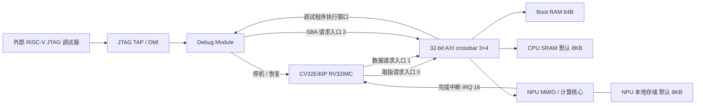

# mynpu：tiny MNIST INT8 完整 SoC

Lab6 外接 FT232H/J5 的 **独立 SRAM / 共享 bank 两套 4-lane 工程**及 WSL OpenOCD/GDB、PC 冷加载与连续推理工具见 [Lab6 JTAG 操作指南](docs/lab6-jtag.md)。该模式由 CPU 在 ROM 等待，PC 加载固件/模型后放行；外接探针实测状态与 USB/VIO 自运行板测分开记录。

电脑只有一个 USB-A 时，使用 [EGo1 Flash 启动](docs/ego1-flash-boot.md)：先烧 FPGA 配置，再由充电头给板子供电，电脑 USB 接外部 FT232H；两版 Flash 镜像、烧写脚本和原有 PC 冷加载程序配套提供。

2026-10-19 已完成共享 bank / 4-lane 的 **Flash 上电启动、外接 FT232H/DM 冷加载、真实 CPU 参与的 197 次实板推理**，全部通过整数参考及 PyTorch 输出对照，GDB 寄存器/内存访问通过。NPU 每次 35570 周期，50MHz 下 0.7114ms。记录见 [Flash/JTAG 板测](docs/ego1-flash-board.json)；独立 SRAM 版的外接探针板测仍待进行。

本分支 `feature/dual-bank-shared-sram` 新增 **3×3 AXI crossbar + CPU/NPU 共用双 8KB SRAM bank** 的完整 ASIC/FPGA 实现。模型权重只保存一份，按 32-bit word 分布到两块 SRAM；每 bank 独立仲裁，CPU 冲突访问可以等待，NPU 并行发起激活/权重读。4-lane 默认计算段约 35,600 周期，激活缓存和 lane 数可参数化。配置、加载地址、缓存实测和回归命令见 [共享 bank 架构](docs/shared-bank-npu.md)。下文保留原独立 CPU/NPU SRAM 版本的基线说明。

2026-10-15 已在 EGo1 实际下载双 bank 4-lane 版本，21 次启动/105 次 CPU 推理全部通过，每次 35570 周期（50MHz 下 0.7114ms）、五次 IRQ；ASIC/FPGA 两个存储后端的完整 SoC 压力回归记录见 [验证汇总](docs/dual-bank-verification.json)，实体板记录见 [FPGA 板测](docs/dual-bank-fpga-board.json)。

本工程在独立目录中整合了 **CV32E40P CPU、3×4 AXI crossbar、原有 JTAG/Debug Module、Boot RAM、CPU SRAM 和 INT8 CNN NPU**。流片主配置为 CPU 8KB RA1SHD + NPU 8KB RA1SHD、`USE_ASIC_SRAM=1`、`NPU_LANES=4`，四个 MAC 同拍计算。顶层的历史默认值仍保留功能数组/8 lanes，实际流片配置必须显式设置参数。原始 `lab3-ST` 未修改；复用源码保存在 `third_party/lab3`，新增集成顶层是 `rtl/mynpu_soc_top.sv`。

这是已通过完整 ASIC SoC 宏功能模型、FPGA BRAM SoC 压力仿真和 EGo1 Vivado bitstream 生成的 RTL 工程。`USE_FPGA_BRAM=1` 同时将 CPU/NPU 替换为同步单口 BRAM，`USE_ASIC_SRAM=1` 同时替换为 RA1SHD wrapper；NPU 在 1 lane 时使用原串行核心，在 2/4/8 lanes 时使用 `cnn_npu_sp_lanes` 向量核心。原 1-lane 已实际上板；新版 4-lane 的下载记录单独列在 FPGA README。真实宏 timing check/PDK 签核按约定不在本次任务范围；共享 bank 的 FT232H/OpenOCD/GDB 实测见上面的独立记录。

## 架构



NPU 是 AXI 从设备；它从本地存储读取参数、输入和层描述符，不包含 AXI DMA master。外部可通过原有 JTAG → DMI → Debug Module SBA 加载程序和访问 NPU，保留三个 AXI 请求入口即可。

## 复现完整 SoC 仿真

需要 Python 3 和支持 SystemVerilog 类型参数的 VCS。仓库包含 CPU 程序镜像和模型数据；直接运行仿真不需要 PyTorch 或 RISC-V 编译器。

```sh
git clone https://github.com/one-bite-one-pig/mynpu.git
cd mynpu
python3 tools/verify_assets.py
# 流片主配置：完整 ASIC SoC，CPU/NPU 各一块 8KB 宏，4 lanes
python3 tools/run_single_port_regression.py --memory asic \
  --macro-model /private/path/RA1SHD_2048x32M8.v --lanes 4 --suite soc
# 同一 4-lane 数据通路的 FPGA BRAM 完整 SoC 回归
python3 tools/run_single_port_regression.py --memory fpga --lanes 4 --suite soc
# 下面保留早期功能数组的对照回归：
python3 tools/run_sim.py --backend vcs --layout 8k --lanes 8
python3 tools/run_sim.py --backend vcs --layout 16k --lanes 16
python3 tools/run_sim.py --backend vcs --layout 8k --lanes 1
# SoC stress: reset pulses, 64 SBA words, invalid-config recovery, 3 halt/resume rounds
python3 tools/run_sim.py --backend vcs --layout 8k --lanes 8 --stress
# FPGA BRAM / single-port schedule regression (Icarus)
iverilog -g2012 -s tb_cnn_npu_sp -o build/tb_cnn_npu_sp.vvp \
  sim/tb_cnn_npu_sp.sv cnn_npu_int8/rtl/cnn_npu_sp_top.sv \
  rtl/mynpu_sram_2048x32_fpga.sv
vvp build/tb_cnn_npu_sp.vvp

# 完整 MNIST 测试集的 PyTorch INT8 / RTL 整数参考，以及 64 张随机样本的 RTL 回灌
conda run -n eeml python tools/mnist_regression.py --layout 8k --random-vectors 64

# CPU-in-loop：CPU AXI 写模型、Debug SBA 注入输入、CPU IRQ 读回结果
python tools/build_stream_firmware.py --runs 1000
vcs -full64 -sverilog -assert svaext -timescale=1ns/1ps +define+SYNTHESIS \\
  -f sim/soc.f sim/tb_mynpu_soc_stream.sv -top tb_mynpu_soc_stream \\
  -pvalue+tb_mynpu_soc_stream.VECTORS=64 -o build/vcs-soc-stream/simv
build/vcs-soc-stream/simv

# AXI 随机 burst + 每响应拍随机 RREADY/BREADY（在 VCS 主机上运行）
vcs -full64 -sverilog -assert svaext -timescale=1ns/1ps \
  +incdir+third_party/lab3/soc/rtl/include +incdir+third_party/lab3/soc/rtl \
  third_party/lab3/soc/rtl/axi/axi_pkg.sv \
  third_party/lab3/soc/rtl/axi/axi_intf.sv \
  third_party/lab3/soc/rtl/axi/axi2mem.sv sim/tb_axi2mem_backpressure.sv \
  -top tb_axi2mem_backpressure -pvalue+tb_axi2mem_backpressure.TRANSACTIONS=1000 \
  -o build/vcs-axi-bp/simv
build/vcs-axi-bp/simv +ntb_random_seed=14596
```

成功标志是 `[SOC] PASS`，脚本会检查该标志，不能只依据模拟器退出码判断成功。日志在 `build/vcs-<layout>-<lanes>/`。Vivado 2023.2 XSim 对原始 AXI 源码中的 `default disable iff` 不支持，因此当前验证使用 VCS。

完整 testbench 通过真实 CPU 指令执行以下流程：JTAG SBA 读写两块 SRAM → CPU 启动 → JTAG 停机、读取/写入/恢复 x31 → CPU 加载模型并进行第一轮轮询推理 → 连续四轮重新装载输入、启动、处理中断并清除 DONE。五轮推理每层都严格对照独立 Python 整数参考，同时逐元素检查与 PyTorch FBGEMM 的差值不超过 1。CPU 和 NPU 的同步 BRAM 版本另有 `sim/tb_mynpu_soc_fpga.sv`，单端口 NPU 的独立回归是 `sim/tb_cnn_npu_sp.sv`。

## 参数与地址

| 顶层参数 | 默认值 | 含义 |
|---|---:|---|
| `CPU_SRAM_BYTES` | 8192 | CPU 程序、数据和栈容量 |
| `NPU_SRAM_BYTES` | 8192 | NPU 参数、激活和描述符容量 |
| `NPU_LANES` | 8 | 功能数组的输出通道并行数；单端口 ASIC/FPGA 支持 1-lane 基线或 2/4/8-lane 向量核心，主配置推荐 4 |
| `NPU_IRQ_ID` | 16 | 接入 CV32E40P 的中断编号 |
| `CPU_INIT_FILE` | 空 | CPU RAM 仿真/FPGA 初始镜像 |
| `NPU_INIT_FILE` | 空 | 可选 NPU RAM 初始镜像 |

CPU 固件当前对应 8KB CPU SRAM、中断 16；改变这两项须同步修改 `sw/linker.ld` 和 `sw/main.c` 后重新编译。`8k/16k` 选项改变 NPU SRAM 布局，CPU SRAM 保持 8KB。`boot_ready_i=1` 允许 CPU 取指；动态加载时先保持为 0，再通过 SBA 加载并使能取指。ASIC 中 `.hex` 初始化不能替代实际程序加载。

| 地址 | 用途 |
|---|---|
| `0x0000_0000 .. 0x0000_0fff` | Debug Module 的 CPU 可见窗口 |
| `0x0001_0000 .. 0x0001_003f` | Boot RAM，跳转到 CPU SRAM |
| `0x8000_0000 .. 0x8000_1fff` | 默认 CPU SRAM |
| `0x7000_0000` | NPU CONTROL：START bit0、IRQ enable bit1、清状态 bit2 |
| `0x7000_0004` | STATUS：BUSY bit0、DONE bit1、ERROR bit2 |
| `0x7000_001c` | ERROR：普通 NPU 错误为 bit0；单口 SRAM 在 BUSY 期间的违规本地访问返回 `0xdead_b001` |
| `0x7000_0010` | 本地 SRAM 中的描述符字节偏移 |
| `0x7000_0014` | 推理层数，本模型为 6 |
| `0x7000_0018` | NPU 运行周期计数 |
| `0x7000_4000` 起 | NPU SRAM 的 32-bit、小端访问窗口 |
| `0x8000_1fc0 .. 0x8000_1fff` | 自测结果 mailbox |

当前默认 VCS 回归仍使用高并行功能 backend；FPGA/ASIC 版本通过 `USE_FPGA_BRAM=1` 或 `USE_ASIC_SRAM=1` 选择 CPU 与 NPU 的同步单端口 SRAM backend。流片主配置为 `NPU_LANES=4`、CPU 8KB + NPU 8KB，搭配 `generated/8k-p4/cpu.hex`；四个 MAC 同拍更新，权重按四通道打包，不增加 SRAM 端口。`SHARED_SRAM=1` 规定 NPU BUSY 时主机本地写不落 SRAM、违规本地读返回确定错误标记，不代表 CPU 主存与 NPU 已共用一个物理 SRAM。

4-lane 单口版本在 ASIC 宏功能模型和 FPGA BRAM 上都是 **65732 cycles**，相对 1-lane 的 288390 cycles 加速 **4.39×**。各通过 100 次逐层推理、200 组随机算子/SRAM 全区检查、64 张 MNIST 的 NPU 回归、64 张 CPU-in-loop 完整 SoC 回归及复位/竞争/错误恢复压力测试。架构、镜像协议和复现命令见 [单口向量 NPU](docs/npu-single-port-vector.md)。

## 模型及整数运算

模型来自 [tiny_MNIST 的 pool-stride2-fp32-int8 分支](https://github.com/CatalpaEel/tiny_MNIST/tree/pool-stride2-fp32-int8)，checkpoint 存在 `model/checkpoints/model_int8.pt`。卷积的 BatchNorm 和 ReLU 已在 PyTorch 量化流程中融合。

| 层 | 输入 CHW | 输出 CHW | 核 / stride |
|---|---|---|---|
| Conv1 + ReLU | 1×28×28 | 2×14×14 | 3×3 / 2 |
| Conv2 + ReLU | 2×14×14 | 4×14×14 | 3×3 / 1 |
| Conv3 + ReLU | 4×14×14 | 8×7×7 | 3×3 / 2 |
| Conv4 + ReLU | 8×7×7 | 8×3×3 | 3×3 / 2，保留原 4×4 的左上 3×3 |
| Conv5 + ReLU | 8×3×3 | 16×3×3 | 3×3 / 1 |
| FC | 144 | 10 | 10×144 |

输入/中间值保存为 8-bit activation code，权重为 per-output-channel signed INT8；芯片不做浮点输入量化或 BatchNorm 运算。导出器预先生成 INT32 bias、每通道 Q31 multiplier 和 shift：

```text
b_int[c] = round(b_float[c] / (s_input * s_weight[c]))
acc[c]   = b_int[c] + Σ ((q_input - z_input) * q_weight[c])
M[c]     = round((s_input * s_weight[c] / s_output) * 2^31)
q_output = clamp(((acc[c] * M[c] + 2^30) >> 31) + z_output, 0, qmax)
```

ReLU 在 clamp 前将值下限设为 `z_output`。此 RTL 的半整数舍入向正无穷；它与 FBGEMM 的浮点 requant 不完全 bit-exact。当前固定向量的最终整数输出为 `[68,50,82,68,55,80,75,63,76,59]`，PyTorch 为 `[68,49,82,68,55,80,75,63,76,59]`，两者 argmax 都是 2。

当前描述符 `qmax=127`。`quint8` 本身仍允许 0..255；reduced-range observer 不能保证任意输入下所有转换后算子的输出都 ≤127。现有验证向量满足该范围，尚未做全测试集的 RTL 精度评估。更换数据分布或 qmax 后应重新做模型与 RTL 对照，不能直接把 activation 当 signed INT8 使用。

## 重新导出和编译

已实际验证的 PyTorch 版本为 2.2.2 CPU，使用 FBGEMM。更高版本应先确认旧 checkpoint 和量化 API 的兼容性。

```sh
python cnn_npu_int8/tools/export_model.py --checkpoint model/checkpoints/model_int8.pt --out-dir cnn_npu_int8/generated/8k --sram-bytes 8192 --lanes 8
python cnn_npu_int8/tools/export_model.py --checkpoint model/checkpoints/model_int8.pt --out-dir cnn_npu_int8/generated/16k --sram-bytes 16384 --lanes 16
python tools/build_firmware.py --layout 8k --gcc /path/to/riscv64-unknown-elf-gcc
python tools/build_firmware.py --layout 16k --gcc /path/to/riscv64-unknown-elf-gcc
```

编译器须支持 `-march=rv32imc_zicsr -mabi=ilp32`，匹配的 objcopy 默认从 gcc 路径推导，也可以传 `--objcopy`。固件、模型常量共约 6.3KB，另保留 1KB 栈和 64B mailbox。模型数据先在 CPU RAM 的只读区，再由 CPU 写入 NPU RAM。

详细验证数据见 [docs/verification.md](docs/verification.md)，JTAG/存储/流片边界见 [docs/integration.md](docs/integration.md)，SRAM 宏与 FPGA 替身见 [docs/sram-and-fpga.md](docs/sram-and-fpga.md)，上板指导见 [EGO1 指导](cnn_npu_int8/docs/fpga-ego1-guide.md)。

## EGo1 无 Debug Module 上板自测

`fpga/ego1/ego1_autonomous_top.sv` 是独立的 EGo1 顶层：CPU 和 NPU 都使用
FPGA BRAM，CPU 固件自动加载模型并连续完成五轮推理，外部只需要板载
USB-JTAG 配置口。`fpga/ego1/program_autonomous.tcl` 用 Vivado Hardware
Manager 下载 bitstream，并通过 VIO 读取 mailbox、IRQ 和分类结果、控制软复位；
它不使用 OpenOCD/GDB，也不需要 RISC-V JTAG 的 FT232H 或杜邦线。该路径已在
真实 `xc7a35tcsg324-1` 上完成 4 次启动、20 次推理回归。具体命令和 LED 定义见
[EGo1 FPGA README](fpga/ego1/README.md)。

`fpga/ego1/build_autonomous_4lane.tcl` 为真正 4-lane 单口 BRAM 配置创建独立
Vivado 工程，并使用 packed4 CPU 镜像；它与 ASIC 共用向量核心。原 1-lane
工程和曾上板的 bitstream 保留。新旧镜像不能混淆：原 `8k` 用于 1-lane
基线，`8k-p4` 用于向量核心的打包权重路径。

2026-10-13 新 4-lane 已实际下载到 EGo1，以板载 USB-JTAG/VIO 完成
21 次启动、105 次固定输入推理。每次 class=2、IRQ edges=4、error=0、
NPU cycles=65732，CPU 每轮检查全部 10 个输出。无需外部 Debug 下载器。
