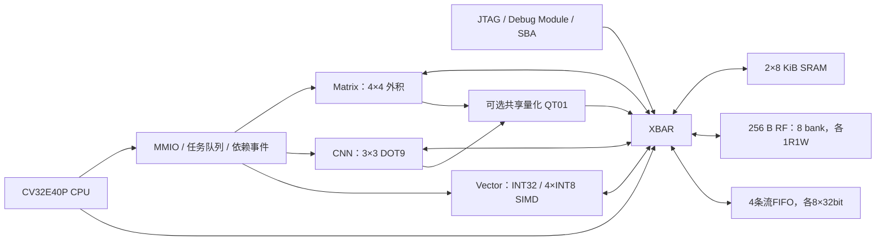

# mynpu

> 外部Host接口已删除，SoC仿真与板级访问统一走[JTAG Debug Module SBA](npu/docs/jtag.md)。当前main不包含GPIO；完整r3后端是接口改动前的冻结基线，本次尚未重跑PPA或实体板验证。

基于 CV32E40P 的整数 NPU，使用独立 Matrix、CNN、Vector 计算单元和软件任务调度。
本文描述当前默认设计；配置来源为 [build_config.json](npu/build_config.json)，接口以 RTL 和软件头文件为准。

已本地合入 **`fpga/ego1-board-20261114-afb74fd` 的板级工具与冻结归档**，集成情况见[合并验证](npu/fpga/ego1/MERGE-20261114.md)。
其中旧板测SoC基线为`afb74fd`、硬件源码对应`03e2870`；当前JTAG-only开发设计与它不同。
EGo1 / XC7A35T：10MHz系统、100kHz外接JTAG，使用CPU暂停/恢复流程通过2021次推理。
源码、镜像、PC程序、原始记录及限制见[固定上板版本说明](npu/fpga/ego1/versions/ego1-10mhz-20261114/README.md)。

## 设计架构



- Matrix：INT8/INT16 输入、INT32 累加；CNN：U8×I8 DOT9、INT32 累加。
- Vector：通用整数指令与最多16条指令的程序模式，4个32bit临时寄存器。
- Matrix/Vector/CNN 各有4项任务队列，支持软件标记依赖事件、完成计数及独立 IRQ。
- Stream 负责地址、窗口与数据搬运；计算核处理操作数。软件负责任务分块、配置修改时机和资源同步。
- RF 由软件显式管理。gather 读口需按物理 bank 仲裁；1R1W 同址同时读写返回旧值。
- 模型程序和数据通过 JTAG SBA 装载；计算单元通过 XBAR、RF 和流 FIFO 交换数据。

## 软件与验证

软件支持 GEMM、批量 GEMM、逐元素运算、步长/广播、转置、归约及3×3卷积组合。
高级 API 的布局覆盖范围和调度代价见[软件任务层](npu/docs/general-workloads.md)，硬件布局与事件见[LY01 / EV01](npu/docs/layout-events.md)。

JTAG-only回归的MNIST为**21,005周期/张（从CPU启动MMIO提交计时）**；包含串行启动命令阶段为21,728周期，其中723周期发生在提交前。历史21,008周期使用旧Host测试口的启动计时口径，不能把两者差异视为计算优化。输入下载单独统计，不计入上述推理时间。
这是一项回归负载，不能代表所有算子组合的吞吐。[RF功能与性能证据](npu/docs/rf1r1w.md)。

从仓库根目录运行，VCS 回归需要相应工具和许可证；每次使用新的 `--tag`：

```sh
python3.12 npu/scripts/gen_sources.py
python3.12 npu/tests/test_task_graph.py
python3.12 npu/scripts/run_vcs.py --suite latency --tag my_latency
python3.12 npu/scripts/run_vcs.py --suite jtag --tag my_jtag
python3.12 npu/scripts/run_vcs.py --suite workloadcpu --tag my_workloads
```

## ASIC 完整后端结果（GPIO加入前）

已有完整物理验证的冻结版本为 **RF 1R1W，1950µm，r3，2026-11-10**：

| 指标 | 结果与口径 |
| --- | --- |
| 工艺 / 系统频率 | TSMC 180nm / 50 MHz |
| Die / Seal Ring外框 | 1950×1950 / 1980×1980 µm |
| 综合cell面积 | 2.569286 mm²，含两块SRAM，不含PAD/CTS/布线 |
| PNR核心非filler面积 | 2.632349 mm²，含SRAM，不含外围IO与core filler |
| 布线后setup / hold WNS | +0.468 / +0.018 ns |
| 布线后JTAG/MNIST功能回归 | 34项通过，零延迟、未回标SDF |

[完整报告](npu/docs/rf1r1w-die1950-signoff.md)保留了检查口径：课程规则排除后DRC为0；LVS在教学PR容差下CORRECT，严格PR参数偏差及ERC残项仍待评审。
没有完成Dummy后PEX/STA、多角或IR/EM签核，不能据此宣称正式投片签核全部通过。

## 项目导航

| 入口 | 内容 |
| --- | --- |
| [npu/](npu/README.md) | 目录、配置与开发入口 |
| [RTL导航](npu/rtl/README.md) | 当前模块与源文件清单 |
| [软件与MNIST](npu/mnist/README.md) | 固件、整数镜像与回归 |
| [文档索引](npu/docs/README.md) | 现行接口说明与实现专题 |
| [EDA流程](npu/eda/tsmc180/README.md) | ASIC构建脚本及独立运行目录 |
| [EGo1工程](npu/fpga/ego1/README.md) | 板级准备；尚无本版Vivado实现结果 |
| [格式约定](FORMATTING.md) | 代码格式与检查入口 |

[报告索引与逐文件审计](npu/reports/README.md)仅保留当前版本证据。
已撤回方案与被替代的阶段文档从工作树删除，历史可通过Git查看。EDA日志、网表和检查点等生成物不入库。
