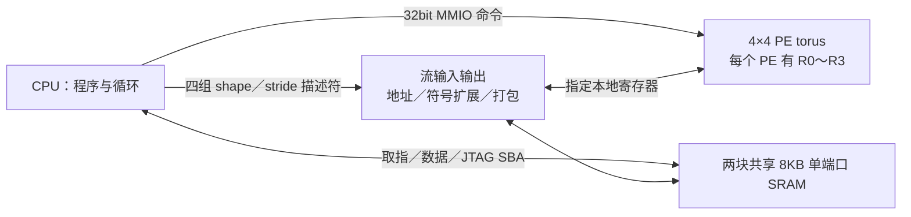

# 软件控制的 4×4 torus 实现

实现目录是 `mynpu-torus`，分支 `experiment/torus-register-file`。

精简图文报告：[网页版](design-report.html)、[PDF](design-report.pdf)、[可编辑正文](design-report.md)，包含架构／单层调度示意图及真实后端截图。

本文是 ABI 与命令集的参考手册；**逐模块的设计分析、取舍与限制见 [design.md](design.md)**，软件流水时序见 [overlap.md](overlap.md)，验证数据见 [validation.md](validation.md)。这是独立工作区；`mynpu`、`mynpu-review-78f7844` 和 `mynpu-software-control` 保留原状。新架构的 SoC 入口是 `rtl/mynpu_soc_top.sv`，默认使用共享双 SRAM 和 torus。旧架构的脚本及寄存器 ABI 不能直接用于这一分支。

## 数据通路



- 每个 PE 有 **4×32bit 数据寄存器**，16 个 PE 共 2048bit。PE 没有指令 RAM、PC 或层执行状态机。
- PE 的两路读操作数分别选择“本地／北／南／西／东 + R0～R3”。边界环绕，例如 PE(0,0) 的北邻居是 PE(3,0)，西邻居是 PE(0,3)。
- **算术写目的只能是当前执行 PE 的 R0～R3**。不存在远程写寄存器、发送端输出寄存器配置或 EXPORT 命令。流加载和调试 MMIO 写属于外部装载本地寄存器。
- 一条广播指令可使多个 PE 同时计算；mask 的 bit0～3 分别使能四行，每行四个 PE。未使能行不执行算术写。
- 同一个时钟沿执行的所有 PE 都读取该沿之前的值。例如一排 PE 同时读取西邻居并写 R0，产生一次环移，不会在一个周期内连锁传播。
- 流写回通过描述符的 2bit 寄存器号，读取每个参与 PE 的本地 R0～R3。这个选择与下一条算术指令的目的、邻居的读寄存器选择均独立。
- 全部数值运算在 PE 内。流单元只做地址生成、符号／零扩展、字节选择与打包；没有外置量化、激活或卷积计算单元。

## 32bit 命令与软件接口

| 位 | 字段 |
|---|---|
| 31:26 | 6bit opcode |
| 25:24 | 本地目的寄存器 |
| 23:19 | srcA：3bit 方向 + 2bit 寄存器号 |
| 18:14 | srcB：3bit 方向 + 2bit 寄存器号 |
| 13:10 | 四行 mask |
| 9 | B 使用立即数 |
| 8:0 | 有符号 9bit 立即数，范围 −256～255；寄存器格式可编码并行搬运 bundle |

方向编码：0 本地、1 北、2 南、3 西、4 东；5～7 非法。例如 `TOR_SRC(TOR_W,2)` 读取西邻居 R2。两个操作数可选择不同方向及寄存器。32bit 大常数通过流加载或 MMIO 写入数据寄存器。

```c
#include "sw/torus/torus.h"
// 每个 PE 从西邻居 R2 和北邻居 R3 取值，相加后写自己的 R1。
TOR_EMIT(TOR_CMD(TOR_ADD,1,TOR_SRC(TOR_W,2),TOR_SRC(TOR_N,3),15));
// 只使能第 0、2 行；每个 PE 将自己的 R1 加 7 后写自己的 R0。
TOR_EMIT(TOR_IMM(TOR_ADD,0,TOR_SRC(TOR_LOCAL,1),7,5));
```

写入 `0x70000ffc` 发出一条命令，要求完整 32bit 写。CPU 原生数据口有直接 valid/ready 路径，并对直接命令与普通总线访问保持响应顺序。没有命令 FIFO 或寄存器数组微程序。SRAM 取指、数据和 JTAG SBA 仍通过实际 grant/response 仲裁。

空闲时接口每周期可接受一个命令。普通 NEXT 搬运通过寄存器号的读／写占用表保护依赖：流 load 阻塞读写相同寄存器的 PE 指令，流 store 阻塞写相同寄存器的指令；邻居寄存器读取也检查占用。独立寄存器上的 PE 运算可与搬运重叠。占用表保守地覆盖全部 PE，当前不按行细分。

PREFETCH 将下一组数据留在流单元的输入缓冲，COMMIT 才把它们写入指定 PE 本地寄存器；因此预取期间 PE 可以继续使用当前组的 R0～R3。EXCHANGE 同时提交已预取的数据并开始下一组预取，用于软件流水。它复用原有的 2×4×32bit gather 数据锁存器，新增有效标志、目标寄存器和 PE 掩码；没有指令存储或第三块 SRAM。CPU 不必轮询，未满足的数据依赖由命令 ready 反压。

opcode 0～52 为 PE 普通运算：MOV、ADD/SUB、位运算、移位、比较、MIN/MAX、扩展、旋转、位计数、截断、选择及整数乘加等；具体编号见 `sw/torus/torus.h` 和 `torus_pe.sv`。MAC/ADDSELF/SELECT 使用**选定目的寄存器的旧值**。支持有符号 INT8、INT16、INT32 乘法／乘加、9×8 乘加，以及无符号 8/16bit 乘法。每个 PE 每条指令做一个标量运算，没有 4 路 INT8 打包 SIMD。算术默认为低 32bit 回绕，饱和需显式指令。

- `MULH`：有符号乘积的高 32bit。
- `MULHR`：`signed_product[63:32] + product[31]`，即 `(a*b + 2^31) >> 32`，恰好半值时向正方向舍入。
- `SAR_ROUND`：加半值后算术右移，移位范围 0～31。
- `CLIPU`：将有符号 A 限制在 `[0, unsigned(B)]`；软件应提供合法非负上限。
- `BASEPAIR=53`：一次更新两个描述符的 bank 内 13bit 基址，并重置选中上下文。两个基址分别为命令 `[25:13]` 和 `[12:0]`；所选上下文、bank 和 ARM mask 来自 MMIO `0x024`。不执行数值运算。
- `EXCHANGE=58`：等待所有选中输入缓冲就绪，提交其数据，并按命令中的行 mask 预取下一组。上下文 mask 必须等于当前全部保留的预取上下文。
- `COMMIT=59`：等待选中输入缓冲就绪，再同时写入其已记录的本地寄存器和 PE 掩码；可选择保留上下文的子集。不推进地址。
- `PREFETCH=60`：启动异步读取，在流单元缓冲结果，不改 PE 寄存器。地址和寄存器游标在读取完成时推进，缓冲中另行保存本次目标寄存器。
- `ARM=61`：命令低 4bit 为上下文 mask，重置选中上下文的外层坐标和寄存器游标。
- `NEXT=62`：命令低 4bit 为上下文 mask，搬运每个选中上下文的下一个 tile；行 mask 控制参与 PE。
- opcode 54～57、63 非法。非法读源／算术 opcode 置错且不写 PE；部分字节命令写置错且不执行。

## 并行 ALU／搬运命令（ABI 4，保留 ABI 3 命令）

普通寄存器格式指令可同时编码“使用旧寄存器计算、提交预取缓冲、启动下一次预取”。bit9 必须为 0；bit8=1 启用 bundle；bit7=1 启动下一组预取；bits6:4 选择上下文：0～3 为单个上下文，4={0,1}、5={0,3}、6={2,1}、7={2,3}；bits3:0 是**下一组预取**行 mask。算术行 mask 仍是 bits13:10，提交使用输入缓冲保存的目标掩码。

同一沿上算术读取旧 RF，预取提交写入本地 RF。算术目的与加载目的寄存器冲突会报错且整条命令无效果；下一组预取必须消费当前全部保留的上下文。缺少相应保留缓冲也会报错。数据尚未就绪则命令保持等待。立即数格式不能同时编码 bundle。

```c
// 当前 R2*R3 累加到 R0；同沿提交下一组 R2/R3，并预取再下一组。
TOR_EMIT(TOR_BUNDLE(TOR_MAC9X8,0,TOR_SRC(TOR_LOCAL,2),
                   TOR_SRC(TOR_LOCAL,3),15,4,15,1));
```

最后一次 SRAM 响应可直接前递到本沿的提交路径，无须多等一个 buffer-valid 周期。这里没有指令队列或硬件软件循环器，CPU 仍逐条发出普通 MMIO 写。详细稳态与排空时序见 [overlap.md](overlap.md)。

## 通用 shape／stride 描述符

共有四个上下文，基址 `0x70000400 + context*0x100`。上下文 0/2 使用 SRAM 请求口 0，上下文 1/3 使用请求口 1。同一端口的两个上下文按编号先后执行，两个端口可同时发请求；如果访问同一物理 SRAM，会由单端口仲裁串行处理。

每个描述符由一个 PE tile 和外层三维遍历组成。全部步长以**有符号字节数**表示，外层 axis0 最内层。

| word | 内容 |
|---|---|
| 0 | SRAM 内 bank-linear 字节基址，非 CPU MMIO 绝对地址 |
| 1 | control，见下表 |
| 2 | tile 行数 `[2:0]`、列数 `[6:4]`，均为 1～4 |
| 3、4 | tile 内存行／列 byte stride |
| 5、6、7 | 外层 axis0、1、2 的 shape，均至少 1 |
| 8、9、10 | 外层 axis0、1、2 的有符号 byte stride |
| 11 | 本地寄存器基号 `[1:0]`；三个外层轴的寄存器步长 `[3:2]`、`[5:4]`、`[7:6]`，模 4 |
| 12 | PE 起点行 `[1:0]`、起点列 `[3:2]`，tile 放置按 torus 模 4 环绕 |

| control 位 | 内容 |
|---|---|
| 2:0 | 0 U8、1 S8、2 U16、3 S16、4 RAW32；5～7 非法 |
| 3 | 1 store，0 load |
| 5:4 | 0 FULL；1 ROW（每行取一个值，广播到该行的 tile 列）；2 COL（每列取一个值，广播到选中行）；3 非法 |
| 6 | FULL 的遍历转置：外层按列、四个 lane 按行；地址仍由行列 stride 定义 |
| 7 | 保留，必须为 0；不存在发送端 export 选择 |
| 8 | 外层 shape 完成后循环回起点；否则置 ended |
| 9 | 不向小型 gather cache 填入新读字；可用于连续权重流 |

ABI 4 将内部描述符和计数器限宽，MMIO word 地址保持不变：基址、tile/outer stride 为有符号 16bit（−32768～32767），shape 为无符号 16bit（1～65535）。合法 SRAM 字节地址仍是 0～16383；负基址仅适用于被 mask 屏蔽的 padding。地址／stride 字段读回符号扩展，shape 零扩展。

超范围字段写入会置错并标记该字段无效，后续传输不会访问 SRAM。只清 IRQ 不会修复描述符，必须重写对应字段；BASEPAIR 可修复它更新的两个 base。cursor 和两个外轴基址在有符号 16bit 加法溢出后保留无效标志，禁止截断值别名到低 SRAM；ARM 重置游标和这些溢出标志。tile 地址组合计算保留 19bit，以检查三倍行／列 stride 的完整范围。软件编译器需禁止超出这些范围的调度。

对外层坐标 `(i0,i1,i2)` 和 tile 坐标 `(r,c)`，FULL 地址为：

```
base + i0*s0 + i1*s1 + i2*s2 + r*row_stride + c*col_stride
```

寄存器号为 `(reg_base + i0*reg_step0 + i1*reg_step1 + i2*reg_step2) mod 4`。广播、转置、通道跨距、负步长、零步长复用均可用同一描述符表达。行 mask 只屏蔽本次访问和寄存器写，外层游标仍前进；软件可据此处理 padding。

每个 NEXT 搬一块 tile，随后推进外层坐标。它不会自动执行整层计算；CPU 用循环把搬运和普通 PE 运算组合。ARM 不清空寄存器。描述符修改后应重新 ARM。

异步 PREFETCH／EXCHANGE 支持 ROW/COL load，每端口保留一组、最多四个值；同时选择同端口的两个上下文、FULL 或 store 会报错。FULL load/store 继续使用 NEXT，并可与无寄存器冲突的运算重叠。缓冲就绪后状态的 ready bit 置位，busy 保持到 COMMIT／EXCHANGE 消费数据；软件不能用等待 busy=0 代替提交，也不能预取越过非循环 shape 的末尾。配置／ARM 在缓冲保留期间保持反压，防止修改未消费数据的描述符。

加载分别进行 8/16bit 符号／零扩展或 32bit 原样传输；存储只取寄存器的低 8/16/32bit，不做裁剪。共享一个 SRAM word 的 lane 合并 byte enables，保持其余字节。FULL 是普通写回方式；ROW/COL store 取每个广播组中编号最小的参与 PE，不执行归约。重叠 store 地址的后 lane 覆盖前 lane，同端口不同组按遍历顺序覆盖；两个端口重叠访问的程序应由软件禁止。

有效访问必须落在 `[0,16384)`，16/32bit 分别自然对齐。非法 shape、格式、保留 bit7、未 ARM／已经 ended 的 NEXT、越界和非对齐会置错并中止该上下文；不回滚已经完成的其他 lane／tile。被行 mask 完全屏蔽的负地址不会产生 SRAM 请求。循环及量化范围等语义由软件负责。

每口 gather cache 可配置，当前面积优先配置为 **32×32bit／口，共 256B 数据**，RTL、构建、回归与 EDA 脚本默认均为 32。64-word/口的旧版性能记录保留在 [validation-v3.md](validation-v3.md)。每口拆成四个浅 bank，每 bank 一次查询一个 word；同 word 多 lane 广播，同 bank 不同 word 通过 gather 标志分次完成，未知 cache 命中状态的 lane 不提前发 SRAM miss 请求。缓存 lane 数据另行锁存，冲突地址仍能完成。已接受的 host SRAM 写和流 store 只使命中**同一个 word 地址**的 cache 项失效，同时处理与 cache fill 的冲突。软件禁止 CPU／JTAG 在推理中修改正在读取的参数、输入和 CPU 指令，也禁止同一 NEXT 的不同上下文向同一 PE 的同一寄存器加载。可并发访问无关的 SRAM 地址。

## 地址与 MMIO

两块物理单端口 SRAM 总共 16KB，无参数镜像、第三块 SRAM 或隐藏第二端口。CPU `0x80000000..0x80003fff` 和 NPU `0x70004000..0x70007fff` 是**同一 bank-linear 空间**的两个别名：前 8KB 为 bank0，后 8KB 为 bank1。流描述符用 `0..16383` 偏移。底层仲裁模块的 striped 地址由 wrapper 转换，软件无需处理。

| 寄存器偏移 | 说明 |
|---|---|
| 0x000 | ID `0x544f5204` |
| 0x004 | bit0 busy、bit1 error、bits7:4 四个 ended、bits11:8 四个输入缓冲 ready |
| 0x008 | 接受的命令数量 |
| 0x00c | 流 busy 周期数 |
| 0x010 | 写 bit0=1 清错 |
| 0x018 | 活动预取期间接受的非零行 mask PE 运算命令数 |
| 0x01c | 接受的描述符字段写次数；BASEPAIR 计为两个基址字段 |
| 0x024 | BASEPAIR 配置：ctxA[1:0]、ctxB[3:2]、bankA[4]、bankB[5]、ARM mask[9:6] |
| 0x028 | 流字段位宽 `0x10100e10`：cursor=16、shape=16、SRAM 地址=14、stride=16 |
| 0x014 | 能力信息 `0x04041020` |
| 0x100 + PE*16 + R*4 | 调试读取／加载该 PE 的本地 R0～R3，支持 byte enables |
| 0x400 + context*0x100 | 13-word 描述符 |
| 0xffc | 32bit 命令端口 |

错误 IRQ 保持到软件清除；不是每次 tile 完成的中断。busy=0 表示搬运和保留的预取缓冲均已清空；预取缓冲必须显式提交。未定义 MMIO 字默认读零，软件应只使用已定义地址。

## MNIST 软件示例

默认程序为 `sw/torus/main_static.c` 与 `issue_native.S`；`tools/torus_schedule.py` 在主机上把模型几何降为 CPU 原生代码及元数据。循环、padding、层次与命令序列都在共享 SRAM 的 CPU 软件中。旧的运行时调度器 `main.c`／`issue.S` 可通过 `--dynamic` 构建。

软件把四个空间位置映射到 PE 四行，四个输出通道映射到四列：R0 累加／结果、R1 比例常数、R2 激活、R3 权重。模型空间尺寸依次为 28×28 → 14×14×2 → 14×14×4 → 7×7×8 → 3×3×8 → 3×3×16 → FC10，空间尾块和 padding 用行 mask 表达。

1. 每次推理首层完整初始化四组描述符，后续层只写编译器计算出的差量；固定四行 tile，用 mask 处理不足四行的尾块。每 tile 用 BASEPAIR 更新输入／输出基址并 ARM。共 161 个 tile，元数据 1932B、19 种边界指令模板占 1216B CPU 代码槽。
2. ctx2 每块加载 bias 到 R0，倍率仅在输出通道组首块加载到 R1。ctx0 按行广播激活到 R2，ctx1 按列广播权重到 R3。PE 写目的始终本地。
3. 卷积用 NEXT 装载首项、PREFETCH 装载第二项；FC 用 PREFETCH／COMMIT 启动。随后每条 bundle 同时进行当前 MAC、提交下一项、预取再下一项。倒数第二条只计算／提交，最后一条普通 MAC 排空。CPU 原生汇编展开输入通道循环，并复用九个核位置命令；没有硬件层状态机。
4. 首层零点仍为 17。编译器预先计算 `B′=B−17×Σ有效权重`，按顶部／主体、左边界／普通位置生成 32B bias 表；行 mask 对无效输入不做 MAC。左边界的两个特殊 bias 用 CPU 复制常数到 PE0/PE1.R0。整数回绕与原 SUB+MAC 顺序等价，去掉运行期的 504 次 SUB 命令，未改变输入或权重。
5. PE 执行 `MULHR(R0,R1)`、可选 ADD 输出零点、MAX 下限、MIN 上限。ctx3 从 R0 打包写回共享 SRAM，**所有层都写回**，也保留任意中间层的观察／快照接口。

当前 CPU 程序和只读表总计 5604B。首层 bias 折叠只在构建器识别到完全匹配的既有模型布局时启用；`--no-bias-fold` 保留原始逐项减零点流程。编译器不使用输入样本或预期分类值生成调度。这个静态示例支持本模型的 1～8 个卷积输入通道及零点为零的 FC；其他情况应使用 `--dynamic` 或扩展软件编译器。

本模型的原倍率是 `M/2^31`。编译时仅把参数像中的倍率换成 `K=2M`，所有 K 均可表示为有符号 32bit，因此 `MULHR(acc,2M)` 精确等于 `(acc*M+2^30)>>31`。CPU 和流单元不承担这个乘法。独立整数 golden 仍使用原始 M 与 shift=31。

这个示例编译器只适配仓库已有的六层 MNIST PACK4 模型，并检查 shift 与倍率范围，不是通用模型编译器。PE 和流描述符本身不绑定这个模型。记录的 PyTorch 输出只作为原模型的对照数据；本次运行不重新调用 PyTorch。

示例分配：bank0 存 CPU 程序、栈和 mailbox；bank1 的 0x2000～0x30bf 存唯一参数副本，0x3100/0x3420 为两个 784B 激活缓冲，0x3740～0x375f 为 32B 派生 bias 表，0x3800～0x3f01 为可选逐层快照。两块 SRAM 仍共享给所有请求者。

PE 内普通移位、旋转和舍入右移复用同一桶形移位网络；舍入右移按 `floor(a/2^s)+最高丢弃位` 复用已有加法器。CLZ／CTZ 共用计数网络，POPCNT 使用平衡加法树。所有 0～52 算术 opcode 与原版保持相同整数结果，包含完整有符号 32×32 乘法、高位乘法及 MULHR。

## 重现验证

需要 VCS，以及 RV32 GCC 或可用的 `ziglang` Python 环境。无 GCC 时可通过 `--compiler-python` 指定安装了 ziglang 的 Python。

```bash
cd /home/s2400012841/chip-fullstack-2026/mynpu-torus
python3 tools/build_torus.py --out build/torus/area-v4-full --vectors 64 --corpus tests/torus/mnist_vectors_full.json --cache-words 32
python3 tools/run_torus.py --memory fpga --suite unit --cache-words 32 --tag area-v4-final64
python3 tools/run_torus.py --memory asic --suite unit --cache-words 32 --tag area-v4-final64
python3 tools/run_torus.py --memory fpga --suite soc --assets build/torus/area-v4-full --cache-words 32 --max-cycles 20300 --tag area-v4-final64
python3 tools/run_torus.py --memory asic --suite soc --assets build/torus/area-v4-full --cache-words 32 --max-cycles 20300 --tag area-v4-final64
# 单独检查逐层 SRAM 快照；快照复制开销不用于 20k 验收。
python3 tools/build_torus.py --out build/torus/one --vectors 1
python3 tools/run_torus.py --memory asic --suite soc --assets build/torus/one --cache-words 32 --tap-all --tag snapshot
# 旧版软件调度器对照
python3 tools/build_torus.py --out build/torus/dynamic-one --vectors 1 --dynamic
python3 tools/run_torus.py --memory fpga --suite soc --assets build/torus/dynamic-one --cache-words 32 --tag dynamic-one
```

ASIC 仿真需要服务器上的私有 SRAM Verilog 模型；用 `--macro-model` 改路径。模型不复制到本仓库。ASIC 功能测试关闭宏的 timing checks，不能据此声称 50MHz 时序已收敛。

输出均在 `build/torus/`：assets 中有 CPU ELF/hex、参数像、输入、逐层整数 golden 和 manifest；各回归目录有 compile.log、run.log、源码及资产哈希和 result.json。SoC 测试通过实际 JTAG SBA 装载 CPU／参数／输入，测试 halt/resume、并发无关 SBA 访问，观察最终流存储路径的全部六层数据。

性能、综合和实际布局容量结果见 [validation.md](validation.md)；后端命令和 GUI 入口见 [EDA 流程](../../eda/tsmc180/README.md)。

软件流水的命令时序、范围和性能对照见 [overlap.md](overlap.md)。
