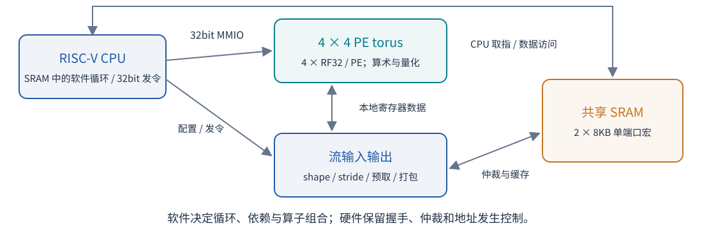
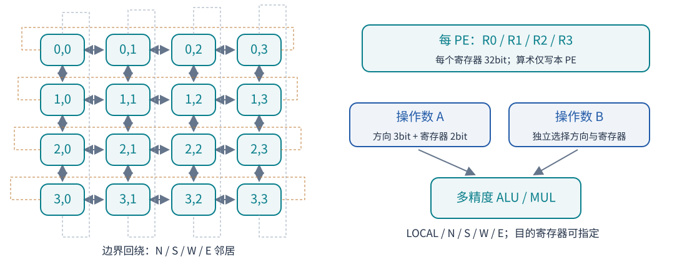
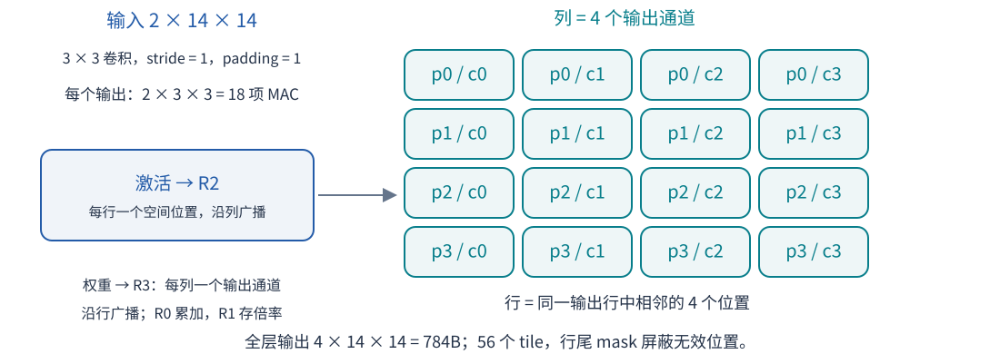
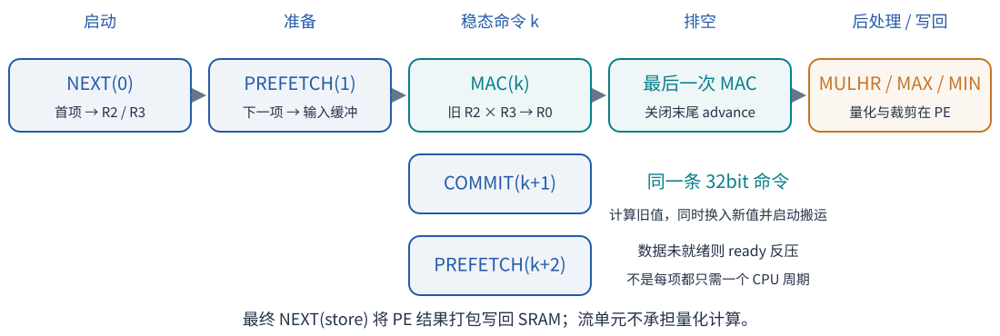
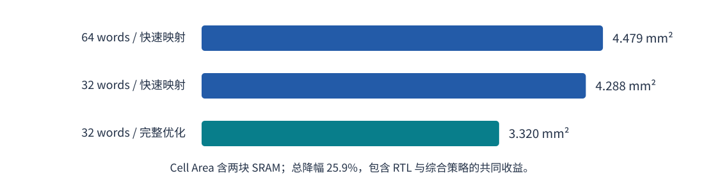
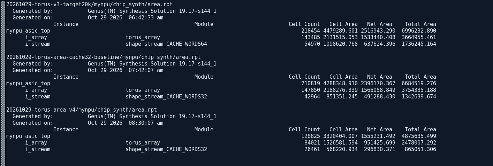
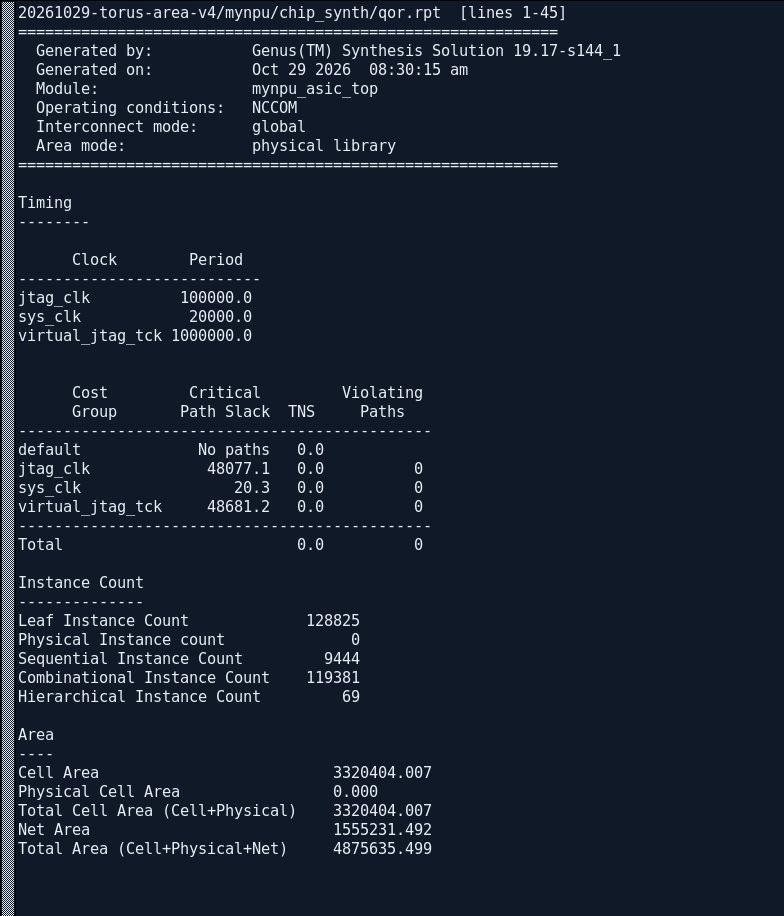
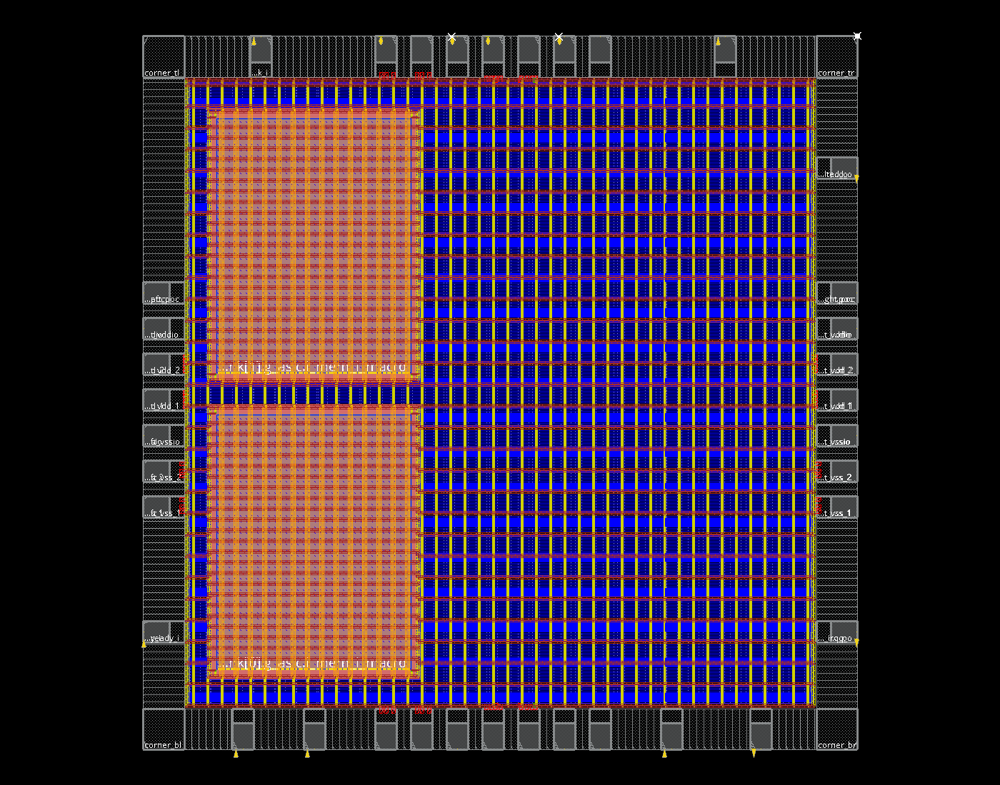
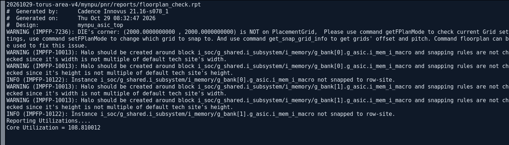
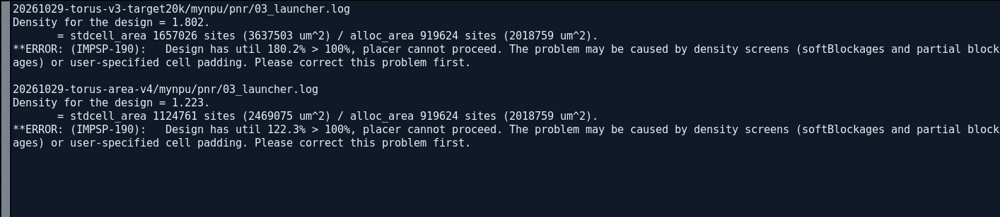

# mynpu 灵活架构与面积优化报告

2026 年 10 月 29 日 · 当前 torus 分支 ABI 4 · TSMC 180nm

软件控制的 16 PE torus 保持灵活算子组合，MNIST 约 20.23k 周期；综合面积由 4.479 降至 3.320mm²，**仍未满足 2mm×2mm 的实际放置容量**。

## 1 设计架构与灵活性

设计将层循环、运算顺序和量化调度交给 CPU 软件，只保留 **CPU、共享 SRAM、PE torus、流输入输出** 四类主体。硬件不再保存层微程序或设置层执行 FSM；流搬运仍需要地址发生、握手和仲裁控制。

CPU 从 SRAM 取指，以 32bit MMIO 命令驱动阵列。4bit 行 mask 可同时控制多行 PE，每行四个 PE。硬件支持连续周期接收命令，但实际 CPU 发令速度受取指、循环和 SRAM 争用影响。

每个 PE 有四个 32bit 寄存器；两个源操作数分别选择本地或上下左右邻居的某个寄存器，边界回绕。算术只写本 PE，目的寄存器可指定。支持 INT8／INT16／INT32 乘法与 MAC、整数移位、比较和位操作；**量化也是 PE 指令组合**。多精度表示操作数解释方式，并非自动提供四路 INT8 SIMD。

## 2 软件如何运行一层 MNIST

以第二层卷积为例：输入 **2×14×14**，3×3 卷积、步长 1、padding 1，输出 **4×14×14**。软件把四个输出位置映射到 PE 行，四个输出通道映射到列；每个有效 PE 累加 18 项。

软件配置四个流上下文：激活、权重、bias／倍率、输出。激活按行广播，权重按列广播；R0 存累加值，R1 存倍率，R2／R3 存激活／权重。shape 描述循环次数，stride 描述 tile 和外层循环地址步进；上下文保留配置，换 tile 主要更新基址和 mask。全层有 56 个 tile，尾块及 padding 由软件 mask 处理。

每 tile 从 bias 开始累加。稳态命令在同一沿完成“旧操作数 MAC、下一项提交、再下一项预取”，数据未到则反压等待。累加后由 PE 执行 `MULHR(R0, R1)`、下限 MAX 和上限 MIN；本层输出零点为 0，裁剪范围 0～127，因此省去零点 ADD。R1 使用 2M，使 MULHR 的舍入结果等价于原模型的 M／2³¹ 缩放，构建时检查倍率范围。最后流单元打包写回 784B，下一层读取 SRAM。当前六层均写回，尚未跨层融合，也未借 torus 转发消除中间结果搬运。

## 3 软件与硬件的优化取舍

| 优化 | 实现与作用 |
|---|---|
| 减少重复配置 | 层间只写变化字段；BASEPAIR 同时更新两路基址；倍率按输出通道组复用。每推理字段写从旧静态计数 8372 降至 445，减少 94.7%。 |
| 提前生成调度 | 161 个 tile 元数据、19 种边界模板存入 CPU SRAM；输入通道和 FC 循环展开，采用压缩 SW，减少命令表读取与循环开销。 |
| 搬运计算重叠 | PREFETCH／COMMIT 与 MAC 合并发令，末个 SRAM 响应可前递；复用每口四项 gather 缓冲。 |
| 精确缓存失效 | 只失效实际被写的 word，保留其他权重缓存；权重在 SRAM 仍只有一份。 |
| 首层常数折叠 | 编译期计算 B′＝B−17×Σ有效权重，按边界提供 32B 派生 bias，去掉 504 条运行期 SUB，保持零点和 padding 语义。 |

全部代码与只读表占 **5604B**。FPGA／ASIC 功能模型各 64 个样本通过，六层实际输出均匹配独立整数 golden；完整推理含 CPU argmax 为 **20233～20237 周期**。这是功能仿真计数，若物理实现最终满足 50MHz，则对应约 0.405ms；目前尚无布线后频率证明。

原 64-word／口缓存为 19258～19262 周期；缩至 32 words 后约多 975 周期。接受该取舍后，两口缓存数据容量由 512B 降为 256B，再进一步精简数据通路。

## 4 综合迭代与面积证据

三轮均使用 TSMC180 TT 库、两块相同 SRAM、20ns 系统时钟约束。面积使用 **Cell Area**，包含 SRAM，不使用含估算连线面积的 Total Area。

| 迭代 | 结构与综合策略 | Cell Area | 流单元面积 |
|---|---|---:|---:|
| A | 64 words／口，低 effort 快速映射 | 4.479290mm² | 1.098621mm² |
| B | 旧 RTL，仅缩至 32 words／口，同样快速映射 | 4.288349mm² | 0.851351mm² |
| C | 32 words／口，结构精简，medium 完整优化 | **3.320404mm²** | **0.568221mm²** |

截图为三份 `area.rpt` 的原始关键行；显示工具版本、生成时间、顶层、阵列及流单元面积。各轮重新映射会改变其他单元尺寸，B 与 A 的全芯片差值不能全部当作 cache 的独立面积。

从 B 到 C：①每口 cache 拆为四个浅 bank，同 word 广播，同 bank 不同 word 分次收集，减少并行选择逻辑；②描述符与游标压至 16bit，保留溢出／越界检查；③PE 移位／旋转／舍入共用移位器和加法器，CLZ／CTZ 共享，POPCNT 使用平衡树；④运行 medium generic／map／opt。**总面积较 A 下降 25.9%**，包含 RTL 和综合策略的共同收益；完整 32×32 乘法与 PE 指令语义均保留。

## 5 时序与真实物理检查

最终综合标准单元面积 **2.517517mm²**，两块 SRAM **0.802887mm²**。`sys_clk` 周期 20000ps，setup slack **+20.3ps（+0.0203ns）**，TNS 为 0。这是映射阶段的全局互联估计，裕量很薄，不能据此宣布布线后 50MHz 通过。

Innovus 从当前 `06_powerplan` 数据库恢复：外围为 PAD，左侧上下两块为 SRAM，网格为供电结构。**这是 floorplan／powerplan，不是已完成标准单元放置或信号布线的版图。**

## 6 面积问题解决到哪一步

2mm×2mm 的 4mm² 包含 PAD；核心约 **3.027321mm²**，扣除 SRAM、halo 等限制后，placer 可分配标准单元区域约 **2.018759mm²**。因此“3.320mm² 小于 4mm²”不代表能放下。报告还保留了 die 网格与 macro／halo 对齐警告，当前并非物理验收通过状态。

实际 placement 利用率从 **180.2% 降至 122.3%**，仍因 `IMPSP-190` 超过 100% 而停止；IO 和供电已完成，**CTS／route 未运行**。按当前 placer 口径，标准单元需求 2.469075mm²，容量 2.018759mm²，还需减少约 **18.2%** 才刚到 100%，实际布线还需要更多余量。placer 与 Genus 的单元统计口径不同，不应混用分子计算利用率。

本轮解决了缓存过大、重复选择逻辑和部分 PE 算术资源重复的问题，保持约 20.23k 周期，但尚未解决 2mm×2mm 的最终容量问题。后续应优先评估剩余 **1.526582mm² PE 阵列**的运算资源成本与软件周期取舍，再用同样的功能回归、综合和实际 placement 闭环验证；不能以缩小缓存的理论估算替代后端结果。

证据入口：[完整验证记录](validation.md)、[软件流水](overlap.md)、[机器可读汇总](../../build/torus/area-v4-validation.json)、[后端操作与 GUI](../../eda/tsmc180/README.md)。截图对应原文件及行号、哈希见 [报告截图来源](report-assets/screenshot-sources.json) 与 [Innovus 画布来源](report-assets/innovus-capture-source.json)；示意图为可重生成 SVG，不是工具截图。原始后端运行位于工作区父目录 `eda-runs/20261029-torus-area-v4`，对照运行以 `torus-v3-target20k`、`torus-area-cache32-baseline` 结尾。
