# mynpu-torus 设计文档

本文分析 `mynpu-torus`（分支 `experiment/torus-register-file`）当前实现——**软件控制的 4×4 torus、每 PE 四个本地寄存器、通用 shape/stride 流搬运、两块共享 8KB 单端口 SRAM** 的 ABI 4 版本。

| 项 | 值 |
|---|---|
| 实现入口 | `rtl/mynpu_soc_top.sv`（`DUAL_BANK_SHARED=1` 分支） |
| 加速器顶层 | `rtl/mynpu_torus_subsystem.sv` |
| 命令 ABI | 4（ID `0x544f5204`，即 `"TOR\x04"`） |
| 加速器本体规模 | `torus_pe` 138 行、`torus_array` 56 行、`shape_stream` 401 行、`mynpu_torus_subsystem` 187 行 |
| 软件 | `sw/torus/` + 主机调度器 `tools/torus_schedule.py` |
| 功能基线 | 161 个 tile、19 个边界模板、5604B CPU 程序、20233 周期/次推理 |

阅读顺序建议：第 1–2 节看整体，第 3–5 节看计算与命令，第 6 节看数据搬运（最复杂），第 7–9 节看存储与软件，第 10 节看取舍，第 11–13 节看证据与边界。

相关文档分工：架构与 ABI 摘要见 [README](README.md)，软件流水时序见 [overlap](overlap.md)，验证数据见 [validation](validation.md)，物理实现流程见 [EDA 教程](../../eda/tsmc180/README.md)。

---

## 1. 设计目标与硬约束

顶层需求不是"再做一个卷积加速器"，而是**在 2mm² 量级的面积预算内、用两块真正的单端口宏，搭一个软件可编程的整数数据流机**。约束来自 `AGENTS.md`，直接决定了架构形态：

| 约束 | 对架构的强制影响 |
|---|---|
| 唯一一份参数副本，禁止权重跨 bank 镜像 | 权重必须靠"打包 + 广播 + 小缓存"复用，不能靠复制换带宽 |
| 单端口宏就是单端口；两个逻辑请求口不等于两个物理端口 | 需要真正的 bank 仲裁 + 每口 gather cache，冲突必须在内部消化 |
| 同拍要用的数据必须已在寄存器或另一个物理 bank | 引入每 PE 本地寄存器堆、预取缓冲、双口流水 |
| 保留 JTAG→DMI→DM→SBA 加载与调试 | 存储空间必须对 CPU、SBA、加速器三方可见，且争用时不许返回假数据 |
| 流片主目标为 ASIC，FPGA 只做等价替身 | 存储后端参数化（`MEM_BACKEND`），但数据通路完全共享 |
| cache / lane 尺寸可配置 | `STREAM_CACHE_WORDS`、PE 行 mask、tile 行列均可配 |

由此得到一条贯穿全文的设计主线：

> **硬件只提供"寄存器 + 邻居读 + 广播搬数"三件事；层、循环、padding、量化顺序全部由 CPU 软件发出。**

torus 里没有指令 RAM、没有 PC、没有层状态机、没有硬件循环器、没有 4 路 INT8 SIMD、没有独立的量化单元。CPU 每算一拍就写一条 32bit MMIO 命令。

### 1.1 演进脉络（为什么长成这样）

| 版本 | 关键变化 | 周期（单样本） |
|---|---|---:|
| v1 | 每 tile 重写全部描述符，搬运与计算串行 | 167828（六层） |
| v2 | 配置复用 + 独立 PREFETCH 命令 | 68686（六层） |
| v3 | 原生汇编驱动 + 三合一 bundle + 64 word/口 cache | 19129（六层）/ 19258（含 argmax） |
| **v4（当前）** | 描述符限宽到 16bit、cache 降到 32 word/口、PE 算子资源共享 | **20104（六层）/ 20233（含 argmax）** |

v4 是**主动用 5% 周期换 26% 面积**的结果：cache 从 512B 降到 256B，描述符从宽字段改成有符号 16bit，PE 把移位/旋转/舍入右移合并到同一桶形移位器。这不是性能退步，而是接受了 ~20.2k 的周期目标后对面积的二次优化。

---

## 2. 顶层结构

### 2.1 框图

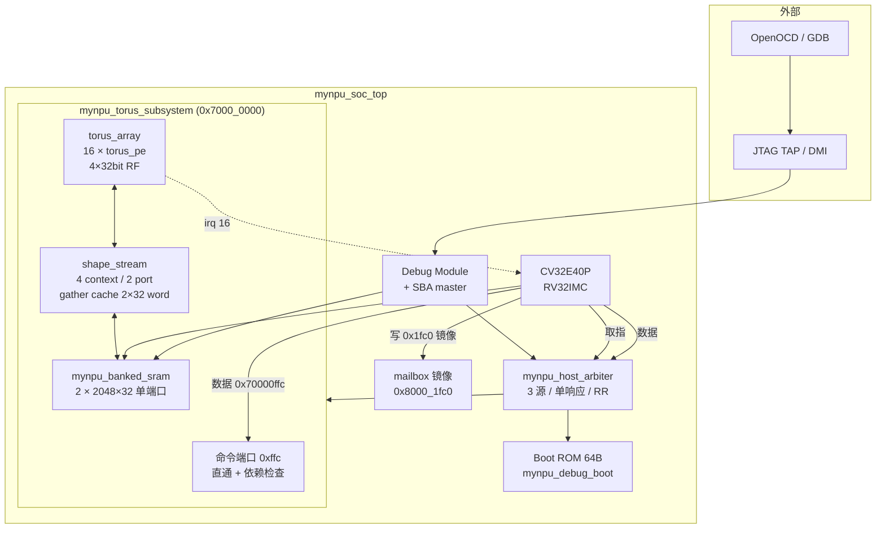

### 2.2 模块清单

| 文件 | 职责 | 行数 |
|---|---|---:|
| `rtl/mynpu_soc_top.sv` | SoC 集成、地址译码、CPU/DM、mailbox 镜像 | 628 |
| `rtl/mynpu_host_arbiter.sv` | 取指/数据/SBA 三源本机总线，单响应槽 | 61 |
| `rtl/mynpu_torus_subsystem.sv` | MMIO、命令接受、依赖记分板、错误汇总 | 187 |
| `cnn_npu_int8/rtl/torus_array.sv` | 广播译码、16 PE、方向环绕 | 56 |
| `cnn_npu_int8/rtl/torus_pe.sv` | 4×32bit RF + 单标量 ALU（opcode 0–52） | 138 |
| `cnn_npu_int8/rtl/shape_stream.sv` | 4 上下文描述符、地址生成、gather cache、预取缓冲 | 401 |
| `rtl/mynpu_banked_sram.sv` | 2 bank 独立单端口仲裁，每拍必有响应 | 66 |
| `rtl/mynpu_sram_2048x32_{fpga,asic}.sv` | 宏替身 / 宏 wrapper | 39 / 23 |
| `rtl/mynpu_debug_boot.sv` | 64B 等待型 boot ROM + ID/能力字 | 34 |

`rtl/mynpu_axi_shared.sv`、`rtl/mynpu_shared_subsystem.sv`、`cnn_npu_int8/rtl/cnn_npu_*.sv` 在 torus 路径中**不参与综合**，只服务 `DUAL_BANK_SHARED=0` 的历史分支。

### 2.3 关键实现选择：torus 路径没有 AXI crossbar

`mynpu_soc_top` 用 `localparam bit NATIVE_HOST = DUAL_BANK_SHARED && NPU_MMIO_GRID && COMPACT_HOST_BUS` 选择两条互斥的集成路径，三者默认全为 1，所以 **torus 的默认实现里没有 3×4 AXI crossbar、没有 `axi_adapter`、没有 `axi2mem`**：

- CPU 取指、CPU 数据、DM SBA 三路直接进 `mynpu_host_arbiter`；
- 地址在仲裁器内部按区间译码（`0x8000_*` / `0x7000_*` → 共享子系统，`0x1_0000` → boot，`<0x1000` → DM）；
- 每路请求 1 拍内给出 grant 或明确保持，**不存在"先用假响应占位、再补数据"**。

动机有三条：AXI 的 ID 排序与 outstanding 能力在这个单核单从场景里是纯开销；`axi_adapter` 的 `MAX_OUTSTANDING_AW=7` 会掩盖真实背压；面积上 crossbar+adapter 是可观的固定成本。保留 AXI 路径的目的仅是让旧分支与旧 testbench 仍能编译。

代价是：三路请求同一拍只能有一路被接受（单响应槽），CPU 取指在 JTAG SBA 连续访问时会短暂排队。`mynpu_host_arbiter` 用轮询（`rr_q`）而不是固定优先级来防止饥饿，并在 `retire` 与 `accept` 同拍时直接复用响应槽。

### 2.4 地址映射

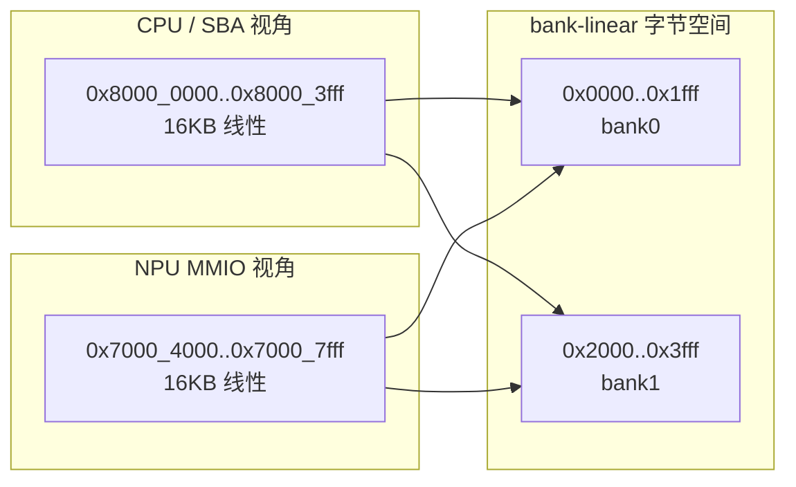

| CPU 地址 | NPU 地址 | 内容 |
|---|---|---|
| `0x0000_0000..0x0000_0fff` | — | Debug Module 窗口 |
| `0x0001_0000..0x0001_003f` | — | Boot ROM（等待型跳板） |
| `0x8000_0000..0x8000_1fff` | `0x7000_4000..0x7000_5fff` | **同一物理 bank0** |
| `0x8000_2000..0x8000_3fff` | `0x7000_6000..0x7000_7fff` | **同一物理 bank1** |
| `0x7000_0000..0x7000_0fff` | 同左 | 加速器 MMIO |
| `0x7000_1000..0x7000_3fff`<br>`0x7000_8000..0x7000_ffff` | 同左 | 未定义（读零；子系统内部置响应错误，本机总线不向 CPU 回报） |

两个别名不是镜像：`0x8000_2000 + off` 与 `0x7000_6000 + off` 落到同一个宏的同一行。SoC 回归里专门有一项 `sba_read(0x70006000) == model[0]` 的别名检查。

**注意**：torus 路径的存储容量固定为 8KB + 8KB = 16KB，顶层参数 `CPU_SRAM_BYTES` / `NPU_SRAM_BYTES` 在此分支被忽略（`addr_map` 里写死 `SRAM_BASE+16384`）。这是有意的简化：v4 的面积预算就是两块 8KB 宏。

### 2.5 启动流程

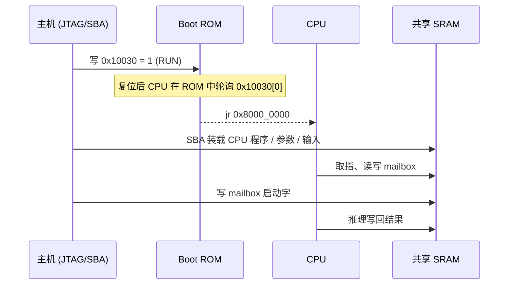

Boot ROM 里的 6 条指令是 `lui t0,0x10; lw t1,48(t0); andi t1,1; beq t1,zero,wait; lui t0,0x80000; jr t0`。设计意图是：**ASIC 上电时宏内容未知**，所以 CPU 必须先停在一个确定的 ROM 软件循环里，等外部把程序灌进 SRAM 再放行；同时 CPU 保持可取指、可被 halt，从而满足 Lab6 的 OpenOCD/GDB 调试链路。`mynpu_debug_boot` 另外在 `0x10034`/`0x10038` 回读 build ID 与 cache 配置，便于外部确认烧的是什么。

`boot_ready_i` 直接接 CV32E40P 的 `fetch_enable_i`，因此还有第二条独立的闸门：即使 `RUN=1`，只要 `fetch_enable=0` CPU 也不取指。

---

## 3. PE：四个寄存器的标量 ALU

### 3.1 接口

```systemverilog
module torus_pe(
  input logic clk_i, rst_ni, execute_i,
  input logic[5:0] operation_i,
  input logic[1:0] destination_i,
  input logic[31:0] operand_a_i, operand_b_i,
  input logic load0_i, load1_i,               // 流单元的两路装载
  input logic[1:0] load0_reg_i, load1_reg_i,
  input logic[31:0] load0_data_i, load1_data_i,
  input logic[3:0] load0_be_i, load1_be_i,
  output logic[31:0] registers_o[0:3]
);
```

一个 PE 只有：4×32bit 架构寄存器、一个组合 ALU、一个算术写端口、两个带字节使能的装载端口。16 个 PE 合计 **2048bit 架构状态**。没有 PC、没有指令寄存器、没有本地指令 RAM、没有流水线寄存器。

### 3.2 写端口语义

```systemverilog
if(execute_i) registers_o[destination_i] <= next_value;
if(load0_i)  registers_o[load0_reg_i]  <= merge(registers_o[load0_reg_i], load0_data_i, load0_be_i);
if(load1_i)  registers_o[load1_reg_i]  <= merge(registers_o[load1_reg_i], load1_data_i, load1_be_i);
```

三个写条件在同一沿按书写顺序生效（SystemVerilog 非阻塞赋值语义：同一目标的后者覆盖前者），综合后是"算术写"与"装载写"的多路选择。**正常路径上不会出现同寄存器双写**：bundle 由 `bundle_bad` 显式检查目的寄存器与提交目的相同（5.4），普通命令由 `safe_alu` 的具锁检查拦住"即将被流单元覆盖的寄存器"。

`merge()` 逐字节选择，使流单元可以只改一个寄存器的低 8bit（例如量化后的激活值），这是 8bit 数据通路能省下整字读改写的原因。

### 3.3 ALU 资源共享

面积优化集中在三处复用：

1. **一个桶形移位器同时做逻辑左/右移、算术右移、循环左/右移**。实现方式是把操作数按方向预翻转（`reversed`），移位后按方向翻回，这样 5 级 stage 只需要一套右移网络；算术移位的填充位由 `shift_sign` 在所有级统一插入。右移 32 位宽的 `<<(32-(1<<j))` 在第 0 级是 `<<31`，仍是合法的 32bit 移位。
2. **舍入右移 `SAR_ROUND` 复用加法器**，不再单独造一个 33bit 舍入加法器：先得到 `floor(a/2^s)`，再把"最高被丢弃位"作为 1bit 加数打进同一个加法器。这就是"加半值后算术右移"的精确等价形式，且天然对负数正确（向 +∞ 舍入）。
3. **CLZ / CTZ 共用计数网络**（CTZ 复用 CLZ 的输入翻转），**POPCNT 用平衡加法树**（16→8→4→2→1），而不是 32 项串行累加。

乘法器是一个 32×32 有符号乘法器，通过操作数预截断获得多种精度：

| opcode | 乘法形态 | 说明 |
|---|---|---|
| 5 / 6 | `signed(A[8:0]) × signed(B[7:0])` | 9×8，专门给 INT8 权重加零点偏移后的 9bit 激活 |
| 21 / 22 | `signed(A[7:0]) × signed(B[7:0])` | INT8 |
| 23 / 24 | `signed(A[15:0]) × signed(B[15:0])` | INT16 |
| 25 / 26 | `signed(A) × signed(B)` | INT32 |
| 49 / 50 | `unsigned(A[7:0]) × unsigned(B[7:0])` / 16bit | 无符号 |
| 27 | `product[63:32]` | MULH |
| 51 | `product[63:32] + product[31]` | MULHR |

`MULHR` 是量化链路的核心（见 9.4）：它把"乘以 Q31 倍率并右移 31 位"变成一个 PE 指令，且**半值处精确地向 +∞ 舍入**，与 PyTorch/FBGEMM 的 `(acc*M + 2^30) >> 31` 在整数意义下位等价（把 `B` 存成 `2M` 即可，推导见 9.4）。

### 3.4 opcode 全表

`0..52` 是普通运算，`53` 与 `58..63` 是流控制，`54..57`、`63` 非法。

| op | 助记符 | 语义 | op | 助记符 | 语义 |
|---:|---|---|---:|---|---|
| 0 | HOLD | 保持（保留 op 亦保持） | 27 | MULH | 乘积高 32bit |
| 1 | MOV | `dst = A` | 28/29 | MINU/MAXU | 无符号最小/最大 |
| 2 | MOVB | `dst = B` | 30/31 | EQ/NE | 相等/不等 |
| 3/4 | ADD/SUB | 加/减 | 32/33 | LE/LEU | 有/无符号 ≤ |
| 5/6 | MUL9X8/MAC9X8 | 9×8 低 32bit / 累加到 dst 旧值 | 34..37 | SEXT8/SEXT16/ZEXT8/ZEXT16 | 符号/零扩展 |
| 7/8/9 | AND/OR/XOR | 位运算 | 38/39 | ROL/ROR | 循环移位 |
| 10/11/12 | SHL/SHR/SAR | 移位（`B[4:0]`） | 40/41/42 | CLZ/CTZ/POPCNT | 位计数 |
| 13/14 | MIN/MAX | 有符号 | 43 | SAR_ROUND | 加半值算术右移 |
| 15/16 | LT/LTU | 有/无符号 `<` 产生 0/1 | 44/45 | SAT8/SAT16 | 有符号饱和 |
| 17 | ADDSELF | `dst = dst + A` | 46/47 | SATU8/SATU16 | 无符号饱和 |
| 18/19/20 | ABS/NEG/NOT | 绝对值/取负/取反 | 48 | SELECT | `dst[0] ? A : B`（用旧 dst） |
| 21/22 | MUL8/MAC8 | INT8 | 49/50 | MULU8/MULU16 | 无符号乘 |
| 23/24 | MUL16/MAC16 | INT16 | 51 | MULHR | `(A*B + 2^31) >> 32` |
| 25/26 | MUL32/MAC32 | INT32 | 52 | CLIPU | 夹到 `[0, unsigned(B)]` |

统一规则：算术写目的只能是**当前 PE 自己的** R0–R3；`MAC`/`ADDSELF`/`SELECT` 使用**选定目的寄存器的旧值**；溢出为低 32bit 回绕，饱和必须显式用 44–47、52。

---

## 4. torus 阵列：广播、方向、环绕

### 4.1 结构

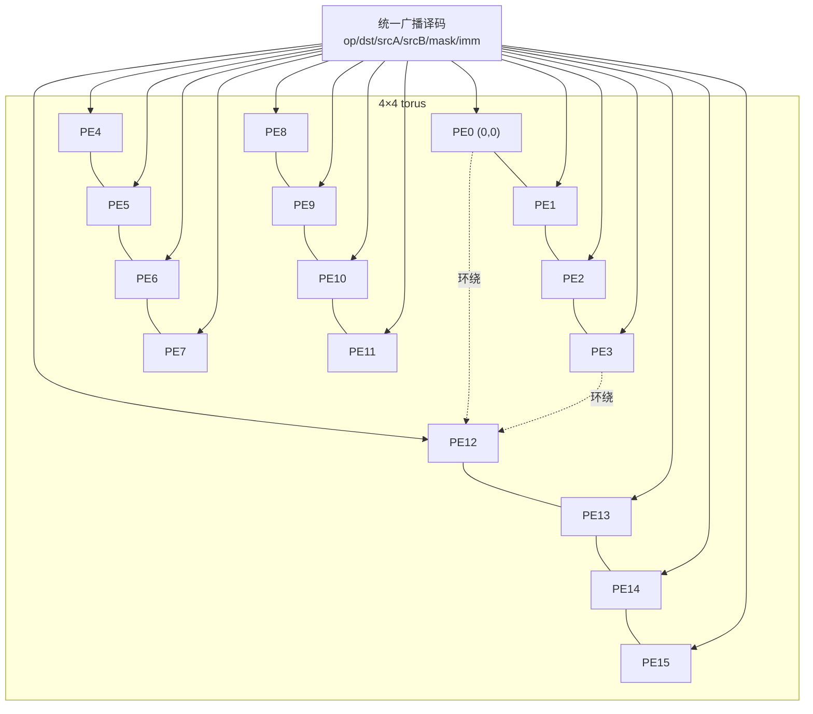

**没有路由器、没有 NoC、没有链路寄存器**——所谓 torus 就是一组组合多路选择器：

```systemverilog
localparam integer N=((p/4+3)%4)*4+p%4, S=((p/4+1)%4)*4+p%4;
localparam integer W=(p/4)*4+(p%4+3)%4, E=(p/4)*4+(p%4+1)%4;
```

PE 编号 `p = row*4 + col`，行与列都以 4 取模环绕，于是 `PE(0,0).north = PE(3,0)`、`.west = PE(0,3)`。这个选择器在综合后是纯组合逻辑，一拍到位；代价是每个 PE 的每个操作数端口都要在 `1 本地 + 4 邻居 = 5` 个来源 × 4 个寄存器之间选择，全阵列 16 PE × 2 个操作数 × 5 × 4 = 640 个 32bit 字（20Kb）的多路选择，是面积上无法忽略的一块（见 12 节）。

### 4.2 操作数选择

```systemverilog
case(sa[4:2])                          // 方向
  0: a = registers_o[p][sa[1:0]];      // 本地
  1: a = registers_o[N][sa[1:0]];      // 北
  2: a = registers_o[S][sa[1:0]];      // 南
  3: a = registers_o[W][sa[1:0]];      // 西
  4: a = registers_o[E][sa[1:0]];      // 东
  default: a = 0;                      // 5..7 非法（由子系统置错，见 5.5）
endcase
```

两个源**各自独立**选择方向和寄存器号，所以 `ADD dst=R0, A=W.R2, B=N.R3` 是一条命令。方向编码 5–7 保留给未来的斜向/全局链路，当前按非法处理。

### 4.3 行 mask 与"同沿旧值"

`mask = command[13:10]`，bit *r* 使能第 *r* 行（4 个 PE）。未使能行完全不执行算术写。这就是软件表达 padding、尾块、部分通道组的手段——不需要改描述符。

**软件给这两个维度赋予了语义**（这是理解整个调度的关键）：

| PE 维度 | MNIST 调度中的含义 |
|---|---|
| PE 行 0–3 | 输出 tile 内第 r 个 **x 位置**（同一输出行上连续的 4 列输出） |
| PE 列 0–3 | 输出通道组内第 c 个 **输出通道** |

于是行 mask 就是"本 tile 实际有效的输出 x 位置"，用于尾块（`ow` 不是 4 的倍数）与左右 padding；一条广播命令最多同时算 **16 个 MAC**（4 个 x × 4 个通道）。这是 v4 主要的算力来源——**并行度在 x×通道这一平面上，不在批/空间块上**。

关键语义：**同一时钟沿执行的所有 PE 都读"该沿之前"的值**。因为 16 个 PE 的 `operand_a/b` 是从 `registers_o` 组合读出的，而 `registers_o` 只在时钟沿更新，所以"一排 PE 同时读西邻居并写 R0"恰好产生一次环移，而不是在一个周期内连锁传播。这一条决定了 torus 可以做**寄存器级 systolic 移动**，但当前 MNIST 软件没有用到它（见 10.2）。

### 4.4 为什么算术只能写本地

如果允许"读邻居、写邻居"，每个 PE 的寄存器堆就要再加一个来自 4 个方向的写端口：写地址译码 → 4 个 4:1 写端口仲裁 → 优先级与冲突语义，面积与验证复杂度都会上一个台阶，而且会让"同沿旧值"的多写语义变得难以界定。

改成"只写本地"之后，写端口永远只有一个源（本 PE 的 `next_value`），跨 PE 的数据移动只能通过 `load` 端口（流单元）完成。这也是"算术写目的只能是 R0–R3"这条 ABI 约定的硬件根源。

### 4.5 装载端口

每个 PE 有两个装载端口，来自 `shape_stream` 的两个物理请求口：

```systemverilog
en0 = |load_mask_i[0][k][p];                 // 该口是否有任一 lane 命中本 PE
ld0 = |load_data_i[0][k] & {32{load_mask_i[0][k][p]}};
```

- `load_mask_i[口][lane]` 是 **16bit 的 PE 位图**，所以一个 lane 可以广播到多个 PE；
- `load_reg_i[口]` 是该口的 2bit 目标寄存器号，**一个口在同一拍只写同一个寄存器号**（这是 U8/16/32 打包与 ROW/COL 广播能成立的前提）；
- 调试 MMIO 写与流装载共用 port0，调试写优先级更高并带字节使能（`be0 = debug_be_i`）；port1 永远是整字写。

调试口与流口的优先级冲突在正常使用中不会发生（推理期间软件被禁止写调试口），但 RTL 里给了确定的优先级而不是"未定义"。

---

## 5. 命令接口（ABI 4）

### 5.1 三种编码

**寄存器格式**（bit9=0）与**立即数格式**（bit9=1）共用布局：

| 位 | 字段 | 说明 |
|---|---|---|
| 31:26 | opcode | 0–63 |
| 25:24 | dst | 本地目的寄存器 R0–R3 |
| 23:19 | srcA | 3bit 方向 + 2bit 寄存器号 |
| 18:14 | srcB | 3bit 方向 + 2bit 寄存器号 |
| 13:10 | 行 mask | 4 行 |
| 9 | imm 选择 | 1 = B 用立即数 |
| 8:0 | 有符号 9bit 立即数 | −256..255；bit8 同时是 bundle 标志 |

**bundle 格式**（bit9=0 且 bit8=1，opcode ≤ 52）：

| 位 | 字段 |
|---|---|
| 8 | 1 = bundle（必须为 1） |
| 7 | 1 = 启动下一次预取 |
| 6:4 | 上下文选择：0–3 单上下文，4={0,1}，5={0,3}，6={2,1}，7={2,3} |
| 3:0 | **下一组预取**的行 mask |

算术行 mask 仍是 13:10，提交使用输入缓冲里记录的旧掩码。**立即数格式不能编码 bundle**（bit9/bit8 互斥），所以 `TOR_IMM` 的常量运算无法与搬运融合。

**流/控制格式**（opcode 53、58–63）：低 9bit 另作解释，`TOR_IO(op, contexts, rows)` 把 context mask 放在 `[3:0]`。

### 5.2 一条命令同时做三件事

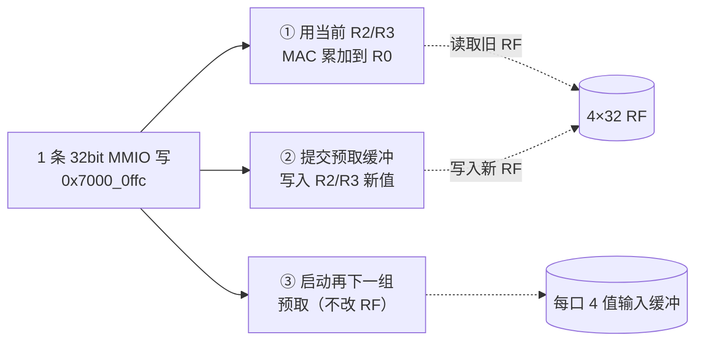

这是 v3 引入、v4 保留的核心机制：稳态下 CPU 每写一条命令，硬件完成"算一项 / 换入一项 / 取下一项"。三件事在同一条上升沿发生，算术读旧值、提交写新值，互不干扰；算术目的与提交目的寄存器相同时置错且整条命令无效果（`bundle_bad`）。

完整流水（卷积）：

```text
NEXT(term0)                        // 首项直接进 R2/R3（非延迟模式）
PREFETCH(term1)                    // 只进缓冲，RF 不动
MAC(term0) + COMMIT(term1) + PREFETCH(term2)
MAC(term1) + COMMIT(term2) + PREFETCH(term3)
...
MAC(termN-2) + COMMIT(termN-1)     // 关闭 advance，不越读 shape 末尾
MAC(termN-1)                       // 普通指令排空
```

FC 用 `PREFETCH` + `COMMIT` 起步后进入同一条稳态流水（见 9.5）。

### 5.3 两条接受路径

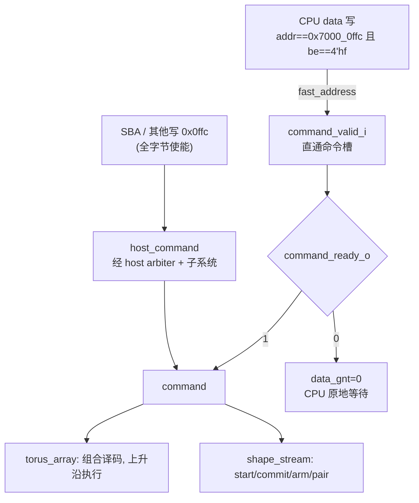

- `fast_address = data_we && (&data_be) && data_addr == 0x7000_0ffc`，走 `command_valid/ready` 直通，**不经过 SRAM 仲裁**，因此空闲时每拍一条；
- 其他全字节使能写落 0x0ffc 由 `host_command` 处理（SBA 灌命令用）；
- 部分字节使能写 0x0ffc 会被接受但**置 command_error**，不执行——避免"以为发了命令其实只写了半个字"。

`data_pending_q/data_fast_q` 保证 CPU 数据响应的顺序：直通命令的响应（`rdata=0`）与普通总线读的响应不会乱序，因为同一时刻只允许一个未完成的 CPU 数据事务。

### 5.4 接受条件（依赖记分板）

`can_issue()` 是纯组合函数，输入是候选命令 + 当前锁状态：

```systemverilog
function automatic logic can_issue(candidate, is_busy, is_safe,
                                   ready_mask, reserved_mask, read_mask, write_mask, regs);
  ctx        = contexts_of(candidate);
  loaded_regs= incoming_registers(ctx, ready_mask, regs);
  safe_alu   = !is_busy || !(|candidate[13:10]) ||
               (!(read_mask[dst]||write_mask[dst]) &&
                !write_mask[candidate[20:19]] &&           // B 的寄存器
                (candidate[9]||!write_mask[candidate[15:14]])); // A 的寄存器
  ...
endfunction
```

| 命令类 | 接受条件 | 不接受时 |
|---|---|---|
| 算术 0–52 | `safe_alu` | 反压（CPU 停在 `sw` 上） |
| 53 BASEPAIR | 走通用 `safe_alu`（字段含义不同，见 13.1 第 13 条） | 反压或不生效 |
| 54–57、63 | 总是接受（随后置错） | — |
| 58 EXCHANGE | 上下文不是全部保留，**或**全部就绪且安全 | 反压或置错 |
| 59 COMMIT | 全部就绪，**或**存在未保留上下文 | 反压或置错 |
| 60 PREFETCH / 61 ARM / 62 NEXT | `!busy` | 反压 |
| bundle | 冲突组合直接接受并置错；否则 全就绪 + `safe_alu` | 反压 |

三组锁由 `shape_stream` 维护：

| 锁 | 来源 | 粒度 |
|---|---|---|
| `read_locks` | 正在搬运的 **store** 上下文当前寄存器号（该寄存器正被读出，禁止再写） | 全局 4bit（不区分 PE） |
| `write_locks` | 正在搬运的 **load** 上下文当前寄存器号（该寄存器即将被覆盖，禁止读写） | 全局 4bit |
| `reserved` | 处于延迟模式且有数据的上下文 | 4bit 上下文掩码 |

刻意保守：锁只按**寄存器号**记，不按行或 PE 细分。因此"PE0 在读 R2"会阻塞"PE5 写 R2"。这是 v4 面积优化的直接结果——按行细分的记分板要 4bit×4 行×4 寄存器，且组合路径更长。软件调度器按这个保守模型排序命令，实测 `stall_mac=3049`（占 15%），可接受。

### 5.5 错误与副作用

错误是**粘性 IRQ**（`irq_o = io_error || command_error_q`），写 `0x7000_0010` bit0 清除。它不是每 tile 中断。

| 条件 | 效果 |
|---|---|
| opcode 54–57、63 | 接受、置错、不执行 |
| 读源方向 ≥ 5（`srcA`/`srcB` ≥ 20） | 接受、置错、无 RF 写 |
| bundle 引用未保留上下文 / advance 但 ctx ≠ 全部保留 / 目的=提交目的 | 接受、置错、**整条无效果** |
| BASEPAIR 两个上下文相同 | 置错、不执行 |
| COMMIT 缺对应预取 | 置错、不挂死 |
| 0x0ffc 部分字节写 | 置错、不执行 |
| ARM/NEXT/PREFETCH 在 buffer 未消费时 | 反压（不是错误） |

"接受但置错且无副作用"是一个刻意的设计选择：它让 CPU 的命令流永远能推进到底，不会因为一条错命令把整个推理卡住，同时错误位与计数让软件可定位。

---

## 6. 流子系统 `shape_stream`

这是全设计最复杂的部分（401 行）：**4 个通用 shape/stride 描述符 + 2 个物理请求口 + 每口 gather cache + 每口 4 值延迟缓冲**。

### 6.1 上下文与端口映射

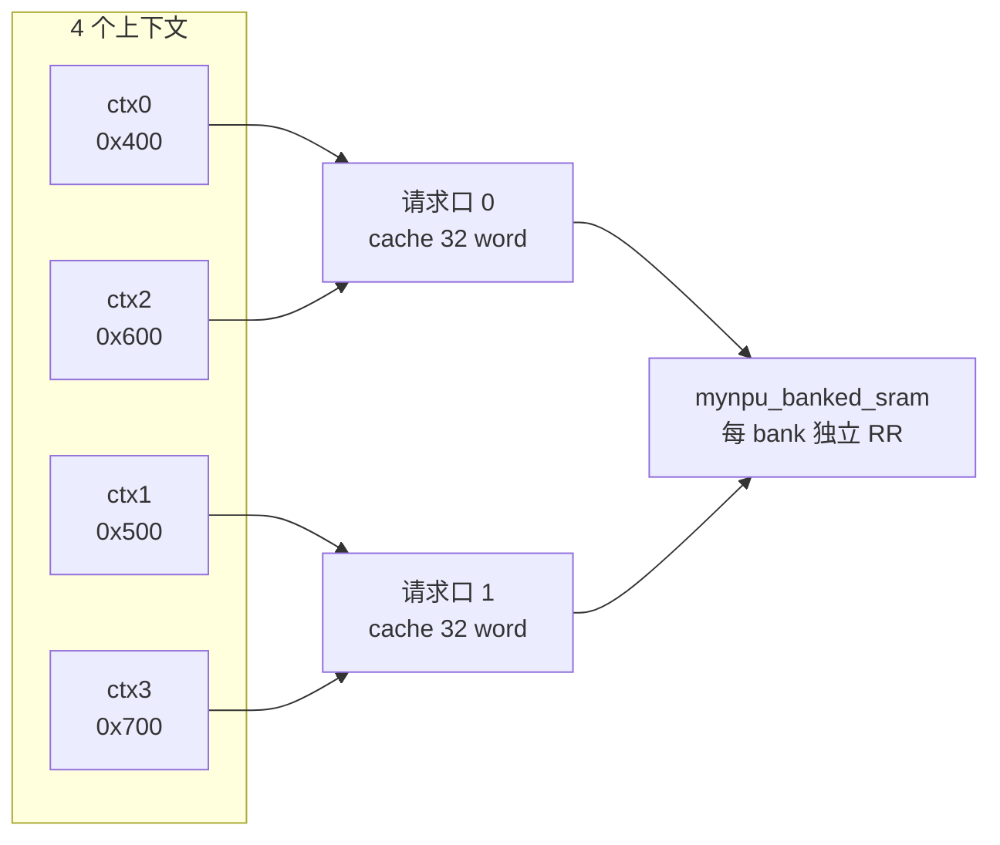

映射是硬连线的：`selected_q[p] = {selected_hi_q[p], p}`，即上下文的**最低位就是端口号**，高位是"该端口上的第二个上下文"。所以：

- 同一端口上的两个上下文**串行**执行（第二个在 `pending_q` 里排队）；
- 两个端口**并行**发请求，但若落到同一物理 bank，由 `mynpu_banked_sram` 串行仲裁；
- 延迟模式（PREFETCH/EXCHANGE/bundle）每端口只允许一个上下文；同一端口的两个上下文同时请求延迟模式（`{0,2}` 或 `{1,3}`）会直接置错——因为每口只有一组 4 值缓冲。

### 6.2 描述符（13 word）

基址 `0x7000_0400 + ctx*0x100`，word 地址不变，但 ABI 4 把**内部位宽收窄**了：

| word | 字段 | 位宽/范围 | 读回 |
|---:|---|---|---|
| 0 | bank-linear 字节基址 | **signed 16**（−32768..32767），合法 SRAM 仅 0..16383 | 符号扩展 |
| 1 | control | 见下表，写入被掩到 `0x3ff` | 零扩展 |
| 2 | tile 行数 `[2:0]`、列数 `[6:4]`（1–4） | 掩到 `0x77` | 零扩展 |
| 3 | tile 行 byte stride | **signed 16** | 符号扩展 |
| 4 | tile 列 byte stride | **signed 16** | 符号扩展 |
| 5/6/7 | 外层 axis0/1/2 shape | **unsigned 16**（1..65535） | 零扩展 |
| 8/9/10 | 外层 axis0/1/2 byte stride | **signed 16** | 符号扩展 |
| 11 | 本地寄存器基号 `[1:0]` + 三轴寄存器步长 `[3:2][5:4][7:6]`（模 4） | 掩到 `0xff` | 零扩展 |
| 12 | PE 起点行 `[1:0]`、起点列 `[3:2]`（模 4 环绕） | 掩到 `0xf` | 零扩展 |

control：

| 位 | 含义 |
|---|---|
| 2:0 | 0 U8、1 S8、2 U16、3 S16、4 RAW32；5–7 非法 |
| 3 | 1 = store，0 = load |
| 5:4 | 0 FULL、1 ROW（每行取一值广播到该行四列）、2 COL（每列取一值广播到四行）、3 非法 |
| 6 | 仅 FULL：转置遍历（外层按列走，四个 lane 按行走） |
| 7 | 保留，必须为 0 |
| 8 | 外层 shape 走完循环回起点；否则置 `ended` |
| 9 | 不填充 gather cache（连续权重流用） |

### 6.3 地址生成

对外层坐标 `(i0,i1,i2)` 与 tile 内位置 `(r,c)`：

```text
addr = base + i0*s0 + i1*s1 + i2*s2 + r*row_stride + c*col_stride
reg  = (reg_base + i0*step0 + i1*step1 + i2*step2) mod 4
```

一条 NEXT 只搬**一块 tile**，随后推进外层游标（axis0 最内）。ROW/COL 把 `r` 或 `c` 换成 lane，FULL 把其中一个维度换成 4 次 group 迭代：

```systemverilog
if(mapping==1)      begin rr=k; a=a+k*rs; end                       // ROW
else if(mapping==2) begin cc=k; a=a+k*cs; end                       // COL
else if(ctl[6])     begin rr=k; cc=group_q; a=a+k*rs+group_q*cs; end  // FULL+转置
else                begin rr=group_q; cc=k; a=a+group_q*rs+k*cs; end  // FULL
```

`group_count = (FULL ? (转置?nc:nr) : 1)`，因此：
- ROW/COL：一块 tile 一拍完成（1 组 × 4 lane）；
- FULL：需要 `nr`（或转置时 `nc`）组，逐组完成后才推进外层坐标。

lane → PE 的映射由两端决定：tile 内 `(tr,tc)` 放到物理 `((origin_r+tr)%4,(origin_c+tc)%4)`，同时受行 mask（按**物理行**索引）与 `tr<nr && tc<nc` 约束。这样 tile 可以放在 torus 的任意起点并环绕。

`nr`（tile 行）对应 PE 行，`nc`（tile 列）对应 PE 列。当前调度器固定 `nr=4`、`nc=min(4,剩余通道数)`，所以"4 行"在硬件上是 4 个 PE 行，在算法上是**同一输出行的 4 个连续 x 位置**；"4 列"是 4 个输出通道。ROW 映射因此是"每个 x 位置一个激活字节、广播给 4 个通道"，COL 映射是"每个通道一个权重字节、广播给 4 个 x 位置"，两者正好拼成 4×4 的乘加平面。

### 6.4 游标推进（嵌套三维）

完成一块 tile 后按"axis0 最内"推进：

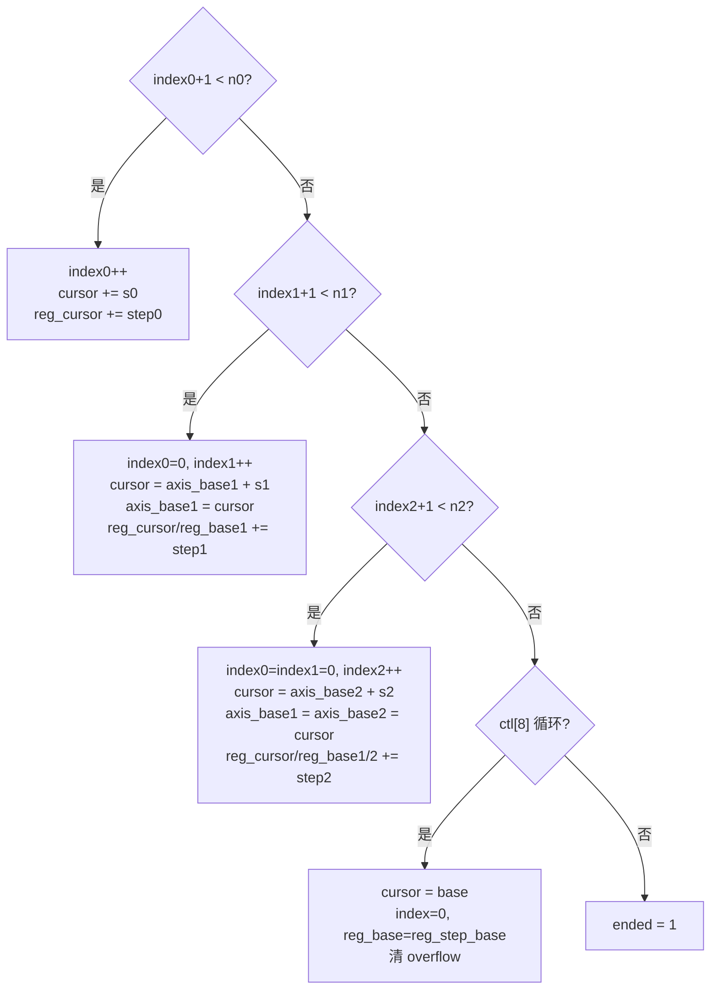

`axis_base1/2` 的存在是为了让 axis1/2 的回绕有正确基准：axis1 前进时不是"cursor += s1"，而是"从 axis_base1 加 s1"，否则多层步长会累积错误。寄存器游标同样有 `reg_base1/2` 影子。

每一级的加法都保留 1bit 溢出：

```systemverilog
function automatic logic[16:0] address_add(input logic[15:0] a,b);
  address_add = {a[15],a} + {b[15],b};
endfunction
// 用途：cursor_overflow_q |= (advance[16] != advance[15])
```

**为什么必须这样**：ABI 4 把地址限制到 16bit，如果直接截断，一个越界游标可能回绕成低 SRAM 的合法地址，造成"以为访问 padding 其实踩坏了参数"。因此越界被记成粘性 `cursor_overflow`，只由 ARM 清除，且在有溢出标志时**拒绝任何传输**。

tile 地址组合另外保留 19bit（`logic signed[18:0] a`），并检查 `|a[18:14]`：这捕获"三个 row_stride 之和超出 14bit 地址空间"的情况。注意这个检查**先于**行 mask 屏蔽：被 mask 完全屏蔽的负地址不产生 SRAM 请求，所以 padding 是安全的。

### 6.5 四种流命令

| op | 名称 | 语义 | 是否改 RF |
|---:|---|---|---|
| 62 | NEXT | 搬一块 tile，**直接**写入 PE 寄存器（非延迟） | 完成时写 |
| 60 | PREFETCH | 异步读取到每口 4 值缓冲，**不改** RF | 否 |
| 59 | COMMIT | 把缓冲数据按记录的目标掩码/寄存器原子写入 | 是 |
| 58 | EXCHANGE | 提交已预取数据 **并** 启动下一组预取（软件流水） | 是 |

延迟模式（PREFETCH/EXCHANGE/bundle）的关键约束：

- 地址和寄存器游标在**读取完成时**推进，但本组目标寄存器号另存于 `staged_reg[p]`。这是一个容易写错的点：tile 完成后游标可能已经指向下一个寄存器，提交时必须用"完成时"的记录值。RTL 里专门有对应回归项（`staged_reg[p] <= reg_cursor[c]`）。
- `ready_o[ctx]` 与 `buffer_regs_o[ctx]` 在**最后一个 SRAM 响应那一拍组合地**置起（`active && deferred && complete`），不额外插入 buffer-valid 周期。这就是 overlap.md 说的"最后一次 SRAM 响应可直接前递到同沿提交路径"。
- `busy` 必须保持到缓冲被 COMMIT/EXCHANGE 消费，所以 **`busy=0` 不能当作"可以读结果"**；软件必须显式提交。
- 预取期间对描述符的写、ARM、NEXT 均被反压，防止改掉未消费数据的描述符。

### 6.6 三张状态表

| 信号 | 含义 | 谁用 |
|---|---|---|
| `ready_o[3:0]` | 该上下文缓冲已就绪 | `can_issue`、COMMIT |
| `reserved_o[3:0]` | 该上下文有保留缓冲 | 冲突检查、bundle 合法性 |
| `read_locks_o` / `write_locks_o` | 正在搬运的寄存器号（load/store） | `safe_alu` |

`compute_safe_o = !pending && !(active && !deferred)`：即"没有非延迟搬运在跑"。它让 NEXT/ARM/PREFETCH 在普通搬运期间被反压，而 bundle 的算术部分仍可与延迟搬运重叠。

### 6.7 gather cache

每口 32 word = 256B 数据，结构上拆成 **4 个浅 bank × 8 word**：

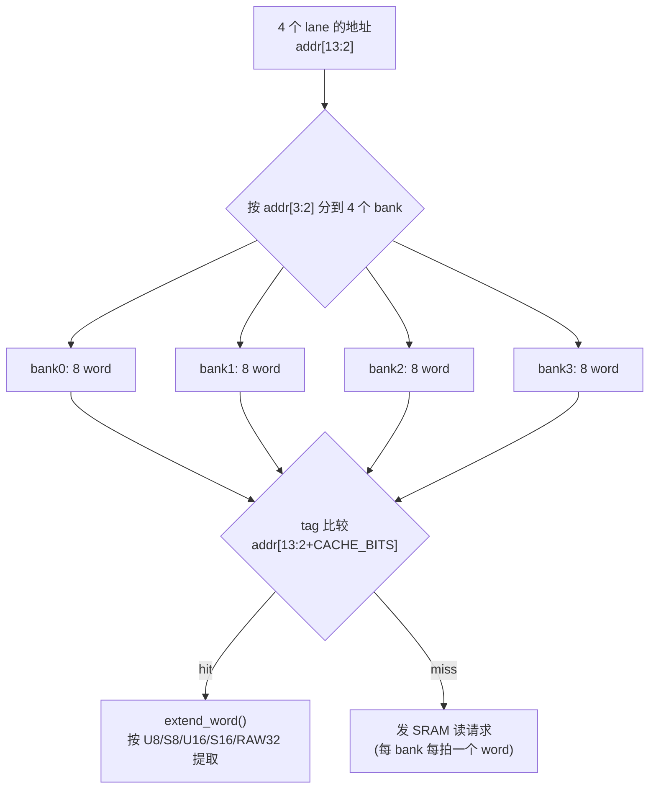

| 属性 | 值 |
|---|---|
| 组织 | 直接映射，索引 = `addr[log2(W)+1 : 2]`，tag = 高位 |
| 关联度 | 1（但 4 bank 并行查询，等价于每拍 4 个不同 bank 的并行探测） |
| 同 word 多 lane | 广播（`lookup_word == lane_address[13:2]`） |
| 同 bank 不同 word | 通过 `gathered_q` 分次完成，不丢进度、不死锁 |
| 填充 | 仅 load 响应，且 `ctl[9]=0` |
| 失效 | host 写 与 流 store **精确到同一 word**；同时处理与在途 fill 的冲突 |
| 关键不变量 | 尚未查询到的 lane **不得**提前当作 miss 发请求（否则会把 "未知" 当 "未命中"，产生多余读甚至错误合并） |

四个 bank 的划分不是面积游戏，而是**把"每拍最多一次 SRAM 读"提升成"每拍最多四次不同 bank 的读"**，直接缩短 gather 收敛时间。同 bank 冲突退回 `gathered_q` 分次，因此最坏情况仍然正确，只是多花几个周期。单元回归里专门有"四个 lane 命中同一 bank 同一 index"的冲突用例。

精确失效是性能关键：推理期间 SBA 会并发写 mailbox 与无关地址，若按整口冲刷，权重 cache 每层都会被清空。RTL 只清命中同一 word 的项，并在同一拍同时处理三种事件（host 写、流 store、在途 fill）。

### 6.8 错误检测清单

| 检查 | 触发 |
|---|---|
| 未 ARM / 已 ended | `!armed_q[c] \|\| ended_q[c]` |
| 配置字段越界 | `config_bad_q[c]`（写时检测，粘性） |
| 游标溢出 | `cursor_overflow_q[c]`（粘性到 ARM） |
| tile 维度 | `nr/nc` 不在 1..4 |
| mapping | `ctl[5:4]==3` |
| 保留位 | `ctl[7]` |
| 格式 | `ctl[2:0]>4` |
| shape 为零 | word5/6/7 == 0 |
| 地址越界 | `\|a[18:14]` |
| 对齐 | 16bit 要求 `a[0]==0`，32bit 要求 `a[1:0]==0` |
| 延迟模式限制 | 延迟模式下的 store 或 FULL |

一旦置错：`error_o=1`、`active_q<=0`，该上下文中止；**已经完成的其他 lane/tile 不回滚**（没有事务回滚能力，也不打算有）。

配置字段的越界检测值得单独说明：写入时若高 16bit 不是低 16bit 的符号扩展（地址/stride）或非零（shape），就把 `config_bad_q` 置起并报错，且**后续传输一律拒绝**。清 IRQ 不能修复它——必须重写该字段。这是防止"上限截断导致静默别名"的唯一可靠办法。

---

## 7. 存储子系统

### 7.1 地址条带化

`mynpu_banked_sram` 的输入是"条带化"地址：`bank = addr[2]`、`row = addr[13:3]`。上层把 bank-linear 字节地址做一次位置换：

```systemverilog
assign addr[0] = {addr_i[12:2], addr_i[13], addr_i[1:0]};
```

| 条带地址位 | 来源 | 作用 |
|---|---|---|
| `[2]` | 逻辑 `[13]` | bank 选择 |
| `[13:3]` | 逻辑 `[12:3]`、`[2]` | bank 内行号 |
| `[1:0]` | 逻辑 `[1:0]` | 字节内偏移（不进宏） |

结果：逻辑 `0..8191` 全在 bank0，`8192..16383` 全在 bank1，每个 bank 内按字线性。于是"前 8KB / 后 8KB"对软件是自然的两半，而硬件拿到的仍是标准 2048×32 单端口接口，不需要改宏。

### 7.2 三请求者仲裁

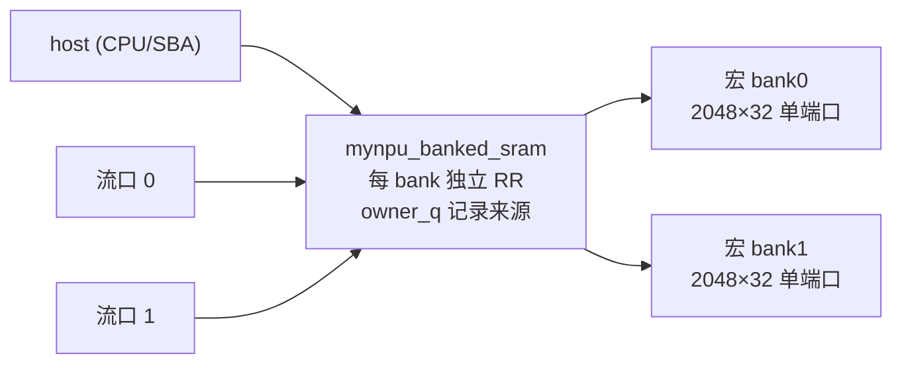

| 特性 | 实现 |
|---|---|
| 仲裁 | 每 bank 独立 3 路轮询（`rr_q[b]`），`chosen` 与 `owner` 同拍记录 |
| 吞吐 | 每 bank 每拍最多一次访问；两块宏并行 |
| 响应 | 每个被接受的请求（含写）下一拍必有 `rvalid`（同步宏的固定延迟） |
| 防饥饿 | 轮询指针只在真正授权后推进；CPU 连续取指不会饿死 SBA |
| 冲突 | 同 bank 请求排队，**不返回假数据、不丢弃请求** |

"每个被接受的请求都有响应"是整条链路的地基：`host_arbiter` 的单响应槽、`shape_stream` 的 `waiting_q`、CPU 的 `data_rvalid` 都依赖"gnt 之后必然 rvalid"。反过来说，**任何可能长期不响应的路径都必须用反压而不是忙标记**——这正是 AGENTS.md 里"never return a busy marker as an instruction"的落地方式。

### 7.3 后端抽象

`MEM_BACKEND`：`1` = FPGA BRAM 替身（`mynpu_sram_2048x32_fpga`），`2` = ASIC 宏（`mynpu_sram_2048x32_asic` 包 `RA1SHD_2048x32M8`）。

两者都保持"同步单端口、每拍一请求、读延迟一拍、四字节写使能"的契约，且**宏内不加复位**（复位不清存储内容，因为 ASIC 上电内容未知、FPGA 靠 `$readmemh` 预置）。`MEM_BACKEND=0` 会在 elaboration 阶段 `$fatal`。

ASIC wrapper 把 `we` 转成低有效 `WEN`、`req` 转成低有效 `CEN`，`OEN` 常 0：

```systemverilog
wire [3:0] wen_n = we_i ? ~be_i : 4'b1111;
RA1SHD_2048x32M8 i_macro(.Q(q), .CLK(clk_i), .CEN(~req_i), .WEN(wen_n), .A(addr_i), .D(wdata_i), .OEN(1'b0));
```

专有模型不入库；ASIC 回归用 `--macro-model` 指向服务器上的私有文件，并关闭 timing check。

---

## 8. CPU 侧集成

### 8.1 host arbiter

三源单响应槽，地址译码在内部完成：

| 目标 | 地址区间 |
|---|---|
| SHARED | `0x8000_0000..0x8000_3fff`、`0x7000_0000..0x7000_ffff` |
| BOOT | `0x0001_0000..0x0001_003f` |
| DM | `< 0x0000_1000` |
| BAD | 其他（返回 `0xdeadbeef`） |

要点：
- 只有目标为 SHARED 时 grant 才依赖下游 `shared_gnt_i`；BOOT/DM 是固定延迟，立即 grant；
- `retire = pending_q && (target!=SHARED || shared_rvalid)`，`allow = !pending || retire` → 同拍可"退休旧的 + 接受新的"，避免气泡；
- 被阻塞的 MMIO 动作不会阻塞另一个 master 的 debug/ROM 访问（`rr_q` 只在 `allow&&valid` 时推进）。

### 8.2 命令直通与顺序

```systemverilog
wire fast_address = data_we && (&data_be) && data_addr == 32'h7000_0ffc;
wire retire_data  = data_pending_q && (data_fast_q || responses[1]);
wire allow_data   = !data_pending_q || retire_data;
assign pe_command_valid = data_req && fast_address && allow_data;
assign data_gnt = fast_address ? (data_req && allow_data && pe_command_ready) : grants[1];
```

这条路径让"发命令"退化成一次普通 store：`sw` 一拍进入，`data_gnt` 由 `command_ready` 决定，`data_rvalid` 下一拍返回、`rdata=0`。CPU 不需要读状态、不需要轮询——**未满足的依赖直接表现为 store 不完成**。

### 8.3 mailbox 镜像

`mynpu_soc_top` 监听所有被接受的全字节 SRAM 写，命中 `0x8000_1fc0/1fc4/1fc8/1fcc` 就镜像到 `firmware_status/error/result/cycles` 输出端口。作用是在没有 JTAG 的场合（例如 FPGA 上 VIO）也能看到推理结果，而不增加任何存储端口。地址常量是 `FIRMWARE_MAILBOX_ADDR` 参数，改 CPU 布局时必须同步。

### 8.4 JTAG/SBA

`dmi_jtag` → `dm_top` → SBA master → host arbiter → 共享 SRAM/MMIO。SoC 回归实际使用这条链路完成：程序装载、参数装载、输入装载、`halt`/`resume`、并发无关地址读写、结果读回。SBA 看到的地址空间与 CPU 完全一致（含 `0x7000_*` 别名）。

---

## 9. 软件栈

### 9.1 内存布局

| 区间（bank-linear） | 内容 | 大小 |
|---|---|---|
| `0x0000..0x15e3` | CPU 程序 + 只读表（含 1932B tile 元数据、1216B 模板代码槽） | 5604B |
| `0x15e4..0x1fbf` | 栈（顶部 `0x1fc0`） | — |
| `0x1fc0..0x1fd0` | mailbox（status/error/result/cycles） | 16B |
| `0x2000..0x30bf` | 模型参数像（唯一副本） | 4288B |
| `0x3100..0x340f` | 激活缓冲 A（784B） | 784B |
| `0x3420..0x372f` | 激活缓冲 B（784B） | 784B |
| `0x3740..0x375f` | 编译期派生 bias 表 | 32B |
| `0x3800..0x3f01` | 可选逐层快照 | 1794B |

只有一块参数副本，权重分布在 bank1 内、按 4 通道打包。没有权重镜像、没有第二块参数区。

### 9.2 参数像与 PACK4

原始模型像来自 `cnn_npu_int8/generated/8k-p4/`（旧 4-lane NPU 的 PACK4 布局：`weight_layout = oc4-term-lane`）。构建器只做两件事：

1. 把前 4288B 参数原样搬到 bank1；
2. 把每个输出通道的 Q31 倍率 `M` 就地改写为 `K = 2M`。

第 2 步是 v3/v4 性能的关键（见 9.4）：它让 PE 的 `MULHR(acc, K)` 精确等于原始 `(acc*M + 2^30) >> 31`，从而**量化乘法完全不经过 CPU 或流单元**。

构建器同时校验：模型必须是 PACK4、`shift == 31`、`0 ≤ M < 2^30`（保证 `2M` 可用有符号 32bit 表示）、参数语义 SHA256 与语料记录一致、记录的整数输出与重新计算的 golden 一致、与记录的 PyTorch 最终输出最大差 ≤ 1 code。

### 9.3 编译流程

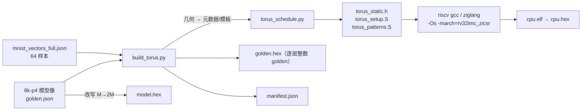

`torus_schedule.py` 是本项目唯一的"编译器"，输入只有**模型几何**，不含样本值、权重、预期分类：

- 生成 161 个 tile 记录（`{address_pair, params, metadata}` 12B/条，共 1932B）；
- 归纳出 19 种边界 mask 模板（`patterns`），每种编译成 9 条 bundle 命令字并放进 64B 代码槽（共 1216B）；第 *i* 条命令负责第 *i* 个核位置，其 bundle 的"下一组 mask"填的是 `(i+2) % 9`（因为 bundle 一次前进两项：提交第 *i+1* 项、预取第 *i+2* 项），并在第 9 个位置回卷到第 1 个，这样同一组 9 条命令字可以在每个输入通道上复用而无需重写；
- 生成每层的 `tor_setup_N`（只写与上一层不同的描述符字段，即"配置差量"）；
- 用 `addi`/`mv` 之间复用相同命令字来压缩模板代码（同 word 用 `mv`、相差 ±2047 内用 `addi`），超 64B 直接报错——这是一个硬约束，保证"模板表"不会退化成指令 RAM。

### 9.4 量化映射与 bias 折叠

原始整数语义：

```text
acc[c]    = b_int[c] + Σ ((q_input - z_input) * q_weight[c])
q_output  = clamp(((acc[c]*M[c] + 2^30) >> 31) + z_output, 0, qmax)   // ReLU: 下界取 z_output
```

硬件映射成 4 条 PE 指令：

| 步骤 | 指令 | 说明 |
|---|---|---|
| 1 | `MULHR(R0,R1)` | `R0 = (acc*K + 2^31) >> 32`，`K=2M` |
| 2 | `ADD R0,#z_out` | 仅当 `z_out≠0` 才生成 |
| 3 | `MIN R0,#lower` | `lower = z_out`（ReLU 语义） |
| 4 | `MAX R0,#upper` | `upper = qmax` |

`MULHR` 与原始式子等价性：`2M = 2·M` 是整数恒等，故

```text
(acc·2M + 2^31) >> 32  =  2·(acc·M + 2^30) >> 32  =  (acc·M + 2^30) >> 31
```

右移为算术移位，等式对负累加器同样成立。这一条把"量化"从硬件单元变成一条指令，代价是必须**在编译期**把 `M` 换成 `2M`，而 golden 仍用原始 `M` 与 `shift=31` 独立计算——两边不共享代码路径，因此是一个真正的交叉验证。

**输入零点折叠**（仅首层，且构建器识别到完全匹配的几何 `(1,2,2,0,28,28,14,14,iz=17)`）：

```text
原始： acc = b + Σ ((q - 17) · w) = (b − 17·Σw) + Σ (q · w)
```

于是把 `B′ = B − 17·Σ_有效权重` 预计算进 32B 表，按"是否顶行/是否左列"生成 4 种组合（`top_normal`/`body_normal` × `left`/普通）。行 mask 已经屏蔽了无效输入，所以 `Σ_有效权重` 与运行时一致；INT32 回绕保证了"先减后累加"和"折叠后累加"在位级完全等价。效果：去掉运行期 504 条 `SUB` 命令，且输入编码、原始权重、量化语义都不变。

`--no-bias-fold` 保留原始逐项减零点流程，用于 A/B。

### 9.5 命令流：卷积与 FC

**卷积**（`tor_native_layer`，通用汇编驱动，元数据在 SRAM 里）：

```text
每个 tile:
  [metadata 触发时才写] 0x500/0x600/0x708  ← 描述符差量
  BASEPAIR(a,b)                  ← 一次更新 ctx0/ctx3 基址并 ARM 全部 4 个上下文
  NEXT ctx2 rows                 ← bias → R0（需要时再一条 → R1 倍率）
  NEXT ctx{0,1} rows(m0)         ← 首项激活/权重直接进 R2/R3
  PREFETCH ctx{0,1} rows(m1)     ← 第二项进缓冲
  loop over ic:                  ← 每个输入通道重复（CPU 侧展开/循环）
     9 条 bundle 命令            ← 逐个核位置：MAC + COMMIT + PREFETCH
  4 条量化命令 (MULHR/ADD/MIN/MAX)
  NEXT ctx3 rows                 ← 结果写回共享 SRAM
```

每层的 tile 数：输出通道每 4 个一组、输出行逐行遍历、输出 x 每 4 列一块（PE 行固定为 4）：

| 层 | 输出 | tile 数 |
|---|---|---:|
| conv1 | 14×14×2 | 56 |
| conv2 | 14×14×4 | 56 |
| conv3 | 7×7×8 | 28 |
| conv4 | 3×3×8 | 6 |
| conv5 | 3×3×16 | 12 |
| FC | 10 | 3 |
| **合计** | | **161** |

**FC**：几何退化成 `1×1 × 144`，`ow=1` 使 tile 只用 1 个 PE 行（`rows=0b0001`、描述符 nr=1），4 个 PE 列对应 4 个输出通道；`row_stride=0` 让 4 个 lane 读到同一激活字节，权重仍按列取 4 个打包字节。驱动走 `.Lfc` 分支：`PREFETCH → COMMIT → 144 条 bundle`，按 8 项展开循环，末尾两条命令分别清 bit7（不 advance）与清低 9bit（退化成普通 MAC 排空）。

因为一条命令最多覆盖 16 个 PE，`9 × 输入通道数` 条 tap 命令就完成了整个 tile 的全部乘加——命令数与 tile 数、通道数成线性，与"每个 PE 多少个输出"无关。

驱动用"字段复用技巧"减少代码：`tor_static_layer.channels` 字段在卷积层存的是**模板代码指针**（负值），在 FC 层存的是**通道数**（正值）；`bgez` 一次判断就分流出两种路径。这让一个通用驱动同时服务两种层型，代价是可读性差。

### 9.6 计数与性能分解

单次推理（64 样本一致）的实测计数：

| 指标 | 值 | 说明 |
|---|---:|---|
| `cycles`（含 CPU argmax） | 20233–20237 | 固件 `mcycle` 与测试台独立时钟一致 |
| `layer_cycles`（argmax 前） | 20104 | 六层 + 全部写回 |
| `wall_cycles`（测试窗口） | 22464 | 含 SBA 装载与轮询 |
| 命令数 | ≈5556 | 64 次共 355585 |
| 描述符字段写 | 445 | BASEPAIR 计 2，旧版每 tile 全量写为 8372 |
| 与活动预取重叠的运算命令 | 3385 | 证明搬运/计算真重叠 |
| 被接受的流 SRAM 读 | 3528 | 两端口合计 |
| MAC 反压周期 | 3049 | ≈15% 周期 |
| 取指停顿 | 1053 | 与 SBA 抢总线 |
| 同拍"读请求 + ALU" | 0 | 新 bundle 在响应边界提交，该指标覆盖不到 |

命令数可以粗分解为三部分：

```text
9 × Σ channels（卷积 9 核位置 × 每 tile 的输入通道数，tile 内重复）
+ 每 tile 固定开销（BASEPAIR 1 + bias NEXT 1~2 + 首项 NEXT/PREFETCH 2 + 量化 4 + 写回 NEXT 1 ≈ 9）
+ FC 的 144 项展开（3 个 tile × ~150）
≈ 5.5k
```

每次推理的有效乘加量（按 1794 个输出各自需要的项数计）：

```text
conv1 392×9 + conv2 784×18 + conv3 392×36 + conv4 72×72 + conv5 144×72 + FC 10×144
= 3528 + 14112 + 14112 + 5184 + 10368 + 1440 = 48744 次 8bit MAC
48744 / 20233 ≈ 2.4 MAC/周期（50MHz 下约 120 MOPS）
```

平均 **3.64 周期/命令**。这个数字比"一条命令含 4–5 条 RV32 指令"要好看，是因为编译器把命令字预先算好放在压缩寄存器里（`c.sw` 一条 2 字节直接发出）、循环展开、以及 SBA 并行负载没有显著拖慢取指。

### 9.7 为什么 20233 而不是更少

瓶颈按重要性排序：

1. **单核发令**：每条命令至少一次 `sw`，稳态受 CPU 指令发射率约束。想再快需要多命令/拍路径或真正的命令 FIFO（本项目明确不做）。
2. **MAC 反压 3049 周期**：cache miss 与同 bank 冲突引起的等待，被记分板转成命令反压。
3. **没有跨层融合**：每层都写回 SRAM（20104 中含全部写回），中间结果不留在寄存器。
4. **torus 邻居链路未用于卷积数据复用**（见 10.2）。

---

## 10. 设计取舍复盘

| # | 决策 | 理由 | 代价 |
|---:|---|---|---|
| 1 | 每 PE 只有 4 个寄存器 | 4 个刚好覆盖"累加/倍率/激活/权重"；寄存器堆面积 ∝ 端口数×深度，16 PE 放大 16 倍 | 层间无法保留中间结果，必须写回 SRAM |
| 2 | 算术只写本地 | 每 PE 只需一个写端口，无跨 PE 写仲裁 | 跨 PE 移动只能走流单元 |
| 3 | 无指令 RAM / 无层状态机 | 面积、验证复杂度、灵活性；软件改调度不用改 RTL | 性能上限被 CPU 发令率锁死 |
| 4 | 三合一 bundle | 一次 MMIO 写做三件事，省 2/3 的 `sw` | ABI 复杂，bit 位紧张（立即数格式无法 bundle） |
| 5 | 描述符 16bit 限宽 | 面积（计数器/加法器减半）与"必须显式报错"的健壮性 | 需要 19bit 中间检查、粘性溢出标志，软件禁止越界 |
| 6 | cache 32 word/口 | 64 word 只换来 975 周期（4.8%）；接受 20233 后优先减面积 | 冲突变多，`stall_mac` 上升 |
| 7 | 单份权重 + COL 广播 | 硬约束；PACK4 让 4 个通道共享一次 32bit 读 | 权重地址必须按 4 通道对齐打包 |
| 8 | 精确 word 失效 | 避免 SBA/mailbox 写冲刷整口 cache | 失效逻辑要处理在途 fill 的竞争 |
| 9 | 去掉 AXI crossbar | 面积 + 去掉假 outstanding；真实反压可见 | 三源共享单响应槽，SBA 会短暂阻塞取指 |
| 10 | 错误"粘性 + 无副作用" | 命令流永远能推进，可定位 | 软件必须显式清错并重写字段 |

### 10.1 保守记分板是最大的性能妥协

按寄存器号全局加锁（不区分 PE、不区分行）让 `can_issue` 的组合逻辑规模可控（4bit 比较），但会把"PE0 读 R2"和"PE5 写 R2"判成冲突。当前调度器按同一模型排序，实测把代价压到 15%。若要进一步提速，第一优先级应该是**按行细分的锁**，而不是加大 cache。

### 10.2 torus 邻居链路：能力 vs 现实用法

硬件支持两个操作数各自读四邻居的任意寄存器，单元测试覆盖了全部方向 × 全部源寄存器 × 双操作数独立选择 × 环绕 × 组合检查。但**当前 MNIST 软件没有用邻居读做卷积数据复用**：激活和权重都由流单元的 ROW/COL 广播直接送进每个 PE 的本地寄存器（`TOR_SRC(TOR_LOCAL,2)` / `(LOCAL,3)`）。

这是刻意的现状，不是遗漏：

- 数据分发已经有更省事的通道（流单元广播），邻居读只会在"同一数据要被多个 PE 沿链传递"时才划算；
- 用邻居做 systolic 归约（例如 FC 的 144 项在 4 行间分摊后环移求和）需要额外的行间同步与屏蔽逻辑，当前调度器不具备；
- 结论：**torus 互联目前是"已验证的架构能力 + 面向未来的扩展点"**，不是当前性能的来源。文档不应把它算作已实现的加速手段。

如果要做行间归约，硬件已具备条件（同沿旧值语义天然支持环移），主要工作量在软件：把 FC 的 144 项拆成 4×36、四行各算一段、再用 `TOR_SRC(TOR_E,0)` 环移三次求和。这是一条明确的后续工作项。

---

## 11. 验证

### 11.1 三层测试

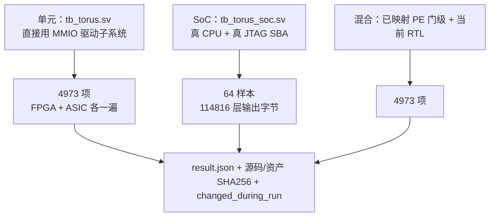

`tb_torus` 的覆盖重点（选摘）：

| 类别 | 覆盖 |
|---|---|
| PE 方向/寄存器 | 4 方向 × 4 寄存器 × 双操作数独立 × 4 行 mask × 环绕 |
| 多精度算术 | INT8/16/32 乘、MAC、MULH、MULHR、64 组随机 MULHR、全部移位量、正反旋转、ties |
| 位计数 | CLZ/CTZ/POPCNT 对 0、1、`0xffffffff`、`0x80000000`、随机值 |
| 持续吞吐 | 连续 64 拍每拍接受一条命令，结果 = 64 |
| shape/stride | 三层外部 shape、负/零 stride、寄存器游标步进、循环模式 |
| 映射方式 | ROW/COL 广播、FULL、FULL 转置、8/16/32bit 打包、符号扩展、PE 起点环绕 |
| cache | 同 bank 冲突收集、同 word 广播、热命中零 SRAM 读、精确失效保留其他行 |
| 流水 | 预取不进 RF、COMMIT 用记录的目标、末项不越界、bundle 同沿旧值 |
| 依赖 | store 读锁阻塞覆盖、邻居 RAW 阻塞、load WAW 阻塞、独立寄存器运算可重叠 |
| 错误 | 非法读源/opcode、部分字节命令、越界、非对齐、未 ARM/ended、FULL 预取被拒 |
| 健壮性 | 被阻塞的配置写不饿死直接 COMMIT（防死锁）、越界字段不别名到低 SRAM、游标溢出粘性 |

`tb_torus_soc` 的覆盖：真实 SBA 装载 CPU/参数/输入 → `halt`/`resume` → 并发无关 SBA 写读 → 逐样本启动 → 逐字节检查所有层写回 → 最终 SRAM 结果 + CPU argmax → 可选逐层快照 → 三次 `mcycle` 读事件交叉校验 → 严格周期上限 → overlap/config 计数断言。

### 11.2 结果

| 项 | FPGA BRAM 后端 | ASIC 功能后端 |
|---|---|---|
| 单元定向检查 | 4973 | 4973 |
| 64 样本推理 | 20233–20237 周期 | 同左 |
| 层输出字节 | 114816 全部一致 | 同左 |
| 六层 SRAM 快照（SBA 读回） | — | 通过，34686 周期（含快照复制） |
| CPU 连续命令峰值 | 64/64 | 同左 |
| JTAG/SBA + halt/resume + 别名 | 通过 | 通过 |
| 混合门级 PE + RTL | 4973 | 不作全 SoC 门级结论 |

golden 独立于硬件：用原始模型参数、原始逐项减零点、原始 `M` 与 `shift=31` 重新计算；与记录的 PyTorch 最终输出最大差 1 code（`[68,50,82,...]` vs `[68,49,82,...]`，argmax 相同）。本次没有重跑 PyTorch，也不构成完整 MNIST 准确率评估。

所有最终运行的 `changed_during_run` 为空，`result.json` 记录 98 个 RTL 输入与资产 SHA256。

### 11.3 计时口径

- `cycles`：固件读 `mcycle` 到写完成字，**含**六层、全部写回、CPU argmax；**不含** JTAG 上传、启动自检、完成报告；
- 测试台根据 CPU 三次实际 `mcycle` CSR 读事件独立计时钟，要求 `|observed − firmware| ≤ 2`；
- `--max-cycles 20300` 对两个数强制严格 `<`；
- 逐层快照的开销单独报告，不计入 20k 验收。

---

## 12. 物理实现状态

按 `docs/torus/validation.md` 记录的实测（TSMC180 TT、两块 SRAM 宏、20ns 系统时钟、2mm×2mm Die）：

| 对象 | Cell Area | 说明 |
|---|---:|---|
| 完整芯片（含 SRAM） | 3.320404 mm² | 相对 64-word 旧版 4.479290 mm² 减 25.87% |
| 标准单元 | 2.517517 mm² | — |
| 两个 SRAM 宏 | 0.802887 mm² | 固定 |
| PE 阵列 | 1.526582 mm² | 减约 28.4% |
| 流单元 | 0.568221 mm² | 减约 48.3% |
| 50MHz 映射 setup slack | +0.0203 ns | TNS = 0，裕量很薄 |

**布局没有通过**：core utilization 报 108.8%，placement 因 `IMPSP-190` 被拒（标准单元需求 2469075 µm² vs 可分配 2018759 µm²，利用率 122.3%），因此**没有 CTS、没有布线、没有布线后时序**。

必须明确的口径（AGENTS.md 要求）：

- 上面的数字是**综合/映射估计**与真实 floorplan 容量检查，不是签核结果；
- 不把它当作"物理 ASIC 频率"、"功耗"或"可制造性"结论；
- ASIC 仿真关闭了宏的 timing check，只证明功能；
- 2mm×2mm 装不下当前设计，下一步应先减面积再谈时序。

---

## 13. 已知限制与后续工作

### 13.1 限制

| # | 限制 | 影响 |
|---:|---|---|
| 1 | 无法装入 2mm×2mm（利用率 122.3%） | 未进入 CTS/route，无布线后时序与功耗 |
| 2 | 没有 torus 版本的实板记录 | `fpga/ego1/` 的 bitstream 仍属于旧 4-lane 架构；torus 只在功能模型层验证 |
| 3 | 保守记分板 | MAC 反压 3049 周期（15%） |
| 4 | 无跨层融合 | 每层都写回 SRAM |
| 5 | 无 4 路 INT8 SIMD | 每 PE 每命令 1 标量运算 |
| 6 | 单核发令 | 性能上限 ≈ CPU 指令发射率 |
| 7 | 邻居链路未用于卷积 | torus 互联未产生实测收益 |
| 8 | 静态编译器只适配本仓库 6 层 PACK4 模型 | 其他模型必须走 `--dynamic` 或扩编译器 |
| 9 | 延迟模式限制 | 每口一个上下文、不支持 FULL、不支持 store |
| 10 | `qmax=127` 仅为当前描述符 | 换数据分布须重做精度评估 |
| 11 | 无精确事务回滚 | 出错后已完成的 lane/tile 保留 |
| 12 | `NPU_GRID_TOPOLOGY` 仅为流程占位 | 在 torus RTL 中不驱动任何逻辑 |
| 13 | **BASEPAIR 缺少显式反压**（代码阅读发现，回归通过） | 见下 |

第 13 条展开：`can_issue` 对 opcode 53 走通用 `safe_alu` 分支，而 53 的位域与算术命令完全不同（`[25:13]` 是 base_a、`[12:0]` 是 base_b），因此依赖检查读的是无意义字段；同时 `shape_stream` 里 `if(pair_i && !busy_o)` 会**静默丢弃**忙时的 BASEPAIR。也就是说：若 CPU 在上一个 tile（尤其 store）尚未完成时就发 BASEPAIR，基址更新与 ARM 会一起丢失。

当前编译器在 store NEXT 与下一条 BASEPAIR 之间保留了约 10 条指令的距离（metadata 载入 + 掩码移位），使 store 通常已排空；`161 tile × 64 样本 × 2 后端` 全通过、周期完全可复现，说明时序上恰好安全。但这是**隐式时序假设**而非协议保证：一旦改变命令序列密度、cache 大小或 SRAM 争用，就可能出现难以复现的错算。建议的修法是把 53、61 的接受条件显式改成 `!busy`（或在 `pair_i/arm_i` 上返回反压而不是丢弃）。

### 13.2 建议的后续顺序

1. **面积**：这是硬阻塞。可选方向：PE 阵列互连从全交叉改为按行/列共享（省 4 方向 4 寄存器多路）、流单元只保留 2 个上下文、cache 降到 16 word/口（实测 16 word 也通过 4973 项）。
2. **实板验证**：把 torus 接入 `fpga/ego1/`，先在 VIO 自运行模式下复现 20233 周期，再走 FT232H/OpenOCD 的 Lab6 链路。
3. **按行细分锁**：把 `read_locks/write_locks` 扩成 4×4，预计能吃掉大部分 3049 周期的 MAC 反压。
4. **torus 邻居归约**：用环移把 FC 的 144 项在 4 行间分摊，同时给邻居链路一个真实的性能论据。
5. **动态编译器**：让 `main.c` 路径成为一等公民，摆脱"只适配本模型"的限制。

---

## 14. 复现

```bash
cd /home/s2400012841/chip-fullstack-2026/mynpu-torus

# 构建：CPU 程序 + 唯一参数像 + C 输入 + 逐层整数 golden
python3 tools/build_torus.py --out build/torus/area-v4-full --vectors 64 \
  --corpus tests/torus/mnist_vectors_full.json --cache-words 32

# 单元回归（两个存储后端）
python3 tools/run_torus.py --memory fpga --suite unit --cache-words 32 --tag area-v4-final64
python3 tools/run_torus.py --memory asic --suite unit --cache-words 32 --tag area-v4-final64

# 完整 SoC 回归（真 CPU + JTAG SBA），严格 < 20300 周期
python3 tools/run_torus.py --memory fpga --suite soc --assets build/torus/area-v4-full \
  --cache-words 32 --max-cycles 20300 --tag area-v4-final64
python3 tools/run_torus.py --memory asic --suite soc --assets build/torus/area-v4-full \
  --cache-words 32 --max-cycles 20300 --tag area-v4-final64

# 逐层快照（ASIC，快照复制开销单独计）
python3 tools/build_torus.py --out build/torus/one --vectors 1
python3 tools/run_torus.py --memory asic --suite soc --assets build/torus/one \
  --cache-words 32 --tap-all --tag snapshot

# 旧版运行时调度器对照
python3 tools/build_torus.py --out build/torus/dynamic-one --vectors 1 --dynamic
python3 tools/run_torus.py --memory fpga --suite soc --assets build/torus/dynamic-one \
  --cache-words 32 --tag dynamic-one
```

ASIC 需要服务器上的私有宏模型（`--macro-model`），仓库不含该文件。所有产物在 `build/torus/`，每个回归目录有 `compile.log`、`run.log`、`inputs.json`（源码/资产哈希）、`result.json`（通过状态、证据行、`changed_during_run`、scope 声明）。

成功标志是 `TORUS-PASS` / `TORUS-SOC-PASS` 出现在日志里，脚本同时校验该标志、`Fatal:` 不存在、运行期间源码未被修改——**不能只看模拟器退出码**。

---

## 附录 A：MMIO 寄存器

| 偏移 | 读 | 写 |
|---|---|---|
| `0x000` | ID `0x544f5204` | — |
| `0x004` | `{ready[11:8], ended[7:4], 2'b0, error[1], busy[0]}` | — |
| `0x008` | 已接受命令数 `command_count` | — |
| `0x00c` | 流 busy 周期数 | — |
| `0x010` | 0 | bit0=1 清错 |
| `0x014` | 能力 `0x04041020`（4 寄存器 / 4 行 / 16 PE / 32bit） | — |
| `0x018` | 活动预取期间接受的非零行 mask 运算命令数 | — |
| `0x01c` | 被接受的描述符字段写次数（BASEPAIR 计 2） | — |
| `0x024` | BASEPAIR 配置 `{ARM[9:6],bankB[5],bankA[4],ctxB[3:2],ctxA[1:0]}` | 同左 |
| `0x028` | 位宽能力 `0x10100e10`（cursor16 / addr14 / stride16 / shape16） | — |
| `0x100+PE*16+R*4` | 该 PE 的 R0–R3 | 写该寄存器（支持字节使能） |
| `0x400+ctx*0x100+word*4` | 13 word 描述符（地址/stride 符号扩展，shape 零扩展） | 写描述符字段（busy 时反压） |
| `0xffc` | 0 | 32bit 命令（要求全字节使能） |

## 附录 B：`torus.h` 使用示例

```c
#include "sw/torus/torus.h"

// 每个 PE 从西邻居 R2 与北邻居 R3 取值相加写自己的 R1，四行全开
TOR_EMIT(TOR_CMD(TOR_ADD, 1, TOR_SRC(TOR_W,2), TOR_SRC(TOR_N,3), 15));

// 只开第 0、2 行：每个使能 PE 把自身 R1 加 7 写 R0
TOR_EMIT(TOR_IMM(TOR_ADD, 0, TOR_SRC(TOR_LOCAL,1), 7, 5));

// 稳态 bundle：R2*R3 累加到 R0，同沿提交下一组 R2/R3，并预取再下一组
TOR_EMIT(TOR_BUNDLE(TOR_MAC9X8, 0, TOR_SRC(TOR_LOCAL,2),
                    TOR_SRC(TOR_LOCAL,3), 15, 4, 15, 1));

// 通用描述符：ROW 广播、tile 4×4、外三维、寄存器游标步进
tor_desc(0, base, TOR_U8|TOR_ROW, 4, 4, stride, 0, 3, 3, ic, 1, iw, ih*iw, 2, 0);
TOR_EMIT(TOR_IO(TOR_ARM, 1, 0));
TOR_EMIT(TOR_IO(TOR_NEXT, 1, 15));
```

## 附录 C：术语

| 术语 | 含义 |
|---|---|
| context / 上下文 | 一组 13 word 描述符 + 游标 + 寄存器游标，共 4 组 |
| tile | 一次 NEXT 搬运的矩形块，最多 4×4 个 PE 位置 |
| group | FULL 映射下 tile 沿非 lane 维度的第 g 次迭代 |
| lane | 一次搬运中的 4 个并行数据通道，对应 tile 的一维 |
| deferred / 延迟模式 | PREFETCH/EXCHANGE/bundle 的"只进缓冲、显式提交"模式 |
| bundle | 一条命令同时编码算术 + 提交 + 启动预取 |
| bank-linear | 0..8191=bank0、8192..16383=bank1 的逻辑字节空间 |
| PACK4 | 每 4 个输出通道的权重按 term 打包成 4 个连续字节 |
| golden | 独立于 RTL 的整数参考模型输出 |
