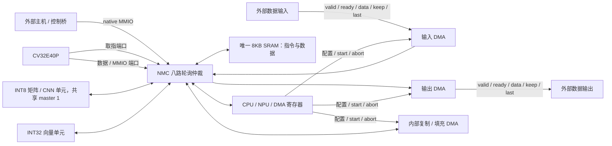

# NMC NPU v5：128B 寄存器缓存、Tiny MNIST 多图片流水

新增 packed INT8 CNN/FC 单元，已运行 external 中 stride=2 分支的 Tiny MNIST checkpoint。部署、数值与仿真说明见 [mnist/README.md](mnist/README.md)。

ASIC 为最终实现目标，FPGA 使用 Vivado 2025.2 / `xc7a35tcsg324-1` 验证。
`rtl/npu_core.sv` 是不含存储器实例的 ASIC 核心；`rtl/npu_soc.sv` 是接入 external 8KB SRAM 模型的 FPGA/仿真顶层。
**指令、完整参数和张量存放在唯一的 2048×32 位 SRAM；新增 128B 数据工作集的寄存器缓存及写回队列，没有新增 SRAM 宏或指令 ROM。**



## 设计边界和 external 复用

复用 `external/lab3-ST/SoC_cv32e40p/cpu_cv32e40p` 的 CV32E40P，FPU/PULP 扩展关闭。
FPGA/行为仿真复用 `soc/rtl/mem/sram_ff.sv`，参数为 11 位字地址、32 位数据、4 位字节写使能、同步读、read-first。
原始 external 文件与 ZIP 保持不变。实验附带的 NPU 空壳未纳入构建。

八个 NMC 访问方：0=CPU 数据，1=矩阵，2=向量，3=外部控制 host，4=CPU 取指，5=输入 DMA，6=输出 DMA，7=复制/填充 DMA。
最多每周期接收一个事务，grant 后轮询指针移向下一方。八方持续请求时，每方每八周期获准一次。
读写均在接受后的周期响应，响应返回对应访问方，支持逐周期连续接受。CPU 取指没有独立存储路径。

每个 DMA 只增加一个 32 位数据暂存寄存器、地址/长度/状态寄存器；没有深度 FIFO。
MMIO 寄存器和 CPU 原有寄存器、取指缓冲不属于新增 SRAM。程序不通过 `$readmemh` 初始化硬件 SRAM。
`boot.hex` 仅用作外部加载器/测试平台的数据源，只加入 Vivado 仿真文件集。

## 外部搬运与无 ROM 启动

复位后 MMIO 可用，但 CPU 始终保持复位。主机控制通路独立于 CPU，因此不需要先执行片上引导程序。

1. 外部主机保持 `CPU_CONTROL=0`，配置输入 DMA：DST=`0x80000000`，ROW_BYTES=程序字节数，ROWS=1，MODE=0。
2. 主机写 RX_CONTROL.start，随后通过输入流送入程序；有 ready 才提交一个 beat。
3. 等待 RX_STATUS.done 且 error=0，检查 BYTES_DONE。需要时使用输出 DMA 回读校验。
4. 主机写 CPU_BOOT_ADDR，默认入口 `0x80000080`，再写 CPU_CONTROL=1；`cpu_run_i` 应置 1。
5. CPU 从 SRAM 取指，使用 MMIO 启动 NPU/DMA，轮询或中断获知完成。

`sw/load_program.py` 将 `boot.hex` 转换为 `sw/boot_transfer.json`，列出主机寄存器写、输入流 beat、完成检查与 CPU 释放步骤。
这是与物理传输协议无关的操作序列，需要外部控制/流接口桥执行。当前 RTL 提供 native 控制和流数据接口；
AXI、PCIe、USB、SPI、UART 等实际外部协议通过桥接器接入，当前没有这些物理协议的 RTL 实现。

CPU_CONTROL 写 0 会仅复位 CPU，SRAM、DMA 和计算单元继续工作。重新加载程序前，应停止 CPU，并确认其他单元不会访问被覆盖的区域。
改变 CPU_BOOT_ADDR 只允许在 CPU 保持复位时，地址必须在 SRAM 内且按字对齐。
重新运行自检时先将 TEST_RESULT 清零。外部 `cpu_run_i` 控制首次取指使能；CV32E40P 的 fetch_enable 是 sticky，停止运行使用 CPU_CONTROL。

## 三个独立 DMA 通道

| 通道 | MMIO 基偏移 | 方向/模式 |
|---|---|---|
| RX | `0x300` | MODE=0，外部输入流 → SRAM |
| TX | `0x400` | MODE=1，SRAM → 外部输出流 |
| MEM | `0x500` | MODE=2，SRAM → SRAM；MODE=3，32 位图案填充 |

三个通道可以独立并发，也可以与 CPU、矩阵、向量同时工作。每个通道支持：

- 1D 连续传输、2D 行搬运、独立源/目的行步长。
- 字节长度 `ROW_BYTES=1..8192`，行数 `ROWS=1..2048`；所有实际 SRAM 访问必须落在 8KB 内。
- 1..3 字节尾部写使能，保持最后一个字中不属于任务的字节。
- 源 stride=0 的重复行读取/广播，MEM 填充重复 32 位图案。
- done/error、中止、可关闭的周期超时、已完成字节和周期计数。
- 描述符地址/范围/步长校验，忙时保护，流 keep/last 格式校验。

源/目的起始地址及行步长必须按 4 字节对齐。非零 stride 在多行任务中必须至少为 ROW_BYTES 向上取整到 4 的长度，
因此当前不支持部分重叠的行；源 stride=0 允许广播，目的 stride 在多行任务中不能为 0。
MEM_COPY 源/目的包络范围不得重叠，完全同址且同 stride 的原位复制允许。当前不提供 memmove、任意非对齐地址搬运或硬件 scatter-gather 链。
不连续块可由 CPU/外部主机按描述符序列逐项启动，后续硬件链式取描述符也可从同一 SRAM 读取。

二维第 r 行地址为 `SRC + r*SRC_STRIDE`、`DST + r*DST_STRIDE`；有效数据字节总数为 `ROW_BYTES*ROWS`。
stride 是从行起始到下一行起始的距离，不是行末额外间隙。

### 流接口约定

RX/TX 均为同一 `clk_i` 下的 32 位 valid/ready 接口，数据按低字节到高字节排列。
每行最后一个 beat 的 keep 必须是 `0001/0011/0111/1111` 中的对应值；其余 beat 为 `1111`。
last 只在**整个任务最后一行最后一个 beat**置位，行尾不一定是任务尾。
输出在反压期间保持 valid/data/keep/last 稳定。RX 接收到不符合 keep/last 的 beat 后不写该 beat，置错误并发出 rx_abort。

软件 abort、超时或总线错误会终止当前任务；已完成前缀保留，没有回滚。
`dma_rx_abort_o` / `dma_tx_abort_o` 是一个周期的任务取消通知，流对端必须丢弃当前任务残余数据并重新同步。
abort/reset 会撤销尚未接受的输出 beat，这个带 abort 通知的接口不是未加扩展的 AXI-Stream 接口。
RX/COPY/FILL 的 BYTES_DONE 记录已确认写入 SRAM 的字节；TX 记录已被外部 ready 接受的字节。
如果在此前写入返回响应的同周期中止/超时，该已提交写入仍计入 BYTES_DONE。
不同物理时钟的外部接口需要在桥接器中完成 CDC；核心自身不提供跨时钟 FIFO。

无竞争、无外部停顿时，RX/TX 约每 3 周期完成一个 word，COPY 每 4 周期一个 word，FILL 每 2 周期一个 word。
NMC 单端口 SRAM 峰值仍是一周期一个 32 位字，所有取指、计算和搬运共同分享带宽。

## 地址与寄存器

| 地址区域 | 说明 |
|---|---|
| `0x80000000..0x80001fff` | 唯一 8KB SRAM，包含程序、数据、软件可选描述符 |
| `0x40000000..0x40000fff` | MMIO，仅 CPU 数据端和 host 可访问 |

没有 `0x00000000` 指令 ROM。示例程序预留 SRAM 前 2KB 为程序镜像，张量从 `0x80001000` 开始。
这只是软件分配，不是物理拆分或硬件访问保护。程序、栈和张量总量必须不超过 8KB，运行中不能覆盖正在取指的代码。

下表偏移相对 MMIO 基地址。

| 偏移 | 寄存器 | 说明 |
|---|---|---|
| `0x000` | ID | 只读 `0x4e505531` |
| `0x004` | TEST_RESULT | 自检成功 `0x600d0001`，失败 `0xbad00001` |
| `0x008` | CPU_CONTROL | bit0=释放 CPU 复位，默认 0 |
| `0x00c` | CPU_BOOT_ADDR | 默认 `0x80000080`，CPU 复位期间可写 |
| `0x100 / 200` | MAT/VEC_CONTROL | bit0=start，bit1=clear |
| `0x104 / 204` | MAT/VEC_STATUS | bit0=busy，bit1=done，bit2=error |
| `0x108 / 10c / 110` | MAT_A/B/D | 完整 SRAM 字节地址 |
| `0x114 / 118 / 11c` | MAT_M/N/K | 维度 1..16 |
| `0x120` | MAT_CYCLES | busy 周期计数 |
| `0x208 / 20c` | VEC_A/D | 输入/输出地址 |
| `0x210 / 214 / 218` | VEC_LEN/OP/B | 长度 1..1024，OP=0 ReLU / 1 Add，B 为 Add 输入 |
| `0x220` | VEC_CYCLES | busy 周期计数 |

每个 DMA 基偏移再加：

| 通道内偏移 | 寄存器 | 说明 |
|---|---|---|
| `+0x00` | CONTROL | bit0=start，bit1=clear，bit2=abort，自清零 |
| `+0x04` | STATUS | bit0=busy，bit1=done，bit2=error |
| `+0x08 / 0c` | SRC / DST | 完整 SRAM 地址；未使用的方向字段忽略 |
| `+0x10 / 14` | ROW_BYTES / ROWS | 每行字节数、行数 |
| `+0x18 / 1c` | SRC_STRIDE / DST_STRIDE | 行起始字节步长 |
| `+0x20` | MODE | RX=0、TX=1、MEM=2 copy / 3 fill |
| `+0x24` | FILL | 填充图案 |
| `+0x28 / 2c` | BYTES_DONE / CYCLES | 只读，最近任务的进度与周期 |
| `+0x30` | ERROR_CODE | 只读：0 无，1 描述符，2 忙时命令，3 流格式，4 总线，5 中止，6 超时 |
| `+0x34` | TIMEOUT | 0 禁用；非零为本任务 busy 总周期上限，包含外部停顿 |

新 start 清旧 done/error 并校验描述符。非法任务不访问 SRAM。忙时改描述符返回 host_error，置 command error；正在执行的任务继续。
忙时 start/clear 也置 command error；abort 终止该通道。done/error 保持到 clear、新 start 或全局复位。
BYTES_DONE/CYCLES 在 start 后重新计数，clear 只清状态。DMA timeout 使用通道自己的时钟周期计数。
矩阵、向量、RX、TX、MEM 的 done 分别对应 `irq_o[0..4]`，连接 CPU IRQ16..20；示例固件采用轮询。

矩阵按行优先计算 `D[M,N]=A[M,K]*B[K,N]`。A/B 为每个 32 位字低 8 位的有符号 INT8，D 为 INT32。
向量为 INT32 ReLU 或补码回绕加法；支持完全同址原位运算，禁止部分源/目的重叠。
跨 CPU、DMA、矩阵、向量的地址冲突和任务依赖由软件负责，NMC 只保证访问仲裁，不做缓存一致性或地址保护。
CPU 原生数据端没有 error 输入，非法 CPU 读返回 `0xdeadbeef`；host 有显式 error 响应。

## ASIC 接入

`npu_core` 不实例化 FPGA BRAM、SRAM 行为模型或其他内存，也不包含 `$readmemh`。
`build/asic_sources.f` 包含核心和原 CPU RTL，排除 `npu_soc` 及 SRAM 模型；顶层选择 `npu_core`。
外部唯一 SRAM 宏需满足单端口、2048×32、4 字节写使能、一周期读响应的接口契约：

| 核心信号 | 含义 |
|---|---|
| `sram_req_o` | 接收当前周期的读/写 |
| `sram_addr_o[10:0]` | 字地址 |
| `sram_wen_o[3:0]` | 高有效字节写使能，0 为读 |
| `sram_wdata_o[31:0]` | 写数据 |
| `sram_rdata_i[31:0]` | 请求上升沿后有效的读数据 |

宏的低有效 CEN/WEN/BWEN 可在技术 wrapper 中映射；若需 32 位位写使能，将每个字节使能复制 8 次并按宏的有效电平取反。
SRAM 不能反压；NMC 对合法请求的写响应默认为成功。若目标宏有 ECC 错误或不同读延迟，需要扩展 wrapper/NMC 响应路径。
复位取消在途任务，不清 SRAM；上电程序由外部 DMA 装载，不依赖 ASIC SRAM 初值。

`npu_clock_gate.sv` 默认是锁存器式时钟门控参考模型，行为测试使用这一 ASIC 路径。
定义 `NPU_ASIC_ICG` 时实例化 `npu_tech_icg`，需将其绑定到工艺库 ICG cell。
FPGA 构建定义 `NPU_FPGA_TEST`，时钟门控直通，避免 FPGA fabric gated clock。
目前完成通用 RTL 与 FPGA 验证；ASIC 面积/频率及后端收敛需在目标 PDK、SRAM 宏、时钟和复位约束下重新验证。

## 构建与测试

```bash
cd /home/zzh/vivado/projects/xc7a35t/npu
./scripts/simulate.sh          # ASIC 时钟门控参考路径 + 全 SoC、八路 NMC、DMA 取消边界测试
./scripts/build_vivado.sh      # FPGA 路径，综合/布局/布线及报告
./scripts/simulate_netlist.sh  # 同一测试集的 Vivado 综合后功能网表仿真
./scripts/simulate_mnist.sh    # 当前 Tiny MNIST 逐层仿真
./scripts/simulate_mnist_latency.sh
./scripts/simulate_mnist_stream.sh # 当前多图片连续流
./scripts/simulate_mnist_netlist.sh # 当前 CNN 综合网表仿真
python3 mnist/validate.py     # 当前 MNIST 证据与源文件哈希
python3 sw/load_program.py    # 生成外部 DMA 程序装载步骤
```

测试从外部 RX DMA 加载完整程序，TX DMA 回读 512 个字核对，再释放真实 CV32E40P。
CPU 从共享 SRAM 取指，执行矩阵、ReLU、Add 和二维内部复制 DMA，逐项核对后报告成功。
随后覆盖三 DMA 并发、计算/搬运/host 竞争、二维步长、广播、图案填充、尾部字节、反压、非法描述符、帧错误、busy 保护、超时、中止和复位。
独立 DMA 测试专门检查取消与已提交写响应同周期时的字节计数，以及总线故障。

项目入口为上级 `xc7a35t.xpr`，设计顶层 `npu_soc`，默认仿真顶层已设为 `tb_mnist_stream`。ASIC 顶层是 `npu_core`。
`sw/gen_boot.py` 生成实际 RV32I 自检程序，无需 RISC-V 工具链；`sw/npu.h` 包含 CPU MMIO/NPU/DMA API。
`reports/` 保存本次 DCP、网表、资源、时序和 DRC 报告，v1 的旧 ROM 方案报告隔离在 `reports/legacy_v1/`。
Vivado 在当前 Rocky Linux 环境导出网表头部有多行主机信息问题，网表仿真脚本只修复仿真副本的头部注释，HDL 电路保持原样。

FPGA 构建是 50MHz、IO 延迟 2ns 的 out-of-context 实现，实板仍需板级时钟、IO/电压约束和外部接口桥。
复位按异步有效、同步释放接入；当前 reset 路径作为 false path。FPGA 验证不等同于目标 ASIC 工艺时序。

## 历史 v2 验证结果（新增 CNN 之前）

| 项目 | 结果 |
|---|---|
| ASIC 核心 RTL 检查 | `npu_core`，通过；文件集不含 SRAM 模型或 FPGA wrapper |
| ASIC 门控参考路径行为仿真 | 1228 项检查、13230 次 host 事务通过 |
| FPGA 综合后功能网表 | 同一测试集全部通过；已核对仿真网表与最终导出 HDL 完全一致 |
| 八路 NMC 饱和测试 | 128 次连续接受和响应，每个端口 16 次获准 |
| 独立 DMA 控制测试 | 中止/超时与写响应同时发生、取消未获准写、总线故障均通过 |
| XC7A35T OOC 布局布线 | 50MHz 通过，WNS=+0.172ns、WHS=+0.131ns，TNS/THS=0 |
| LUT / FF | 8828 / 5120（42.44% / 12.31%） |
| DSP48 | 11 / 90 |
| 存储器原语 | **2×RAMB36、0×RAMB18，唯一 8KB SRAM** |

DRC 没有 Error/Critical Warning，仍有 SRAM 异步控制、DSP 流水线建议和板级配置电压未设置等 Warning。
当前建立时间余量较小，板级 wrapper/接口桥变化后需要重新实现；ASIC 的约束与工艺库也须独立验证。
历史证据保存于 `reports/legacy_v2/validation.json`，其资源和时序数字不适用于新增 CNN 的版本。当前 Tiny MNIST 证据见 `mnist/README.md` 和 `reports/mnist_validation.json`。


## 可选 NoC 相同节点试验

新增 `npu_noc_core`（ASIC 外接 SRAM 宏）和 `npu_noc_soc`（FPGA 唯一 SRAM wrapper）。所有节点硬件相同，以启动配置提供坐标、有效方向和 DDR 服务接入；每个节点都有同样的 DDR 桥接口。五端口 XY 路由、请求/响应独立队列、分包网络 DMA、远端写确认和 CPU IRQ21 已在 2×2 mesh 中验证，包含通过网络启动 Tiny MNIST。原 `npu_soc` 默认关闭 NoC，原算法和 DMA 接口保留。

协议、配置、错误恢复、逻辑链路与物理 IP 的边界见 [noc/README.md](noc/README.md)。Vivado 新项目为 `noc/vivado/noc_node.xpr`，资源和时序报告放在 `reports/noc/`，不覆盖原模型报告。
