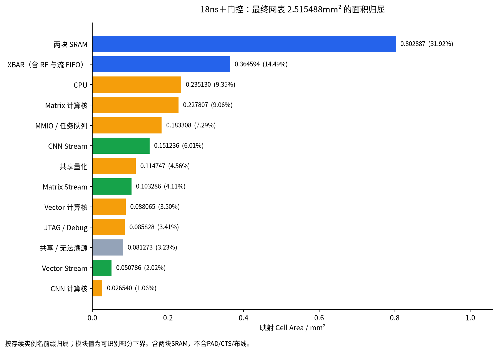
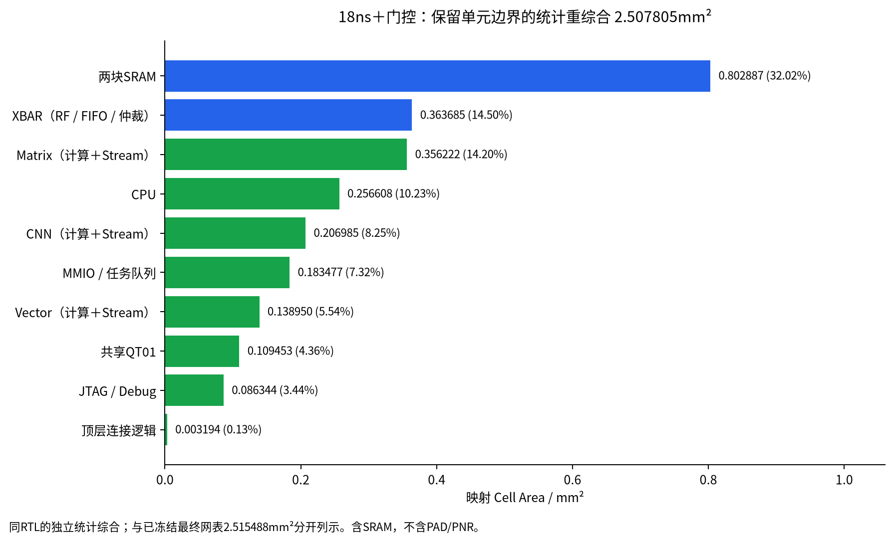
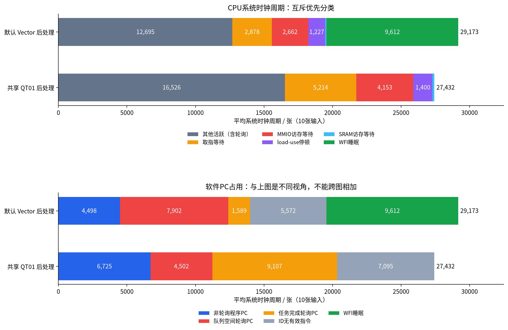
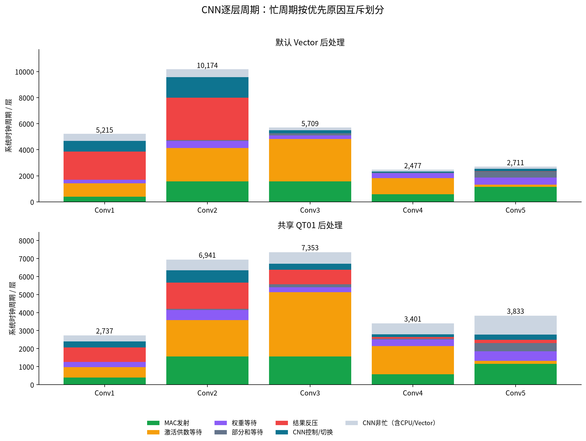

# 18ns＋门控：面积与软件周期分布

本报告以最终映射网表 **2.515488mm²**、50MHz setup slack **+2.0040ns** 为面积基准。包含两块8KB SRAM，不含PAD、CTS、布线和放置留白；未重跑PNR。RTL与该网表冻结输入一致。软件统计是同RTL、真实SRAM宏模型仿真，两条路径各10张MNIST，硬件与固件均未为本次统计改动。

## 最终网表面积

Genus high effort已展开部分RTL层级，原hierarchical report里0.726376mm²的“Top/core glue”含大量计算逻辑，不能当作纯胶合。这里从最终optimized.db逐一导出68,614个leaf cell的工艺库面积；按存续的来源实例名前缀归属 **96.77%**，其余 **3.23%** 单列。各模块值是可识别部分的下界，不把跨模块合并后丢失前缀的单元强行归属。所有行不重叠，总和与最终Genus报告一致。

| 归属 | mm² | 总面积占比 |
|---|---:|---:|
| 两块SRAM | 0.802887 | 31.92% |
| XBAR（含RF、流FIFO） | 0.364594 | 14.49% |
| CPU | 0.235130 | 9.35% |
| Matrix计算 | 0.227807 | 9.06% |
| MMIO / 任务队列 | 0.183308 | 7.29% |
| CNN Stream | 0.151236 | 6.01% |
| 共享QT01 | 0.114747 | 4.56% |
| Matrix Stream | 0.103286 | 4.11% |
| Vector计算 | 0.088065 | 3.50% |
| JTAG / Debug | 0.085828 | 3.41% |
| 共享 / 无法溯源 | 0.081273 | 3.23% |
| Vector Stream | 0.050786 | 2.02% |
| CNN计算 | 0.026540 | 1.06% |

XBAR可归属的0.364594mm²中：RF为0.182821mm²、流FIFO为0.144308mm²、仲裁与响应为0.037465mm²。前两者合计89.72%，不能把XBAR面积全部归因于仲裁。这里RF是软件管理的256B寄存器存储，没有透明SRAM读缓存。



## 保留模块边界的18ns＋门控对照

同样的RTL、工艺库、RF与8/8/8队列，另做high effort全量18ns综合并保留计算单元/CPU/Stream边界，得到 **2.507805mm²**，50MHz setup slack **+2.0021ns**，全部clock/门控使能组TNS为0。CNN、六方向连接和CPU共享量化MNIST三个零延迟门级smoke通过。它是独立网表，综合路径和跨边界优化空间不同，比前述最终网表少0.007683mm²（约0.31%），两次面积不混加。

| 统计版模块（含完整保留边界） | mm² | 该版总面积占比 |
|---|---:|---:|
| 两块SRAM | 0.802887 | 32.02% |
| XBAR（含RF/FIFO） | 0.363685 | 14.50% |
| Matrix计算＋Stream | 0.356222 | 14.20% |
| CPU | 0.256608 | 10.23% |
| CNN计算＋Stream | 0.206985 | 8.25% |
| MMIO / 任务队列 | 0.183477 | 7.32% |
| Vector计算＋Stream | 0.138950 | 5.54% |
| 共享QT01 | 0.109453 | 4.36% |
| JTAG / Debug | 0.086344 | 3.44% |
| 顶层连接逻辑 | 0.003194 | 0.13% |

计算和供数拆分：Matrix为 **0.252384＋0.103837mm²**；CNN为 **0.048086＋0.158900mm²**；Vector为 **0.087692＋0.051258mm²**。可见CNN的大头是Stream，不是9路MAC本身。

这版XBAR的RF为0.181936mm²、流FIFO为0.144124mm²、仲裁/响应为0.037626mm²；RF与流FIFO合计89.65%。



[统计版原始面积报告](/home/s2400012841/chip-fullstack-2026/eda-runs/20261107-area25-profile-hier/reports/area.rpt)、[时序报告](/home/s2400012841/chip-fullstack-2026/eda-runs/20261107-area25-profile-hier/reports/qor.rpt)。


## CPU周期：互斥划分

每个推理周期只进入以下一项。优先顺序为reset/boot、WFI、LSU等待、取指等待、load-use、jump、其他流水线停顿、其他活跃。表中为每张平均值；这些主计数在10张图之间相同。LSU按当前或最近被接受的访问地址分类。“其他活跃”包含正常发射、轮询和控制气泡，不等于有用NPU运算。

| CPU状态 | 共享QT01 周期 | 占27,432拍 | 默认Vector 周期 |
|---|---:|---:|---:|
| 其他活跃（含轮询） | 16,526 | 60.24% | 12,695 |
| 取指等待 | 5,214 | 19.01% | 2,878 |
| MMIO访存等待 | 4,153 | 15.14% | 2,662 |
| load-use停顿 | 1,400 | 5.10% | 1,227 |
| SRAM数据访存等待 | 136 | 0.50% | 99 |
| WFI睡眠 | 3 | 0.01% | 9,612 |

RF/FIFO数据等待、reset/boot、jump及其他流水线停顿在这两次测量中均为0。这里只统计system clock的周期状态，不是每一棵门控时钟的实际翻转次数或功耗。

## 软件PC占用：另一种互斥划分

轮询范围由实际boot.bin中的后向分支与boot.S标签共同确定，只统计真实循环，不把循环后到下一个label之间的配置代码也算作轮询。仅当ID有有效指令时按其PC归属；ID无有效指令、WFI和reset另列。该表与上一张CPU状态表是同一段时间的两个视角，不能跨表相加。

| 软件PC分类 | 共享QT01 周期/张 | 占比 | 默认Vector 周期/张 |
|---|---:|---:|---:|
| 队列空间轮询 | 4,502 | 16.41% | 7,902 |
| 任务完成轮询 | 9,107 | 33.20% | 1,589 |
| 非轮询程序PC | 6,725 | 24.52% | 4,498 |
| ID无有效指令 | 7,095 | 25.86% | 5,572 |
| WFI睡眠 | 3 | 0.01% | 9,612 |
| 外部ACK轮询 | 0 | 0.00% | 0 |

共享QT01路径的两类轮询合计13,609拍（49.61%）。这是PC所在循环的占用时间，已经包含其中的访存/流水线等待，不能再加5,214拍取指等待或4,153拍MMIO等待。两条路径均无外部逐层ACK等待。



## 各层与计算单元等待

| 层 | 共享QT01总周期 | 默认Vector总周期 |
|---|---:|---:|
| Conv1 | 2,737 | 5,215 |
| Conv2 | 6,941 | 10,174 |
| Conv3 | 7,353 | 5,709 |
| Conv4 | 3,401 | 2,477 |
| Conv5 | 3,833 | 2,711 |
| FC / GEMM及后处理 | 3,028 | 2,748 |
| 最终分类 / 收尾 | 139 | 139 |

共享QT01路径下，CNN忙21,032拍、Matrix忙1,959拍、所有计算单元均非忙4,441拍，三者在当前软件调度下不重叠，总和27,432拍。“所有计算单元非忙”包含CPU配置、收尾及单元协议间隙，不能全部称为CPU阻塞。Vector在该路径没有任务；默认路径中CNN与Vector重叠24,570拍，不能将两个单元的busy时间相加。

| CNN忙周期原因（共享QT01，互斥） | 周期 | CNN忙周期占比 |
|---|---:|---:|
| 激活供数等待 | 7,910 | 37.61% |
| MAC发射 | 5,256 | 24.99% |
| 结果反压 | 3,362 | 15.99% |
| 权重等待 | 2,008 | 9.55% |
| 控制 / 切换 | 1,776 | 8.44% |
| 部分和等待 | 720 | 3.42% |



Matrix忙周期中，WAIT_WORDS为900拍（45.94%），FETCH为612拍（31.24%，其中实际乘加握手432步），其余为clear、seed读、emit和写回。普通请求grant拒绝计数为0，仍然存在多周期取数与供数协议开销；“没有仲裁拒绝”不等于“没有访存瓶颈”。

## 总线事件与主要瓶颈

下面是事件计数，彼此以及与上面的CPU/计算单元周期有重叠，不能叠加为总延迟。

| 事件 | 共享QT01 | 默认Vector |
|---|---:|---:|
| CPU取指请求未获grant | 7,626 | 4,471 |
| CPU数据请求未获grant | 326 | 376 |
| CNN普通SRAM请求未获grant | 4,554 | 3,230 |
| 上述等待时同bank正被CPU取指接受 | 4,424 | 2,921 |
| 上述等待时同bank正被CPU数据接受 | 130 | 148 |
| CNN流FIFO请求未获grant | 0 | 7,088 |
| CNN独立RF写口等待 | 56 | 81 |
| Vector普通请求未获grant | 0 | 2,915 |
| Matrix普通请求未获grant | 0 | 0 |
| QT01非空闲 | 3,918 | 0 |
| QT01输出有效但下游未就绪 | 330 | 0 |

共享QT01路径下，CNN的4,554拍SRAM请求等待中，4,424拍（97.15%）同bank正被CPU取指接受，另130拍被CPU数据接受。这是直接观测到的bank竞争；由于取指/数据请求、预取和计算互相重叠，不能直接宣称去掉轮询就能节约4,424拍。需要修改固件后的对照推理来验证净收益。

优先优化方向是：降低共享QT01路径的完成轮询频率，利用完成中断/WFI；减少CPU逐任务配置与状态读取；再考虑代码与活跃张量的bank分配、CNN供数流水和量化结果通路。默认Vector路径主要还受通用后处理程序吞吐与FIFO反压约束；共享QT01路径更偏向CPU轮询竞争和激活供数。当前数据不能证明继续增加算术单元就会明显提速。

## 复现与证据

[面积JSON](../reports/area18_distribution.json)、[周期JSON](../reports/area18_blocking_profile.json)。周期JSON包含10张图的逐样本计数、均值/范围、逐层明细与PC循环地址范围。面积导出与累计均核对原optimized.db、网表、SDC和源码哈希。

本轮新增外部观察testbench，未修改DUT。原profile中的matrix_req_stall端口曾误用CNN master1，新观察器改用Matrix master5；原vector_input_wait未递增，因此不拿它作为零等待的证据。

```bash
NPU_AREA_RUN=/absolute/final-run genus -no_gui -batch -files npu/eda/tsmc180/export_leaf_area.tcl
python3.12 npu/eda/tsmc180/collect_area18_distribution.py --run /absolute/final-run --hier-run /absolute/hierarchy-run
python3.12 npu/scripts/run_vcs.py --suite blocking --macro --tag area18_final_quant --artifacts-dir npu/build/outer-artifacts
python3.12 npu/scripts/run_vcs.py --suite blocking --macro --tag area18_final_default --artifacts-dir npu/mnist/artifacts
python3.12 npu/scripts/collect_blocking_profile.py
/tmp/mynpu-ppt-env/bin/python npu/eda/tsmc180/draw_area18_profile.py
```

保留层级版可用 `prepare_run.py --effort high --clock-gating --synth-period 18 --preserve-unit-boundaries` 准备，然后在生成目录执行Genus。
