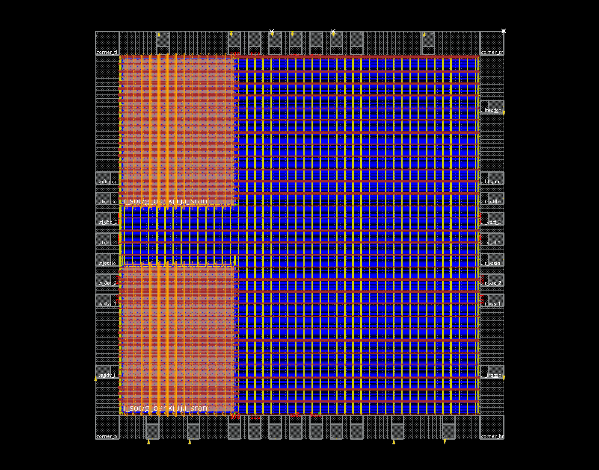
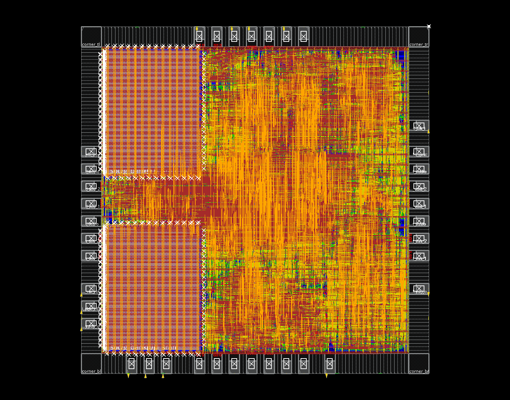
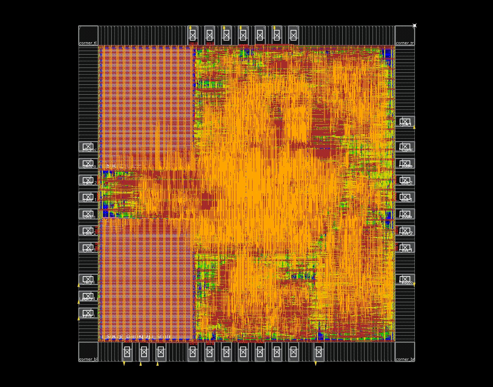

# 4/4/4 队列完整芯片布局布线

2026-11-08，按当前源码完成九信号 PAD 的 2mm × 2mm 完整芯片流程：封装顶层综合、floorplan、供电、PAD 调整、placement、CTS、hold 修复、详细布线、最终 ECO 与版图导出。

配置为 Matrix/Vector/CNN 任务 FIFO 各 4，RF 256B，数据流 FIFO 各 8 words，两块 RA1SHD_2048x32M8（总计16KB）。保持当前软件与 RTL；系统时钟 20ns / 50MHz，JTAG 100ns / 10MHz。

| 项目 | 最终结果 |
|---|---:|
| 含 PAD die | 2mm × 2mm = 4mm² |
| 核心综合 mapped cell area，含 SRAM | 2.569744mm² |
| 布线后标准单元，含时钟/缓冲等、不含 filler | 1.835279mm² |
| 两块 SRAM 宏 | 0.802887mm² |
| 布线后核心非 filler 面积 | **2.638167mm²** |
| 核心 filler | 0.390127mm² |
| 原生 IO 单元几何并集 | 0.867100mm² |
| 最终 setup WNS / TNS | **+0.529ns / 0** |
| 最终 hold WNS / TNS | **+0.020ns / 0** |
| setup / hold 违例路径 | 0 / 0 |
| Innovus DRC / antenna | 0 / 0 |
| 核心 VDD/VSS 连接问题 | 0 |

因此当前版本能布进含 PAD 的 2×2mm²，但**后端实际核心非 filler 面积尚未低于 2.6mm²**，比目标高 0.038167mm²。综合面积和布线后面积不可混用。PAD 并集、核心 filler 与单元面积也不能简单相加作为 die 面积。

两块 SRAM 分别位于左下、左上角，信号引脚朝向核心。使用 9 个信号 PAD、28 个电源/地/POC PAD、4 个 corner、37 个 bond window。沿用原生 IO 环几何；PAD 分配优化的曼哈顿估计成本从 2,467,673.515 降至 1,626,856.165µm，此指标不是实际布线总长。

CTS 后最初有 188 条 hold 违例，修复至零；详细布线后重新出现 22 条 hold 违例和 2 处短路，最终 ECO 后均消除。最终 setup/hold 裕量来自提取布线寄生后的 STA，不是早期综合估计。

普通连接检查仍保留 `VDDPST: no routing`、`VSSPST: no routing` 两条提示。这两条属于相邻原生 IO 单元内部的供电轨；IO 几何审计通过，核心信号与 VDD/VSS 检查通过。机器报告保留保守的 whole-chip `physical_closure=false`，独立列出核心收敛结果；不能据此声称完成晶圆厂级供电、DRC/LVS、ESD 或 EM/IR 签核。当前只有 TT 单角、captable RC 结果。Placement 日志还保留两次 `IMPSP-9099`：约 12.07% 触发器被工具识别为 scan flop，但未定义 scan chain，可能影响布局/时序 QoR；本轮未实施 DFT 扫描链，不能声称 DFT 验证通过。最终 STA 和物理检查结果如上，阶段执行成功不代表日志没有 ERROR。

## 实际版图

以下均由 Innovus 恢复本次数据库截图，旁边的 `.source.json` 记录数据库与图像哈希。

Floorplan：



Placement：



最终布线：



## 文件与复现

本次运行目录：

`/home/s2400012841/chip-fullstack-2026/eda-runs/20261108-area26-all4-fullchip`

最终输出在 `mynpu/pnr/outputs/final/`：GDS、DEF、层次布线网表、flat LVS 网表、SDC、SPEF、SDF、LEF 均已生成。导出审计核对 GDS 引用完整、两块 SRAM、九个信号 PAD 和九个外部信号接口；不等于 foundry LVS。所有阶段日志、脚本快照和 SHA256 留在运行目录。

在项目根目录执行以下命令可运行同样的流程，新运行请换用新目录：

```bash
python3.12 npu/eda/tsmc180/prepare_chip.py \
  --core ../eda-runs/20261108-area26-all4 \
  --out ../eda-runs/NEW_FULLCHIP
python3.12 npu/eda/tsmc180/run_fullchip.py \
  --run ../eda-runs/NEW_FULLCHIP --macro-plan left --tag all4
```

GUI 查看最终版图：启动 Innovus，在 Tcl 控制台输入（需图形显示环境）：

```tcl
source /home/s2400012841/chip-fullstack-2026/eda-runs/20261108-area26-all4-fullchip/mynpu/pnr/checkpoints/14_exported.enc
fit
```

映射网表与最终布线网表分别通过九引脚 JTAG/SBA 功能测试，各 34 项检查，包括通过 JTAG 写入程序与数据后运行 MNIST。该测试为零延迟门级仿真，**没有回标 SDF**；时序依据上表的 STA。默认固件核心 MNIST 为 21,008 周期/图，此数不包含 JTAG 装载时间。

[本次完整机器报告](../reports/area26_all4_fullchip_validation.json)包含阶段执行、最终检查、STA、IO/导出审计、门级仿真及输出哈希。[此前综合与回归说明](area26-all4.md)保留面积优化对比。
