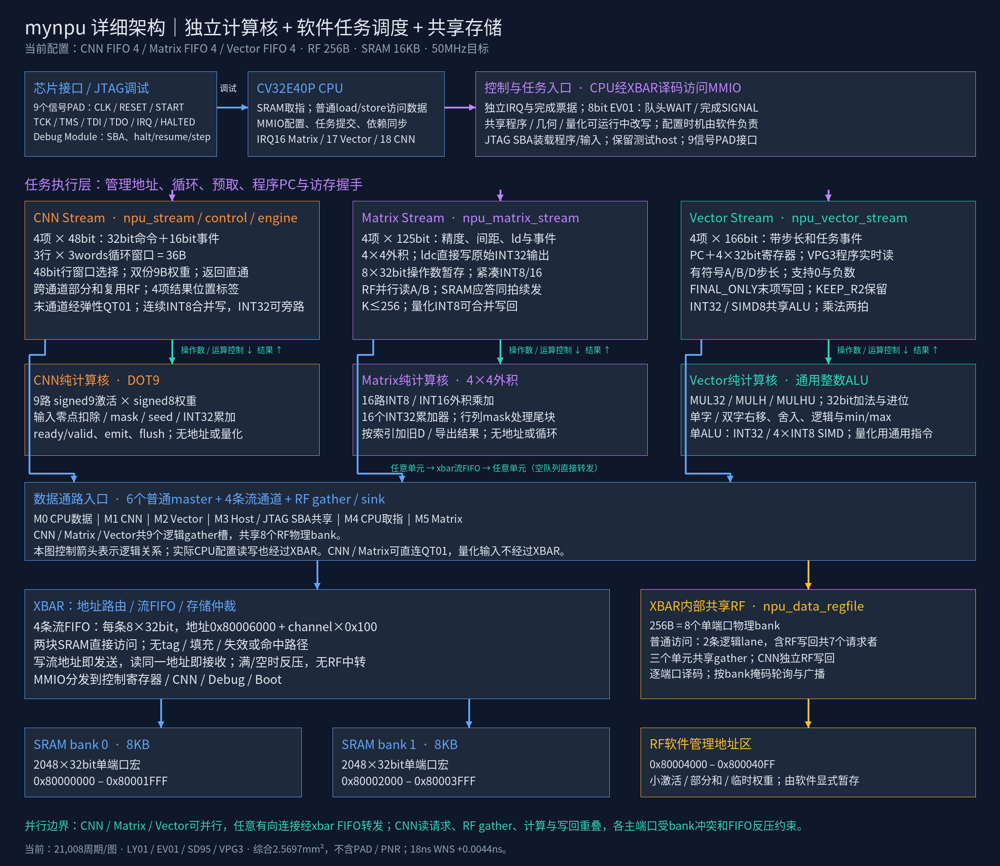

> 补充：本版本现已完成[完整含 PAD 布局布线](area26-all4-pnr.md)，后端实际核心非 filler 面积为 2.638167mm²。下文保留原综合阶段测量。

# 任务队列统一4项：面积低于2.6mm²

当前默认配置为 **Matrix / Vector / CNN = 4 / 4 / 4**，配置文件是 `npu/build_config.json`；对应RTL后备宏也统一为4。XBAR的四条数据流FIFO仍为每条8 words，RF仍为256B，两块SRAM合计16KB。

计算阵列、指令、精度、零/负步长、末项归约、KEEP_R2、Matrix ldc和8bit WAIT/SIGNAL均保留。每项任务载荷仍为Matrix125bit、Vector166bit、CNN48bit，待发任务名义存储从2712bit减为1356bit；active配置与CSR shadow保留。

## 实测面积与时序

Genus19.17、TSMC180 TT、18ns优化目标、20ns同网表报告、clock gating、high effort、保留功能单元边界。工艺库、约束、RF、数据流FIFO和计算规模与8项基线一致。

| 指标 | 8 / 8 / 8 | 4 / 4 / 4 |
|---|---:|---:|
| 总cell面积，含两块SRAM | 2.637060mm² | **2.569744mm²** |
| 标准单元面积 | 1.834173mm² | 1.766857mm² |
| 两块SRAM宏面积 | 0.802887mm² | 0.802887mm² |
| 18ns setup WNS | +0.0068ns | **+0.0044ns** |
| 20ns setup WNS | +2.0068ns | **+2.0044ns** |
| 各时钟组TNS | 0 | 0 |

面积减少0.067316mm²，约 **2.55%**，比2.6mm²目标低0.030256mm²。MMIO/任务队列层级从约0.2840降至0.2247mm²，CNN从约0.2411降至0.2303mm²，是主要收益。全局映射会使其他模块的单元选择略变，因此不能把每一项层级差异都解释成FIFO位数的精确面积。

这些是综合mapped cell area与综合setup STA，**不含PAD、CTS和布线开销，也不是新一轮PNR signoff**。完整综合目录：`../eda-runs/20261108-area26-all4`。

## 性能代价与验证

默认MNIST程序保持不变，10张均通过：

- 8项：20,728周期/张。
- 4项：**21,008周期/张**，增加280周期，约1.35%。
- 使用既有的可选队列IRQ等待程序：20,944周期/张；10张最终结果自检通过，未设为默认。

四类真实CPU小图仍分别为：GEMM→偏置→Sum 741周期、广播/反向/转置1,066周期、紧凑INT16 GEMM 801周期、CNN→Vector 726周期，与本轮基线相同。这些小图结果不代表所有未来负载都不受队列深度影响。

23类通用负载共1,302项数值检查通过，包含新加的128像素宽卷积行：8个16位置窗口通过4项队列分批提交，128个输出与尾部保护字均正确。其他回归覆盖逐层60个张量17,940字节、IRQ/WFI、JTAG、错误恢复、队列溢出/回绕、运行中配置、RF、FIFO和多精度运算。

映射网表通过MNIST一张、计算单元、LY01/EV01边界、JTAG四组测试，共113项检查；零延迟、无SDF、关闭宏timing check。

## 宽行C接口

旧的非阻塞 `npu_cnn_start()` 保留整行任务数不超过队列容量的约定。宽行或较浅队列改用：

```c
int rc = npu_cnn_start_wait(&row, queue_poll_budget);
```

该接口先验证整行缓冲，再等待队列空间、逐窗口提交，返回时表示整行已入队，计算可能尚未完成。`npu_cnn_layer()` 已调用此接口，最大行宽不因队列减小而缩小。超时返回-2，故障/参数错误返回-1；已经接受的任务不会回滚。共享配置的使用时机仍由软件负责。

新增C回归模拟4槽队列的背压，验证8窗口的顺序、超时、故障和别名拒绝；这是C提交语义测试。卷积算术由真实SoC的128像素宽行案例另行验证。

## 复现与结果位置

```sh
python3.12 npu/scripts/run_vcs.py --suite blocking --tag NEW_TAG --macro
python3.12 npu/scripts/run_vcs.py --suite workloads --tag NEW_TAG --macro
python3.12 npu/scripts/run_vcs.py --suite layoutevents --tag NEW_TAG --macro
cc -std=c11 -Wall -Wextra -Werror npu/tests/cnn_enqueue.c -o /tmp/cnn-enqueue
/tmp/cnn-enqueue
```

当前审计入口与报告：

```sh
python3.12 npu/scripts/collect_area26_all4.py --run ../eda-runs/20261108-area26-all4
```

- 汇总：`npu/reports/area26-all4-validation.json`。
- 面积分布：`../eda-runs/20261108-area26-all4/area_distribution.json`。
- 原始面积：该run下的`reports/area.rpt`。
- 18ns时序：`reports/optimized_synth_clock_qor.rpt`与`optimized_synth_clock_timing.rpt`。
- 20ns时序：`reports/qor.rpt`与`timing.rpt`。
- 最新run指针：`npu/build/latest-area-timing-run.txt`。

逻辑接口与字段详见[LY01/EV01](layout-events.md)。该页8项结果保留为历史基线，当前配置和面积以本页为准。


