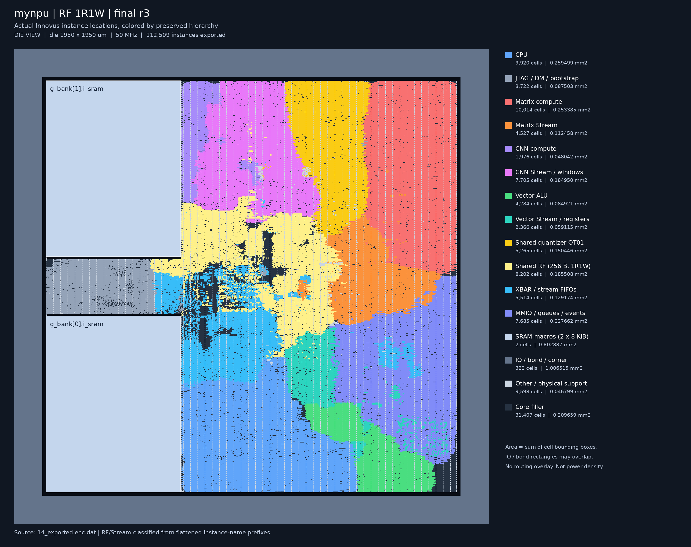
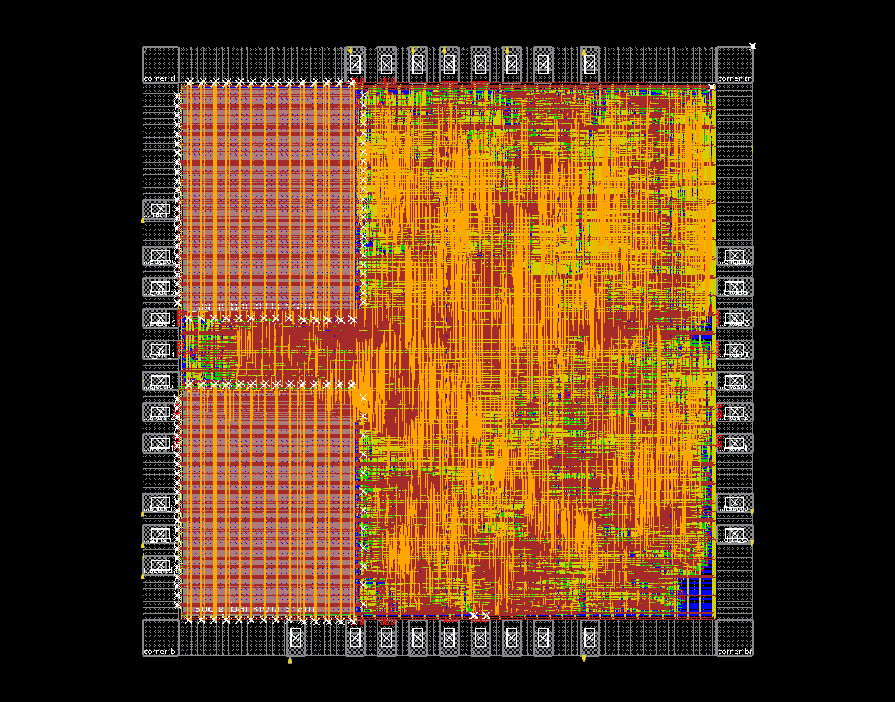
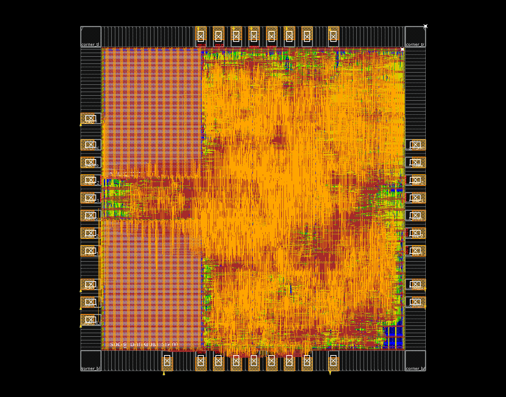
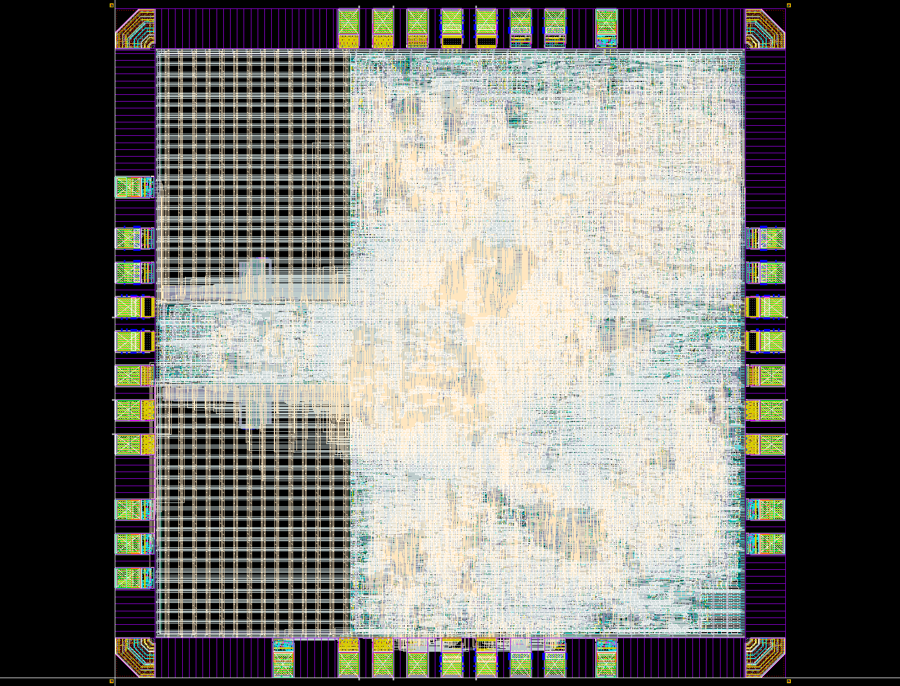

# GPIO加入前：完整ASIC实现流程与问题复盘

整理日期：2026-11-12。本文回顾已执行的流程，不是本次重新运行EDA的结果。

**主线是2026-11-10完成的RF 1R1W、1950µm die、最终r3。** 它完成了从综合、带PAD布局布线到Seal Ring、Dummy、Calibre检查和交付归档的流程；严格LVS及ERC仍有明确残项，不能称为正式投片签核全部通过。后续左侧JTAG/成对电源PAD试验单列在附录，GPIO不在本文范围内。

本文把问题分为“实际消除”“按课程规则单列”“仍待评审”，不把命令成功退出等同于检查通过。历史试验用于解释最终方案的来由，不代表当前GPIO源码的测量结果。

逐组Tcl命令的含义与GUI观察方法见[后端专题教程](backend-tcl-gui-tutorial.md)。

## 目录

1. [版本、输入和最终结果](#1-版本输入和最终结果)
2. [完整执行链与检查点](#2-完整执行链与检查点)
3. [综合：怎样压面积](#3-综合怎样压面积)
4. [Floorplan、SRAM和PAD](#4-floorplansram和pad)
5. [电源规划与放置](#5-电源规划与放置)
6. [CTS与setup](#6-cts与setup)
7. [两轮hold修复](#7-两轮hold修复)
8. [布线、filler和原生DRC](#8-布线filler和原生drc)
9. [Calibre与Bond PAD增量修复](#9-calibre与bond-pad增量修复)
10. [Lab 5：GDS、Seal Ring、Dummy](#10-lab-5gdsseal-ringdummy)
11. [LVS、ERC、天线与最终状态](#11-lvserc天线与最终状态)
12. [失败尝试与问题台账](#12-失败尝试与问题台账)
13. [产物、证据与复核](#13-产物证据与复核)
14. [附录：后续PAD重排试验](#14-附录后续pad重排试验)

## 1. 版本、输入和最终结果

### 1.1 哪一个版本

| 阶段 | 冻结运行目录，相对工作区根目录 |
| --- | --- |
| 核心综合 | `eda-runs/20261110-rf1r1w/` |
| 完整PNR父运行 | `eda-runs/20261110-rf1r1w-die1950-fullchip/` |
| Calibre增量修复 | 上述名称加`-r2/` |
| 最终PNR | `eda-runs/20261110-rf1r1w-die1950-fullchip-r3/` |
| 最终Lab 5 | `eda-runs/20261110-rf1r1w-lab5-die1950-r3/` |
| 后续PAD试验，未完成全套Calibre | `eda-runs/20261111-jtag-left-paired-pads/` |

下文简称核心综合目录为 **SYN**，最终PNR目录为 **PNR**，最终Lab 5目录为 **LAB5**。工作区根目录为`/home/s2400012841/chip-fullstack-2026`，仓库为其下`mynpu-softpe`。

PNR的`manifest.json`记录Git基线`549b352ad6a99942d09fbe03781b6d85ca6f791b`，但当时存在未提交RF修改，不能仅凭commit判断为旧1RW设计。实际依据是冻结的输入文件及SHA256。2026-11-11的源码审计确认70个输入、24个项目RTL与当时工作区一致；该结论有日期边界，不适用于此后GPIO修改。

冻结硬件包含：CV32E40P、JTAG/Debug Module、两块2048×32 SRAM、XBAR、256B RF、Matrix 4×4外积、CNN 3×3 DOT9、Vector INT32/4路INT8 SIMD、可选共享量化单元。RF为8个物理bank，各1R1W；任务队列4/4/4，四条流FIFO各8 words。无外部DMA接口、NoC或透明SRAM缓存。

### 1.2 最终结果与面积口径

| 指标 | 最终r3 |
| --- | ---: |
| Die / 物理Seal Ring外框 | 1950×1950 / 1980×1980µm |
| 综合cell面积，含SRAM、不含外围IO | 2.569286mm² |
| 综合标准单元面积 / 两块SRAM | 1.766398 / 0.802887mm² |
| PNR核心非filler面积，含SRAM | 2.632349mm² |
| PNR标准单元，不含core filler | 1.829462mm²，80,778个 |
| Core filler | 0.209659mm²，31,407个 |
| 原生IO几何并集，不重复计Bond窗口 | 0.844100mm² |
| 非filler placement density | 89.510% |
| 系统 / JTAG约束周期 | 20 / 100ns |
| 最终setup WNS / TNS / 违例数 | +0.468ns / 0 / 0 |
| 最终hold WNS / TNS / 违例数 | +0.018ns / 0 / 0 |
| Innovus DRC / native天线 / 核心PG连通问题 | 0 / 0 / 0 |
| 带实际IO/SRAM模型的JTAG/MNIST回归 | 34 checks通过 |

IO、Bond、corner及IO filler的实例矩形面积直接相加为1.006515mm²，但其中有重叠；不能再将这个数当成独立IO占地与核心面积相加。全芯片112,509实例包含标准单元、SRAM、core filler及322个IO/Bond/corner/IO filler实例。Die面积3.8025mm²也不是“可放逻辑面积”。

综合到PNR核心非filler增加约0.063064mm²，包含CTS、hold延迟、tie/tap/天线支持及物理优化，不能把差额全部归到某一个模块。面积能放下还不足以证明设计可交付，必须继续验证布线、时序、连通性和实际GDS规则。



[核心区放大](images/rf1r1w-r3-module-map-core.png)。颜色来自最终数据库实例层次与坐标，不代表附近金属均由该模块独占。

## 2. 完整执行链与检查点


实际执行脚本保存在PNR的`scripts/`；不能直接拿当前GPIO模板覆盖冻结脚本后声称复现了r3。

| 阶段脚本 | 主要数据库/结果 | 阶段门槛 |
| --- | --- | --- |
| `pnr_01_floorplan_io.tcl` | `01_core_floorplan`→`02_pre_io_registration`→`03_io_floorplan` | 宏、PAD、端口位置正确 |
| `pnr_02_powerplan.tcl` | `04_rings`→`05_sram_power`→`06_powerplan` | 电源及宏接入可检查 |
| `pnr_03_place.tcl` | `07_placed`→`08_post_tie` | 无未放置/非法重叠，tie连接正确 |
| `pnr_04_cts.tcl` | `09_pre_cts`→`10_post_cts` | 真实时钟树和postCTS分析 |
| `pnr_04b_holdfix.tcl` | `11_pre_route` | CTS后hold归零 |
| `pnr_05_route.tcl` | `12_route_raw`→`12_routed` | 详细布线完成 |
| `pnr_06_finish.tcl` | `13_finished` | setup/hold、filler、DRC初次收尾 |
| 实际ECO脚本 | `13_eco_fixed`→`13_calibre_fixed`→`13_wb_fixed` | 原生及GDS实际问题修复 |
| 最终export | `14_exported`及`outputs/final/` | 网表、GDS、约束与报告一致 |
| `LAB5/scripts/run_signoff.py` | 最终postDummy GDS及各检查目录 | 相同GDS/CDL的完整检查 |

目录中存在`03a_reclaim`等可选脚本，不等于最终链实际采用它。CTS实际恢复的是`08_post_tie`，因此不能把`08_reclaimed`的效果记到最终结果。失败尝试在`attempts/`独立保存，也不算成功阶段。

## 3. 综合：怎样压面积

### 3.1 先改变有效硬件，再调工具

面积工作分三层：减少重复的供数/控制逻辑；调整缓冲深度但保留计算阵列；最后比较综合effort、时钟门控和目标周期。没有采用减少Matrix乘法器、降低计算精度或数据锁存器的方案。

历史数据属于不同RTL阶段，表中相邻两行未必是严格单变量实验，不能把整个下降全部归于某个工具开关。

| 历史阶段 | 前→后综合面积mm² | 实际含义 |
| --- | ---: | --- |
| Stream供数整理 | 2.976653→2.846849 | 减少控制和地址/供数冗余，保留4×4 Matrix |
| 面积与门控搜索 | 2.846849→2.515488 | 同阶段进一步RTL/门控/映射/约束迭代，总降约11.64% |
| 后续功能版本队列8→4 | 2.637060→2.569744 | 三个任务FIFO缩小，计算能力与256B RF不变 |
| RF 1RW→1R1W | 2.569744→2.569286 | 增加同bank读写并发；整芯片面积近似持平 |

Stream分层测量曾得到Matrix Stream 0.209350→0.120936mm²、CNN engine 0.162219→0.146194mm²、Vector Stream 0.076926→0.067072mm²。它们来自对应历史层次综合，不能直接当最终r3模块面积。

队列缩小有真实性能代价：三个任务payload存储由2712降到1356bit，MNIST由20,728变成21,008周期，增加280周期，约1.35%。这不是“完全无损”。四条stream FIFO仍各8 words，并没有全部改成4。

RF 1R1W也不是压面积手段：孤立RF面积0.189149→0.191461mm²，约增加1.22%；整芯片映射差异抵消了局部增长。同bank 256次写＋256次gather读微基准由512缩到256周期，而该MNIST仍21,008周期。

### 3.2 最终Genus设置

核心综合使用TT标准单元及SRAM时序库，对应LEF和补充SRAM antenna LEF，180nm工艺设置。关键设置摘录自SYN：

```tcl
set_db max_cpus_per_server 4
set_db design_process_node 180
set_db lp_insert_clock_gating true
set_db syn_generic_effort high
set_db syn_map_effort high
set_db syn_opt_effort high
# 读取实际Liberty、LEF、RTL与SDC后：
syn_generic
syn_map
syn_opt
```

主要模块设置`.ungroup_ok false`，保留CPU、XBAR、MMIO、Stream、CNN、Matrix、Vector、量化、Debug等层次，便于归属面积与物理图。它不是禁止模块内部优化。芯片封装综合复用并preserve已映射核心，避免PAD封装阶段再次改变核心逻辑。

时序设置为：综合系统18ns，JTAG100ns；系统/JTAG异步分组；setup uncertainty 0.52ns、hold 0.2ns；输入/输出delay 0.5ns、输入transition 0.2ns、输出load 0.2pF；TDO按JTAG下降沿约束，复位路径单独false path。输出报告再按20ns评估同一网表。最终综合约为18ns下+0.0006ns、20ns下+2.0006ns。

**这里是18ns综合、20ns最终PNR验收，不是18ns布线后通过。** 异步分组也不能替代RTL中的CDC协议检查。

### 3.3 为什么比较多个约束而不是只放宽周期

历史面积搜索记录如下；面积单位mm²。不同脚本变体要结合冻结输入看，不能当作所有行均为严格单变量。

| 运行名后缀 | effort/综合周期 | 面积 |
| --- | --- | ---: |
| `area25-cg-low` | low / 16ns | 2.680148 |
| `area25-cg-high` | high / 16ns | 2.533809 |
| `area25-rtl-cg-low` | low / 16ns | 2.649413 |
| `area25-rtl-cg-high` | high / 16ns | 2.518886 |
| `area25-rtl-cg-20ns` | high / 20ns | 2.593327 |
| `area25-high-18ns` | high / 18ns | 2.516063 |
| `area25-high-19ns` | high / 19ns | 2.515808 |
| `area25-high-20ns` | high / 20ns | 2.515742 |
| `area25-high-18ns-regaware` | high / 18ns，增量门控优化 | 2.515488 |

`regaware`实际是在已有数据库上执行：

```tcl
set_db syn_opt_effort high
read_sdc <18ns约束文件>
set_db lp_insert_clock_gating_incremental true
set_db lp_clock_gating_register_aware true
syn_opt
```

该历史选中结果有665个提取的ICG。门控通过共享寄存器组使能减少大量逐位反馈mux，可能同时改善面积；也引入时钟负载和CTS成本，所以必须连同物理后端评估。不能把11.64%的整阶段下降全部记作门控收益。

20ns不一定得到最小面积：综合启发式、映射和门控决策会改变，脚本版本也不同。最终选择18ns保留后端余量，而不是反复放宽约束直到报告变绿。

### 3.4 未采用的压面积方案

2.4mm²研究中的控制字段收窄、合法配置范围简化、稳定地址共享等FF方案曾测得2.505653mm²（18ns）、2.502440mm²（20ns），与另一Matrix映射组合约2.484228mm²；这些候选**不是本次最终r3网表**。部分方案改变非法高位配置行为，必须同步ABI及负向测试，不能只说合法推理通过就等价。

数据锁存器方案被明确排除；Matrix降并行/分时乘法方案没有进入最终设计。完整DC综合还受SRAM `.db`缺失限制，不能将孤立子模块DC结果冒充完整芯片面积。最终r3保留计算能力和FF数据存储；工艺库ICG内部的时钟门控锁存结构不等于采用数据锁存器RF。

## 4. Floorplan、SRAM和PAD

### 4.1 为什么1950而不是原先2mm

早期2mm流程能放置不代表符合后续交付尺寸。按[课程Lab 5](https://full-stack-ai-chip.tianyuj.com/lab-5/)的尺寸条件，最终die采用1950µm，外加原生15µm Seal Ring后外框1980µm。没有缩放SRAM、PAD或Seal Ring工艺图形来凑尺寸。

Core实际边界`(130.48,129.36)–(1819.84,1819.84)µm`。两块SRAM放在左下/左上，分别R180/R0，把有信号的边面向内部。采用原生LEF外轮廓、OVERLAP和真实pin检查，不以“只有一边出pin”为由把宏主体或PG压进IO。

宏halo通常5.2µm，信号侧12µm；原生OVERLAP相对完整边界有5.2µm内缩，因此要区分halo相对哪一轮廓。宏周边cutRow额外约0.5µm，避免标准单元最底层金属贴近SRAM。角落宏不再强行放完整四边block ring，改用核心ring和上层PG接入，避免两套环重合。

### 4.2 最终r3的9信号PAD

| 信号 | 边与沿边坐标µm |
| --- | --- |
| 系统时钟 | top 1400 |
| CPU启动 | bottom 460 |
| IRQ观察 | bottom 1400 |
| TDI / TMS / TCK | left 260 / 360 / 460 |
| 复位 | left 1400 |
| TDO / halted | right 360 / 460 |

37个原生PAD包括9信号和28供电/POC，另有37个Bond PAD及4角单元。Bond叠在原生PAD上，并不是每个GPIO需要四个外部引脚那样的含义。程序/数据通过JTAG SBA进入，host并行口和外部DMA没有引出。

r3每侧电源旧排列是VSS650、VSS750、VSSIO850、VDD950、VDD1050、VDDIO1150、POC1250；它**不是后来要求的相邻VDD/VSS成对方案**。

原生信号单元为PDDW0204CDG8。输入PAD接收端开启、输出三态；输出PAD反向配置。顶层`*_pad`与核心net分开，防止测试或综合网表绕开实际PAD。`loadIoFile -specifiedIosOnly`之后固定native坐标，按方向补IO filler，并将端口标签放在真实PAD/Bond内的METAL4上，避免自动处理把端口挪到无关IO filler。

PAD优化曾按32个候选slot和实际端点的Manhattan距离排序，目标值2,283,570→1,725,798。它只是位置估计，受时钟等大fanout网影响，不是全局布线最优，也不是最终真实线长；后来移动JTAG仍可能有空间。

## 5. 电源规划与放置

### 5.1 四条电源网

核心VDD/VSS与IO VDDPST/VSSPST分别处理，不能为消除报告随意短接。关键几何如下，单位µm：

| 对象 | 参数 |
| --- | --- |
| Core ring | M4竖边、M5横边；宽4，间距2，offset 2 |
| M4竖stripe | 宽2，间距1，set-to-set 40，offset 8 |
| M5横stripe | 宽4，间距2，set-to-set 60 |
| M6分布供电 | 宽4，间距4，set-to-set 40；VDD/VSS offsets 14/22 |
| M5跨接 | 宽4，间距2，set-to-set 30 |
| 宏PG | 基于LEF的M3/M4 pin，上升连接到M5 |
| 标准单元供电 | M1 followpin/corepin接入上层grid |
| Well tap | interval 60，checkerboard，按30规则检查 |

PAD供电考虑allPort/allGeom和分割连接；PG层范围按实际结构设置，不把信号route blockage当PG隔离区。没有密集decap预填满可放置位置，以给高密度放置和ECO留空间。该选择没有经过IR/EM证实，不能据此宣称供电裕量已签核。

### 5.2 电源过孔为什么要清理

SRAM/核心边缘PG多次连接可能生成重叠via array。`fix_pg_edge_vias.tcl`只在**同网且上下两层金属都被保留连接覆盖**的条件下删除冗余M1/M2阵列。它不删除电源rail，也不无条件删除高层via。清理后必须重跑special connectivity及DRC。

最终还有VDDPST/VSSPST两条regular connectivity no-routing提示：Innovus抽象看不到原生IO内部所有导体，因此单列保留；真实IO GDS的连接继续由LVS检查。不能把“工具抽象限制”扩展成对所有电源开路的豁免。

### 5.3 放置和tie

放置采用高congestion effort；global max density 0.98、优化max density 0.99是工具上限，不是最终实际利用率，更不是允许DRC。IO控制tie与核心tie分开，排除供电端子；IO tie按max fanout 1、max distance 100处理。

功能扫描型触发器引出IMPSP-9099：未定义scan chain。流程使用`place_global_ignore_scan true`、不重排scan chain。它允许本轮功能实现继续，但不能声称已经完成DFT/scan插入。

早期高密度试验曾出现约98.02%密度和9个overlap；另一历史版本即便放下仍有DRC124、setup−0.566ns、hold−0.033ns。最终通过逻辑精简、宏/PG布局和物理修复一起解决，不存在单独将density上限调高就“修好设计”的结论。



## 6. CTS与setup

采用完整`ccopt_design`，不只是搭树；进入真实propagated clocks、OCV与CPPR both。时钟buffer/inverter使用工艺允许的CKBD等单元，输入clock transition设置0.5ns。

从实际`10_post_cts`检查点查询得到：

```tcl
usefulSkew          = true
usefulSkewCCOpt     = standard
usefulSkewPreCTS    = true
usefulSkewPostRoute = true
```

系统时钟插入延迟1.367～1.497ns，skew约0.130ns。日志保留了目标0.128ns略超出，以及输入slew 0.5ns高于内部0.393ns目标的提示；不能用最终setup通过抹掉这些QoR警告。

流程对IO latency采用`update_io_latency false`、`force false`，并使用真实clock network latency。CTS前setup uncertainty为0.52ns，CTS后为0.47ns；hold uncertainty始终0.2ns。**报告必须披露这个变化**：前后setup WNS不完全是电路优化的直接差值，也不代表已建立正式多角时钟误差预算。

最终最差setup从XBAR的`aux_owner_reg[1]/Q`到量化单元`product_reg[63]/D`，required约21.011ns、arrival约20.543ns，slack +0.468ns。该路径提示仲裁到量化乘法是当时关键组合链，但没有据此削减通用计算能力。

## 7. 两轮hold修复

### 7.1 完整指标链

| 检查点 | Setup WNS ns | Hold WNS ns | Hold TNS ns | Hold违例路径 |
| --- | ---: | ---: | ---: | ---: |
| PreCTS | +0.058 | — | — | — |
| PostCTS | +0.161 | −0.555 | −3.099 | 95 |
| PostCTS holdFix | +0.172 | +0.001 | 0 | 0 |
| PostRoute，hold修复前 | +0.468 | −0.053 | −0.359 | 31 |
| PostRoute holdFix | +0.468 | +0.018 | 0 | 0 |
| 最终r3 | +0.468 | +0.018 | 0 | 0 |

Hold要求新数据不能在捕获边沿后过早到达。CTS把真实时钟延迟、偏斜带进分析，短数据路径可能突然不足；布线又改变时钟和数据延迟，所以CTS后归零不代表布线后仍归零。

降低系统频率通常不能直接修复同沿hold：需要增加数据最小延迟或合理调整时钟偏斜。没有采用删除hold uncertainty、将正常TDI/boot输入设false path、恢复ideal clock等掩盖方式。

### 7.2 第一轮：CTS后95条

最差路径为`boot_ready_i`到CPU sleep unit的`fetch_enable_q_reg/D`，属于系统时钟输入短路径。报告中capture arrival约1.442ns，library hold约0.087ns，加0.2ns hold uncertainty，required约1.729ns；data arrival约1.175ns，得到约−0.555ns（分项显示有舍入）。

实际执行：

```tcl
setOptMode -fixHoldAllowSetupTnsDegrade false
optDesign -postCTS -hold -expandedViews -outDir <postCTS_holdFix报告目录>
# 随后分别重跑setup及hold分析
```

先修到1条、约−0.003ns，再插入一个单元后归零。总新增93个：

| 单元 | 数量 |
| --- | ---: |
| BUFFD1 | 3 |
| DEL015 | 1 |
| DEL01 | 88 |
| DEL1 | 1 |

最终hold +0.001ns、setup +0.172ns。保护setup TNS是为了避免修短路径时无约束地伤害长路径；仍必须实测setup，开关本身不是保证。

### 7.3 第二轮：布线后31条

最差路径变为`td_i`到JTAG TAP `idcode_q_reg[31]/D`。capture arrival约1.053ns、hold约0.086ns、uncertainty 0.2ns，required约1.339ns；data arrival约1.286ns，差−0.053ns。

finish阶段保留约0.30ns setup target，执行：

```tcl
setOptMode -fixHoldAllowSetupTnsDegrade false -holdTargetSlack 0.02
optDesign -postRoute -hold -expandedViews -outDir <postRoute_holdFix报告目录>
```

0.02ns是优化目标，不是把SDC检查放宽0.02ns；最终+0.018ns仍为正，但没有达到每条路径都+0.020ns。不得把小负数通过显示精度四舍五入成通过。

| 单元 | 数量 |
| --- | ---: |
| BUFFD1 | 9 |
| CKBD10 / CKBD1 | 1 / 2 |
| DEL015 / DEL01 / DEL0 | 8 / 111 / 3 |
| 合计 | 134 |

两轮共227个新增修复单元。最终最差hold转到CNN Stream配置源地址寄存器到CNN engine配置寄存器，required约1.822ns、arrival约1.839ns、slack +0.018ns。必须检查全部path group，不只复查原来最差的一条。

最终金属ECO之后继续跑setup/hold，防止只清DRC而破坏时序。这套操作与[Lab 4](https://full-stack-ai-chip.tianyuj.com/lab-4/)的hold保护setup、设置目标裕量思路一致，实际数据以本项目日志为准。

## 8. 布线、filler和原生DRC

### 8.1 布线设置与收尾

信号主布线范围M2～M6，优先时钟；详细布线不自动提前结束，结束迭代数20。天线修复明确选择ANTENNABWP7T，避免工具随意使用不适合的单元。RC使用cap table及低effort postRoute提取，SI aware关闭，启用OCV/CPPR；它不等价于正式耦合PEX/SI签核。

finish先处理setup/hold，再插入FILL64至FILL1等core filler，执行定向ecoRoute、PG dangling trim，最后分别检查：placement、DRC、regular connectivity、special PG connectivity、antenna、setup/hold与面积。Filler不是计算逻辑，但占据物理空隙；不能将其混入RTL面积。

### 8.2 `13_finished`的63处真实问题

| 问题 | 数量 | 修复动作与安全条件 |
| --- | ---: | --- |
| PG过孔重叠 | 58 | 删除两个重复19-cut VIA12阵列；同网18/25-cut阵列与PG金属保留 |
| TCK PAD外侧多余绕线 | 4 | 核对外部网只有一个native PAD.PAD端点与重叠top port后，删除多余regular wire/via |
| 底边reset接入 | 1 | 移动一个CPU寄存器文件触发器，重新合法化和局部布线 |

PG删除位置为VDD约`(1059.48,129.36)`和`(1099.48,129.36)µm`。这是对已确认冗余形状的删除，不是删除所有VIA12或者降低DRC规则。

reset接入涉及`mem_reg[6][7]`。在旧位置建立硬blockage，按row/site对齐，unplace该单元，再用`ecoPlace -fixPlacedInsts true -timing_driven false`完成定向放置；随后重接PG、ecoRoute并复查时序。RTL与寄存器功能没有改变。

PAD清理只针对已证明物理重叠即可连接的外侧网络，**没有删除核心TCK时钟树**。如果拓扑或端点数不符合断言，应停止脚本重新定位，不能为了清零批量删除同名net。

修复后重新补filler、route并全项检查，native DRC归零。成功脚本见仓库[验证过的ECO目录](../eda/tsmc180/fullchip/verified_die1950_ecos/README.md)，原始运行副本为`PNR/repairs/finish_eco.tcl`。

### 8.3 早期M1.S.1的定位经验

更早all4流程曾有270处M1.S.1，两个SRAM各约135处。对照原始SRAM GDS单独检查为0、PNR GDS为270、Dummy后仍270，说明问题已在PNR宏PG/接入阶段引入，并非Dummy制造。后续重新做1950 floorplan、宏周边PG接入及ECO，最终该规则为0。

现有记录不足以证明“只删最后两个via array就独立修掉全部270处”，因此不作这种单因果归因。排查要按原库→PNR导出→preDummy→postDummy逐级比对，找到首次出现问题的阶段。



## 9. Calibre与Bond PAD增量修复

### 9.1 第一轮：native DRC=0仍有M2.S.2

Calibre实际GDS检查发现1处M2.S.2，标记约`x=904.703～905.520、y=115.000～115.450µm`，在底边PVSS2CDG宽M2金属附近。CPU内部乘法相关网络靠近实际IO金属，LEF抽象检查没有完整反映该间距。

解决是在该IO边界增加项目级METAL2信号route blockage，范围约`(849,114.8)–(911,115.8)µm`，排除PG，仅删除并重布受影响的一条CPU网络。没有通过扩大DRC容差或修改共享IO GDS来解决这处M2问题。r2完整检查中该问题归零。

成功脚本为`fix_calibre_m2_block.tcl`；仓库副本为`fix_io_m2_spacing.tcl`。修复后重新导出、重做Lab 5，而不是只在Calibre浏览器中把marker删掉。

### 9.2 第二轮：Bond M5/M6五处

WB deck发现5处CB.S.2.M5/M6：信号线到Bond金属间距不足2.5µm。原生PAD60LU_OBV局部真实图形：

- M5：`(3.3,0)–(56.7,71.36)µm`。
- M6：`(1.5,0)–(58.5,73.16)µm`。

把这两个矩形按37个Bond的R0/R180/R90/R270实际方向变换、向外扩2.5µm、裁剪到die内，得到74个信号禁布区。PG不受该信号blockage影响。脚本先断言受影响clock为0，再重布4条CPU数据网络。

这里修的是走线与Bond几何的关系，没有缩小Bond PAD、扩大芯片、改变寄存器阵列或新增存储。先跑24项定向金属与2项PAD间距检查均为0，再跑完整DRC、LVS/ERC、antenna和WB，形成r3。

### 9.3 失败尝试也要保留

1. `06-calibrefix`中一次`globalDetailRoute`返回Tcl `false`，没有产出有效完成点。改成显式route blockage、定向删除受影响regular wires并ecoRoute后成功。
2. 后续尝试恢复尚未生成的`13_calibre_fixed`，自然失败。回到成功的`13_eco_fixed`重新执行，不能把缺失检查点当作完成。
3. 一次WB脚本把`dbGet`返回的单元素Tcl列表当字符串，网名带花括号导致匹配错误。改用`lindex [dbGet $wire.net.name] 0`取元素，并用`dbGetNetByName`查询。成功版本为`fix_wb_spacing2.tcl`。

失败记录保存在`attempts/`，成功执行副本在`scripts/*executed.tcl`；这些路径共同解释了为什么目录中有多个相似脚本。不能仅选最后修改时间最新的文件判断成功版本。

## 10. Lab 5：GDS、Seal Ring、Dummy

### 10.1 入口和输入一致性

在确认PNR完成记录、哈希和native DRC后，复制最终GDS、flat LVS网表及DEF到独立Lab 5工作区。原始标准单元/IO SPI与真实SRAM CDL参与`v2lvs`，SRAM Verilog端口声明用于保持端口顺序，常量0/1映射到VSS/VDD。

不把SRAM作为black box跳过，也不新增virtual connect来掩盖断线。物理顶层与源CDL名字不同是有意的：最终GDS顶层`mynpu_asic_top_postDummy`包住原设计与Dummy；源CDL顶层仍`mynpu_asic_top`。

### 10.2 DBU不一致

早期模板路径与本机不同，实际课程参考在`/lec/lab5/layout`。OA技术库原为1000 DBU/µm，而PNR为2000；直接导入会将0.5nm网格坐标舍入，可能制造窄缝、短边或间距变化。

解决是建立项目私有`mynpu_tech2000`，在stream-in之前设置2000 DBU/µm，使用原layer map、case Preserve并报告precision loss；不修改共享技术库。规则对应`PRECISION 2000`，DRC/fill/antenna/WB的`RESOLUTION 10`为0.005µm，LVS `RESOLUTION 2`为0.001µm。单位配置匹配不等于放宽实体间距规则。

### 10.3 Seal Ring不能缩放

使用原生1µm节距边单元与角单元拼接。旧参考环边界约`(-15,-15)–(1875,2005)`；适配1950 die时横向增加90µm、纵向减少40µm，补180个水平边实例、移除80个垂直边实例，最终共7844个实例，bbox`(-15,-15)–(1965,1965)`。

早期拼接右边存在1µm seam gap，需要补齐边单元。只移动角、增减完整边实例，不scale工艺金属。OA文本显示bbox可能超过环物理边界，尺寸审计要用真实边/角实例几何，不能用字体范围。

### 10.4 POC端口缺失

IO SPI中的`.GLOBAL POC`使源网表出现额外POC端口；9信号＋4PG原本只有13个顶层端口。需要让真实POC导体上的标签进入提取，不能删源端口骗过LVS。

流程在底部PVDD2CDG实例内，根据原生位置`(30,113.215)`变换后放M3 POC pin label，在preDummy阶段完成，使后续merge保留。最终匹配14个端口。标签用于给已有导体命名，不是把四条电源短接。

### 10.5 IO的CO.R.4：确实改过项目私有版图

这是必须单独披露的修补。项目导入OA库内的`B776_POSTVDD2CDG`有一块PIMP边缘未充分覆盖相关接触/电阻POLY区域，出现CO.R.4（历史约1层次/8展开）。

`build_layout.il`先断言恰有一块PIMP匹配：

```text
原bbox：(-2.3,52.91)–(52.3,73.795)
新bbox：(-2.3,52.91)–(52.59,73.795) µm
```

右边扩0.29µm以补足覆盖，重新检查后CO.R.4为0。**共享PDK、原始IO GDS/SPI/CDL文件未编辑，但最终GDS包含项目私有OA的IO几何修补。** “没有修改共享库”不能写成“IO几何完全没有改”。该处理仍需库/工艺负责人认可，不能自动视为foundry批准的库修版。

### 10.6 Dummy生成与合并

在加入Seal Ring、POC标签和上述私有修补后，输出preDummy GDS并跑DRC。r3 preDummy仍有M5.R.1、M6.R.1、DOD.R.1各1项，属于后续填充要处理的密度问题。

Metal Dummy与OD/PO Dummy分别用各自规则生成，匹配实际六金属栈，关闭不适用的40K thick-top分支，M6小fill采用0.8×0.8µm。再用`calibredrv layout filemerge -rename -createtop mynpu_asic_top_postDummy`合并三份GDS。密度规则继续保留，没有为了通过禁用它们。

最终重新stream-in到独立OA库，再对同一个postDummy GDS跑所有检查。M5.R.1、M6.R.1、DOD.R.1及M6.A.1最终为0。Native filler与Dummy是不同对象：前者是单元行填充，后者是工艺层面的金属/OD/PO密度填充。



## 11. LVS、ERC、天线与最终状态

### 11.1 几何DRC

最终完整deck执行523项，原始2433层次/21777展开，非零如下：

| 规则 | 层次 / 展开 |
| --- | ---: |
| ESD.24g | 30 / 270 |
| ESD.25g | 2384 / 21456 |
| LUP.3.3g_3.3V | 1 / 9 |
| LUP.5.3g_3.3V | 16 / 40 |
| MOM.R.2 | 1 / 1 |
| DRM.R.1 | 1 / 1 |

按课程汇总单列DRM/ESD/MOM/LUP四类后剩余0；原始报告没有删规则或改成0。M1.S.1、M2.S.2、CO.R.4、SR.S.1等真正几何问题已经消除。这是课程分类结果，不是foundry正式waiver。

### 11.2 严格LVS与教学容差LVS

严格LVS仍INCORRECT，主要是IO PR阻值约+3.47%的模型/提取差异。教学配置仅对三处PR属性条件使用3.48%容差，最终CORRECT；仍执行605条完整属性检查、Split Gate YES，无SRAM Box、无额外虚连，其余属性检查保留。

| 变换后匹配项 | Layout / Source |
| --- | ---: |
| Ports | 14 / 14 |
| Nets | 327488 / 327488 |
| Total Inst | 494947 / 494947 |

这里器件数是LVS变换后统计，不是未经归并的物理晶体管数。报告仍有ambiguity points和unbalanced smashed MOSFET等warning，不能把CORRECT解释为日志无警告。

不要在GUI只新建一条Trace Property表而覆盖其余检查；应保留完整deck与605检查。严格版本也必须保留，与教学容差结果并列，等待IO模型适配评审。

### 11.3 ERC没有被“修到0”

12项ERC均执行，剩余7层次/977展开：

| 检查 | 层次 / 展开 | 状态 |
| --- | ---: | --- |
| mnpg | 4 / 832 | IO保护结构相关，待评审 |
| floating.nxwell_float | 1 / 72 | IO/外圈模式，待评审 |
| npvss49 | 1 / 72 | IO结构相关，待评审 |
| floating.psub_float | 1 / 1 | 隔离带外圈衬底，待评审 |

这些模式与课程说明的IO/外圈案例一致，但不意味着可以自动忽略。没有跨Seal Ring禁布带补线、合并不同电源或伪造接地标签；需要负责人判断其接受条件。最终机器汇总明确`course_acceptance_passed=false`、`foundry_signoff_passed=false`。

### 11.4 天线、WB与功能验证

最终GDS天线62项、WB64项均0。WB使用PITCH_55_SINGLE、OBV_CUP、SRwidth 15µm。必须验证同一最终GDS，不能拿r2的LVS和r3的WB拼成通过。

带实际IO、标准单元及SRAM模型的PAD级JTAG/MNIST回归34项通过，JTAG10MHz。该仿真是零延迟、无SDF回标；证明对应网表功能路径，不证明最坏角物理时序。

尚未完成Dummy后PEX/STA、多角MCMM、IR/EM及正式封装/工艺审批。r3 Innovus时序是TT单角、cap table RC、OCV/CPPR的postRoute结果，不是这些未完成工作的替代品。

## 12. 失败尝试与问题台账

| 问题 | 定位依据 | 解决或处理 | 最终状态 |
| --- | --- | --- | --- |
| 面积过大/高密度 | 综合层次报告、placement overlap与拥塞 | Stream整理、门控/effort搜索、队列减半 | r3核心2.632349mm²，未牺牲Matrix计算规模 |
| 锁存器压面积风险 | 存储实现与用户要求 | 不采用数据锁存器候选 | 最终FF数据存储 |
| 只放宽综合周期无稳定收益 | 多组冻结综合对照 | 选择18ns综合、20ns物理目标 | 按真实结果选择，不假设单调 |
| RF串行读写 | 同bank微基准 | 1R1W | 512→256周期，MNIST不变 |
| SRAM边缘M1.S.1 | 原库/PNR/pre/postDummy逐级对比 | floorplan、PG接入及ECO重做 | 最终0；不臆断单一修复贡献 |
| PG冗余via | 原生DRC与上下层同网几何 | 有断言的删除，保留有效连接 | DRC及special PG复核 |
| CTS后hold95条 | postCTS min path | 增加93个延迟/buffer单元 | 0，+0.001ns |
| Route后hold31条 | postRoute min path | 目标+0.02ns，增加134单元 | 0，+0.018ns |
| reset接入冲突 | native局部marker | 移动单一CPU触发器并ECO | 0 |
| PAD外侧多余TCK绕线 | 单PAD端点/重叠port审计 | 删除确认为冗余的外侧route | 核心树保留，回归通过 |
| Native检查漏掉实际IO M2间距 | Calibre M2.S.2坐标 | M2信号blockage＋一网重布 | r2/r3为0 |
| WB M5/M6间距5处 | Bond原始GDS＋WB markers | 74个信号blockage，4网重布 | r3完整WB0 |
| Tcl route返回false | attempts日志、缺失产物 | 换定向ecoRoute，检查完成点 | 失败尝试不计通过 |
| 恢复不存在的checkpoint | restore日志 | 回到已成功父检查点 | 重跑后成功 |
| Tcl列表/网名花括号 | dbGet结果与net匹配失败 | lindex取元素、按net对象查找 | 成功修复脚本归档 |
| OA DBU舍入 | stream-in网格/精度 | 项目私有2000DBU技术库 | 保留precision检查 |
| Seal Ring seam/尺寸 | 原生边单元、物理bbox | 增删1µm边实例，不缩放 | 1980µm外框，SR.S.1为0 |
| POC端口不匹配 | IO SPI GLOBAL及LVS端口数 | 真导体上补POC标签 | 14/14 |
| IO CO.R.4 | PIMP与接触/电阻几何 | 私有OA PIMP右扩0.29µm | 0，库修补需负责人认可 |
| 金属/OD密度 | preDummy DRC | 六层匹配的Metal及OD/PO fill | postDummy相关项0 |
| IO PR参数不匹配 | 严格LVS属性报告 | 教学3.48%容差并保留严格报告 | 教学CORRECT，严格未通过 |
| ERC保护/外圈残项 | 12项完整ERC、层次位置 | 保留，不伪造连接 | 待评审，不记Clean |
| VDDPST/VSSPST native no-routing | IO抽象与真实GDS差异 | 单列提示并用完整LVS验证 | 两提示仍保留 |
| clock slew/skew目标提示 | CTS QoR日志 | 记录并继续检查最终时序 | 有提示，未声称理想树 |
| 未定义scan chain | IMPSP-9099 | 功能流程ignore_scan，不重排 | 非DFT签核 |

台账覆盖本次冻结主线、直接前置试验中有证据的问题；课程提醒但没有本项目失败证据的事项只作为复核要点，不冒充亲历故障。

## 13. 产物、证据与复核

### 13.1 读什么文件

| 目的 | 位置 |
| --- | --- |
| 综合设置/约束/面积时序 | `SYN/synth.tcl`、`synth.sdc`、`reports/` |
| 输入与父运行关系 | `PNR/manifest.json`、各阶段JSON和`attempts/` |
| 真正执行的PNR命令 | `PNR/scripts/*executed.tcl`及`repairs/` |
| hold完整报告 | `PNR/mynpu/pnr/reports/postCTS_hold*`、`postRoute_hold*`、`final_hold/` |
| 最终数据库 | `PNR/mynpu/pnr/checkpoints/13_wb_fixed.enc`及配套`.enc.dat/`，最终导出`14_exported` |
| 最终PNR设计 | `PNR/mynpu/pnr/outputs/final/`内GDS/DEF/Verilog/SDC/SPEF/SDF/LEF |
| 最终制造几何输入 | `LAB5/outputs/mynpu_asic_top_postDummy.gds` |
| 源电路 | `LAB5/cdl/mynpu_asic_top.cdl` |
| Lab 5实际执行脚本 | `LAB5/scripts/run_signoff.py`、`build_layout.il` |
| 完整规则及原始结果 | `LAB5/rules/`、`drc_pre/`、`drc_post/`、`lvs/`、`lvs_strict/`、`antenna/`、`wb/` |
| 交付包及校验 | `LAB5/deliverables/mynpu_rf1r1w_die1950_design_and_reports.tar.gz`、`SHA256SUMS` |
| 历史面积实验汇总 | `eda-runs/20261111-historical-report-cleanup/`下对应JSON |

仓库内机器结果：[完整PNR](../reports/rf1r1w_die1950_fullchip_validation.json)、[Lab 5](../reports/lab5_rf1r1w_die1950_validation.json)、[RF功能与性能](../reports/rf1r1w-validation.json)。历史JSON不重新放回当前结果目录，避免混淆最新数据。

本报告的[证据索引](backend-rf1r1w-r3-full-process.evidence.json)记录选定脚本、报告、输入的SHA256；原始路径仍是最终证据。外部授权PDK、活动OA和完整Innovus数据库不全部放入Git或交付压缩包，迁移时需要相同库环境。

### 13.2 只读复核示例

以下不会重新运行布局布线；在工作区根目录执行：

```bash
sha256sum -c eda-runs/20261110-rf1r1w-lab5-die1950-r3/outputs/final_inputs.sha256
python3 - <<'PY'
import hashlib, json
from pathlib import Path
p = Path('mynpu-softpe/npu/docs/backend-rf1r1w-r3-full-process.evidence.json')
e = json.loads(p.read_text())
for item in e['files']:
    q = Path(item['absolute_path'])
    assert hashlib.sha256(q.read_bytes()).hexdigest() == item['sha256'], q
print('selected evidence hashes match')
PY
```

检查问题时按以下顺序：确认版本/输入哈希→找到第一次出现marker的阶段→检查真实几何/路径→最小范围修复→重新导出→重跑受影响检查及完整最终检查→记录仍未解决的项目。不要在旧GDS上取得通过后再继续改版却沿用旧结论。

## 14. 附录：后续PAD重排试验

2026-11-11试验把TCK/TMS/TDI/TDO放left 850/950/1050/1150；每侧core VDD/VSS为260/360与650/750，IO VDD/VSS为1250/1350，POC1450；时钟/reset也移到1600。依然是9信号PAD，无GPIO。

该试验实际遇到旧PG顶层标签仍在旧位置，引起4个short及2个unconnected term/2 pieces；删除旧PG pin并在270/370/1260/1360对应新导体处重建后消除。另有内部M5 short，finish ECO解决。说明移动PAD必须同步顶层PG标签和约束，不能只改IO文件。

完整原生PNR后setup +0.342ns、hold +0.011ns、核心非filler2.633928mm²、native DRC/antenna/core PG为0，JTAG/MNIST34项通过。相比r3面积增加约0.001578mm²，setup/hold裕量略退；相同端点Manhattan JTAG距离估计约下降85.3%，不是实际route wirelength。

此试验重跑了放置/CTS，并移动了其他PAD，最差setup也变成Vector SIMD乘法路径，所以不能把PPA变化简单归因于“JTAG靠近”或“电源成对”。**没有针对它重跑完整Calibre/LVS，不能继承r3签核。** 详见[独立试验报告](jtag-left-paired-pads.md)。
