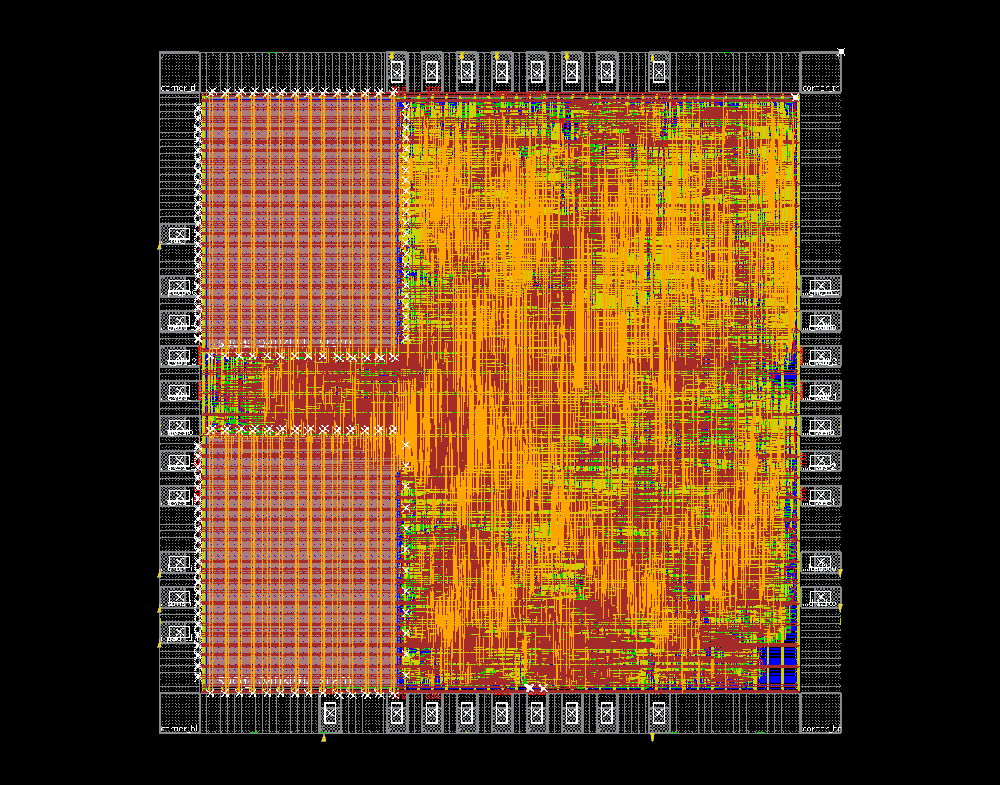
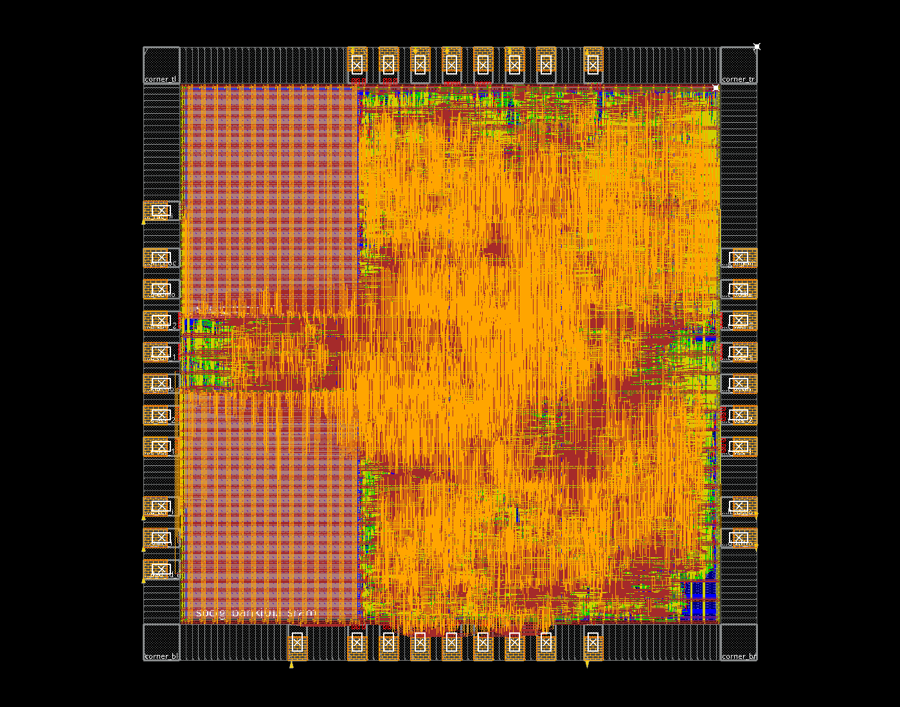
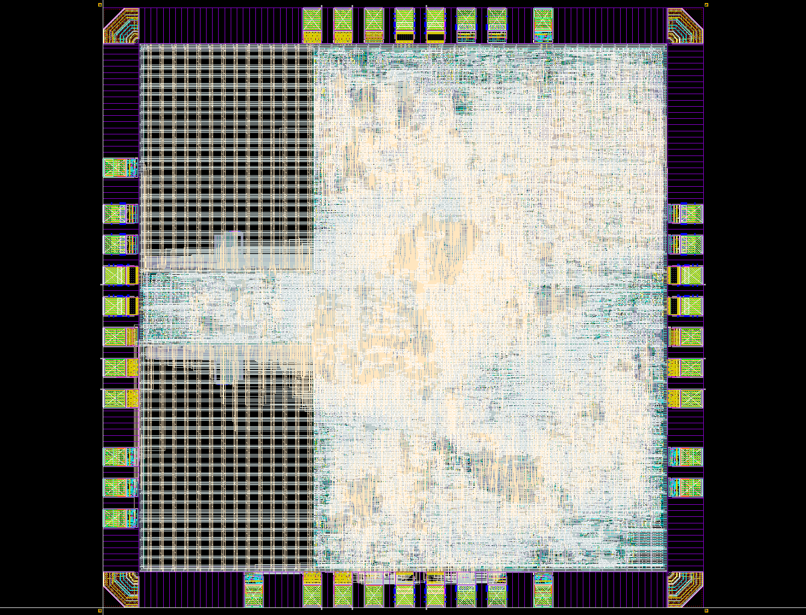

# 后端专题教程：Tcl命令、数据库变化与GUI观察

本教程配合[完整实现复盘](backend-rf1r1w-r3-full-process.md)阅读。复盘记录真实问题和数值；本文解释每组命令改变了什么、为什么按这个顺序执行，以及去哪里观察。参考对象是**GPIO加入前RF 1R1W、1950µm、最终r3**，不是当前GPIO源码的重跑结果。

## 1. 先理解三类命令

| 类型 | 例子 | 执行后的变化 |
| --- | --- | --- |
| 设置/加载 | `setPlaceMode`、`setOptMode`、`read_sdc` | 更新模式或约束；通常尚未产生单元/走线 |
| 修改设计 | `place_opt_design`、`ccopt_design`、`routeDesign` | 改实例、连接、坐标或金属，可能影响面积/时序 |
| 检查/导出 | `checkPlace`、`timeDesign`、`saveDesign` | 生成报告/文件；检查本身不等于修复 |

例如`setOptMode -holdTargetSlack 0.02`只是设优化目标，必须随后执行`optDesign -hold`才会插延迟单元。`verify_drc`产生marker，不会自动消除marker对应的几何问题。

Tcl基本读法：`$out`取变量，`[...]`执行内部命令并使用其返回值，`{...}`把内容作为字面量传递，`foreach`逐项迭代，`source`立即执行另一个脚本，`error`立即中止当前流程。`dbGet`返回对象/列表，单元素列表也不能一律当普通字符串；网名匹配应注意`lindex`和层次名。

## 2. 如何打开GUI并观察每一步

### 2.1 使用冻结数据库，而不是重复运行修改命令

服务器终端有图形显示环境时：

```bash
cd /home/s2400012841/chip-fullstack-2026/eda-runs/20261110-rf1r1w-die1950-fullchip-r3
innovus
```

在Innovus Tcl控制台加载一个检查点：

```tcl
set run_root /home/s2400012841/chip-fullstack-2026/eda-runs/20261110-rf1r1w-die1950-fullchip-r3
set out $run_root/mynpu/pnr
restoreDesign $out/checkpoints/10_post_cts.enc.dat mynpu_asic_top
fit
```

`restoreDesign`加载网表、物理位置、约束及已有布线等数据库内容；`fit`只是缩放视野。初学时建议分别启动两个GUI打开前后检查点，避免混淆已有选择、颜色和未保存修改。

这些批处理脚本末尾有`exit`。**不要在GUI直接source整个阶段脚本来学习**，否则它可能恢复旧点、重新修改设计并退出GUI。观察用restore；实验则在独立目录复制输入、另存检查点，按组执行，不能覆盖冻结运行。某些子脚本含绝对路径，复制前也要检查路径。

### 2.2 固定观察顺序

1. 全芯片视图：die、core、两块SRAM、PAD位置是否正确。
2. 显示标准单元，隐藏信号线：观察放置密度与空隙。
3. 分别显示special PG、clock和signal nets；不要把三类线混在一起判断拥塞。
4. Layer面板逐层看M1～M6，选中对象查看属性中的net、layer、width、status。
5. 选择实例，通过属性确认master cell及层次归属；相邻单元不一定属于同一模块。
6. 打开报告/Violation Browser，定位marker及其两侧几何。只有marker截图不足以判断该删哪条线。

不同版本菜单名可能有差异，以上操作通过对象属性、显示控制、时序/DRC浏览器完成。Tcl及实际报告比菜单名字更稳定。

只读查询示例：

```tcl
dbGet top.fPlan.box
dbGet top.fPlan.coreBox
dbGet top.insts.name
# 精确实例名先从上一条结果中取得：
set inst [dbGet top.insts.name <精确实例名> -p]
dbGet $inst.cell.name
dbGet $inst.box
dbGet $inst.pStatus
```

`-p`返回匹配对象的上一级指针，后续才能读取实例属性；返回`0x0`通常表示没匹配，不能继续假设拿到了合法对象。大规模列表建议重定向文件，不要在GUI一次打印十万行。

## 3. 综合：从RTL变成工艺单元

输入RTL描述功能，Liberty描述单元时序/功耗/面积，LEF描述物理抽象，SDC描述时钟和接口预算。SRAM需要宏库，不能用几千个寄存器替代后再当作宏实现面积。

### 3.1 导入与时序预算

下面是命令结构示例，尖括号需要替换；实际长文件列表见冻结`20261110-rf1r1w/synth.tcl`。

```tcl
set_db design_process_node 180
read_libs {<标准单元TT.lib> <SRAM TT.lib>}
read_physical -lef {<标准单元.lef> <SRAM.vclef> <补充antenna.lef>}
read_hdl -sv {<项目RTL文件列表>}
elaborate npu_core
read_sdc <synth.sdc>
```

**之后的变化：** 设计进入Genus数据库，层次和连接已建立；还不能把RTL运算符数量当最终工艺单元数量。检查未解析模块、端口宽度和宏识别；若SRAM模块未解析，先修库/模块名，不继续报面积。

本轮核心综合用系统18ns、JTAG100ns；报告用20ns重新评估同一网表。输入输出delay不是走线长度，而是分配给芯片外部路径的时序预算；uncertainty是时钟误差预算，不是布线器可以随意使用的延迟。

### 3.2 门控与三步综合

```tcl
set_db lp_insert_clock_gating true
set_db syn_generic_effort high
set_db syn_map_effort high
set_db syn_opt_effort high
syn_generic
syn_map
syn_opt
```

| 命令后 | 内部变化 | 应观察 |
| --- | --- | --- |
| `syn_generic` | RTL展开、表达式/寄存器优化，建立通用逻辑 | 宽度、寄存器数量、意外存储结构 |
| `syn_map` | 通用逻辑映射为库内门、触发器、ICG等 | SRAM仍是宏，乘法器/FF/ICG构成 |
| `syn_opt` | 在当前约束下做逻辑与映射优化 | 面积与setup同时比较，不能只看一个数 |

`.ungroup_ok false`保留主要模块边界，便于后续统计和染色，不是冻结模块内部所有逻辑。门控设置允许工具提取公共寄存器使能，能减少逐位反馈mux，但实际是否提取、提取多少，要看网表/报告。

历史增量门控试验额外使用：

```tcl
set_db lp_insert_clock_gating_incremental true
set_db lp_clock_gating_register_aware true
syn_opt
```

它作用于已有映射数据库，不代表在空设计上只跑这三行即可完成综合。历史选中结果约2.515488mm²；最终RF1R1W网表为2.569286mm²，二者RTL阶段不同。完整搜索表及队列缩小的性能代价见复盘第3节。

### 3.3 生成报告与交接

```tcl
report_area
report_qor
report_timing -max_paths 10
write_hdl > <mapped.v>
write_sdc > <mapped.sdc>
```

**之后的变化：** 主要新增报告和映射网表文件，尚无真实布局。面积按库单元求和，不包含未来CTS、hold修复和filler；综合时序也不是布线后时序。芯片壳层综合再复用已映射核心并加入完整IO相关逻辑，防止后端只实现裸核心。

## 4. 导入Innovus：建立物理数据库

冻结脚本`pnr_01_floorplan_io.tcl`先设置：

```tcl
set init_verilog <完整芯片postsyn.v>
set init_top_cell mynpu_asic_top
set init_lef_file [list <STD LEF> <IO LEF> <Bond LEF> <SRAM LEF>]
set init_mmmc_file <chip_mmmc.tcl>
set init_pwr_net VDD
set init_gnd_net VSS
setLibraryUnit -cap 1pf -time 1ns
init_design
setDesignMode -process 180 -bottomRoutingLayer METAL2 -topRoutingLayer METAL6
setAnalysisMode -analysisType onChipVariation -cppr both
setDelayCalMode -SIAware false
```

- `init_*`变量指定输入，`init_design`才真正装入设计。
- MMMC脚本连接Liberty、RC corner、SDC和analysis view；不能只有一个clock定义而没有库。
- 工艺/布线层设置限定实际路由层；不创建M2～M6金属线。
- OCV考虑所设分析模式的时序变化，CPPR去除公共时钟路径的重复悲观；本轮仍只有TT单角，不因此变成多角签核。
- `SIAware false`关闭该SI感知分析，不应宣称已做串扰签核。

**GUI变化：** 能看到设计对象和宏类型，但还没有有效完成的全芯片放置。先查未解析单元与单位，再做floorplan。

## 5. Floorplan与SRAM：定义空间，固定大物体

### 5.1 Die/Core

```tcl
set core_box {130.48 129.36 1819.84 1819.84}
floorPlan -site core7T -b [concat {0 0 1950 1950 0 0 1950 1950} $core_box] -noSnapToGrid
```

`-b`给出die、IO边界和core边界；site指定标准单元行的放置基本单位。`-noSnapToGrid`控制本次边界自动对齐，不代表后续标准单元可以任意离开site放置。

**变化：** 新建1950µm边界及core rows；没有完成标准单元放置。GUI打开row显示，检查外围预留区域，不要将core面积当die面积。

### 5.2 放宏、留halo、切row

```tcl
placeInstance $name $x $y $orientation -fixed
addHaloToBlock $left $bottom $right $top $name -snapToSite
cutRow -area <宏外轮廓扩0.5µm的矩形>
checkFPlan -reportUtil -outFile <floorplan_check.rpt>
saveDesign <01_core_floorplan.enc>
```

- `placeInstance`修改坐标/朝向并固定宏，后续放置器不再随意移动它。
- halo为宏附近保留标准单元空间，不是制造金属，也不等价于禁止所有金属经过。
- `cutRow`删除指定区域可放标准单元的row，避免M1贴近宏；它不切掉SRAM内部结构。
- 检查/保存不会进一步优化宏位置。

**GUI变化：** 两块宏分别左下R180、左上R0，信号边朝内；halo/row空白可见。对比原始LEF完整边界与OVERLAP内缩，不能只凭宏图标轮廓猜距离。

## 6. PAD：建立真实外部接口

### 6.1 实例、端口和核心网分开

```tcl
addInst -cell PDDW0204CDG -inst $name -loc [list $x $y] -ori $orientation -place_status fixed -dontSnapToPlacementGrid
addNet ${port}_pad
detachModulePort - $port
attachModulePort - $port ${port}_pad
attachTerm $name PAD $ext_net
# 输入方向：
attachTerm $name C $core_net
attachTerm $name OEN 1'b1
attachTerm $name IE 1'b1
attachTerm $name I 1'b0
```

`addInst`创建native IO实例；detach/attach把顶层端口转到外侧网，内部核心信号仍通过PAD输入接收端。OEN为输出禁止控制，输入模式置1，IE接收端开启。输出模式使用PAD的I端，OEN=0、IE=0；PE/DS按既定配置接常量。

**变化：** 核心网和外部网成为两个网络，通过IO单元联系。GUI追踪路径应是top port→PAD→core，不能直接port→core绕过PAD。

### 6.2 补全外围结构

脚本继续添加core/IO供电、POC、corner、Bond以及IO filler。`loadIoFile -specifiedIosOnly`应用PAD位置计划；`optimize_pads.tcl`在放置阶段还会重排信号PAD，所以01脚本中初始坐标不是最终r3坐标。

**变化：** 37个native PAD（9信号＋28电源/POC）、37个Bond窗口、4角及填缝构成环。观察四边朝向、间隙、Bond覆盖、端口标签与真实导体是否重叠。电源PAD移动之后还必须同步顶层PG标签。

## 7. PG：先绑定网络，再画电源导体

### 7.1 逻辑绑定与core ring

```tcl
globalNetConnect VDD -type pgpin -pin VDD -all
globalNetConnect VSS -type pgpin -pin VSS -all
setAddRingMode -avoid_short true -stacked_via_bottom_layer METAL1 -stacked_via_top_layer METAL5
addRing -nets {VDD VSS} -type core_rings -follow core -layer {top METAL5 bottom METAL5 left METAL4 right METAL4} -width 4 -spacing 2 -offset 2 -center 0
```

`globalNetConnect`绑定PG pin归属，**不画线**。`setAddRingMode`设置后续画环行为；`addRing`才生成金属/过孔。width/spacing/offset单位为µm，offset按core边界计算。

**变化：** core四周出现两条供电环，但宏和所有标准单元未必已连通。GUI只显示special PG和M4/M5看环，不能看到环就认定供电完整。

### 7.2 Stripe和SRAM接入

```tcl
addStripe -nets {VDD VSS} -layer METAL4 -direction vertical -width 2 -spacing 1 -set_to_set_distance 40 -start_from left -start_offset 8
addStripe -nets {VDD VSS} -layer METAL5 -direction horizontal -width 4 -spacing 2 -set_to_set_distance 60 -start_from top -start_offset 1
```

这是核心参数摘录；冻结脚本还包含via层范围、block ring限制等选项，不能用短摘录替代完整生产脚本。`spacing`是同一组相邻线间距，`set_to_set_distance`是重复组节距，不是同一个量。

随后`sroute -connect {blockPin} -blockPin useLef`按宏LEF pin连接SRAM；M6竖stripe与M5横跨接补充宏上方供电。角落宏不另画与core ring碰撞的四边block ring。

**变化：** 横竖PG grid和宏接入via出现。查看每根stripe属于VDD还是VSS，检查跨层via，不根据线条视觉相交推断电连接。

### 7.3 PAD、row和tap

```tcl
# 实际脚本还明确指定目标层和via范围：
sroute -nets {VDD VSS} -connect {padPin} <其他完整选项>
sroute -nets {VDD VSS} -connect {corePin} <其他完整选项>
addWellTap -cell TAPCELLBWP7T -cellInterval 60 -checkerBoard -prefix WELLTAP
verifyWellTap -cell TAPCELLBWP7T -rule 30 -report <welltap.rpt>
verifyConnectivity -type special -net {VDD VSS} -allPGPinPort -report <pg.rpt>
```

padPin连接PAD与ring；corePin接标准单元行M1供电；tap增加衬底/阱接触实例，不是数据逻辑。verify命令只检查。

**变化：** row供电rail和tap出现，检查点`06_powerplan`可保存。PG修补脚本清理已证明冗余的via，之后重查DRC和连通；不能直接删除所有报错via。

## 8. 放置：小单元从未放置变成合法坐标

```tcl
setPlaceMode -place_global_cong_effort high
setPlaceMode -place_global_max_density 0.98
setPlaceMode -place_global_ignore_scan true -place_global_reorder_scan false
setOptMode -maxDensity 0.99 -fixHoldAllowSetupTnsDegrade false
place_opt_design
checkPlace <07_place_check.rpt> -ignoreOutOfCore
saveDesign <07_placed.enc>
```

mode命令不移动单元；`place_opt_design`综合考虑线长、拥塞和时序进行放置与优化，可能更换驱动或添加buffer。0.98/0.99为阶段上限，不是最终实测density。ignore scan是本轮功能实现设置，不能等同完成DFT。

**GUI变化：** 标准单元落入row，飞线变短，出现密度/拥塞热点。比较07与06，观察单元是否侵入宏halo、是否有overlap，而不是只看填得是否紧密。

```tcl
setTieHiLoMode -cell {TIEHBWP7T TIELBWP7T} -maxFanout 1 -maxDistance 100
addTieHiLo -cellPin {PDDW0204CDG:I PDDW0204CDG:DS PDDW0204CDG:OEN PDDW0204CDG:PE PDDW0204CDG:IE}
# 核心tie另设fanout/distance并排除供电端子
refinePlace
timeDesign -preCTS -expandedViews -outDir <preCTS>
saveDesign <08_post_tie.enc>
```

**变化：** 常量由合适的tie单元提供，refinePlace做局部合法化；preCTS仍没有完整真实时钟树。最终r3此处setup约+0.058ns。GUI选一个IO控制pin，追踪应看到tie网，而不是错误连到POC或外部供电端子。



## 9. CTS：把理想时钟变成真实树

```tcl
set_ccopt_property primary_delay_corner delay_tt_io
set_ccopt_property buffer_cells {CKBD1BWP7T CKBD2BWP7T CKBD4BWP7T CKBD6BWP7T CKBD8BWP7T CKBD10BWP7T CKBD12BWP7T}
create_ccopt_clock_tree_spec -views {func_tt_io}
ccopt_design -check_prerequisites
saveDesign <09_pre_cts.enc>
ccopt_design
set_propagated_clock [get_clocks {sys_clk jtag_clk}]
```

指定cell列表限定CTS可选时钟buffer；clock tree spec从时钟/约束生成树规划；prerequisite检查不构建树；`ccopt_design`插入并优化实际树，可能调整数据路径；propagated clock使时序分析使用已建树的延迟。

实际脚本还设置允许的inverter、IO latency策略、source slew/cap，并把setup uncertainty由0.52改成0.47ns、hold保持0.2ns。这些约束变化也影响报告，不能将前后WNS差异全归于插树。

**GUI变化：** 新增时钟buffer/inverter与分支；查看clock tree层次、sink分布与latency/skew，比较09/10。Useful skew实际开启，不能要求每个sink绝对同延迟。系统插入延迟约1.367～1.497ns。

```tcl
timeDesign -postCTS -expandedViews -outDir <postCTS>
timeDesign -postCTS -hold -expandedViews -outDir <postCTS_hold>
```

**报告变化：** setup +0.161ns，hold−0.555ns/95条。插树没有“自动保证hold通过”。在timing browser分别看max/min路径及launch/capture时钟；不要只显示数据路径。

## 10. Hold：设置目标不等于改变检查标准

```tcl
setOptMode -fixHoldAllowSetupTnsDegrade false
optDesign -postCTS -hold -expandedViews -outDir <postCTS_holdFix>
timeDesign -postCTS -expandedViews -outDir <setup复查>
timeDesign -postCTS -hold -expandedViews -outDir <hold复查>
saveDesign <11_pre_route.enc>
```

**变化：** 数据短路径新增93个buffer/delay单元，局部位置和连线更新；hold95条→0、裕量+0.001ns，setup +0.172ns。GUI对比原来boot到CPU的短路径，会看到增加的延迟链。不是靠降低主频修复同沿hold。

route之后再次执行：

```tcl
setOptMode -fixHoldAllowSetupTnsDegrade false -holdTargetSlack 0.02
optDesign -postRoute -hold -expandedViews -outDir <postRoute_holdFix>
```

**变化：** 再新增134个修复单元，31条→0，最终hold+0.018ns；0.02为优化期望，SDC hold检查没有因此放宽。具体关键路径与单元构成见复盘第7节。

## 11. Route：飞线变成逐层金属与via

```tcl
checkPlace <route_entry_place.rpt> -ignoreOutOfCore
setNanoRouteMode -routeWithTimingDriven true -routeDesignRouteClockNetsFirst true
setNanoRouteMode -drouteFixAntenna true -routeInsertAntennaDiode true -routeAntennaCellName ANTENNABWP7T
setNanoRouteMode -drouteAutoStop false -drouteEndIteration 20
setExtractRCMode -engine postRoute -effortLevel low -tQuantusForPostRoute false
routeDesign
```

先检查无未放置和非法重叠，再路由；路由器不是overlap修复器。routeWithTimingDriven考虑时序，clock first优先时钟。显式指定antenna diode是因为该库LEF类别不能完全依赖自动识别。

**变化：** 信号飞线变成M2～M6真实走线与via，产生提取RC及可能的antenna支持单元；拥塞可能变成绕线、DRC和时序下降。20迭代给定修复机会，不保证全部DRC归零。

```tcl
verify_drc -check_only default -limit 100000 -report <route_drc.rpt>
verifyConnectivity -type regular -report <signal.rpt>
verifyConnectivity -type special -net {VDD VSS} -allPGPinPort -report <pg.rpt>
verifyProcessAntenna -report <antenna.rpt>
timeDesign -postRoute -expandedViews -outDir <postRoute>
timeDesign -postRoute -hold -expandedViews -outDir <postRoute_hold>
```

**之后：** 生成分开的几何、信号连通、PG、天线和时序结果；某一项0不能替代其他项。GUI按层观察via enclosure和相邻线间距，不要在全层叠加图中凭颜色判短路。



## 12. 收尾、filler与定向ECO

```tcl
setFillerMode -core {FILL64BWP7T FILL32BWP7T FILL16BWP7T FILL8BWP7T FILL4BWP7T FILL2BWP7T FILL1BWP7T} -corePrefix FILLER -check_signal_drc true -add_fillers_with_drc false
addFiller
ecoRoute -target
editTrim -nets {VDD VSS}
```

摘录展示核心选项，冻结脚本还有fitGap/ecoMode等设置。Filler填单元行空隙，保持工艺连续性，不增加计算能力；ecoRoute修受影响局部连线；editTrim修剪相应PG悬空段，需要继续验证PG，不能理解为任意删短线。

**变化：** 空隙出现31,407个core filler，单列面积0.209659mm²；不把它们计入功能逻辑面积。若还要移动单元，通常先移除受影响filler再ECO并补回。

### 12.1 如何修DRC，而非只清marker

| 一组操作 | 数据库变化 | 必须复查 |
| --- | --- | --- |
| PG冗余via几何/同网断言→定向删除 | 删除冗余阵列，保留有效金属与via | special connectivity＋DRC |
| unplace单一CPU FF→ecoPlace→ecoRoute | 一个触发器搬离冲突位置，局部线改变 | placement＋reset连通＋setup/hold |
| `createRouteBlk ... -layer METAL2 -exceptpgnet`→定向重布 | 新增信号路由限制并改变一条CPU网 | 实际GDS M2.S.2＋STA |
| 按Bond方向构造M5/M6禁布区→重布 | 74个信号blockage，4条数据网改线 | WB＋完整DRC＋LVS＋STA |

route blockage是数据库中的约束，不是新制造金属。创建blockage本身不会自动把已经违规的线挪开；必须执行受控重布。删除marker也不会删除违规导体。

查看[已验证ECO脚本](../eda/tsmc180/fullchip/verified_die1950_ecos/README.md)。这些脚本含精确实例/位置断言，不能直接套到GPIO或另一版综合网表。

## 13. Export：为什么要输出这么多文件

```tcl
defOut -routing <final.def>
saveNetlist <flat_lvs.v> -excludeLeafCell -flat -phys -excludeCellInst <纯物理排除列表>
write_sdc -view func_tt_io > <final.sdc>
extractRC
rcOut -view func_tt_io -cUnit pF -spef <final.spef.gz>
write_sdf -min_view func_tt_io -typ_view func_tt_io -max_view func_tt_io -recompute_delay_calc <final.sdf.gz>
setStreamOutMode -labelAllPinShape true -virtualConnection false
streamOut <final.gds.gz> -mapFile <gds2.map> -merge <STD SRAM IO Bond原生GDS列表> -mode ALL -units 2000
```

| 文件 | 包含什么 / 不包含什么 |
| --- | --- |
| DEF | 实例坐标、朝向、网络及走线，依赖LEF解释 |
| Flat LVS Verilog | 源连接，保留LVS所需器件，排除纯物理填充等 |
| SDC | 时序约束，不是实际延迟 |
| SPEF | 提取寄生RC，不是时序通过证书 |
| SDF | 时序回标数据；三个参数都用同TT view，不意味着三个工艺角 |
| GDS | 制造几何，合并原生库才有宏/IO真实内部结构 |

**之后变化：** 文件产生，设计没有因为导出自动变好。检查top、layer map、units、库结构引用以及GDS/CDL哈希。SDF已导出也不代表做过SDF回标仿真。

注意：基础`pnr_07_export.tcl`恢复`13_finished`；r3成功最终export实际恢复修复后的检查点。应读`scripts/07-wbfix2-executed.tcl`及成功ECO导出脚本，不能运行基础模板后把未修复的GDS当最终r3。

## 14. Lab 5：从PNR GDS到最终检查

此阶段主要使用SKILL、Python及Calibre规则/命令，不是所有操作都是Tcl；应理解工具边界。

| 命令组/操作 | 之前→之后 | GUI/报告应观察 |
| --- | --- | --- |
| `v2lvs`，读取STD/IO SPI及真实SRAM CDL | Verilog连接→可对照的CDL源电路 | SRAM端口顺序、常量、PG、POC |
| `strmin ... -dbuPerUU 2000` | GDS→私有OA布局 | 网格未舍入、layer map正确 |
| `virtuoso -nograph -restore build_layout.il` | 原设计→加入Seal Ring、POC及私有PIMP修补 | 物理环外框1980µm、无seam |
| `strmout` | 私有OA→preDummy GDS | 导出层和POC标签保留 |
| `calibre -drc`，Metal及OD/PO fill规则 | 密度不足→生成两份Dummy GDS | pre/post密度规则差异 |
| `calibredrv ... filemerge` | 三份GDS→postDummy顶层 | 原设计、环和fill同时存在 |
| `calibre -lvs` | 几何提取与CDL比较 | 端口/网络/器件和属性逐项匹配 |
| 完整DRC/antenna/WB | 同一最终GDS→独立检查报告 | 不能拼接不同版本通过项 |

私有PIMP修补将IO一处边缘扩0.29µm，修复CO.R.4；没有修改共享库文件，但确实改变最终IO几何，需库/工艺负责人认可。Seal Ring通过增减原生边单元拼接，禁止缩放工艺图形。

最终教学容差LVS CORRECT、605属性检查；严格LVS仍有IO电阻差异；ERC7层次/977展开待评审。课程四类单列后DRC0不等于原始deck0；最终天线62项和WB64项0。所有数值和原始非零规则见复盘。



## 15. 推荐的学习练习与检查表

先只读比较：03与06看PG增加；06与08看标准单元/tie；09与10看时钟树；10与11看hold delay；11与12看信号金属；13_finished与13_wb_fixed看定向ECO；preDummy与postDummy看密度填充。

每完成一组命令，写下四项：**新增/删除了什么对象、哪些对象位置或连接改变、哪个报告证明达标、还有什么没有验证**。例如“timeDesign运行结束”不是“setup/hold通过”，必须记录WNS/TNS/path count；“route完成”不是“Calibre通过”。

最终可复核的链应为：冻结输入→每阶段检查点→成功执行脚本→最终GDS/CDL哈希→对应完整检查报告。本文未重新运行任何EDA阶段，也没有把GPIO当前设计套用旧r3结论。
