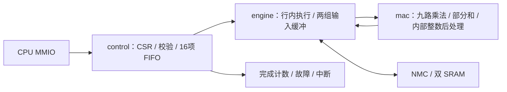

> 历史阶段记录：当前 CNN 原始结果、vector 后处理及双 bank regfile 见 [当前架构](regfile-vector.md)。本文数值与旧 ABI 仅对应当时快照。

> 本文代码行数和源码哈希记录格式化前的精简快照。当前排版规则与等价验证见 [代码格式规范](../../FORMATTING.md)。

# CNN 冗余逻辑精简

当前 CNN 固定使用九路乘法、输入通道外循环和整行输出位置内循环。CPU 仍调度输出通道、输出行和层；一次 CRO2 任务执行一个输出通道的一行，或一个 FC 点积。本次不修改固件、模型或整数结果。

## 删除了什么

| 原有结构 | 当前实现 | 理由 |
|---|---|---|
| 旧四输出小块与整行两套路径 | 只保留整行 | 当前软件和性能目标使用整行；删除分支及专用坐标控制 |
| 3/9 MAC 参数化与分支 | 固定九路 | 三路只用于旧性能对照，不属于当前产品配置 |
| 两槽权重命中标签及复制路径 | 按 Ci 顺序加载到 ping-pong bank | 同一个行任务中每个 Ci 只遍历一次，无需命中判断 |
| Conv 的 Ci 与 FC 的特征游标 | 一个归约游标 | 两者都沿输入维度前进，步长分别为 1 和最多 12 |
| 每个 bank 一份 multiplier/bias，以及操作数级副本 | 每个任务一份 multiplier/bias | 一行只属于一个输出通道，两个输入 bank 使用相同量化参数 |
| PREP 加载状态 | 权重/参数请求结束后直接准备输入行 | 删除 FC 路径中仍残留的准备气泡 |
| 重复的输入逻辑起点、裁剪起点和请求快照 | 必要的行范围与在途请求快照 | 内存协议需要快照，但无需重复保存相同地址 |
| 14bit 结果标签与 FIFO 地址偏移 | 5bit 行内字节标签、3bit word 偏移 | 最宽 28 字节，加目标起始字节偏移最多 31 字节、8 个 word |

旧 `NPU_CNN_ROW_ORDER`、`NPU_CNN_MACS` 和对应 RTL 参数及 CLI 选项已移除；传入旧 CLI 选项会报错。只读 CSR `0x4000066c` 返回 9，`0x40000670` 返回 1，保留软件查询接口。CRO2 的 104bit 队列快照、MMIO 地址、任务计数、故障状态和中断语义不变。

## 当前代码分工



- [npu_cnn.sv](../rtl/cnn/npu_cnn.sv)：端口与模块连接，21 行。
- [npu_cnn_pkg.sv](../rtl/npu_cnn_pkg.sv)：任务/事件类型、地址和维度校验，34 行。
- [npu_cnn_control.sv](../rtl/npu_cnn_control.sv)：CSR、任务 FIFO、互斥和统计，68 行。
- [npu_cnn_engine.sv](../rtl/npu_cnn_engine.sv)：访存加载、预取、归约游标、结果打包，158 行。
- [npu_cnn_mac.sv](../rtl/cnn/npu_cnn_mac.sv)：九路乘法、28 个 24bit 部分和、Q24 流水线，61 行。

包含注释与空行，所有 CNN 文件合计 **342 行**，精简前两个文件合计 **462 行**，减少约 **26%**。这里统计全部模块，不能只拿拆分后的顶层行数比较。

保留 5 个执行状态 `IDLE/START/WAIT_INPUT/RUN/DRAIN` 和 6 个加载状态 `BIDLE/WREQ/MREQ/BREQ/AREQ/COMPLETE`。这些状态分别处理缓冲就绪、带宽等待和流水线排空，不执行跨行、跨输出通道或跨层调度。继续删除等待/排空状态会破坏现有握手协议。

保留两份 3×28B 激活条带、两份 12B 权重缓冲、28×24bit 部分和和 8 项输出 word FIFO；未通过缩小缓冲牺牲当前吞吐。CNN 内部的 Q24 乘加、ties-to-even 舍入、输出零点、可选 ReLU 和 U8 饱和属于现有整数模型契约，未改成外置共享服务。

## 验证与性能

同一组未修改的固件和 hex 资产：

| 项目 | 精简前 | 精简后 |
|---|---:|---:|
| 单图推理，不含输入搬运 | 19,936 | **19,825 周期** |
| 单图输入至分类结果 | 20,556 | **20,445 周期** |
| CNN busy 周期 | 18,992 | **18,881 周期** |
| 20 帧总周期 | 408,190 | **406,016 周期** |
| 20 帧平均 | 20,409.5 | **20,300.8 周期/帧** |

单图推理低于 20k；含输入和连续流平均仍超过 20k。节省来自控制气泡减少，没有减少 MAC 数或更换模型。

VCS 使用实际 SRAM 宏功能模型完成单图 10 样本、逐层 19,033 次逐值检查与 20 帧流测试；包括宽度 16/17/27/28、边缘 padding、stride、裁剪、未对齐权重/输出、双 bank、FC 尾部、signed tie 舍入、饱和、非法尺寸和重叠地址。其余回归覆盖 CNN FIFO 深度 1/2/16 的快照、溢出、顺序、故障和复位，以及 matrix/vector、CPU、JTAG、NMC 并发、DMA 和批量任务。测试中的层级探针随模块拆分更新，golden 和期望整数不变。

| 综合指标 | 精简前 | 精简后 |
|---|---:|---:|
| 全芯片含 SRAM 的 Cell Area | 2.767714113mm² | **2.703941357mm²** |
| CNN Cell Area | 0.759910189mm² | **0.696958438mm²** |
| 50MHz setup slack | +4.0028ns | **+4.0028ns** |
| 系统 TNS / 违例路径 | 0 / 0 | **0 / 0** |

同库、同约束、同 effort 比较，CNN自身面积减少约8.28%，全芯片减少约2.30%；新CNN面积统计执行核与控制模块，不重复加算执行核内部的MAC子模块。最终映射网表还以零延迟、无SDF方式验证单图推理与批量任务；它不能替代布线后时序验证。

本轮综合结果和网表验证统一记录在 [cnn_cleanup_validation.json](../reports/cnn_cleanup_validation.json)。原始运行及精简前源码保存在工作区外 `../eda-runs/20261103-cnn-cleanup/`。综合使用 TSMC180 TT、low effort、16ns 优化 / 20ns 报告，包含 CPU、三个独立计算单元、NMC、DMA、JTAG 和两块真实 8KB SRAM，不含 PAD。尚未进行本版布局布线。旧整行/小块对比仅作为[历史记录](cnn-row-order.md)，其报告不代表当前源码。

复现时使用新的 tag 和不存在的输出目录：

```sh
/usr/bin/python3.12 npu/scripts/run_vcs.py --suite latency --macro --max-cycles 20000 --tag NEW_TAG
/usr/bin/python3.12 npu/scripts/run_vcs.py --suite layers --macro --tag NEW_TAG
/usr/bin/python3.12 npu/scripts/run_vcs.py --suite stream --macro --tag NEW_TAG
/usr/bin/python3.12 npu/scripts/run_vcs.py --suite cnnqueues --tag NEW_TAG
/usr/bin/python3.12 npu/eda/tsmc180/prepare_run.py --out ../eda-runs/NEW_RUN --effort low
```

综合和网表运行命令见 [EDA 说明](../eda/tsmc180/README.md)。[收集脚本](../scripts/collect_cnn_cleanup.py)核对当前源码、库、测试和资产哈希，并区分冻结的精简前记录与当前测量。
