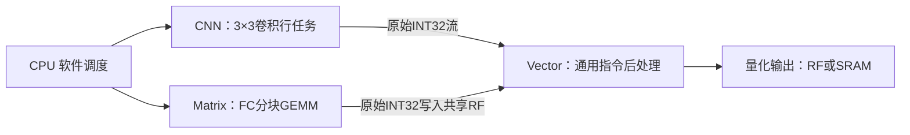

> 本页记录删除CNN FC时的基线。当前RF/CNN已改为[并行RF读与小窗口](rf-gather.md)，旧面积和25,950周期不代表当前版本。

# CNN 只执行卷积，FC 迁移到 Matrix

本次删除 CNN 的 FC 模式，不修改 Matrix 数据通路，不增加专用量化单元。默认仍为 256B 共享 RF、两块 8KB SRAM、Matrix/Vector/CNN 队列 8/8/16 项。



## 硬件变化

- 删除 CNN 的 FC 分块长度、feature cursor、FC tap cursor、FC取数与模式选择；输入通道 cursor 缩为5bit。
- 九个卷积 tap 固定连接三个输入行及九个权重位置，保留双缓冲、stride 1/2、边界补零和输入零点扣除。
- CNN仍输出原始有符号INT32，支持写内存或流给Vector。无量化、偏置、激活或U8打包计算。
- CRW2 的 ABI 为 `0x43525732`，寄存器地址不变。配置 `op` 仅允许0（内存输出）或2（流输出）；旧 FC 操作码1和3在入队前报错，不能被静默当成卷积。
- 队列快照由85bit减至81bit，保留16深度。宽度最大28；硬件仍保留完整CSR校验，再打包窄字段。

## FC 软件实现与整数结果

当前 Matrix 是通用有符号 INT8/INT16 GEMM，单任务 `M,N,K ≤ 16`。MNIST最后一层是144→10，软件分解为每个输出9个 `M=1,N=1,K=16` 任务，共90个任务。首块使用 `PACKED=8` 覆盖结果，后8块使用 `PACKED|ACCUMULATE=12`，由FIFO顺序保证同一目标地址的累加依赖。

Matrix接收signed INT8，而模型的激活是U8。软件在输入最后一次使用时原地对每个字节XOR `0x80`，得到 `a = u − 128`，不复制权重。对于原始零点 `iz`：

```
原始点积 = Σ((u − iz) × w)
         = Matrix点积 + (128 − iz) × Σw
```

编译固件时，对每个输出通道生成 `offset=(128−iz)×Σw`。原权重及Q24参数不改，另追加10组三个32bit常量 `[M,bias,offset]`，参数区由3932B变为4052B，仍仅存一份权重矩阵。

FC的通用Vector程序如下。前四条每个通道执行一次，之后的五条处理该通道的原始点积：

```
LD32    r2,[r1+4]        # 原有Q24 bias
LD32    r0,[r1+8]        # offset
LD32    r1,[r1]          # M
MADD32  r2,r0,r1,r2      # INT64: compensated_bias = offset*M + bias
# 循环入口：r0装载Matrix的原始INT32结果
MADD32  r0,r0,r1,r2      # INT64: raw*M + compensated_bias
RSHR64  r0,r0,24         # 原有整数 ties-to-even 舍入
ADD32   r0,r0,r3         # 输出零点
MAX32   r0,r0,0          # FC无ReLU，按U8下界裁剪
MIN32   r0,r0,255
```

补偿留在INT64中，不能把 `offset*M+bias` 强行存成INT32。边界测试包括补偿乘积达到 `2^31`、输入零点255、长度1～16及143/144、正负累加边界；结果与原整数参考一致。卷积的前五层仍使用原来的流式通用Vector程序。

默认配置下，最后一层输入占共享RF的 `[0x80004048,0x800040d8)`；十个Matrix原始结果放在相邻的 `[0x800040d8,0x80004100)`，没有覆盖输入。Vector最终将十个U8 logits写到SRAM输出区。软件在Matrix完成后再提交Vector任务，在Vector排空后再报告层完成；连续流保留输入槽所有权协议和RX/TX重叠。

## 同配置综合面积对照

两次均使用TSMC180 TT、相同的256B RF和8/8/16队列、Genus low effort、16ns综合及20ns报告约束。

| 模块 | 删除FC前 | 删除FC后 | 变化 |
|---|---:|---:|---:|
| CNN engine | 0.367187mm² | 0.326562mm² | −11.1% |
| CNN control | 0.177877mm² | 0.173550mm² | −2.4% |
| CNN合计 | 0.545064mm² | 0.500113mm² | −8.2% |
| 全核心，含两块SRAM、不含PAD | 2.927683mm² | 2.881318mm² | −1.6% |

MAC子模块仍为0.090488mm²，九路乘法和累加容量不变。全核心减少0.046365mm²，主要来自FC取数和选择逻辑的删除；其他未改RTL的模块也可能受全局映射优化影响，不能把每一处映射差异解释为源代码改动。50MHz报告约束下，系统setup slack为 **+4.0077ns**，TNS为0。这些是综合结果，不能证明含PAD的2×2mm²布局布线已经收敛。

CNN仍有约0.4096mm²落在MAC子模块之外；本次没有精简卷积缓冲、取窗、命令队列和完整CSR校验，因此节省有限。

## 功能与性能边界

15项RTL回归覆盖逐层golden、单图、20帧连续推理、JTAG、共享存储、DMA、算子、队列和错误处理。另有4项无SDF映射网表回归通过：单图推理、JTAG（41项检查）、通用算子（68个GEMM/116个Vector任务，8706项检查）、队列突发（516项检查）；映射网表推理周期与RTL一致。CNN队列测试改为真实1×1图像的3×3 padded卷积，并显式验证旧FC操作码拒绝。

| 默认256B RF | 本次实测 |
|---|---:|
| 10张单图推理，均一致 | 25,950周期 |
| 仿真含输入DMA | 26,571周期 |
| 20帧连续流合计 | 525,780周期 |
| 连续流平均 | 26,289周期/帧 |
| 每张CNN卷积任务 | 212 |
| 每张Matrix FC任务 | 90 |

**功能迁移完成，但未达到原先小于20k周期的目标。** 相比删除FC前的19,986周期，本次增加5,964周期。当前Matrix逐元素取数、单任务K较小；后续性能优化应改进通用GEMM的数据复用和任务粒度，不再把FC特例放回CNN。两种架构都完成同样的40,770次有效乘加：CNN 39,330次、Matrix 1,440次；测试日志中的CNN利用率统计只统计CNN。

面积与综合时序结果见[本次机器报告](../reports/cnn_conv_only_validation.json)。旧VPG1/CRW1报告与含PAD的CTS失败记录均属于删除FC前的版本，本次没有重跑布局布线。

## 复现

```sh
python3.12 npu/mnist/firmware.py
python3.12 npu/mnist/stream_firmware.py
python3.12 npu/scripts/run_vcs.py --suite layers --tag NEW_LAYERS
python3.12 npu/scripts/run_vcs.py --suite latency --tag NEW_LATENCY
python3.12 npu/scripts/run_vcs.py --suite stream --tag NEW_STREAM
python3.12 npu/eda/tsmc180/prepare_run.py --out ../eda-runs/NEW_CNN_CONV_ONLY --effort low --synth-period 16 --report-period 20
genus -no_gui -batch -files ../eda-runs/NEW_CNN_CONV_ONLY/synth.tcl > ../eda-runs/NEW_CNN_CONV_ONLY/launcher.log 2>&1
```

此前 `--max-cycles 20000` 门限在本次应当报失败，不能降低测试覆盖或把输入DMA排除方式改掉来隐藏性能回退。
