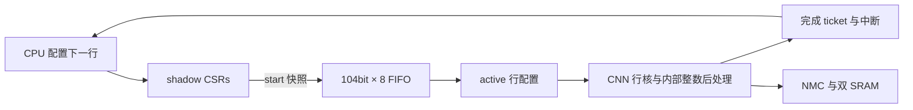

> 历史记录：本文是 CNN FIFO 2/8 项实验。当前三种任务 FIFO 均为16项，见[最新说明](fifo16.md)与[当前报告](../reports/fifo16_validation.json)。下文数字属于旧快照。

# CNN 行任务 FIFO 与面积时序对照

当前默认 CNN FIFO 为 **8 项待执行任务＋1 项 active**；matrix/vector 仍各为 2 项待执行 FIFO。FIFO 深度通过 `NPU_CNN_QUEUE_DEPTH` 或 `npu_cnn.QUEUE_DEPTH` 配置。CNN 的通道、行和层仍由软件循环调度，没有把整层 FSM 加回来。

## 队列内容与执行

每项 104bit，保存 src/weights/quant/dst 各 14bit SRAM offset、W 8bit、H/Ci 各 5bit、stride 2bit、output_width/y 各 5bit、输入/输出零点各 8bit、opcode 2bit。地址高位由共享 SRAM 区域隐含，提交前用完整 32bit 配置检查范围、维度和重叠，不能靠截断绕过校验。

8 项的数据载荷为 832bit＝104B；2 项为 208bit＝26B。增量 624bit＝78B **只是队列载荷**，还存在读写指针、计数器、配置影子、active 配置、完成统计等逻辑，不能据此直接推算单元面积。



忙时允许修改 shadow CSRs，已经入队或执行的任务不会改变。满队列的提交返回 MMIO error，保留已有任务。完成计数在最后一个输出写响应排空后递增，软件在重用层间 SRAM 前等待全部 ticket 完成。reset 清空队列和计数。

matrix 与 CNN 仍共用访存端口、互斥执行。matrix 已 active/发出 start 或在 CNN 空闲时已有待执行任务，则不能抢先提交 CNN；CNN 已占有端口且 matrix 后来排队时，允许 CNN 队列继续排空，避免双方等待。没有增加跨单元自动依赖推断或共享量化模块。

## 寄存器

基地址 `0x40000600`，原 `+08..3c` 配置字段不变。

| 偏移 | 含义 |
|---|---|
| `00` | 写 1 提交 shadow 快照；写 2 清 done/error；写 8 仅确认 done，保留故障 |
| `04` | bit0 busy（active 或有待执行任务），bit1 sticky done，bit2 sticky error |
| `54` | `0x43524f32`，CRO2 队列 ABI |
| `58` | 高 16bit 为 FIFO 容量，低 16bit 为待执行数量，不含 active |
| `5c/60` | completed/submitted，32bit 累积 ticket |
| `64/68` | 累积实际执行周期/有效 MAC 数；周期不含等待出队的 idle 拍 |

`+40..50` 保留最近一次行任务统计。计算完成中断与 matrix 共用 CPU IRQ16。任何执行故障都会锁存 error、停止当前执行并清空待执行任务；新提交不能覆盖故障。写 8 不清 error。执行失败后票据不再连续，软件应报告失败并复位后重建任务，不应继续等待旧票据。

C API 在 [npu.h](../sw/npu.h)，实际汇编生成在 [firmware.py](../mnist/firmware.py)。旧 CRO1 单任务程序可以串行提交，但读取 ABI 标识的程序需要适配 CRO2。计数器以 32bit 回绕，正常软件应避免同时保留超过 2^31 个未完成 ticket。

## 软件策略

先写 dst/y，再检查 FIFO 是否有空位；有空间就发射，继续准备下一行。队列满时确认 done、重查空位再执行 WFI，完成中断唤醒后继续提交。先确认再重查可避免“完成刚发生却错过唤醒”的竞争；故障位单独检查，不被普通 done 确认清除。

全部行任务提交后，以 `submitted` 为目标，等待 `completed` 到达该 ticket，再推进下一层。静态配置按层差分更新，weights/quant 按通道更新，SRAM 中仍只有一份参数。CPU 程序 418 条指令，连续流 434 条，加载像 4KB，入口 `0x80000080`、软件层表 `0x80000c00`。

持续忙轮询会与 CNN 争用 SRAM；实测 8 项 FIFO 忙轮询单图 33,238 周期，加入 WFI 后为 27,403。额外的软件空槽计数没有改善实测，当前采用较简单的 WFI 版本。

## 验证与 PPA

TSMC180 TT、Genus 19.17、low effort、16ns 优化/20ns 报告的最终映射结果：

| CNN FIFO pending 深度 | 含两 SRAM 的 Cell Area | CNN 单元 Cell Area | 50MHz setup slack | 单图周期 | 流式平均周期 |
|---|---:|---:|---:|---:|---:|
| 2 | 2.271434273mm² | 0.420437875mm² | +4.0042ns | 27,613 | 28,235.55 |
| 8（默认） | 2.309398061mm² | 0.458467520mm² | +4.0042ns | 27,403 | 28,033.05 |

8 项相对 2 项，整芯片 Cell Area 增加 0.037963788mm²（1.67%），单图节省 210 周期（0.76%）。两者系统时钟 TNS=0、违例路径=0；JTAG 100ns 时钟 slack=+47.7999ns。两片 SRAM 共约 0.802887182mm²，8 项配置其余标准单元约 1.506510879mm²。

两种深度均低于 3mm² **Cell Area** 预算；仍未达到 <20k 周期。系统最差路径均为 CNN 内部 `i_mac/q0acc_reg[8]` 到 `q1product_reg[54]`，深 FIFO 没有改变该路径或本次报告的 setup slack。不据此推断任意深度都无时序成本。

8 项最终映射网表也用真实标准单元和 SRAM 宏模型完成 1 张 MNIST：含输入 28,023 周期、15 项检查通过，与 RTL 一致（零延迟，无 SDF，关闭 timing check）。此外完整 RTL 回归覆盖 10 张逐层 golden、20 帧流式 logits、FIFO 快照/顺序/满队列/复位/故障/互斥，以及 matrix/vector/DMA/NMC/JTAG。

原始运行记录在 `../eda-runs/20261102-cnn-fifo8/safe-depth2` 和 `safe-depth8`。最终面积、setup slack、周期及报告哈希由 [collect_fifo.py](../scripts/collect_fifo.py) 汇总为 [cnn_fifo_validation.json](../reports/cnn_fifo_validation.json)。两套 RTL 哈希、库和约束一致，仅深度宏不同。结构检查 unresolved、empty、undriven/multidriven ports 与 leaf pins 均为 0。

这里报告的是映射后的布线前 setup 时序；不含 PAD，没有完成布局布线或硅上频率验证。`area.rpt` 中的 Net Area 或 Cell+Net Total Area 不能当作芯片/core 的可放置面积；Cell Area 小于 3mm² 也不直接证明 3mm² core 能完成布线。

复现（从仓库根目录运行；输出目录必须不存在）：

```sh
/usr/bin/python3.12 npu/scripts/run_vcs.py --suite cnnqueues --tag NEW_TAG --cnn-queue-depth 8
/usr/bin/python3.12 npu/scripts/run_vcs.py --suite latency --tag NEW_TAG --cnn-queue-depth 8 --macro
/usr/bin/python3.12 npu/eda/tsmc180/prepare_run.py --out ../eda-runs/NEW_RUN --cnn-queue-depth 8 --effort low --synth-period 16 --report-period 20
genus -no_gui -batch -files ../eda-runs/NEW_RUN/synth.tcl > ../eda-runs/NEW_RUN/launcher.log 2>&1
```
