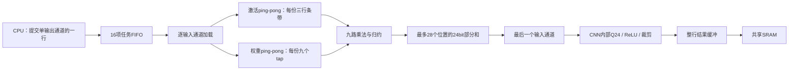

> 历史记录：本文描述精简前的整行/旧小块对照。当前源码已删除小块和三路 MAC 分支；当前实现与验证见 [CNN 精简说明](cnn-cleanup.md)。本文中的旧参数与 CLI 命令仅适用于冻结的旧源码。

# CNN 行内循环重排

当前默认执行顺序为**输入通道在外、整行输出位置在内**，保留九路3×3乘法和CPU逐行/逐输出通道调度。CRO2任务结构、16项任务FIFO、软件程序、输入/权重/量化参数和逐层golden不变；没有跨行保留权重或新增整层FSM。

## 原循环与新循环

原执行顺序：每次最多四个输出位置，遍历全部输入通道，完成这四个位置，再加载下一个空间小块。

```text
for x0 in range(0, output_width, 4):
    clear partial_sum[0:4]
    for ci in input_channels:
        load weights[ci] and three short input segments
        for lane in this_tile:
            partial_sum[lane] += dot3x3(...)
    quantize_and_store_this_tile()
```

新执行顺序：加载一个输入通道的九个权重与三行输入条带，供整行输出使用。每个位置保留自己的部分和，直到最后一个输入通道才进入内部整数后处理和写回。

```text
clear row_partial_sum[0:output_width]
for ci in input_channels:
    load weights[ci] once
    load three required input row strips once
    for x in range(output_width):
        row_partial_sum[x] += dot3x3(input_window(x), weights[ci])
        if ci == last_input_channel:
            quantize_and_store(row_partial_sum[x])
```

这样消除了相邻四输出小块之间重复的条带读取，并避免输入通道较多时两个权重缓冲装不下全部通道、导致同一权重反复加载。



## 数据容量与控制

| 存储 | 原四输出小块 | 整行模式 |
|---|---:|---:|
| 激活ping-pong | 2×32B | 2×84B（3行×28B） |
| 部分和 | 4×24bit＝12B | 28×24bit＝84B |
| 输出队列 | 2项 | 8项 |
| 权重ping-pong | 2×12B | 2×12B，不增加 |

主要数据容量增量约213.5B，另有指针、选择和控制逻辑，不能直接换算成映射面积。

输出缓冲为8项，是为了容纳最大28个结果字节加最多3字节地址偏移，总共至多8个SRAM word。最后一个输入通道可能连续产生整行结果；预留整行容量可避免依赖SRAM立即获得grant。每个任务排空后才完成，结果不会混入下一行。任务FIFO仍为16项。

控制状态集合仍为5个执行状态和7个加载状态。整行卷积在权重/量化参数请求结束时直接准备首个激活行，省掉一次PREP气泡；FC和旧小块对照路径保留原加载流程。整行模式每个Ci只出现一次，因此移除了该模式中无用的两槽权重命中/复制逻辑。没有改变FC数学语义或引入跨任务缓存一致性要求。

实现：

- [npu_cnn.sv](../rtl/cnn/npu_cnn.sv)：行内循环、输入条带加载、部分和索引和输出队列。
- [npu_cnn_mac.sv](../rtl/cnn/npu_cnn_mac.sv)：可配置上下文数量，24bit整数累加与原Q24流水线。
- `NPU_CNN_ROW_ORDER` / `npu_cnn.ROW_ORDER`：默认1，0保留旧四输出小块对照。
- `0x40000670`（C宏`NPU_CNN_LOOP_ORDER`）：只读返回执行模式，1为整行、0为小块；原CSR和任务ABI不变。

行缓冲只加载当前输出实际需要的输入条带，右侧crop不会强制读取整幅输入宽度；padding由mask处理。软件仍决定输出通道、输出行、输出地址及跨单元依赖。当前W/H≤28、Ci≤16、stride1/2和非对齐输出/权重的支持保持不变。

## 性能与访存对照

两种模式使用相同源码、相同九路MAC、新NMC、16项任务FIFO和相同软件程序。

| 指标 | 原小块顺序 | 整行顺序 |
|---|---:|---:|
| MNIST单图，不含输入DMA | 23,938 | **19,936** |
| 含输入DMA | 24,558 | **20,556** |
| CNN实际busy周期 | 22,994 | 18,992 |
| 20帧总周期 | 490,682 | 408,190 |
| 连续流平均周期/帧 | 24,534.10 | 20,409.50 |
| 权重word读取 | 3,852 | 3,180 |
| 激活word读取 | 9,596 | 7,270 |
| 量化参数word读取 | 444 | 444 |
| 输出word写入 | 594 | 594 |
| 请求未获grant周期 | 3,111 | 3,332 |
| WAIT_TILE周期 | 15,719 | 11,716 |

表中读取次数为CNN/NMC接口接受的word请求，包含NMC缓存命中，并非仅物理SRAM读次数。

单图节省4002周期，约16.72%；权重和激活合计减少2998次word读取。有效MAC仍为40,770，发射拍数仍5496，改变的是数据复用和加载等待。剩余请求的仲裁等待计数略有增加，总WAIT_TILE时间仍明显下降，不能简单将所有改善都归为仲裁加速。

**10张单图推理均通过严格 `<20000` 周期检查；含输入DMA与连续流平均尚未低于20k。** 单图裕量只有64周期，其他负载或额外争用需要独立检查，不能据此保证所有场景都低于20k。

最初仅重排循环的中间版本为20,748周期，整行卷积跳过冗余PREP后降至19,936。最终配置的面积/时序与测试记录见 [cnn_row_order_validation.json](../reports/cnn_row_order_validation.json)，中间版本不作为最终PPA证据。

## 验证范围

- 10张MNIST逐层与边界共19,033项检查，20帧stream logits/类别和DMA重叠通过。
- 新增22组宽行检查，覆盖W16/17/27/28、H1/2/3/27/28、Ci1/2/4/8/16、stride1/2、裁剪、边界行、非对齐权重/输出及跨SRAM bank输入。最大28个部分和与末端写回均被覆盖。
- 发现并修正了缩窄有符号X索引导致16以上列被解释为负数的问题；最终使用无符号列索引。
- 原FC长度1..16/143/144、极值累加、Q24 ties-even、零点、ReLU/饱和等检查继续通过。
- 整行三路MAC兼容模式通过相同逐层与边界检查；默认性能/PPA对照为九路。
- CNN/matrix/vector队列、GEMM/vector算子、NMC并发与故障/复位、SoC、DMA和JTAG回归通过。

所有推理hex资产与上一轮快照逐一比对，软件与模型未修改。原始综合目录为 `../eda-runs/20261103-cnn-row-order/tile` 与 `row`。使用TSMC180 TT、Genus19.17、low effort、16ns优化/20ns报告，含两片真实8KB SRAM及CPU/DM/JTAG/DMA/NMC和三个计算单元，不含PAD。

同源码最终映射对照（含两片SRAM）：

| 模式 | Cell Area | 50MHz setup slack | 系统TNS |
|---|---:|---:|---:|
| 小块 | 2.602755809mm² | +4.0042ns | 0 |
| 整行（默认） | 2.767714113mm² | +4.0028ns | 0 |

Cell Area增加0.164958304mm²（6.34%），单图周期减少16.72%，仍符合约3mm²单元预算。两片SRAM共约0.802887182mm²，整行模式其余标准单元约1.964826932mm²。这里使用本轮参数化后、同源码小块配置作面积基线，不混用上一轮不同源码的2.5770mm²。

整行最终映射网表通过一张MNIST与严格 `<20000` 推理门限：含输入20,556周期，扣除620周期输入后为19,936，15项结果检查通过。批量GEMM/vector网表测试也通过，提交288周期、总完成16,941周期、516项检查。使用真实标准单元/SRAM功能模型、零延迟、无SDF、关闭timing check。

物理规划边界为2mm×2mm，Cell Area预算约3mm²。本轮是映射与布线前时序验证，没有布局布线结果。

## 复现

```sh
/usr/bin/python3.12 npu/scripts/run_vcs.py --suite latency --tag NEW_TAG --cnn-loop-order row --macro --max-cycles 20000
/usr/bin/python3.12 npu/scripts/run_vcs.py --suite layers --tag NEW_TAG --cnn-loop-order row --macro
/usr/bin/python3.12 npu/scripts/run_vcs.py --suite stream --tag NEW_TAG --cnn-loop-order row --macro
/usr/bin/python3.12 npu/eda/tsmc180/prepare_run.py --out ../eda-runs/NEW_RUN --cnn-loop-order row --effort low --synth-period 16 --report-period 20
genus -no_gui -batch -files ../eda-runs/NEW_RUN/synth.tcl > ../eda-runs/NEW_RUN/launcher.log 2>&1
```

对照改为 `--cnn-loop-order tile`，不要给旧小块版本强加20000门限作为功能判定。输出目录和tag必须新建。结果收集脚本为 [collect_cnn_row_order.py](../scripts/collect_cnn_row_order.py)。
