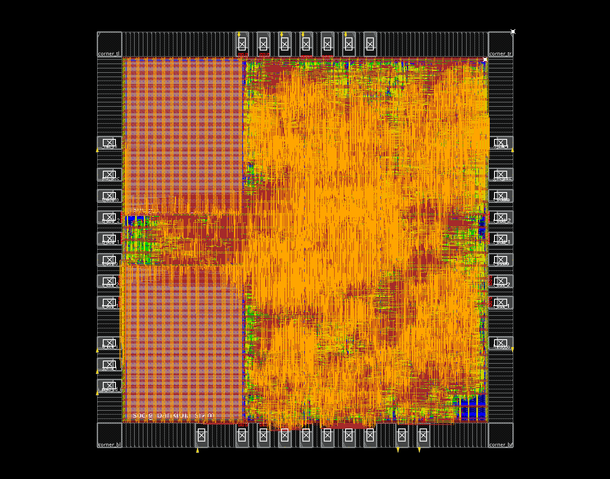
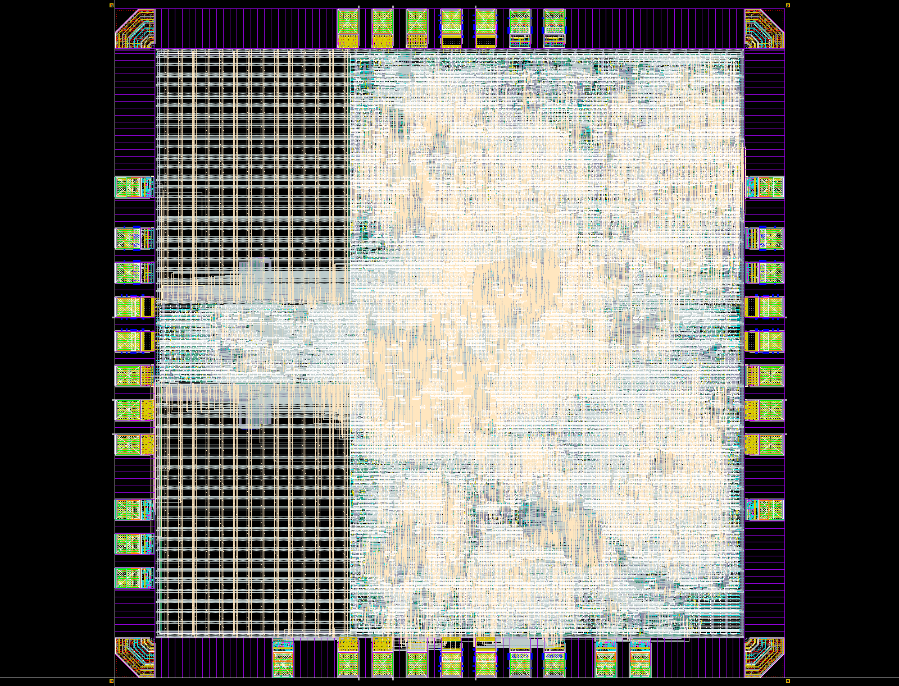

# 1950 µm 全芯片布局布线与 Lab 5 验证

本轮已完成 1950×1950 µm 全芯片布局布线、Seal Ring、Dummy Fill、最终 DRC、LVS/ERC、独立天线、Wire Bond PAD 检查和归档。保留原始硬件计算能力，不引入数据锁存器。课程口径的几何/连接/天线/WB 检查满足本轮条件；ERC 原库及外圈残项待评审，严格 PR 参数比较未通过，不能标记正式投片签核通过。

## 输入与尺寸

- RTL/综合网表：复用 `20261108-area26-all4` 的冻结综合网表及原生 PAD 映射壳，当前 RTL 哈希与源清单一致；未重新削减 Matrix、CNN、Vector 或 CPU。
- Matrix 16 路 INT16 乘法、CNN 9 MAC、Vector INT32/SIMD8 保留；RF 每 bank 32 words，Matrix/Vector/CNN 队列各 4。
- 两块 `RA1SHD_2048x32M8`，9 信号 PAD、28 供电/POC PAD、37 Bond PAD。程序和数据经 JTAG SBA 加载。
- PNR Die：1950×1950 µm，面积 **3.8025 mm²**；核心边界 `(130.48,129.36)–(1819.84,1819.84)` µm。
- Seal Ring 实际外框：`(-15,-15)–(1965,1965)` µm，即 **1980×1980 µm**。没有缩放工艺单元，使用 7844 个原库边/角实例拼接。
- OA 顶层 bbox 含文字显示框，可比物理环外框大；本表尺寸取实际环几何与 DEF Die，不用文字 bbox 代替芯片尺寸。

课程尺寸依据：[Lab 5 §4.3](https://full-stack-ai-chip.tianyuj.com/lab-5/#43)。

## 布局布线结果

| 项目 | 本轮实测 |
| --- | ---: |
| 综合 cell 面积，含两块 SRAM | 2.569744 mm² |
| PNR 标准单元面积，含 CTS/tie/tap/天线支持，不含 core filler | 1.830430 mm² |
| 两块 SRAM 面积 | 0.802887 mm² |
| PNR 核心非 filler 面积，标准单元＋SRAM | **2.633317 mm²** |
| Core filler 面积，单列 | 0.208630 mm² |
| 原生 IO 几何并集面积，含原生角/IO filler，排除重叠 bond window 重复计算 | 0.844100 mm² |
| timeDesign 非 filler placement density | 89.562% |
| 系统时钟 | 50 MHz / 20 ns |
| Post-route setup WNS / TNS | **+0.592 ns / 0** |
| Post-route hold WNS / TNS | **+0.019 ns / 0** |
| Setup / hold 违例路径 | 0 / 0 |
| Innovus DRC / 天线 | 0 / 0 |
| VDD/VSS 特殊电源连通性 | 0 问题 |
| Regular connectivity | 仅 VDDPST/VSSPST 两条原生 IO 轨 no-routing 提示 |
| 核心 placement | 无未放置、无非法实例 |
| 布线后网表 JTAG 功能回归 | CHIP JTAG PASS，34 checks |

面积是 cell footprint，不等同 Die 面积。IO/bond 原本存在有意的物理重叠，不能把所有实例矩形直接累加。VDDPST/VSSPST 位于相邻原生 IO GDS 内，最终完整 LVS 验证其物理连接；未合并四条电源轨来消除提示。

时序使用 TT 单角、cap table RC、OCV/CPPR 的 Innovus post-route 分析，未执行 Dummy 后重新提取或多角签核。JTAG 仿真使用真实标准单元、IO 与 SRAM 模型，10 MHz JTAG，零延迟、不回标 SDF；它证明功能连接，不能替代 STA。

### 本轮物理修正

1. 两块 SRAM 靠左上下放置，底部宏 R180、顶部宏 R0，信号侧朝中间约 242.78 µm 的通道。PAD 位置依据固定合法槽位的端点距离优化，仍以实际布线检查为准。
2. 对 SRAM 完整 bbox 加 0.50 µm 做 `cutRow`，阻止 followpin 电源轨进入宏 LEF OVERLAP 的内缩边带。旧版的 **270 处 M1.S.1 全部消失**；未编辑 SRAM GDS，也未用 SRAM Box 跳过验证。
3. 收尾时出现 64 处 native DRC。定位并移动底边两个 CPU 寄存器实例，保留旧站点小型 placement blockage；删除外部 TCK 在连续 PAD 金属之外的多余路由。只操作顶层 TCK 的单 PAD＋重叠 top port 网络，内部时钟仍完整布线，最终 LVS CORRECT。
4. 删除两组重叠的 19-cut VIA12 电源阵列，保留同网的 25-/18-cut 阵列及连续 M1/M2 电源导体；重新检查电源连通性、DRC 和时序。最终 DRC 0、PG 0，setup/hold 均通过。



## Lab 5 最终检查

所有检查使用同一个 `mynpu_asic_top_postDummy.gds`，源 CDL Top 为 `mynpu_asic_top`。原始报告、完整规则和 SHA256 均保留。

| 检查 | 实际结果与口径 |
| --- | --- |
| 最终几何 DRC | 523 项；原始 2432 层次 / 21776 展开；按课程排除 DRM、ESD、MOM、LUP 后 **0** |
| 旧 SRAM 边缘 M1.S.1 | 0 |
| M5.R.1、M6.R.1、DOD.R.1 | Dummy 前有结果，Dummy 后全部归零 |
| CO.R.4、M6.A.1、SR.S.1 | 0 |
| 教学容差 LVS | **CORRECT**，605 条完整属性检查，Split Gate YES，PR 容差 3.48%；未新增虚连或 SRAM Box |
| LVS 比较计数 | 端口 14/14，网络 327519/327519，器件 494871/494871 |
| 原始严格参数 LVS | INCORRECT，仅保留 IO PR 电阻约 +3.47% 的属性差异；完整报告另存 |
| ERC | 12 项，7 层次 / 977 展开，原库/外圈残项待评审 |
| 最终 GDS 天线 | **62 项 / 0 违规** |
| Wire Bond PAD | **64 项 / 0 违规**，PITCH_55_SINGLE＋OBV_CUP，SRwidth 15 µm |

DRC 原始非零项目为 ESD.24g 270、ESD.25g 21456、LUP.3.3g_3.3V 9、LUP.5.3g_3.3V 39、MOM.R.2 1、DRM.R.1 1，数值均为展开计数。规则没有为了取得 0 而关闭这些检查，课程排除仅在汇总时单列。

ERC 残项逐类核对：

| 规则 | 层次 / 展开 | 与课程记录一致的结构来源 |
| --- | ---: | --- |
| mnpg | 4 / 832 | 原库跨电源轨保护 MOS |
| floating.nxwell_float | 1 / 72 | PVSS1CDG 保护二极管井结构 |
| npvss49 | 1 / 72 | 同一原库保护结构 |
| floating.psub_float | 1 / 1 | 包含 Seal Ring 的隔离带外圈衬底 |

按[课程 §10–14](https://full-stack-ai-chip.tianyuj.com/lab-5/)保留上述残项待负责人评审，不宣称 ERC Clean；没有跨 Seal Ring 禁布带补线，也未伪造接地标签。教学容差不表示修复了 IO 模型差异，原始严格结果保留。正式投片还需 ERC 接受结论、工艺模型确认、Dummy 后 PEX/STA、多角、IR/EM 及封装人工规则。



## 文件位置

以 `/home/s2400012841/chip-fullstack-2026/` 为根：

| 内容 | 路径 |
| --- | --- |
| 本轮 PNR、冻结执行脚本、日志、检查点 | `eda-runs/20261109-die1950-fullchip/` |
| 最终 PNR 数据库 | 上述目录 `mynpu/pnr/checkpoints/13_eco2_fixed.enc` 及 `.enc.dat/` |
| PNR GDS/DEF/Verilog/SDC/SPEF/SDF/LEF | 上述目录 `mynpu/pnr/outputs/final/` |
| PNR 原始报告 | 上述目录 `mynpu/pnr/reports/` |
| 本轮 Lab 5 完整工作区 | `eda-runs/20261109-lab5-die1950/` |
| **最终物理版图**，包含 Seal Ring/Dummy | 上述目录 `outputs/mynpu_asic_top_postDummy.gds` |
| LVS 源 CDL | 上述目录 `cdl/mynpu_asic_top.cdl` |
| 最终规则/报告 | 上述目录 `rules/`、`drc_post/`、`lvs/`、`lvs_strict/`、`antenna/`、`wb/` |
| 冻结签核运行脚本 | 上述目录 `scripts/run_signoff.py`、`scripts/build_layout.il` |
| 交付包及 SHA256SUMS | 上述目录 `deliverables/` |
| PNR 机器可读汇总 | `mynpu-softpe/npu/reports/die1950_fullchip_validation.json` |
| Lab 5 机器可读汇总 | `mynpu-softpe/npu/reports/lab5_die1950_validation.json` |
| JTAG 回归记录 | `mynpu-softpe/npu/build/chip-die1950-routed/result.json` |

Innovus 原始 GDS 不包含后加入的 Seal Ring/Dummy，不能拿它替代最终物理版图。归档不包含完整 OA 和 Innovus 恢复环境，这些仍在运行目录保留。CDL 引用服务器原始 SPI/SRAM CDL 的绝对路径，迁移需要同版本工艺环境。

复核已有输入和结果，可从项目目录执行：

```bash
cd /home/s2400012841/chip-fullstack-2026/mynpu-softpe
python3.12 npu/eda/tsmc180/collect_fullchip.py --run ../eda-runs/20261109-die1950-fullchip --out npu/reports/die1950_fullchip_validation.json --gate-tags die1950-routed
python3.12 ../eda-runs/20261109-lab5-die1950/scripts/collect_results.py
sha256sum -c ../eda-runs/20261109-lab5-die1950/outputs/final_inputs.sha256
```

本轮原始 PNR 01–07 执行记录均为 `*-die1950`；两次物理 ECO 为 `06-ecofix`、`06-eco2`，最终导出为 `07-eco2`。脚本与输入哈希记录在各阶段 JSON 中。旧 2000 µm 运行和修复前报告保留，未覆盖。
