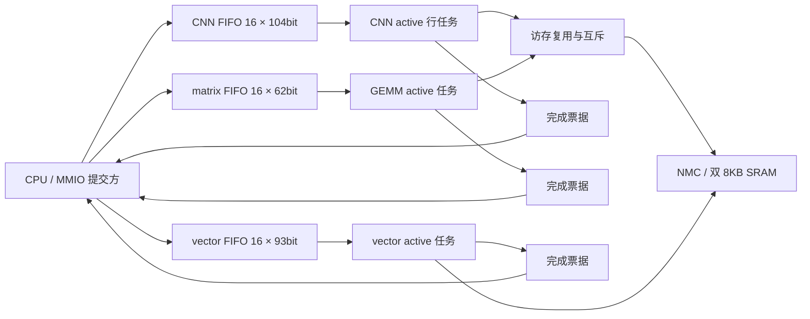

> 历史记录：本文为任务FIFO扩容实验。当前NMC并发和CNN九路MAC见[最新说明](nmc-mac9.md)及[报告](../reports/nmc_mac9_validation.json)。布局布线边界现已确认为2mm×2mm。

# 三种计算任务 FIFO 扩展至 16 项

当前 CNN、matrix、vector 的任务 FIFO 均为 **16 项 pending＋1 项 active**。保持三个独立计算单元，CPU 负责通道、行、层和跨单元依赖；队列只保存已提交的任务快照，不恢复整层控制 FSM。

## 哪些队列值得加深

| 队列 | 原配置 | 新配置 | 实测依据 |
|---|---:|---:|---|
| CNN 行任务 | 8 | 16 | MNIST 单图节省 244 周期，实际 pending 峰值达到 16 |
| matrix 描述符 | 2 | 16 | 16 个任务可一次批量提交，减少提交端等待 |
| vector 描述符 | 2 | 16 | 可与 matrix 的批量任务一起提前提交，减少提交端等待 |
| CNN 输出打包 | 2 words | 2 words | 单图 MNIST 测得峰值 1，无加深收益证据 |

DMA 仍只有单级数据暂存，没有新增任务 FIFO。NMC 缓存仍每 bank 16 words；缓存不是 FIFO。CPU/JTAG 库内的取指与协议缓冲保持原验证配置。本次“全 16”指三种计算任务队列。



matrix 与 CNN 仍互斥共用 NMC 主端口，vector 有独立主端口。跨单元依赖没有自动推断，软件必须等待生产者的完成票据，才能提交消费其结果的任务；同一计算单元的队列保持 FIFO 顺序。

## 存储与接口

三条队列的 payload 合计 `16×(104+62+93)=4144bit=518B`。旧 `8/2/2` 合计 1142bit，新增加 3002bit≈375.25B。这只是任务载荷，还需要影子/active 配置、选择器、指针和计数逻辑，不能当作全部映射面积。

matrix/vector 从固定两个槽、单 bit 指针改为参数化数组、显式回绕指针和容量计数。16 项使用 4bit 指针与 5bit 占用计数，避免把 16 错表示为 0。支持 1/2/4/8/16 项；默认均为 16：

- `NPU_CNN_QUEUE_DEPTH` / `npu_cnn.QUEUE_DEPTH`
- `NPU_MATRIX_QUEUE_DEPTH` / `npu_mmio.MATRIX_QUEUE_DEPTH`
- `NPU_VECTOR_QUEUE_DEPTH` / `npu_mmio.VECTOR_QUEUE_DEPTH`

现有 MMIO 保持不变。`+0x124`、`+0x224`、`+0x658` 分别查询 matrix/vector/CNN：高 16bit 是容量，低 16bit 是 pending 数，不含 active。软件应查询容量而不是写死 2、8 或 16。C 辅助函数已按查询值判断空间，因此不需要改变模型权重、任务格式或软件层描述表。

配置写入 shadow，start 接受时保存快照；后续修改不影响已经排队的任务。满时拒绝提交，软件先检查空间。完成票据、错误状态和 reset 语义沿用各计算单元原契约，reset 清空 pending 与计数。CNN 的具体寄存器与 WFI 协议见 [CRO2 接口记录](cnn-fifo.md)。

## 有用在哪里

### MNIST：CPU 软件调度 CNN 行任务

固定输入、参数和逐层 golden，不改汇编调度方式，只修改队列深度：

| 配置 CNN / matrix / vector | 单图周期 | 含输入周期 | 20 帧总周期 | 平均周期/帧 |
|---|---:|---:|---:|---:|
| 8 / 2 / 2 | 27,403 | 28,023 | 560,661 | 28,033.05 |
| 16 / 16 / 16 | 27,159 | 27,779 | 554,863 | 27,743.15 |

单图改善约 0.89%，连续流改善约 1.03%。MNIST 当前使用 CNN 行核，**这些周期变化不能归功于 matrix/vector 扩容**。CNN pending 峰值 16，说明确有更多行任务进入队列；输出打包峰值 1，所以不增加该数据缓冲。当前仍未达到 <20k 目标。

### GEMM＋vector 批量提交微基准

测试在真实 SoC 与双 SRAM 宏模型中，通过 host MMIO 交错提交 16 个 `4×4×16` packed INT8 GEMM 和 16 个长度 256 的 INT32 scalar ADD。GEMM 输出分开存放；vector 按队列顺序原地累加，每项 scalar 不同。所有最终数值共 516 项检查通过。

| matrix / vector FIFO | 提交全部任务耗时 | 全部完成耗时 | pending 峰值 |
|---|---:|---:|---|
| 2 / 2 | 20,622 周期 | 25,359 周期 | 2 / 2 |
| 16 / 16 | 288 周期 | 25,359 周期 | 15 / 15 |

这里测的是 **host MMIO 提交序列，不是 RV32 CPU 指令执行时间**。深队列允许提交方更早返回去做其他工作；并没有使这批运算的总吞吐提高 70 倍。总完成周期保持不变，说明这个微基准的计算/访存瓶颈仍在执行单元，而不是 FIFO 容量。该结果支持批处理和软件流水调度，但不代表所有模型都会加速。

## 功能与物理验证

RTL 回归包括：10 张 MNIST 的逐层 golden 与边界 18,492 项检查、20 帧流式 logits、CNN 队列 144 项检查、matrix/vector 队列 595 项检查（两次回绕、满队列、快照、并发、非空复位）、67 个 GEMM＋96 个 vector、SoC 并发、DMA/NMC/JTAG。权重、输入、量化参数和 golden 不变。

同源码最终映射结果（面积包含两片 SRAM）：

| 配置 CNN / matrix / vector | Cell Area | 50MHz setup slack | 系统 TNS |
|---|---:|---:|---:|
| 8 / 2 / 2 | 2.311136660mm² | +4.0042ns | 0 |
| 16 / 16 / 16 | 2.520978023mm² | +4.0028ns | 0 |

增加 0.209841363mm²（9.08%），仍低于 3mm² Cell Area 预算。slack 减少 0.0014ns，两者均无系统 setup 违例；JTAG 100ns 时钟也无 setup 违例。两片 SRAM 共约 0.802887182mm²，全16配置其余标准单元约 1.718090842mm²。这里的基线也是参数化后同源码重新综合的结果，不混用上一轮旧源码的2.3094mm²。

最终全16映射网表也通过：1张MNIST（含输入27,779周期、15项检查），以及16个GEMM＋16个vector批量任务（提交288周期、总计25,359周期、516项检查）。网表使用真实标准单元与SRAM功能模型，零延迟、无SDF、关闭timing check，不代替布线后时序验证。

最终面积和时序记录见 [fifo16_validation.json](../reports/fifo16_validation.json)。同源码基线 `8/2/2` 与新配置 `16/16/16` 的原始记录在 `../eda-runs/20261102-fifo16/baseline` 和 `all16`。使用 TSMC180 TT、Genus 19.17、low effort、16ns 优化/20ns 报告，包含两片真实 SRAM、CPU、三个运算单元、DMA/NMC、DM/JTAG；不含 PAD。

报告是映射后的 Cell Area 与布线前 setup 时序，不是布局布线结果。Cell+Net Total Area 不等于可放置 core 面积，也不能以 Cell Area 小于 3mm² 直接证明 3mm² core 能完成布线。

## 复现

```sh
/usr/bin/python3.12 npu/scripts/run_vcs.py --suite queues --tag NEW_TAG
/usr/bin/python3.12 npu/scripts/run_vcs.py --suite cnnqueues --tag NEW_TAG
/usr/bin/python3.12 npu/scripts/run_vcs.py --suite burst --tag NEW_TAG --macro
/usr/bin/python3.12 npu/scripts/run_vcs.py --suite latency --tag NEW_TAG --macro
/usr/bin/python3.12 npu/eda/tsmc180/prepare_run.py --out ../eda-runs/NEW_RUN --cnn-queue-depth 16 --matrix-queue-depth 16 --vector-queue-depth 16 --effort low --synth-period 16 --report-period 20
genus -no_gui -batch -files ../eda-runs/NEW_RUN/synth.tcl > ../eda-runs/NEW_RUN/launcher.log 2>&1
```

基线增加参数 `--cnn-queue-depth 8 --matrix-queue-depth 2 --vector-queue-depth 2`。输出目录和 tag 不可覆盖。原 [CNN 2/8 项实验](cnn-fifo.md) 与其 JSON 报告保留为历史快照。
