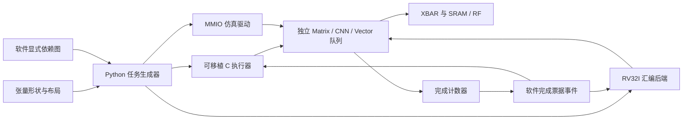

> 本页记录前一轮软件参考降低器；当前已实现原生步长、末项归约、ldc和硬件事件，见 [LY01/EV01](layout-events.md)。复现本页参考策略使用 `Plan(native=False)`，历史验证JSON不代表本轮RTL。

# 面向多负载的软件任务层

本轮在 `mynpu-softpe` 实现了通用任务生成器、依赖图和执行器，并增加真实 SoC 回归。计算 RTL、队列深度和 RF 容量没有修改；通用性首先来自软件组合已有的独立 Matrix、CNN、Vector 单元。没有增加模型识别 FSM、配置双缓冲或硬件配置锁。

这不是一个完整模型编译器。新增接口描述整数计算、布局、工作区和依赖，不绑定 MNIST 网络层号、固定权重地址或固定量化参数。MNIST 保留为兼容回归。



## 已实现的接口

源文件：`npu/sw/task_graph.py`。

| 接口 | 软件负责的事情 | 现有硬件负责的事情 |
|---|---|---|
| `gemm` | M/N 按最多16分块，K按最多256分块；算出转置地址；设置 lda/ldb；用 Vector 将紧凑结果放入带 ldc 的输出 | Matrix 内部4×4外积、INT8/INT16、INT32累加、K分块累加 |
| `batched_gemm` | 批次循环和字节间距；A/B批间距为0时共享输入；提前检查跨批次别名 | 同上，不增加 batch FSM |
| `vector` | 生成合法描述符；检查基本范围和别名 | INT32或4路INT8 SIMD运算、尾部 byte enable |
| `strided` | 任意正/负的4字节倍数步长，输入零步长广播；连续部分合成较长任务 | 连续 Vector 任务，非连续位置用单元素任务 |
| `transpose` | 将二维转置降低成带间距的复制任务 | Vector Copy |
| `reduce` | 加载三条通用程序，保持 r2 累加器；最后复制末项 | Vector Sum/Min/Max，没有外置归约单元 |
| `conv3x3` | CHW/OIHW布局、多输入/输出通道、padding=1、stride=1/2、输出行/通道循环 | CNN DOT9与窗口供数；输出原始INT32 |
| `Graph` | 按显式 RAW/WAR/WAW 依赖安排任务，独立根任务先提交，汇合前等待完成票据 | 各队列独立执行，完成计数器表示结果已完成写回 |

矩阵的计算精度与存储布局仍分开：本轮高级 GEMM 降低器使用 **每元素占4字节的 INT8/INT16 输入**，输出 INT32。底层 RTL 原有的1/2字节紧凑存储能力没有取消，但高级降低器尚未自动打包非对齐 tile。输入基址、lda/ldb 和输出 ldc 可独立选择；leading dimension 单位为元素，批次和 Vector stride 单位为字节。

高级 GEMM 用调用者提供的紧凑 tile 工作区，最多 `min(M,16)*min(N,16)*4` 字节。该区可位于 SRAM，足够小时也可位于 RF。Matrix 完成后 Vector 搬出有效行，Vector 完成前不能复用这块工作区。当前是保守单工作区调度，没有假称双缓冲或零开销的任意 ldc。

### 归约和重排的实际代价

Sum/Max/Min 的程序是：

```text
prologue: r2 = scalar                # sum:0 / max:INT_MIN / min:INT_MAX
loop:     r2 = add/max/min(r2, r0)   # r0 是当前输入，r2 跨元素保留
          r0 = r2                   # 现有输出路径写一个前缀结果
```

硬件支持FINAL_ONLY末项写回和KEEP_R2跨任务累加；原生任务降低使用这些能力，详见[布局与事件](layout-events.md)。兼容降低路径可能使用前缀暂存及末项复制。当前归约使用INT32，不把SIMD8独立累加误称为跨lane归约。

广播和重排也有清晰代价：连续向量是一条较长任务，非连续或零步长输入按位置生成任务，增加配置和排队开销。没有为了少数 MNIST 地址在硬件里增加特殊路径。

## 事件同步语义

`Event(unit, ticket)` 是**软件事件**，不是本轮新增的硬件 WAIT/SIGNAL 指令。生成器在依赖点等待相应单元完成计数器达到票据；等待会先检查 sticky error，并有超时。独立根任务可先进入不同队列并行执行。运行中的单元不会因为另一个单元被软件等待而停止。

依赖边由软件明确给出，包括读后写、写后读和写后写；生成器不猜测任意闭包内部访问了哪些缓冲。软件必须保证无依赖任务之间没有数据竞争。静态广度优先顺序不是一个运行时动态调度器；包含内部等待的复杂降低器也可能推迟其他任务提交。

共享 Vector 程序在执行期间是 live 状态，因此更换程序前等待该 Vector 队列已提交的全部任务完成，相同程序复用时不重复写程序。CNN 几何/卷积核也是共享配置，因此参考降低器在改变一行配置前等待前一行完成。硬件没有恢复“队列非空禁止写”的保护；这是软件调度策略。直接 MMIO 和既有手写汇编仍可按真实采样时刻提前修改配置。

更进一步的“消费者已入队，在硬件等待事件后自动启动”仍需要任务级硬件事件字段，本轮没有把软件等待包装成这项硬件功能。

## 使用示例

```python
from task_graph import Graph, Plan

p = Plan()
g = Graph()
g.add("conv", lambda q: q.conv3x3(
    0x80000000, 0x80001400, 0x80003000, width=16, height=1, cin=8))
g.add("residual", lambda q: q.vector(
    0x80000800, 0, 0x80003080, 16, op=24 | 128, scalar=2))
g.add("join", lambda q: q.vector(
    0x80003000, 0x80003080, 0x80003c00, 16, op=1),
    after=("conv", "residual"))
events = g.lower(p)
p.wait(events["join"])
```

数组和卷积核由调用者事先放入相应存储。示例中的两个根任务不重叠写缓冲，join 等待二者，随后通过 XBAR 读中间结果。

生成可执行样例：

```sh
python3.12 npu/workloads/generate.py --out npu/build/general-plans
```

生成内容：

- `workloads.hex`：真实 MMIO 测试驱动读取的命令流。
- `workloads_plan.h`：大套件的 C 命令数组，适用于外部 host 执行；其数据地址覆盖 SRAM 起始区，数组本身也大于片上 SRAM，不能直接当成片上 CPU 程序运行。
- `workload_cpu_plan.h`：小型流水的 C 命令数组，输入位于 SRAM 的 `0x2000` 之后，适合与前8KB内的执行代码分开放置；C 回调执行器为 `npu/sw/npu_plan.h`。
- `workload_cpu.S` / `workload_cpu.hex`：小型 GEMM→标量偏置→Sum 归约程序，真实 RV32I 指令，包含7项自检。
- `workloads_manifest.json`：案例名称、任务数量和 CPU 程序大小。

C 执行器接受 read/write/fence/relax 回调；read/write 同时覆盖内存和 MMIO，fence 必须保证设备访问顺序。RISC-V 裸机通常使用 volatile 访问和 `fence iorw, iorw`。`relax` 可为空；如果使用中断等待，回调必须避免丢失唤醒，不能无条件执行可能永远不醒的 WFI。执行器启动时检查队列成功排空，读取各单元 submitted 基线，支持完成计数器32位回绕；单一生产者拥有配置和入队操作。

RV32I 后端针对复位后零票据的队列生成小型展开程序，限制代码位于 SRAM 前8KB，检查数据不覆盖代码。它是验证用后端，没有替代现有 MNIST 紧凑循环汇编。C 执行器和测试驱动使用同一命令格式，但只有 RV32I 小程序在真实 CPU 上执行；多负载大套件由外部 host 端口驱动。

计划必须显式调用 `wait`/`drain` 才保证末项已完成，执行器不会在计划末尾偷偷加入全局屏障。超时或故障可能留下部分输出，缓冲复用/清理/恢复仍由软件处理。当前高级接口按默认256字节 RF 检查地址，不自动利用更大参数化 RF。

## 后续硬件优化如何选择

这次实现提供了可量化的通用性基础，但不掩盖软件组合的成本：

1. 若广播/转置任务数和配置写占比高，优先考虑 Vector 的独立输入/输出 stride，而非扩大乘法阵列。
2. 若归约前缀写回占主导，考虑累加器最终项写回与跨任务保留模式；不增加 LayerNorm/Softmax 专用 FSM。
3. 若工作区复用屏障占主导，软件先尝试双工作区；容量/吞吐证据充分后再扩大 RF。
4. 若 CPU 等待影响跨单元提交，才扩展队列级 WAIT/SIGNAL；必须与故障、取消、真实写回完成语义一起验证。
5. 完整 MobileNet、Transformer、音频等模型仍需算子覆盖、导出器和精度回归，当前内核套件不构成这些模型已适配的声明。

## 当前验证入口

默认配置和性能使用[项目首页](../../README.md)；当前版本的功能、综合、最终PNR及检查证据统一见[报告索引](../reports/README.md)。
