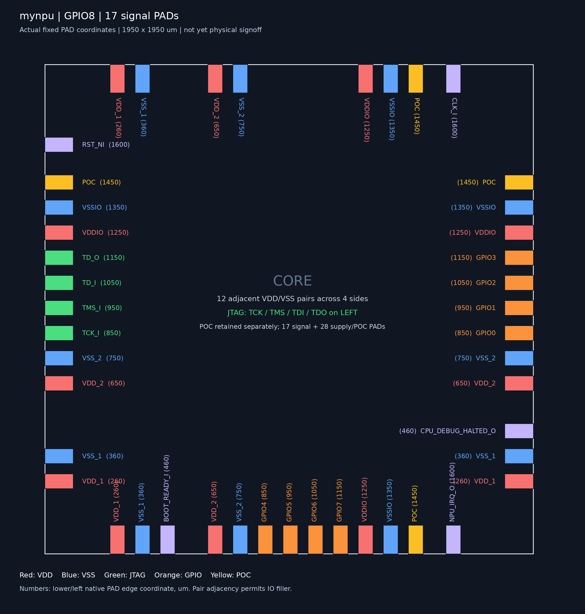

# GPIO8

八根独立方向的双向引脚组成一个8bit数据口，经现有XBAR辅助/MMIO路径访问。
CPU和JTAG SBA可读写，不增加独立总线master、DMA或任务FSM。当前不含GPIO中断、自动任务触发或FIFO；计算单元的MMIO访问权限没有扩大。

## 寄存器

基址`0x40000800`，所有访问使用对齐的32bit load/store；数据和方向只使用低8位。每位DIR=1输出、DIR=0输入/高阻。

| 地址偏移 | 寄存器 | 读/写 |
| --- | --- | --- |
| `0x00` | IN | 只读，同步后的PAD实际电平；输出模式也可读回 |
| `0x04` | OUT | 读写，8位输出锁存值 |
| `0x08` | DIR | 读写，8位输出使能，复位全0 |
| `0x0c` | SET | 写1置OUT对应位，读0 |
| `0x10` | CLEAR | 写1清OUT对应位，读0 |
| `0x14` | TOGGLE | 写1翻转OUT对应位，读0 |
| `0x18` | CAP | 只读，`0x00010008`：版本1，8根引脚 |

无效地址、对只读寄存器写入向XBAR返回错误，不产生写副作用；现有XBAR拒绝未对齐访问和非完整word写。
当前CPU和Debug Module SBA均可收到总线错误，SBA通过SBCS.sberror报告；外部Host接口已删除。下方历史测量基于当时版本。
数据/方向/掩码寄存器的高24位写入忽略，数据/方向读回高24位为0；CAP高位包含版本。SET/CLEAR/TOGGLE由单次MMIO事务完成，避免CPU/JTAG使用读改写时丢失位更新。

## 软件

```c
#include "npu.h"
npu_gpio_write(0xa5);       // 先准备输出值
npu_gpio_direction(0xff);   // 再使能八位输出
npu_gpio_set(0x01);
npu_gpio_clear(0x02);
npu_gpio_toggle(0x80);
uint8_t pins = npu_gpio_read();
npu_gpio_direction(0x0f);   // 低四位输出，高四位输入
```

外部通过JTAG SBA也可操作同样的寄存器。例如`mww 0x40000804 0xa5`预装输出，再`mww 0x40000808 0xff`使能输出；`mdw 0x40000800 1`读回PAD电平。

输入使用两级同步器。任意异步多位数据不保证原子采样；外部byte传输需要约定数据稳定窗口和握手。
芯片POR与Debug Module的ndmreset都将DIR/OUT清零，释放引脚；CPU-only reset不复位整个GPIO外设。
浮空输入没有保证电平，本版没有启用内部上下拉。外部驱动和本芯片应按方向协议交接，避免同时输出。

## 实现和IO

- [npu_gpio.sv](../rtl/control/npu_gpio.sv)：32bit触发器状态（8 OUT、8 DIR、16同步）与寄存器译码，没有数据锁存器。
- [npu_core.sv](../rtl/top/npu_core.sv)：MMIO页8译码，经现有XBAR返回读值和错误；不增加仲裁层。
- [chip_top.sv](../eda/tsmc180/chip_top.sv)：每位复用一个`PDDW0204CDG`双向PAD，PAD输出使能使用DIR取反，输入使能常开。
- [gpio_pads.tcl](../eda/tsmc180/fullchip/gpio_pads.tcl)：将GPIO0～3放在右边、GPIO4～7放在底边，位置均为850/950/1050/1150µm。保留左侧JTAG及电源/地配对。

8根GPIO新增8个信号PAD和8个Bond窗口，共用原有IO电源；不是每根GPIO四个PAD。
新增native PAD矩形面积为8×115×60µm²=0.0552mm²，消耗480µm沿边宽度，可替换现有IO filler；Bond与native PAD重叠，不能重复累加为新增Die面积。
初始floorplan已确认17个信号PAD、28个电源/地/POC PAD及45个Bond窗口可放入1950µm Die，native PAD无槽位重叠；不等同最终核心布局、CTS和布线通过。
EGo1 wrapper暂将GPIO输入接0、输出不引出，没有指定未经核对的板卡引脚。



## 验证与面积

```sh
python3.12 npu/scripts/run_vcs.py --suite gpio --tag NEW_GPIO --macro
python3.12 npu/scripts/run_vcs.py --suite latency --tag NEW_LATENCY
python3.12 npu/scripts/run_vcs.py --suite jtag --tag NEW_JTAG --macro
```

实际IO模型下79项GPIO检查通过：真实CPU程序、host、JTAG SBA、混合方向、高阻、按位原子更新、无效写与复位。
原JTAG宏模型42项检查通过；10张MNIST每张21,008周期、120项检查通过；12项软件测试及GPIO C API语法检查通过。

GPIO独立模块在TSMC180 TT、18ns、高努力、clock gating综合：87 cells，cell面积0.002362mm²（2362.035µm²），无未解析引用。
该数值仅为独立GPIO逻辑，非整芯片增量，不含PAD及布线。

完整核心同约束综合：含两块SRAM、不含PAD的cell面积 **2.571490mm²**，比加入前增加 **0.002204mm²（0.086%）**；18ns优化、20ns报告的setup WNS **+2.0008ns**，TNS/违例为0。
实际ASIC封装的GPIO网表通过36项逐位/方向/CPU/JTAG检查，封装JTAG/MNIST另通过34项；核心映射网表MNIST通过12项检查。Innovus插入全部17个信号PAD后，又分别通过36项GPIO及34项JTAG/MNIST检查。
封装综合的2.626775mm²含核心及8个RTL内GPIO PAD，不含后续加入的9个控制/调试PAD和完整PG/Bond环，不能与核心面积混用。
完整GPIO版CTS、详细布线及Calibre/LVS尚未执行，不能沿用此前物理时序/DRC结论。

[本版GPIO8验证与测量证据](../reports/gpio8-validation.json)。

复核封装GPIO：

```sh
python3.12 npu/scripts/run_chip_gate.py --run ../eda-runs/20261112-gpio8-chip --tag NEW_CHIP_GPIO --gpio
```

GPIO加入前的r3/左侧JTAG后端结果仍是冻结版本证据，不作为本版GPIO布局布线或签核结论。
