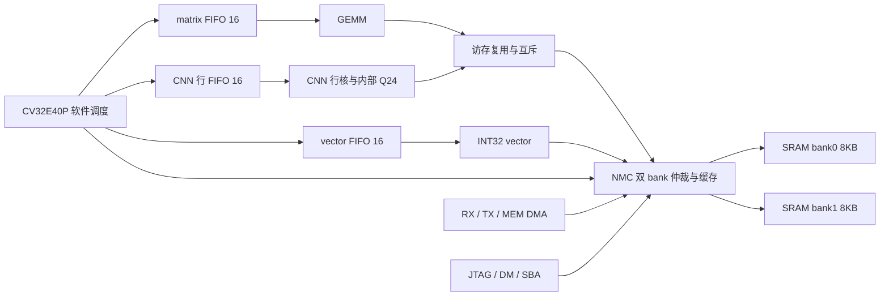

> 本页中的CRW1、CNN FC模式及性能/面积结果属于历史版本。当前CNN已移除FC，见[CRW2卷积专用化与Matrix FC](cnn-conv-only.md)。通用Vector指令设计仍沿用。

> 历史阶段记录：当前 CNN 原始结果、vector 后处理及双 bank regfile 见 [当前架构](regfile-vector.md)。本文数值与旧 ABI 仅对应当时快照。

# 独立 CNN／matrix／vector 架构

当前目录 `mynpu-softpe` 沿用旧名，分支 `experiment/independent-units`。CNN 是**单输出通道、单输出行**的独立计算单元，新增默认 16 项行任务 FIFO；CPU 软件调度通道、行与层。matrix 和 vector 各有独立数据通路与 16 项待执行 FIFO。没有恢复统一 PE 或 NoC。

| 单元 | 一个任务的计算 | 任务入口 |
|---|---|---|
| matrix | signed INT8/INT16 GEMM，M/N/K 1..16，转置/累加，INT32 输出 | `0x40000100`，16 pending＋active |
| CNN | 一个输出通道的一行 padded 3×3 卷积，或一个 FC 点积；内部 Q24 后处理 | `0x40000600`，16 pending＋active |
| vector | 1..1024 个 INT32 逐元素运算，16 种 opcode，可广播标量 B | `0x40000200`，16 pending＋active |

matrix 与 CNN 共用 NMC 主端口 1，互斥执行；vector 用主端口 2，可与其中之一及 DMA 并行。每 bank 每拍最多接受一个 32bit 请求；NMC 每 bank 16 words 缓存。CPU 指令在 SRAM，不使用寄存器数组保存指令。

## CNN 的硬件与软件边界

硬件不再自动遍历整层的输出通道和行。CPU 给出当前通道 weights/quant、当前输出行 y 与目的地址。行内使用Ci外循环、整行部分和、padding mask、激活/权重 ping-pong 与加载计算重叠。仍有必要的 5 个执行状态和 7 个加载状态，用于总线握手、行内计数和流水排空。

[npu_cnn.sv](../rtl/cnn/npu_cnn.sv) 连接独立的 [CSR/FIFO 控制](../rtl/npu_cnn_control.sv)与[行执行核](../rtl/npu_cnn_engine.sv)，后者负责行内地址生成、缓冲及访存；[npu_cnn_mac.sv](../rtl/cnn/npu_cnn_mac.sv) 是 CNN 私有的计算流水线，提供 9 路 `(UINT8 − input_zero) × INT8`、28 个 signed 24bit 累加上下文及整数后处理。后者没有独立 MMIO 或共享服务端口。

整数语义保持不变：56bit `acc * M + B` 除以 `2^24`、ties-to-even 舍入、加输出零点（INT32 加法）、可选 ReLU、裁剪到 `[0,255]`。没有浮点，没有外置共享量化单元。权重、量化参数、输入和逐层 golden 未改变。

卷积 W/H 1..28，Ci 1..16，CHW，3×3 kernel、padding 1、stride 1/2；可裁剪右侧输出宽度。FC 单点积长度 1..144。输入和量化参数按 word 对齐，权重与输出允许 byte 对齐，末尾按 byte enable 写回，保护邻接字节。

## 软件调度

第一层输出为 `2×14×14`，CPU 循环 2 个输出通道、每通道 14 行，提交 28 个任务；每项包含当前通道 9B 权重指针、8B `{M,B}` 指针、行 y、14B 输出目的地址。CNN 接收任务快照后，CPU 可继续准备下一项。

全模型共 222 项任务，最后的 FC 分别提交 10 个点积。静态配置按层差分更新；weights/quant 每通道更新，dst/y/start 每行更新。队列满时确认 done、重查空位、执行 WFI。层末等待 completed 达到 submitted ticket，才重用激活 SRAM 并推进下一层。最后 CPU 对 packed U8 logits 做 argmax。

详细寄存器、FIFO 格式、故障处理和 WFI 竞争处理见 [CNN FIFO 说明](cnn-cleanup.md)，实际汇编生成器见 [firmware.py](../mnist/firmware.py)，C 参考接口见 [npu.h](../sw/npu.h)。当前 CNN 行接口标识 CRO2 `0x43524f32`，matrix/vector ABI 保持不变；旧整层描述符与行接口不兼容。

程序入口 `0x80000080`，软件层表 `0x80000c00`；单图 418 条指令，连续流 434 条，加载像均为 4KB。参数唯一副本 3932B 在 bank1 `0x80002000`。不增加 im2col 张量。

## 当前功能与性能

当前三种任务FIFO均16项，MNIST单图19,825周期、含输入20,445周期；20帧平均20,300.80周期。单图推理已低于20k，含输入与连续流平均仍超过20k。matrix/vector批量提交微基准可更早提交完所有工作，但总计算周期不变；具体收益边界、参数和复现方法见[16项FIFO说明](cnn-cleanup.md)。

当前RTL宏功能模型无SDF、关闭timing check；逐层/边界、流式、队列、通用算子、DMA/NMC、SoC和JTAG回归通过。[最新综合与验证报告](../reports/cnn_cleanup_validation.json)记录当前精简版面积、时序及网表功能证据；[CNN精简说明](cnn-cleanup.md)列出删除的结构和代码分工。物理规划边界为2mm×2mm，Cell Area预算约3mm²。本轮没有布局布线结果。
