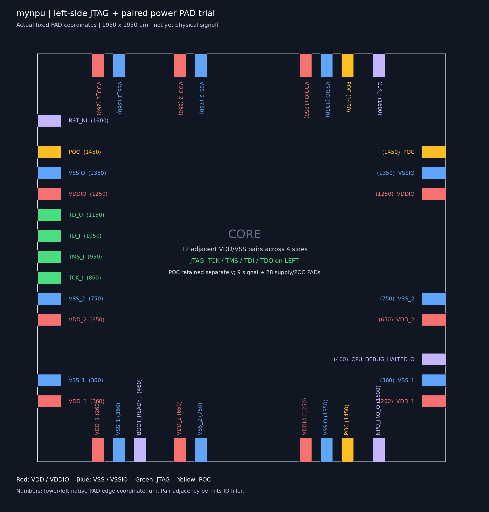

# 左侧 JTAG 与电源/地成对 PAD 试验

本轮只改变物理PAD规划，复用RF 1R1W已映射核心及封装网表。1950×1950µm Die、2块SRAM、9个信号PAD、28个电源/地/POC PAD不变。
独立运行目录：`../eda-runs/20261111-jtag-left-paired-pads/`。原r3仍作为已验证基线，试验未完成时不替换其报告。

## 位置

| JTAG | 左侧PAD下沿y，µm |
| --- | ---: |
| TCK | 850 |
| TMS | 950 |
| TDI | 1050 |
| TDO | 1150 |

该组对准原两块SRAM之间的TAP/Debug Module区域。clk在顶边1600µm；reset在左侧1600µm；boot在底边460µm；IRQ在底边1600µm；halted在右侧460µm。

每条边的电源PAD排列：VDD1(260) / VSS1(360)、VDD2(650) / VSS2(750)、VDDIO(1250) / VSSIO(1350)，POC单列1450µm。
括号为PAD沿边下沿/左沿坐标。每对之间只允许IO filler，不插入其他信号或电源域PAD；native PAD宽60µm，配对中心相距100µm，中间40µm由原生IO filler补齐。

完整计划：[jtag_left_paired.json](../eda/tsmc180/fullchip/pad_plans/jtag_left_paired.json)。图片按实际DEF位置绘制，不是完整核心布局截图。

## 实测结果

| 检查 | 结果 |
| --- | --- |
| 核心非filler面积，含两块SRAM | 2.633928 mm² |
| 50MHz布线后setup / hold WNS | +0.342 / +0.011 ns |
| Innovus DRC / 天线 | 0 / 0 |
| 核心VDD/VSS连通性 | 无问题 |
| 布线网表JTAG装载与MNIST | 34项通过，10MHz JTAG，无SDF |
| PAD位置与成对检查 | 37个native PAD、左侧4个JTAG、12对电源/地全部通过 |

顶部四个PG端口标签已随PAD移动，避免旧标签落到IO filler或相反电源PAD上。初次详细布线的一处内部信号短路也已在收尾ECO中修复。
同一组已放置端点下，JTAG的PAD距离估计为3,036.8µm；这里只是几何估计，不等同实际布线总长度。

[实际DEF核对、测量及文件哈希](images/jtag-left-paired-pads-trial.source.json)。最终数据库为`mynpu/pnr/checkpoints/14_exported.enc.dat`，内部来源为`13_paired_labels.enc.dat`。

本次没有修改RTL或重新映射核心。VDDPST/VSSPST在原生IO抽象视图中仍有两条no-routing提示；真实IO GDS连通性需由LVS核实。
Calibre DRC、LVS/ERC、Seal Ring/Dummy后检查、封装、IR/EM均未对这个新PAD布局重跑，不以旧r3结果代替。新排列暂作为验证过原生PNR与功能的候选，不替换r3签核基线。
