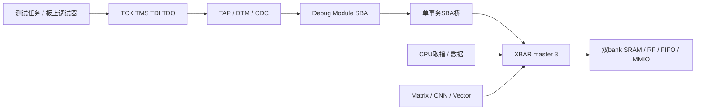

# 移除Host：统一JTAG Debug Module仿真

2026-11-14。当前SoC级仿真的装载、MMIO配置和结果读取统一走：



## 实现变化

- 从`npu_soc`、`npu_core`、`npu_jtag_debug`删除全部`host_*`端口，ASIC和EGo1壳层同步更新。
- 删除Host/SBA请求mux、公平轮换、`owner_sba`状态；master 3只服务SBA。
- 保留`pending`，保证一笔SBA接受与一次响应匹配；CPU和NPU仍使用其他master，单事务并不要求halt CPU。
- 保留ndmreset前排空已接受响应的处理。没有添加SBA FIFO、改变SRAM bank数或增加SRAM端口。
- 移除OOC约束中的Host引脚，更新相关仿真驱动和门级测试include依赖。

SoC测试的`bus`/`transfer`等便利任务仍可存在，但实现改为逐位驱动真实JTAG，不是访问DUT内部总线。独立XBAR、RF、计算核测试直接驱动模块接口，仍用于验证本地协议；它们不具备通向完整SoC的Host后门。

## DM错误及子字访问

迁移负向测试时发现旧课程库的两个限制，因此修改了仓库中的课程DM副本：

1. `dm_top/dm_sba`新增总线错误输入，XBAR返回错误时终止对应SBA并设置`SBCS.sberror=2`。
2. `dm_csrs`不再每周期强制`sbaccess=32bit`，声明8/16/32bit支持；`dm_sba`按地址选字节lane、移位数据并给XBAR发送对齐word地址。未对齐报3、不支持尺寸报4。

MMIO写仍要求32bit，不因为SBA支持字节而改变CSR契约。错误位按W1C清除；访问前需要检查busy。没有实现总线响应超时硬件。

`db_sba_access.svh`可将稀疏byte mask拆成多次SBA字节操作，保持对应字节最终内容，但不承诺一次总线写的原子性。原Host/SBA双入口并发测试已替换；只有一个外部TAP，不应让两个测试线程同时驱动它。

## 验证重点

新`tb_jtag_running.sv`经SBA装载真实RV32程序。CPU持续取指、更新两个SRAM bank并反复启动Vector；测试端完成1024轮伪随机SRAM写/读，交替访问两个bank并穿插MMIO读取。监测器逐拍核对master 3的接受与返回，并要求CPU前进、CPU未halt且NPU确有访存流量。

真实SRAM宏模型下得到：

| 项目 | 结果 |
| --- | ---: |
| 检查 | 1161通过 |
| SBA接受 / 返回 | 2278 / 2278 |
| 接受时CPU/NPU也在请求 | 1996次 |
| CPU取指 / 数据grant | 2034575 / 905011 |
| Vector grant | 870991 |
| SBA最大grant等待 | 1周期 |

包括总线错误、错误清除、未对齐/不支持尺寸、字节lane、半字读、ndmreset及SRAM保留。压力测试不是1000帧推理，也没有覆盖所有bank映射/时钟比；它验证了本轮实际竞争模式。

原有JTAG halt/resume/单步/autoincrement/冷加载MNIST回归，在同步SRAM模型与真实宏模型下各34项通过。EGo1板级壳层功能仿真38项通过，MMCM/BUFG使用仿真替身，不是实体板或Vivado实现结果。

Matrix/Vector并行供数测试改为将两任务先入队等待同一EV01事件，再用一次JTAG写释放，确保真正重叠。串行JTAG分别发START可能让短任务先后完成，不能再用旧Host几周期间隔的启动方式证明并发。

详细测试路径和输入哈希见[机器验证结果](../reports/jtag-only-validation.json)。失败尝试保存在`npu/build/`：包括旧测试仍假设DM不返回错误、强制32bit导致子字测试失败、串行启动未产生预期重叠，以及一次压力测试把Vector COPY误配为ADD；均修正后重新验证，不计入通过项。

## 性能计时口径

JTAG装载/配置比Host测试口慢，不能将测试墙钟周期直接当作NPU性能。MNIST10样本、120检查通过；每样本：

- 输入784B串行装载：244608周期。
- 从发出启动命令阶段开始到完成：21728周期。
- 其中启动MMIO实际提交前：723周期。
- 从启动MMIO提交到完成：21005周期。

历史21008周期来自旧Host启动口径，不是本次少了3周期计算。计算核统计仍为39330 useful MACs和15180 kernel cycles。测试保留原elapsed字段并新增`SBA_LAUNCH`分解，避免静默改变历史统计意义。

## 复现

从仓库根目录执行，tag需为尚未使用的新名称：

```bash
python3.12 npu/scripts/run_vcs.py --suite jtag --tag jtag-only-local --macro
python3.12 npu/scripts/run_vcs.py --suite jtagrunning --tag jtag-running-local --macro
python3.12 npu/scripts/run_vcs.py --suite latency --tag jtag-latency-local
python3.12 npu/scripts/run_vcs.py --suite sharedoperands --tag jtag-parallel-local
python3.12 npu/fpga/ego1/simulate.py --out npu/build/ego1-jtag-local
```

本轮没有重跑综合/布局布线，也没有重新生成或下载FPGA bitstream。此前GPIO面积和完整r3后端报告都是旧源码冻结基线，不能为本次接口/DM变化背书。仿真没有复现板上故障，不能据此宣布已定位或消除了旧bitstream的运行态SBA问题；需使用本轮源码重新构建后板测。
