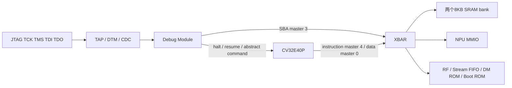

# JTAG 与 RISC-V Debug Module


当前设计只保留外部JTAG调试入口，已删除`npu_soc`、`npu_core`和`npu_jtag_debug`的Host端口及Host/SBA复用仲裁。课程DTM/DM位于`external/lab3-ST/SoC_cv32e40p/soc/rtl/debug/`，其中SBA已补接总线错误，并支持可写的8/16/32bit访问尺寸。



实现入口为 `npu/rtl/debug/npu_jtag_debug.sv`；`npu_core.sv` 连接CPU和XBAR，`npu_soc` 暴露这些引脚。

| 接口／地址 | 含义 |
|---|---|
| `tck_i / tms_i / td_i / td_o` | 四线 JTAG；TRST 内部连接 POR `rst_ni` |
| `cpu_debug_halted_o` | CPU 已暂停指示 |
| TAP IR length / IDCODE | 5 / `0x00000001`，与旧版一致 |
| IR `0x10 / 0x11` | DTMCS / 41bit DMI（7bit 地址、32bit 数据、2bit op） |
| Hart ID | 0 |
| `0x00000000..0x00000fff` | DM slave；halt ROM 入口 `0x800`，异常入口 `0x808` |
| `0x00010000..0x0001003f` | 不可写 bootstrap ROM |
| `0x80000000..0x80003fff` | 两个 SRAM bank，共 16KB |
| `0x40000008 / 0x4000000c` | CPU_CONTROL / 程序入口，默认 `0x80000080` |

DM 支持 CPU halt/resume、abstract register/CSR access、progbuf 与 SBA。单步使用 DCSR.step；测试覆盖 x5、x7、作为 debug scratch 的 x10，以及 DPC/DCSR。硬件触发器和全部 OpenOCD/GDB 命令尚未逐项验证。

SBA使用XBAR独立master 3，与CPU取指、CPU数据及NPU各master仲裁。仅保留一笔outstanding SBA事务，用`pending`追踪完成；没有Host owner或Host公平轮换状态。CPU运行时可以发起SBA访问，bank冲突通过grant等待处理。CPU暂停不会暂停计算单元，读写活动张量/代码的顺序仍由软件负责。

SRAM/RF支持8/16/32bit自然对齐SBA访问，lane选择与数据移位由DM实现；MMIO写仍要求32bit。总线错误回传`SBCS.sberror=2`，未对齐为3，不支持的访问尺寸为4。错误通过SBCS对应位写1清除；新的访问前应检查`sbbusy`，不能在busy期间修改访问设置。本次没有增加总线超时硬件或响应FIFO。

SoC仿真使用真实TAP引脚任务：`db_jtag_tasks.svh`和`db_sba_access.svh`，不通过层次force注入DMI或XBAR。后者把稀疏字节mask拆成多次SBA字节操作，不承诺原子性。XBAR/RF/计算核的独立单元测试仍可直接驱动被测模块的本地接口，这不属于外部Host后门。

## 启动与复位

`cpu_run_i` 应保持 1，让 CPU 在程序尚未装载时也能进入 debug ROM。POR 后 CPU 在小型 bootstrap 中 WFI 等待 CPU_CONTROL，而非一直保持 reset。这样冷启动时 JTAG 就能暂停 CPU、访问寄存器。bootstrap 仅 11 条指令，不占 SRAM。

向 CPU_CONTROL 写 1：IRQ31 唤醒 bootstrap，读取 CPU_BOOT_ADDR，清除 bootstrap 使用的 mie 后跳入 SRAM 程序；不要求改变原程序链接地址。IRQ31 仅在首次 SRAM 取指前用于启动，原 NPU 中断位保持不变。

向 CPU_CONTROL 写 0：产生四周期 CPU-only reset，CPU 返回 bootstrap 等待；NPU、DM 不受该复位影响。它不再表示持续拉住 CPU reset。

DMCONTROL.ndmreset 复位 CPU/NPU/XBAR，保持 TAP/DM 和 SRAM 内容。桥先停止接受新请求，并排空已接受的 SBA响应，再复位系统；解除复位后同步释放。POR 才同时复位 TAP/DM。

## OpenOCD 使用示例

已提供 `npu/debug/target.cfg`，需由实际开发板的 adapter 配置先选定 USB 适配器及 GPIO 接线，例如：

```sh
openocd -f interface/ftdi/YOUR_ADAPTER.cfg -f npu/debug/target.cfg
```

目标配置从旧板卡配置提取，初始 JTAG 为 10kHz；本次完成的是 RTL／宏模型测试，没有连接实体板卡验证 OpenOCD。`clk_i` 必须持续运行。

首次上电后，在 OpenOCD telnet 控制台依次执行（从仓库根目录启动）：

```tcl
init
halt
load_image npu/mnist/artifacts/sram0.bin 0x80000000 bin
mww 0x80001f00 0xffffffff
mww 0x80001f04 0
mww 0x80001f08 0
mww 0x80001f0c 0
mww 0x4000000c 0x80000080
mww 0x40000008 1
resume
# 等待推理完成，再查看 mailbox 与 logits
mdw 0x80001f00 4
mdw 0x80001400 3
```

该示例用于新上电的 bootstrap；重跑前先 CPU_CONTROL 写 0 并重新 halt，让 CPU 返回 bootstrap。若调试器通过写 DPC 直接启动自备程序，则由该程序自己完成寄存器／中断初始化。

## 可复现验证

```sh
/usr/bin/python3.12 npu/scripts/run_vcs.py --suite jtag --tag local --macro
/usr/bin/python3.12 npu/scripts/run_vcs.py --suite jtagrunning --tag local --macro
/usr/bin/python3.12 npu/scripts/run_vcs.py --suite latency --tag local
```


## 当前验证入口

默认配置和性能使用[项目首页](../../README.md)；当前版本的功能、综合、最终PNR及检查证据统一见[报告索引](../reports/README.md)。

`jtagrunning`将实际CPU程序、Vector输入与配置都经SBA装载，CPU持续取指、访问两个SRAM bank并反复启动Vector，同时进行1024轮SBA读写和MMIO读。测试逐拍核对master 3接受/响应数量、CPU未halt、CPU计数前进和NPU流量；包含错误清除、字节lane、半字读及ndmreset后SRAM保留。它不能代替新bitstream的板测。

JTAG串行装载/配置明显慢于旧Host仿真口；测试总运行周期包含这部分，不能与旧Host端到端周期直接比较。计算性能应使用固件内部周期计数，避免把JTAG轮询开销混入推理时间。

本次Host删除的实现与测试数据见[JTAG-only验证](jtag-only-simulation.md)。
