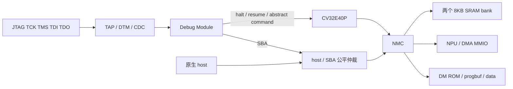

> 实现专题：文中阶段性队列、周期和面积仅适用于当时快照。当前默认配置及最终结果见[项目首页](../../README.md)；接口字段以当前 RTL / `npu/sw/npu.h` 为准。

# JTAG 与 RISC-V Debug Module

当前独立单元恢复及本轮验证见independent-units.md（历史文档已移除）。本文面积／时序／网表数据保留为此前快照，不能替代当前源码的物理验证。

> 本文面积及验证记录属于通用算子扩充前的 JTAG 快照。调试接口保持一致；后续计算功能与验证见 Operator ABI 1.0（历史文档已移除）。


本次在 `experiment/dual-bank-queued` 双 SRAM 版本接回旧 `mynpu-torus/rtl/mynpu_soc_top.sv` 使用的课程库 DTM/DM。库代码保持原样，位于 `external/lab3-ST/SoC_cv32e40p/soc/rtl/debug/`；没有重新引入 AXI。



实现入口为 `npu/rtl/debug/npu_jtag_debug.sv`；`npu_core.sv` 连接 CPU 和 NMC，`npu_soc` 暴露这些引脚。

| 接口／地址 | 含义 |
|---|---|
| `tck_i / tms_i / td_i / td_o` | 四线 JTAG；TRST 内部连接 POR `rst_ni` |
| `cpu_debug_halted_o` | CPU 已暂停指示 |
| TAP IR length / IDCODE | 5 / `0x00000001`，与旧版一致 |
| IR `0x10 / 0x11` | DTMCS / 41bit DMI（7bit 地址、32bit 数据、2bit op） |
| Hart ID | 0 |
| `0x00000000..0x00000fff` | DM slave；halt ROM 入口 `0x800`，异常入口 `0x808` |
| `0x00010000..0x0001003f` | 不可写 bootstrap ROM |
| `0x80000000..0x80003fff` | 两个 SRAM bank，共 16KB |
| `0x40000008 / 0x4000000c` | CPU_CONTROL / 程序入口，默认 `0x80000080` |

DM 支持 CPU halt/resume、abstract register/CSR access、progbuf 与 SBA。单步使用 DCSR.step；测试覆盖 x5、x7、作为 debug scratch 的 x10，以及 DPC/DCSR。硬件触发器和全部 OpenOCD/GDB 命令尚未逐项验证。

SBA 通过 NMC 的原 host 端口访问 SRAM/MMIO，支持 32bit 对齐读写及 autoincrement。原生 host 与 SBA 使用一笔有序 outstanding 事务、公平轮换仲裁；SRAM 写都经过 NMC，因此沿用原有 cache 失效规则。两者可并发发起，不增加每个 bank 的 SRAM 端口。

沿用的 DM 库仅声明 32bit SBA，不声明 8/16bit SBA；适配器没有 bus-error 返回接口。使用者必须限制合法地址、对齐和 MMIO 操作，不能依赖 SBA sberror 报出 NMC 地址错误。CPU 暂停不会暂停 CNN/DMA，修改活动张量和代码仍需软件协调。

## 启动与复位

`cpu_run_i` 应保持 1，让 CPU 在程序尚未装载时也能进入 debug ROM。POR 后 CPU 在小型 bootstrap 中 WFI 等待 CPU_CONTROL，而非一直保持 reset。这样冷启动时 JTAG 就能暂停 CPU、访问寄存器。bootstrap 仅 11 条指令，不占 SRAM。

向 CPU_CONTROL 写 1：IRQ31 唤醒 bootstrap，读取 CPU_BOOT_ADDR，清除 bootstrap 使用的 mie 后跳入 SRAM 程序；不要求改变原程序链接地址。IRQ31 仅在首次 SRAM 取指前用于启动，原 NPU 中断位保持不变。

向 CPU_CONTROL 写 0：产生四周期 CPU-only reset，CPU 返回 bootstrap 等待；NPU、DMA、DM 不受该复位影响。它不再表示持续拉住 CPU reset。

DMCONTROL.ndmreset 复位 CPU/NPU/NMC/DMA，保持 TAP/DM 和 SRAM 内容。桥先停止接受新请求，并排空已接受的 host/SBA 响应，再复位系统；解除复位后同步释放。POR 才同时复位 TAP/DM。

## OpenOCD 使用示例

已提供 `npu/debug/target.cfg`，需由实际开发板的 adapter 配置先选定 USB 适配器及 GPIO 接线，例如：

```sh
openocd -f interface/ftdi/YOUR_ADAPTER.cfg -f npu/debug/target.cfg
```

目标配置从旧板卡配置提取，初始 JTAG 为 10kHz；本次完成的是 RTL／宏模型测试，没有连接实体板卡验证 OpenOCD。`clk_i` 必须持续运行。

首次上电后，在 OpenOCD telnet 控制台依次执行（从仓库根目录启动）：

```tcl
init
halt
load_image npu/mnist/artifacts/sram0.bin 0x80000000 bin
mww 0x80001f00 0xffffffff
mww 0x80001f04 0
mww 0x80001f08 0
mww 0x80001f0c 0
mww 0x4000000c 0x80000080
mww 0x40000008 1
resume
# 等待推理完成，再查看 mailbox 与 logits
mdw 0x80001f00 4
mdw 0x80001400 3
```

该示例用于新上电的 bootstrap；重跑前先 CPU_CONTROL 写 0 并重新 halt，让 CPU 返回 bootstrap。若调试器通过写 DPC 直接启动自备程序，则由该程序自己完成寄存器／中断初始化。

## 可复现验证

```sh
/usr/bin/python3.12 npu/scripts/run_vcs.py --suite jtag --tag local --macro
/usr/bin/python3.12 npu/scripts/run_vcs.py --suite latency --tag local --max-cycles 20000
/usr/bin/python3.12 npu/scripts/run_vcs.py --suite stream --tag local
```

JTAG 测试通过真实引脚扫描，不强制内部 DMI：IDCODE/DTMCS、冷启动 halt、寄存器/CSR、单步、两 bank 边界、SBA autoincrement 跨 bank、host/SBA 并发和 cache 一致性、CPU-only reset、ndmreset 后 TAP 可用且 SRAM 保留；最后通过 JTAG 装载完整 16KB SRAM 镜像并运行一张 MNIST，对比十个 logits。JTAG 装载耗时不计入普通 MNIST 性能指标。

接入后的普通 10 样本回归每张 18,726 周期，包含输入 RX DMA 为 19,346，计算内核仍 18,178；相较接入前增加 13 个启动周期。20 帧连续流为 382,245 周期，平均 19,112.25 周期／帧。统计口径与双 bank 报告相同。

综合新增 TCK 100ns 时钟，系统时钟按 16ns 优化／20ns 评估，并声明两者异步。TMS/TDI/TDO 约束相对于 TCK；这不替代 CDC／物理实现 signoff。接入前的 `dual_bank_validation.json` 属于历史快照，不代表本次 JTAG RTL 的面积时序。

## 本次综合结果

Genus19.17／TSMC180 TT／medium，独立运行 `../eda-runs/20261101-jtag-dual-v1` 正常结束：

| 项目 | 接入前 | 接入后 |
|---|---:|---:|
| Cell Area，包含两块 SRAM | 1.9864117mm² | **2.0843088mm²** |
| SRAM 宏面积 | 0.8028872mm² | 0.8028872mm² |
| 标准单元面积 | 1.1835245mm² | **1.2814217mm²** |
| 50MHz setup slack | +4.0007ns | **+4.0006ns** |

总增量 0.0978971mm²（4.93%）；其中 `i_core_i_debug` 层级为 0.0856106mm²，其余增量包括解码、bootstrap、复位／CPU 接线及重新优化的差异，不能把总增量全部算为 DM 本体。TCK 100ns 下 slack +47.5502ns。两时钟 TNS 均为 0。结构检查 unresolved／empty／undriven-leaf／multidriven-leaf／top port 问题均为 0；另记录 2,067 个优化后的 undriven hierarchical pin，不能据此声称所有检查全零。

这是布线前综合／静态时序结果，不含 PAD ，不是面积可放置证明、布线后频率或芯片板测结果。

最终映射网表也通过相同 41 项 JTAG 检查（含 JTAG 装载 MNIST），以及独立普通启动的一张 MNIST：logits／分类正确、含输入 19,346 周期。网表测试使用实际标准单元和 SRAM 功能模型，零延迟、无 SDF、timing check 关闭，仅证明功能。日志为 `npu/build/gate-jtag-pins/` 和 `npu/build/gate-jtag-final/`。

已完成的源码／库／测试哈希核验与综合摘要：`npu/reports/jtag_validation.json`；后端原始报告位于 `../eda-runs/20261101-jtag-dual-v1/reports/`。
