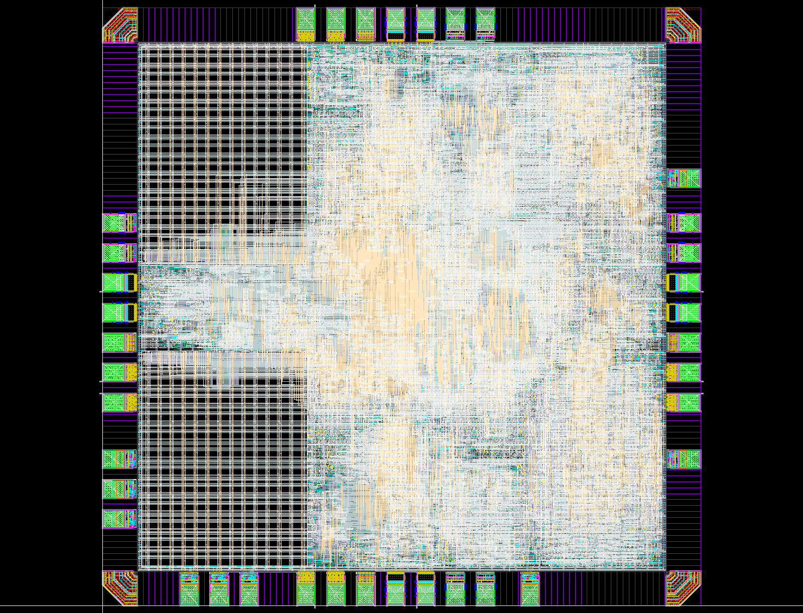

# Lab 5 后续流程实跑：all4 基线

2026-11-09，使用此前已完成布局布线的 `20261108-area26-all4-fullchip`，按 [Lab 5](https://full-stack-ai-chip.tianyuj.com/lab-5/) 执行后续步骤。**工具流程能够执行完，但当前版图未通过课程完整验收，不能投片。** RTL 和原布局布线输出均未修改。

| 阶段 | 实测结果 |
|---|---|
| V2LVS → CDL | 完成，含标准单元、IO、两块 SRAM 原始 CDL；无 SRAM Box |
| Virtuoso 导入、Seal Ring、POC | 完成；保留 2000 DBU/µm 精度 |
| 金属与 OD/PO Dummy | 两类生成和最终合并完成 |
| 最终几何 DRC | 523 项检查；原始 2703 层次 / 22047 展开结果 |
| 课程四类排除后的 DRC | **M1.S.1：270 / 270，未通过** |
| 原始电阻容差 LVS | INCORRECT，仅有 IO PR 电阻约 3.47% 属性偏差 |
| Lab 5 的 3.48% PR 容差 LVS | **CORRECT**；605 项属性检查保留，Split Gates YES |
| ERC | **7 层次 / 977 展开**，有残项，未宣称 Clean |
| 最终独立天线 | **62 项检查，0 / 0 违规** |
| Wire Bond PAD | **64 项检查，0 / 0 违规** |
| 课程尺寸 | 原始 die 2000×2000µm、加环后 2030×2030µm；均超过课程上限 |

LVS 变换归约后的两侧数量为 **14 个端口、327456 个网络、494757 个器件/归约实例**，均匹配。归约前布局/源器件数量不同，报告保留了 unbalanced smashed MOS 和 ambiguity 警告；不能拿归约后计数当原始晶体管数量。四个供电网保持独立，POC 标签没有短接到供电。

## 真正剩下的问题

**270 处 M1.S.1 集中在两个 SRAM 区域，各 135 处。**

为排除导入和 Dummy 引入的问题，额外对照了：

- 原厂 SRAM GDS 单独执行 M1.S.1：0。
- 未修改的 Innovus 原始 GDS 执行 M1.S.1：270。
- 最终带 Dummy 的完整 GDS：仍为 270。

因此问题已经存在于原布局布线导出的几何中。应优先检查 SRAM 边缘新增电源接入的 M1/via 与宏原生金属间距，而不是修改 SRAM 电路或放宽间距规则。首个标记约为 `(135.52,140.72)–(135.68,141.065)µm`。具体坐标见运行目录 `outputs/m1_localization.json` 和 `pnr_diagnostic/results.db`。

最终 DRC 的其他非零项是 ESD.24g、ESD.25g、LUP.3.3g_3.3V、LUP.5.3g_3.3V、MOM.R.2、DRM.R.1。四类教学排除只用于结果分类，**没有关闭原规则，也没有把原始 2703 改写为零**。

ERC 摘要为 mnpg 4/832、floating.nxwell_float 1/72、npvss49 1/72、floating.psub_float 1/1，类型与计数符合教程列出的 IO/外圈残项。原始结果保留待评审；未增加虚连、跨环接地或关闭 ERC。

课程限制原始 die ≤1950µm、加环外框 ≤1980µm；本版仍保持用户指定的原 2mm die，环宽与工艺图形没有缩放。加环外框为 **2.03×2.03mm²，即4.1209mm²**。要满足此尺寸约束，需要回到布局布线阶段重新确定 floorplan，不能通过裁切功能版图满足上限。

## 本次解决的流程问题

1. 旧模板没有 `layout/`，实际规则和填充脚本取自服务器 `/lec/lab5/layout`，原始版本冻结在运行目录 `reference/`。
2. 原技术库为 1000 DBU/µm，直接导入会发生坐标舍入。本次只复制技术数据库到本地 `mynpu_tech2000`，在导入设计前设置为2000；共享 PDK 仍为1000。精确导入无精度丢失警告。
3. Calibre 项目规则 `PRECISION` 同步为2000，`RESOLUTION` 等比例翻倍：DRC/填充/天线/WB 仍为0.005µm物理网格，LVS仍为0.001µm。间距、线宽及其余物理规则数值未放宽。
4. Seal Ring 采用原厂 edge/corner，沿1µm节距扩展并平移，最终8044个实例。修正了试运行中右边接缝的1µm缺口；最终环相关规则归零。原环先经 GDS 转入本地2000精度库，避免跨精度 OA 复制失败。
5. 原 IO 库 CO.R.4 在项目副本 `B776_POSTVDD2CDG` 中修正：将对应 PIMP 右边界从52.3延到相邻 NIMP 边界52.59µm。最终 CO.R.4 为0，未修改共享 IO 库。
6. 金属填充关闭40K厚顶层分支；普通 M6 小填充采用0.8×0.8µm，其余分支不变。密度、DOD 和 M6.A.1 在最终检查中均为0。
7. 先保留原始 LVS 容差跑严格比较；确认仅有教程所述 IO PR 3.47% 系统偏差后，才按教程将三处条件分支设置为3.48%。严格报告和教学报告均保留，未减少605项属性检查。

## 位置与查看方式

运行根目录：

`/home/s2400012841/chip-fullstack-2026/eda-runs/20261109-lab5-all4`

主要文件：

| 路径，相对运行根目录 | 用途 |
|---|---|
| `outputs/mynpu_asic_top_postDummy.gds` | 最终合并 GDS，Top=`mynpu_asic_top_postDummy` |
| `outputs/mynpu_asic_top_preDummy.gds` | 修正后、未加填充的 GDS |
| `cdl/mynpu_asic_top.cdl` | Source Top=`mynpu_asic_top`，引用三份原电路库 |
| `drc_post/summary.rpt`、`results.db` | 最终原始几何检查 |
| `lvs/report.rpt`、`erc.summary`、`erc.db` | 教学容差 LVS 与 ERC |
| `lvs_strict/report.rpt` | 原容差下的完整比较 |
| `antenna/`、`wb/` | 最终独立检查 |
| `rules/`、`scripts/`、`logs/` | 本次实际配置、SKILL、工具日志，含失败尝试 |
| `workspace/` | 可恢复 OA 库和本地 cds.lib |
| `outputs/final_inputs.sha256` | 最终 GDS / CDL 校验值 |

[机器可核对报告](../reports/lab5_all4_validation.json)区分 `flow_commands_completed=true` 与 `course_acceptance_passed=false`。可重新汇总：

```bash
python3.12 npu/eda/tsmc180/collect_lab5.py \
  --run ../eda-runs/20261109-lab5-all4
```

GUI 查看：进入上述运行目录的 `workspace` 后启动 `virtuoso`，打开 `mynpu_lab5_final / mynpu_asic_top_postDummy / layout`。该库是最终 GDS 的精确导入；修改它后必须重新导出并复跑所有受影响检查，现有报告不会自动更新。

以下为实际 Virtuoso 最终层次截图，旁边 `.source.json` 记录了 GDS、导入日志、OA 和截图哈希：



`npu/eda/tsmc180/lab5/build_layout.il` 整合了本次验证后的 Seal Ring/POC/IO 修正步骤，**只适用于本次已记录输入的全新精确导入库**，不要在已修正的活动库上再次执行。其他输入须重新检查原环尺寸和实际 IO 几何。

本次没有执行 Dummy 后寄生提取、STA、IR/EM 或封装人工检查。已有 SPEF/SDF 与50MHz时序结果仍属于原 Innovus 阶段。

本次尝试归档（约162MB）：`../eda-runs/20261109-lab5-all4/deliverables/lab5_attempt.tar.gz`，同目录 `SHA256SUMS` 已验证。包内有 `NOT_READY_FOR_TAPEOUT.txt`，包含本次有效 GDS/CDL、规则、日志、最终 LVS 查询数据库和原容差报告；活动 OA 库和原 Innovus 检查点仍保留在原运行目录。CDL 的原工艺库引用使用绝对路径，迁移时需配置相应授权库环境。
