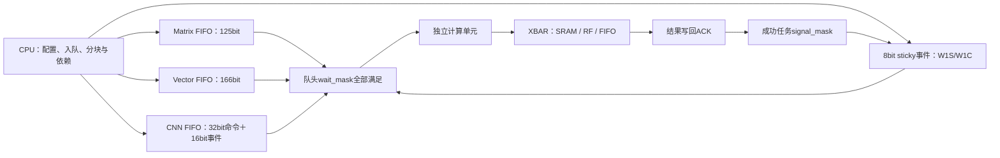

# LY01 布局与 EV01 任务事件

本轮实现通用布局、归约末项写回、输出行距和队列事件同步，并让软件使用这些能力。计算规模不变：Matrix 仍为4×4外积，CNN仍为3×3 DOT9，Vector仍为一套INT32/4路INT8 SIMD ALU；RF为256字节，任务队列4/4/4，数据FIFO每通道8 words。没有增加模型级 FSM 或配置写保护。



## 寄存器与快照

下表均为相对 `0x40000000` 的偏移。

| 地址 | 含义 | 行为 |
|---|---|---|
| `0x088` | EV01能力，`0x45563031` | 只读 |
| `0x08c` | 事件状态 / W1S | 读低8位事件，写1置位 |
| `0x090` | 事件W1C | 写1清除；同周期硬件置位优先 |
| `0x094` | LY01能力，`0x4c593031` | 只读 |
| `0x158` | Matrix ldc | 输出行距，单位INT32元素；0选择N，最大4096；随任务保存 |
| `0x15c` | Matrix事件 | 低8位WAIT，高8位SIGNAL；随任务保存 |
| `0x28c` | Vector A stride | 低16位有符号字节步长，读出符号扩展；随任务保存 |
| `0x290` | Vector B stride | 同上 |
| `0x294` | Vector D stride | 同上 |
| `0x298` | Vector layout | bit0 FINAL_ONLY、bit1 KEEP_R2、bit2 STRIDES；随任务保存 |
| `0x29c` | Vector事件 | 低8位WAIT，高8位SIGNAL；随任务保存 |
| `0x674` | CNN事件 | 低8位WAIT，高8位SIGNAL；随任务保存 |

Vector步长shadow复位值为4，layout复位为0；Matrix ldc复位为0，所有事件mask复位为0。旧二进制程序从复位开始运行时保持连续布局；新C接口的旧入口会显式恢复默认layout/ldc/event，避免混用扩展接口后继承状态。新C头文件要求配套本轮RTL，不承诺反向兼容旧硬件。

Matrix FIFO从96增至125bit：增加13bit ldc和16bit事件。Vector从99增至166bit：增加48bit步长、3bit控制和16bit事件。CNN原32bit窗口命令不变，另有16bit事件sidecar，因此**总队列存储为48bit/项**，不能仅按32bit估计面积。active寄存器与pending FIFO分开计数。

## Vector步长

设置STRIDES后，A/B/D使用各自有符号16位字节步长，包含0和负数。

```text
输入A地址 += A_stride
输入B地址 += B_stride     # 仅直接双输入模式；程序内LD32由程序自己算地址
输出D地址 += D_stride
```

- INT32：每处理一个元素步进一次；普通读写要求基址和步长4字节对齐。
- SIMD8：每处理最多4个INT8元素步进一次，即步长对应一个32bit组；最后不足4个元素使用byte enable。
- A/B步长0：反复从同一内存位置读取，用于广播。
- D步长0：反复写同一位置，最后一次写入保留；这本身不等于归约。
- 程序的PACK_U8输出：一个INT32输入生成一个字节，D步长按字节解释，支持任意有符号字节步长。非连续输出每项独立排空，连续步长1仍可合并一word。
- STRIDES=0：保留旧布局，A/B每次4字节，D普通输出4字节、PACK_U8输出1字节；stride shadow不生效。

FIFO端点是破坏性读写通道，不是内存：零步长仍会消费/产生新token，**不会广播同一token**。高级`Plan.strided`目前只接受SRAM/RF视图，避免混淆这个区别。

扩展布局的完整遍历范围、别名和缓冲生命周期由软件验证。硬件检查初始地址及编码，后续非法总线访问通过FAULT返回；没有为了验证每个跨度在MMIO中加入三套length×stride乘法器。软件必须防止32位地址回绕、越界和非预期原地覆盖。传统layout=0保留原有范围校验。

## 归约与跨任务累加

FINAL_ONLY只在最后一个输入组输出，其余组照常执行程序、保留寄存器效果，跳过写回；最终值写D初始地址。D不因被跳过的输出而步进，任务完成仍等待末次物理写回ACK。

Sum/Max/Min使用同一类通用程序：

```text
prologue: r2 = scalar        # SUM=0，MAX=INT_MIN，MIN=INT_MAX
loop:     r2 = op(r2, r0)
          r0 = r2
```

设置FINAL_ONLY即可把N次前缀输出减为一次输出，既不需要4N字节临时区，也不需要末项Copy任务。KEEP_R2使任务启动时不清零r2；配合不含初始化的loop-only程序，可跨任务接着累计。它只保留r2，不保存多个上下文，也不保留carry；软件负责程序和数据类型一致。SIMD的r2仍是四个8bit lane，不自动变成跨lane的INT32归约。

程序字及count/loop配置仍共享：程序字在执行时读取，count/loop在真正启动时采样。软件`prepare_reduction()`可提前加载循环，随后把生产者、偏置、归约一起入队。更换程序前仍需确保所有使用旧程序的任务结束。

## Matrix输出行距

原始INT32输出地址为：

```text
D + (row * ldc + col) * 4
```

累加模式也按同一地址读取旧D。单元用增量地址寄存器步进，不在每个结果上执行乘法。Quant输出仍按既有逻辑索引和quant destination紧凑排列；ldc描述原始D，不隐式改变共享量化的打包布局。

软件`Plan.gemm()`现在直接提交到带ldc的目标，不再借助紧凑工作区和Vector逐行搬出；M/N按16、K按256分块，后续K块启用ACCUMULATE。`precision`与`element_bytes`独立，输入可按1/2/4字节存储，INT16至少占2字节。16元素/256元素的分块边界使对齐的张量基址在紧凑布局下仍能合法提交，支持奇数leading dimension和尾块。尾部word加载所需物理存储也应保留在有效地址区。

## WAIT/SIGNAL的生命周期

队头满足 `(events & wait_mask) == wait_mask` 时才启动。等待期间CPU和其他计算队列继续执行。任务成功且全部输出完成写回后置位signal_mask；错误、取消和被丢弃的任务不发成功信号。原有单元IRQ/FAULT计数负责通知错误，软件决定复位或恢复；等待失败生产者的消费者不会被当成成功任务释放。

事件是sticky，不自动消费。软件在复用事件位前必须确认所有旧生产者和消费者结束；W1C与硬件完成同时发生时，硬件置位优先。CPU可W1S显式释放任务，这也允许软件决定特殊恢复操作。硬件不检测依赖环、错误mask或FIFO生产/消费死锁。

```text
Matrix任务：wait=0，signal=1
Vector任务：wait=1，signal=2
CNN任务：   wait=2，signal=4
```

三项可以先后入队，不需要CPU在每个算子之间等待。若生产者写FIFO且可能在完成前填满FIFO，则不应让消费者等待其“整任务完成”事件；应让FIFO背压承担流级同步，或由软件分块。

`Graph.lower()`对最多8个节点静态分配8个事件位，先排空前一张图并清除所用位，再将每个节点最终任务绑定signal、将依赖绑定wait。更大的图回退到软件完成票据，不悄悄提前复用事件。节点返回的完成事件必须覆盖本节点全部副作用。节点内部仍可包含软件等待，比如CNN改变共享几何；这不是动态乱序调度器。

## 软件接口与配置复用

- C：`npu_gemm_start_layout()`、`npu_elementwise_start_layout()`、`npu_stream_submit_events()`；字段宏和纯校验函数在`npu/sw/npu.h`。
- Python：`Plan()`默认原生降低；`Plan(native=False)`保留参考的标量展开/工作区搬出实现，用来公平比较。
- 只缓存软件拥有的配置shadow；地址、shape、precision、stride等未变化时不重复写。START、事件W1S/W1C等副作用写不会被省略。通过公开raw MMIO接口修改状态也会使相关软件缓存失效。
- `gemm()`和`reduce()`原生实现不需要scratch；保留可选参数用于旧调用兼容。
- 小型RV32测试预加载归约程序后，将GEMM→偏置→SUM用硬件事件连接，最后由CPU检查结果。


## 当前验证入口

默认配置和性能使用[项目首页](../../README.md)；当前版本的功能、综合、最终PNR及检查证据统一见[报告索引](../reports/README.md)。
