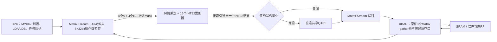

# Matrix 4×4 外积计算单元

后续已完成[三种Stream精简](streams-optimized.md)，[最新面积与时序](streams-optimized-area.md)另列。本文记录外积版初始实现与当时测量。

从检查点 `d7b1794` 改为4×4外积。`npu_matmul.sv` 只保留计算和握手：16个INT32累加器；每个有效计算步接受4个A和4个B，更新 `C[r,c] += A[r]*B[c]`。INT8和INT16均支持，INT8由Stream符号扩展到16位。乘加按INT32回绕。



算术核没有地址、形状循环、缓存或量化。行列mask屏蔽不足4行/列的尾块；通过索引对一个累加器加入旧D，也通过索引逐个导出结果。没有新增一条旧点积旁路或另一套乘法器。

## 数据布局与供数

任务继续计算 `D=op(A)*op(B)`，可选择 `D+=`。M/N/K最大仍为16；Stream自动拆成4×4输出块，遍历K后逐个写回有效单元，再计算下一块。输入支持原有非打包低字节/低半字布局，以及紧密打包INT8/INT16。

- A向量取同一K下最多4个输出行的数据，B向量取同一K下最多4个输出列的数据。
- 8个32位寄存器保留当前A/B字片段，并带有效位和字地址。多个元素位于同一个字时合并一次读取；K继续访问同一个字时直接复用。每个新输出块清空这些操作数暂存。
- 原有3个逻辑RF gather槽不变，每批最多取3个不同的字，RF冲突由既有仲裁处理。SRAM请求经Matrix普通32位端口分周期读取。
- 这是计算单元内的32B操作数暂存，不是重新加入透明SRAM缓存，也不替代共享RF。
- 任一输入或输出为流FIFO时，使用同一计算核的1×1有效mask，保留原来的逐行顺序和消费约定；量化后的32位流输出也遵守此规则。

**16 MAC/拍是计算核操作数就绪时的峰值**。供数、输出逐字写回、可选量化都会造成等待；没有宣称持续每拍完成16 MAC。

## 软件接口

原来的Matrix任务寄存器、标志位和8项队列不变。新增：

| MMIO偏移，相对0x40000000 | 内容 |
|---|---|
| 0x06c | 能力 `0x00030404`：4行、4列，INT8/INT16 |
| 0x134 | LDA，物理A每行跨度，单位为元素；0采用原密集布局 |
| 0x138 | LDB，物理B每行跨度，单位为元素；0采用原密集布局 |

LDA/LDB为整个待执行批次共享，范围0..4096；有活动或排队Matrix任务时禁止修改。转置前物理布局仍为行优先：未转置A默认LDA=K，转置A默认LDA=M；未转置B默认LDB=N，转置B默认LDB=K。自定义跨度必须不小于对应物理行长度。地址范围与输入/原始D不重叠检查按实际跨度计算。

C接口增加 `npu_gemm_leading_dims(lda,ldb)`；旧程序未写这两个寄存器时维持密集布局。原标志仍为TRANS_A、TRANS_B、ACCUMULATE、PACKED、INT16。

新增合法退化情形：**K=0且ACCUMULATE=1**。这时只读取、导出已有INT32 D，不访问A/B，可经共享量化单元处理最终结果；没有增加专用量化指令。K=0而ACCUMULATE=0仍拒绝。

## MNIST调度

FC有10个输出、144个输入。原来每个输出分别提交9个K16任务，共90个Matrix任务。现在：

1. 输入仍原地转成有符号INT8，权重仍只有一份。
2. B设置TRANS_B、LDB=144，直接访问原来的10×144权重矩阵。
3. 输出按4/4/2分组，各提交9个K16任务，共27个Matrix任务。每组内部的第一次覆盖，其余使用ACCUMULATE，结果保存为连续INT32。
4. 通用Vector软件后处理路径保持支持。使用QT01实验路径时，每个输出再提交一次K=0、ACCUMULATE任务，以应用该通道独立的缩放/偏置/零点，共37个Matrix任务。共享量化没有把不同通道的参数错误地合并。

单张图的FC是M=1，因此一次只有阵列的一行、最多4个乘加单元有效。完整16路并行由M/N均不小于4的矩阵测试覆盖；没有声称单图FC获得16倍加速。

软件代码/描述符布局调整为：代码不越过0xD00，描述符0xD00，任务表0xE50，程序镜像到0x1300；仍在原来两块SRAM内，早于最小输入地址0x1360。默认VPG2后处理固件737条CPU指令，QT01固件600条；连续输入固件分别750/603条，均通过代码与表不重叠断言。连续输入固件本轮只验证生成，未测吞吐。

## 验证与结果

[机器报告](../reports/matrix_outer4_validation.json)记录源码、固件和golden哈希、逐项结果及周期。

- 独立算术参考覆盖16个累加器、任意行列mask、INT16极值与溢出、加旧D、输出背压和flush。
- SoC测试覆盖全部32组旧标志，密集/自定义跨度，1/3/4/5/8/9/16等边界尺寸、多个4×4块、SRAM/RF组合、K=0导出、多块量化字节写回与量化流输出顺序。
- MNIST的QT01固件为 **27,432周期/张**，相比旧点积版QT01的27,633减少201周期（0.73%）。CNN未改变，单图FC只能使用阵列一行，所以总推理收益有限。
- 默认通用Vector后处理的新批量固件为 **29,173周期/张**（旧点积版为29,817）。旧标量二进制在新硬件上仍正确，但为30,710周期；需要采用新的4/4/2调度才能获得本轮软件收益。
- 已完成[本版综合测量](matrix-outer4-area.md)：总面积 **2.976653mm²**（含两块SRAM、不含PAD），相比旧点积版增加15.07%。保留层级统计Matrix计算核0.263470mm²、Stream 0.209350mm²。50MHz综合setup slack为+4.0012ns，尚未重新布局布线或物理时序签核。

```bash
python3.12 npu/scripts/run_vcs.py --suite matrixouter --tag OUTER_ALU
python3.12 npu/scripts/run_vcs.py --suite outergemm --macro --tag OUTER_GEMM
# 默认软件使用通用Vector后处理，已生成到npu/mnist/artifacts
python3.12 npu/scripts/run_vcs.py --suite latency --macro --tag OUTER_DEFAULT
# 可选共享量化软件
mkdir -p npu/build/outer-artifacts
cp npu/mnist/artifacts/* npu/build/outer-artifacts/
NPU_SHARED_QUANT=1 NPU_ARTIFACTS_DIR="$PWD/npu/build/outer-artifacts" python3.12 npu/mnist/firmware.py
python3.12 npu/scripts/run_vcs.py --suite latency --macro --tag OUTER_QT --artifacts-dir npu/build/outer-artifacts
python3.12 npu/scripts/run_vcs.py --suite quantlayers --macro --tag OUTER_QT_LAYERS --artifacts-dir npu/build/outer-artifacts
```
