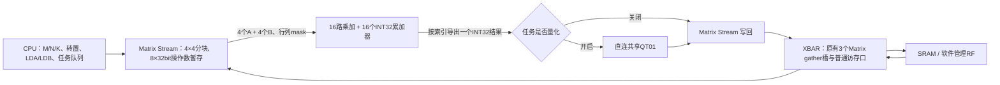

# Matrix 4×4 外积计算单元

本文记录外积版初始实现与当时测量。最新面积与时序见[RF 1R1W最终r3](rf1r1w-die1950-signoff.md)，当前报告定位见[索引](../reports/README.md)。

从检查点 `d7b1794` 改为4×4外积。`npu_matmul.sv` 只保留计算和握手：16个INT32累加器；每个有效计算步接受4个A和4个B，更新 `C[r,c] += A[r]*B[c]`。INT8和INT16均支持，INT8由Stream符号扩展到16位。乘加按INT32回绕。

算术核没有地址、形状循环、缓存或量化。行列mask屏蔽不足4行/列的尾块；通过索引对一个累加器加入旧D，也通过索引逐个导出结果。没有新增一条旧点积旁路或另一套乘法器。

## 数据布局与供数

任务继续计算 `D=op(A)*op(B)`，可选择 `D+=`。M/N最大为16，K最大为256；Stream自动拆成4×4输出块，遍历K后逐个写回有效单元，再计算下一块。输入支持原有非打包低字节/低半字布局，以及紧密打包INT8/INT16。

- A向量取同一K下最多4个输出行的数据，B向量取同一K下最多4个输出列的数据。
- 8个32位寄存器保留当前A/B字片段，并带有效位和字地址。多个元素位于同一个字时合并一次读取；K继续访问同一个字时直接复用。每个新输出块清空这些操作数暂存。
- 原有3个逻辑RF gather槽不变，每批最多取3个不同的字，RF冲突由既有仲裁处理。SRAM请求经Matrix普通32位端口分周期读取。
- 这是计算单元内的32B操作数暂存，不是重新加入透明SRAM缓存，也不替代共享RF。
- 任一输入或输出为流FIFO时，使用同一计算核的1×1有效mask，保留原来的逐行顺序和消费约定；量化后的32位流输出也遵守此规则。

**16 MAC/拍是计算核操作数就绪时的峰值**。供数、输出逐字写回、可选量化都会造成等待；没有宣称持续每拍完成16 MAC。

## 软件接口

Matrix使用4项队列，任务寄存器与标志包括：

| MMIO偏移，相对0x40000000 | 内容 |
|---|---|
| 0x06c | 能力 `0x00030404`：4行、4列，INT8/INT16 |
| 0x134 | LDA，物理A每行跨度，单位为元素；0采用原密集布局 |
| 0x138 | LDB，物理B每行跨度，单位为元素；0采用原密集布局 |

LDA/LDB为整个待执行批次共享，范围0..4096；有活动或排队Matrix任务时禁止修改。转置前物理布局仍为行优先：未转置A默认LDA=K，转置A默认LDA=M；未转置B默认LDB=N，转置B默认LDB=K。自定义跨度必须不小于对应物理行长度。地址范围与输入/原始D不重叠检查按实际跨度计算。

C接口增加 `npu_gemm_leading_dims(lda,ldb)`；旧程序未写这两个寄存器时维持密集布局。原标志仍为TRANS_A、TRANS_B、ACCUMULATE、PACKED、INT16。

新增合法退化情形：**K=0且ACCUMULATE=1**。这时只读取、导出已有INT32 D，不访问A/B，可经共享量化单元处理最终结果；没有增加专用量化指令。K=0而ACCUMULATE=0仍拒绝。

## 当前验证入口

默认配置和性能使用[项目首页](../../README.md)；当前版本的功能、综合、最终PNR及检查证据统一见[报告索引](../reports/README.md)。
