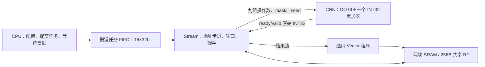

> 本页记录2026-11-04的CNN精简与综合基线。后续Matrix和Vector也已拆为纯计算模块，当前结构及周期定位见[三个纯计算核](pure-compute.md)。

# CNN 最小计算核与软件准备的搬运任务

本轮把 CNN 分为纯 DOT9 运算接口和一个精简的搬运壳。矩阵、Vector、CPU/JTAG、两块 SRAM 和 256B 共享 RF 保留。没有新增专用量化路径；量化继续由软件配置的通用 Vector 指令组合完成。

## 模块与状态的边界



- [`npu_cnn.sv`](../rtl/cnn/npu_cnn.sv) 和 [`npu_cnn_mac.sv`](../rtl/cnn/npu_cnn_mac.sv)：只有算术与结果握手，没有 CSR、任务 FIFO、地址生成或张量状态机。
- [`npu_stream_control.sv`](../rtl/cnn/npu_stream_control.sv)：105bit 公共配置、32bit 任务 FIFO、完成票据及错误处理。
- [`npu_stream_engine.sv`](../rtl/cnn/npu_stream_engine.sv)：固定三行、每行两个 32bit 字的窗口；输入通道及位置的搬运步进、权重双缓冲、RF 部分和读写、反压处理。它仍有 IDLE/START/WAIT_INPUT/RUN/DRAIN 五个状态。这里是固定三行搬运模式，尚不是可编程的任意 DMA 模式。
- [`npu_stream_pkg.sv`](../rtl/cnn/npu_stream_pkg.sv)：公共配置和任务格式。

这次实际删除了私有 `28×24bit` 部分和数组、`32×24bit` 结果 FIFO、关联式窗口 tag、完整张量 shape/重叠检查电路以及逐任务统计寄存器。不是把旧 CNN 控制器整体改名。剩余的传输状态用于等待 SRAM/RF、处理反压与同步，不能把它描述为完全无状态的搬运。

## 计算核接口

一次 `valid_i && ready_o` 接受九组操作数：

```
centered[t] = signed9(a[t] - offset)
dot = Σ(mask[t] ? centered[t] * signed8(w[t]) : 0)
acc = (load ? seed : clear ? 0 : acc) + dot
```

`a` 与 `offset` 是 9bit，部署时输入为零扩展 UINT8，减去 UINT8 零点后精确落在 -255..255。低层接口任意 9bit 输入按模 9bit 相减，不能假定保留第十位。点积使用有符号 20bit，累加器按模 INT32 相加；`load` 优先于 `clear`。

`emit=1` 使结果通过 `valid_o/ready_i` 输出；`emit=0` 只累加。结果直接保留在累加器中，反压时保持数据与 valid。没有额外结果数组。`flush` 丢弃待消费结果并清零。计算核无 bias、移位、激活或裁剪专用逻辑；这些由 Vector 软件程序完成。

## SD91 软件接口

旧 CRW2 二进制接口已退役，固件启动时检查 `0x40000654 == 0x53443931`。C 源码级兼容适配器位于 [`npu.h`](../sw/npu.h)，会把一行拆成最多 8 个位置的任务；旧二进制不能直接运行。

公共配置只在搬运引擎及 FIFO 都空闲时更新，执行中写入会报总线错误。`task` shadow 可以在忙时更新，每次 START 把它复制到 FIFO。

| 地址，相对 `0x40000600` | 含义 |
|---|---|
| `+00` | bit0 提交、bit1 清 done/error、bit3 清 done |
| `+04` | busy/done/error |
| `+08 / +0c / +10` | 输入 / 权重 / 原始输出基址 |
| `+14 / +24` | 行 / 输入通道平面 stride，单位字节 |
| `+18` | 共享 RF 中 32B 部分和工作区，4B 对齐 |
| `+1c / +20 / +2c` | 输入通道数 1..16 / stride 1 或 2 / 输入零点 |
| `+28` | 32bit 任务 shadow |
| `+30` | 0 写原始 INT32 内存，2 输出到 Vector 流 |
| `+54 / +58` | SD91 ABI / 队列容量及占用 |
| `+5c / +60` | completed / submitted 票据 |
| `+64 / +68 / +6c / +70` | 总周期 / 总有效 MAC / 9 路 MAC / `0x00080020` 能力 |

`+40/+44` 是总周期/总 MAC 的别名；旧 `+48/+4c/+50` 逐任务统计已移除。

| 任务位 | 字段 |
|---|---|
| `[3:0]` | 输出通道 co |
| `[8:4] / [13:9]` | 输出 y / 起始 x |
| `[17:14]` | 位置数 1..8 |
| `[20:18]` | 三行输入有效 mask |
| `[21] / [22]` | 首位置左侧 padding / 末位置右侧 padding |
| `[31:23]` | 原始内存输出的 word 偏移；流模式忽略 |

软件负责完整输入、权重、输出范围、边界 mask 和缓冲区不重叠。硬件只检查标量配置、位置数及每次 NMC 访问；它不证明整个张量安全。C 适配器把完整 shape/range/别名检查放在软件侧，直接 MMIO 调用者需要自行满足相同约束。

## 一层 MNIST 如何执行

以第一层 `28×28×1 → 14×14×2` 为例，软件把每行分成 `8+6`，每个输出通道 28 项任务，合计 56 项。编译时计算上/中/下行 mask，以及每个 tile 的左右 padding。

1. CPU 等待上一层 Stream 与 Vector 排空，设置输入、权重、row/plane stride、输入通道数与零点。相邻层相同的配置不重复写；输出通道号放在任务字里。
2. 每个输出通道先提交一个 Vector 消费任务，长度 196，配置该通道 bias/乘数、Q24 舍入、输出零点及上下限。随后 CPU 从 SRAM 表逐项读出 32bit 搬运任务，写 task shadow 与 START。FIFO 满时等待；不是 CPU 每个 MAC 发一条指令。
3. Stream 装载三行窗口与九个权重，将软件 mask 与数据送给 DOT9。第一个输入通道使用 `clear`，后续通道从共享 RF 读取当前位置的部分和作为 `seed`；非末通道结果写回 RF，末通道直接进入 Vector 流。第一层只有一个输入通道，不需要跨通道部分和。
4. 每个 tile 的工作区最多 8×32bit。窗口按字移位，可预取下一位置需要的高字；下一输入通道权重双缓冲。两个 seed 暂存字及在途标记支持 RF 返回直通，8bit busy mask 防止读到尚未写完的部分和。
5. Vector 一边消费原始结果，一边执行通用后处理并写 U8。CPU 按 submitted/completed 票据等待两侧排空后，才复用激活和工作区。

配置与提交对应的核心汇编形式如下，实际队列空间及错误分支见 [`boot.S`](../mnist/artifacts/boot.S)：

```asm
# x6 = 0x40000600；x15 指向预生成的任务表；x31 = 1
lw   x8, 0(x15)       # 每项任务一个 SRAM word
sw   x8, 0x28(x6)     # 写 task shadow
addi x15, x15, 4
# 检查 +0x58 的 FIFO 空间，满时等待
sw   x31, 0(x6)       # START：一次提交一个 tile
```

五层卷积共 296 项任务，FC 仍由 Matrix 执行 90 个 K16 分块任务。共享 RF 仍为 256B，保留末尾 32B 供卷积部分和使用；FC 在卷积及 Vector 排空后复用这段空间。大张量仍放 SRAM。任务表在 SRAM `0x80000d50..0x800011ef`，296×4=1184B；程序像由 4096B 增到 4608B，代码仍在 `0xc00` 描述表之前。没有用寄存器数组存储 CPU 指令。

## 验证与代价

纯计算核随机测试覆盖累加、seed、clear/load 优先级、mask、INT32 回绕、反压和 flush；队列测试覆盖 32bit 任务、公共配置写保护、顺序、溢出与错误。完整 MNIST 还逐层核对十张样本，并检查宽行、边界和 FC 尾块。原参数、输入及整数 golden 保持不变。

最终综合与回归数据由 [`collect_minimal_compute.py`](../eda/tsmc180/collect_minimal_compute.py) 归档到 [`minimal_compute_validation.json`](../reports/minimal_compute_validation.json)。面积比较必须包括 DOT9、Stream engine 和 Stream control，不能拿拆分后的 CNN 小模块单独与旧的整套 CNN 比较。

TSMC180 TT、low effort，综合约束 16ns，最终按 20ns 系统时钟报告。两版使用相同库、RF 容量和 FIFO 深度。

| 指标 | RF-gather 基线 | 本轮 |
|---|---:|---:|
| 全核心 Cell Area，含两块 SRAM、不含 PAD | 2.885133mm² | **2.666814mm²** |
| CNN＋搬运＋所有顶层/核心本地逻辑 | 0.460781mm² | **0.243950mm²** |
| 搬运引擎（基线还内含 MAC） | 0.283201mm² | 0.117821mm² |
| 搬运/任务控制 | 0.173743mm² | 0.065551mm² |
| 50MHz 综合 setup slack | +4.0007ns | **+4.0036ns** |
| 系统 TNS | 0 | 0 |
| 单图推理周期 | 25,156 | **29,206** |
| 含输入 DMA 的周期 | 25,777 | 29,827 |

整体面积减少 **0.218319mm²，约 7.57%**。Genus 将本轮 DOT9 展平进 `npu_core`，没有独立 CNN 层级面积；不能宣称计算核面积为零，也不能把 Stream 两项之和当成完整 CNN。表中合计统一纳入两版全部顶层/核心本地逻辑：基线额外 0.003837mm²，本轮 0.060579mm²（含展平后的 DOT9 与其他胶合逻辑）。因此这个合计有明确且保守的统计边界。全核心面积直接取最终 QoR 的 Cell Area，未使用 Cell+Net Total Area。

**16 项 RTL 回归与 4 项无 SDF 映射网表回归全部通过**。RTL 十张 MNIST 样本逐层一致；映射回归覆盖单图 MNIST、JTAG、算子和队列突发。纯核随机测试 2,008 项检查，任务队列 107 项检查，软件 shape/range/别名/编码检查 628 项；固件重新生成的 101 个文件逐字节一致。20 帧连续流共 590,811 周期，平均 29,540.55 周期。

单图比基线增加 4,050 周期，约 **16.1%**：共享 RF 部分和读写、短 tile 边界和单结果反压带来开销，尚未满足原小于 20k 目标。本轮没有新的布局布线或含 PAD 结果；综合面积低于 3mm²，仍不能据此保证 2mm×2mm PAD 环内的放置/布线收敛，综合 slack 也不能代表最终布线频率。

综合冻结输入、报告、映射网表和回归归档位于工程同级 `eda-runs/20261104-minimal-compute/asic/`，本轮软件检查在 `eda-runs/20261104-minimal-compute/software-checks/`。复现收集：

```sh
python3.12 npu/eda/tsmc180/collect_minimal_compute.py \
  --run ../eda-runs/20261104-minimal-compute/asic \
  --baseline ../eda-runs/20261104-rf-gather/asic \
  --gate-tags minimal-compute-mapped-latency minimal-compute-mapped-jtag \
              minimal-compute-mapped-ops minimal-compute-mapped-burst
```
