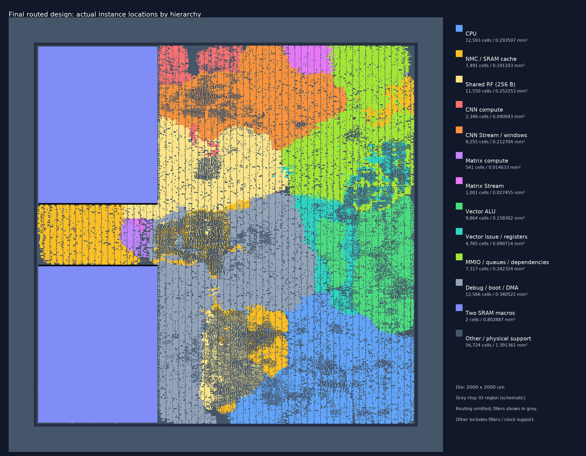

# 最终布局的模块分布

图中单元坐标来自本轮最终`13_finished` Innovus数据库，未改变布局。每个小矩形对应一个实际实例的外接框，颜色依据保留的层次路径和综合展开后的实例名归属。没有用大矩形猜测模块边界。

[可缩放SVG](images/window-prefetch-module-map.svg) · [Innovus直接着色截图](images/window-prefetch-module-gui.png)

CNN与CNN Stream、Matrix与Matrix Stream、Vector与Vector Stream分别着色；共享RF从NMC中单独分出。CPU、CNN和Matrix部分层次经过综合展开，使用`i_cpu`、`i_cnn`、`i_matmul`等实际实例名匹配。不能可靠归属的连接缓冲、时钟树、filler、PAD等列为Other。Other是混合项，不能把它当作一种逻辑模块。

图例面积为对应实例外接框面积之和，含该组下保留的物理修复单元，不能等同于综合逻辑面积。尤其PAD与bond存在有意重叠，Other面积不能作为互不相交的占地面积相加。filler保留在灰色Other中，金属布线在分布图中省略，以便观察模块位置；模块分散或互相穿插是实际布局结果。

数据源、实例统计、颜色及文件哈希记录在[来源清单](images/window-prefetch-module-map.source.json)。原始实例坐标表在工程同级`eda-runs/20261105-window-prefetch-backend/chip/module_instances.tsv`；导出脚本为该目录下`scripts/module_map.tcl`。完整物理结果见[后端报告](window-prefetch-pnr.md)。
