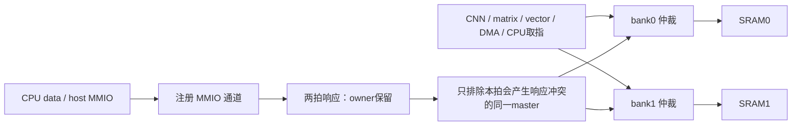
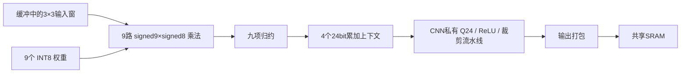

> 历史记录：本文为NMC并发与3/9路MAC对照。当前实现已移除三路对照分支，见[CNN精简说明](cnn-cleanup.md)和[报告](../reports/cnn_cleanup_validation.json)。旧命令仅适用于冻结的历史源码。

# NMC 并发与 CNN 3×3 MAC

当前保持独立 CNN、matrix、vector，三种任务 FIFO 均16项。NMC允许注册MMIO响应与其他master的双bank SRAM访问并行；CNN默认9路乘法，按3×3卷积核的九个tap组织，仍由软件发射单通道、单行任务。没有增加整层FSM或外置量化单元。

物理规划按用户确认的 **2mm×2mm 布局布线边界（4mm²）**，约3mm² Cell Area预算记录。本轮测量为TSMC180 TT映射综合和布线前时序，尚未进行布局布线。

## NMC 改了什么

原先 `aux_pending` 为1时，两个SRAM bank都停止接受请求。这个状态表示一次注册MMIO请求正在等待返回，因此CPU/host配置时会连带暂停CNN、matrix/vector、DMA和取指。

现在只在bank候选仲裁中排除 `aux_pending && candidate==aux_owner`，其他master照常参与独立的两bank轮询。没有增加响应FIFO或新的状态机；SRAM请求仍一拍响应，MMIO仍经注册、两拍响应，aux通道自身仍串行仲裁。



保留owner限制很重要：在MMIO pending拍若接受同owner的一拍SRAM请求，下一拍该master会同时得到两个响应。其他master可以并行，因为每个master都有独立rvalid/rdata/error端口。一次SRAM返回与同owner的新请求也可以按正常流水顺序交接，不需要全局暂停。

实现见 [nmc.sv](../rtl/nmc.sv)。新混合scoreboard不根据DUT选择器预测数据，而以每个master的实际grant、请求类型、独立参考内存和预定响应拍核对返回；覆盖SRAM读写/byte enable、缓存、MMIO延迟错误、DM/boot、非法访问和途中reset。2400个随机驱动周期及定向复位检查共通过5069项响应检查，观察到51次MMIO pending期间双bank并行、793次三请求同时grant、123次同owner SRAM请求被正确阻塞。另验证复位取消尚未执行的MMIO，复位后双bank恢复且没有旧响应重现。原RR公平性、写失效和fill/write竞争检查也通过。

## CNN 的 3×3 MAC 是什么

每拍处理**一个输出位置、一个输入通道**的九个卷积乘积，然后归约并累加到该输出的24bit部分和。Ci>1时继续累加；四个输出位置的上下文仍保留。逻辑上是九tap并行，不是新增九个可独立编程的PE。



- 激活仍是UINT8，先减输入零点得到signed9bit；权重INT8。九个signed17bit乘积在20bit归约，累加仍为signed24bit。
- padding通过九路mask排除，stride1/2和尾部输出列保持原语义。加载端仍有原先的激活/权重ping-pong，按需从SRAM取数。
- FC继续支持长度1..144，用同一九路运算；12项加载块分成9项和最多3项发射，尾部补mask，不访问无效权重索引。
- 输入/输出零点、ties-to-even、Q24、INT32加零点和饱和顺序不变。权重、量化参数、输入和逐层golden均未修改。
- `--cnn-macs 3`保留三路对照，`--cnn-macs 9`为默认；RTL参数为 `NPU_CNN_MACS` / `npu_cnn.MACS`。`0x4000066c`只读返回实际路数，CRO2任务格式不变。

实现见 [CNN控制](../rtl/cnn/npu_cnn.sv)与[内部算术流水线](../rtl/cnn/npu_cnn_mac.sv)。CPU程序及其软件行/通道循环不需要修改。

## 分离两种改进的收益

| 配置 | 单图周期 | 含输入周期 | 连续20帧总周期 | 平均周期/帧 |
|---|---:|---:|---:|---:|
| 原NMC，3 MAC（旧快照） | 27,159 | 27,779 | 554,863 | 27,743.15 |
| 新NMC，3 MAC | 25,578 | 26,198 | 522,095 | 26,104.75 |
| 新NMC，9 MAC | 23,938 | 24,558 | 490,682 | 24,534.10 |

NMC改进节省1581周期；在相同新NMC下，9 MAC再节省1640周期。合计3221周期，约11.86%，仍未达到<20k。

峰值算力从3增至9，并没有带来3倍端到端加速。9 MAC实测有效利用率约19.7%，主要仍受加载和访存等待限制；不能将原三路分母用于九路利用率。两版逐层输出、FC尾部和数值边界的18,492项检查均通过。

另外，相同host MMIO微基准交错提交16个GEMM和16个vector任务：提交时间保持288周期，**总完成时间从25,359降为16,941周期**，516项数值检查通过。CNN未参与该微基准，所以该收益归于NMC并发，而不是九路CNN。它是host MMIO测试，不冒充RV32 CPU指令执行时间。

## 面积、时序与证据

同源码最终映射结果（含两片SRAM）：

| 新NMC配置 | Cell Area | 50MHz setup slack | 系统TNS |
|---|---:|---:|---:|
| 3 MAC | 2.522031719mm² | +4.0042ns | 0 |
| 9 MAC（默认） | 2.577006113mm² | +4.0042ns | 0 |

九路相对三路增加0.054974394mm²，约2.18%；两者系统setup违例均为0，符合约3mm² Cell Area预算。两片SRAM共约0.802887182mm²，九路其余标准单元约1.774118932mm²。没有布局布线结果；2mm×2mm是后续物理规划边界。

九路最终映射网表也通过1张MNIST（含输入24,558周期、15项检查）和批量GEMM/vector（总计16,941周期、516项检查），与RTL一致。采用真实标准单元/SRAM功能模型、零延迟、无SDF、关闭timing check。

相同RTL和约束的3/9 MAC最终报告由 [collect_nmc_mac9.py](../scripts/collect_nmc_mac9.py) 汇总至 [nmc_mac9_validation.json](../reports/nmc_mac9_validation.json)。原始目录为 `../eda-runs/20261103-nmc-mac9/mac3` 和 `mac9`。使用Genus19.17、TSMC180 TT、low effort、16ns优化/20ns报告，含两片真实8KB SRAM、CPU/DM/JTAG/DMA/NMC及三个计算单元，不含PAD。

旧NMC的PPA在本轮before目录保留，属于不同源码快照；本轮3/9对照的两套RTL哈希相同，仅MACS宏不同。没有把旧面积当作同源码NMC增量测量。结构检查及源码/库/功能证据哈希均记录在JSON中。

复测入口：

```sh
/usr/bin/python3.12 npu/scripts/run_vcs.py --suite nmcconcurrent --tag NEW_TAG
/usr/bin/python3.12 npu/scripts/run_vcs.py --suite nmc --tag NEW_TAG
/usr/bin/python3.12 npu/scripts/run_vcs.py --suite latency --tag NEW_TAG --cnn-macs 9 --macro
/usr/bin/python3.12 npu/scripts/run_vcs.py --suite layers --tag NEW_TAG --cnn-macs 9 --macro
/usr/bin/python3.12 npu/scripts/run_vcs.py --suite stream --tag NEW_TAG --cnn-macs 9 --macro
/usr/bin/python3.12 npu/eda/tsmc180/prepare_run.py --out ../eda-runs/NEW_RUN --cnn-macs 9 --effort low --synth-period 16 --report-period 20
genus -no_gui -batch -files ../eda-runs/NEW_RUN/synth.tcl > ../eda-runs/NEW_RUN/launcher.log 2>&1
```

对照改为 `--cnn-macs 3`。三个任务FIFO默认均16项；缓存仍每bank16words，没有增加额外参数副本。所有输出目录与tag必须新建。
