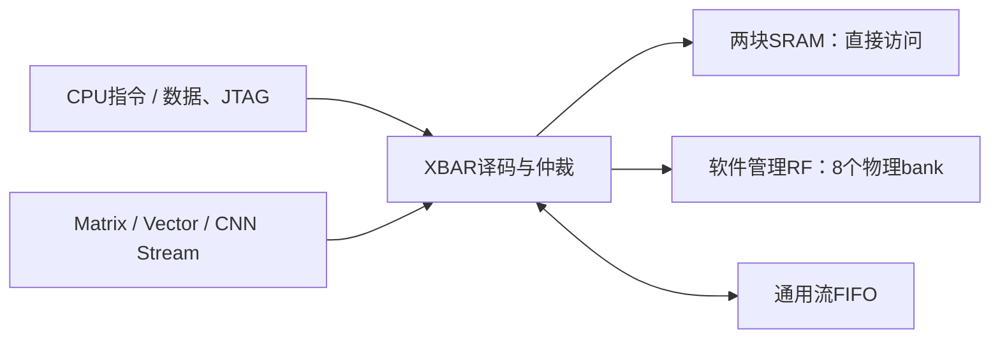

> 实现专题：文中阶段性队列、周期和面积仅适用于当时快照。当前默认配置及最终结果见[项目首页](../../README.md)；接口字段以当前 RTL / `npu/sw/npu.h` 为准。

# 删除透明SRAM读缓存

当前XBAR不再包含SRAM缓存数据、tag、valid数组、命中判断、填充、失效或缓存返回数据寄存器；缓存容量参数也已删除。两块8KB SRAM、256B软件管理RF、流FIFO、任务队列和VPG2指令保持原配置。

## 为什么没有降低推理性能

原缓存的命中和未命中都占用同一个bank的一个仲裁名额，均在下一周期响应；命中后没有把省下的SRAM端口再授予第二个请求。因此它能减少宏的物理读操作，但没有增加本设计的访存并行吞吐。现在每个被授权的SRAM请求直接访问宏，仍由两个bank独立仲裁，下一周期返回数据；写请求仍响应零。



RF通过独立地址空间由软件显式选择使用，容量可在构建时配置，软件可查询实际容量。现有固件已经按张量活跃区间分配RF，暂存部分权重、中间张量和部分和；较大张量与CPU程序留在SRAM。固件的`RF_WEIGHT_CACHE`开关控制显式权重暂存。RF不执行透明填充、地址tag匹配或自动替换。本轮没有修改固件、权重、输入或整数golden。

## 兼容的诊断寄存器

| CSR | 当前语义 |
|---|---|
| `0x038` | 两个32位SRAM bank、总容量16384B，保持不变 |
| `0x03c` | `0x00020000`，两个bank，每bank零个缓存字 |
| `0x020 / 0x024` | 原命中计数位置，恒为零，不保留命中计数器 |
| `0x028 / 0x02c` | SRAM读请求计数，C头文件新增`NPU_SRAM_READS0/1`别名 |
| `0x030 / 0x034` | 每个SRAM bank接受的请求数，包含读写 |

保留原寄存器地址和旧C宏名以兼容诊断软件，没有保留缓存硬件或重新启用缓存的参数。VPG2 ABI不变。

## 验证

11组最终回归全部通过。独立的带缓存旧版作为参考，两套XBAR各连接独立SRAM模型，5,000轮对比每周期授权、响应有效位、数据、错误和MMIO载荷，结果一致。测试覆盖热地址反复读取、随机读写、部分字节写、两个bank并行、无效地址和复位。宏物理读操作为7,508次，旧缓存参考为2,221次，双bank同时访问4,258周期。这是该合成测试的统计，不是功耗测量或真实模型的访问次数预测。

实际SRAM宏模型下10张MNIST逐层整数结果一致，每张仍为29,817周期，含测试host输入搬运为30,209周期。JTAG42项、单元流路由24项、共享操作数3,409项、队列340项、RF473项、RF写回868项、流FIFO4,000轮、xbar并发5,069项与普通xbar读写顺序/公平性测试均通过。

[功能与源码对应报告](../reports/no_sram_cache_validation.json)。面积和时序测量使用与前版相同的TSMC180 TT、low effort、16ns优化/20ns报告，最终结果见`no_sram_cache_area_validation.json`。尚未重新布局布线，未测功耗。

```bash
python3.12 npu/scripts/run_vcs.py --suite sramuncached --tag MY_NO_CACHE_EQ
python3.12 npu/scripts/run_vcs.py --suite latency --macro --tag MY_NO_CACHE_MNIST
```

## 综合实测

相同TSMC180 TT、low effort、16ns优化/20ns报告下：

| 部分 | 带缓存/mm² | 无缓存/mm² | 节省 |
|---|---:|---:|---:|
| 整芯片默认优化 | 2.543393 | 2.438904 | 4.11% |
| XBAR合计（保留层级） | 0.522962 | 0.417720 | 20.12% |
| SRAM缓存/仲裁/响应 → 直接仲裁/响应 | 0.149028 | 0.043757 | 70.64% |

整芯片总面积使用默认优化结果，XBAR分项使用保留层级版（其整芯片合计2.439229mm²），两种口径不混加。默认版标准单元1.636017mm²，两块SRAM宏合计0.802887mm²。不含PAD、CTS、布线、filler或放置留白。

50MHz综合setup slack为+4.0031ns，TNS 0.0000ns，违反路径0。推理仍为29,817周期。

原始报告：
- [20261107-no-sram-cache-area/area.rpt](/home/s2400012841/chip-fullstack-2026/eda-runs/20261107-no-sram-cache-area/reports/area.rpt)。
- [20261107-no-sram-cache-area-hier/area.rpt](/home/s2400012841/chip-fullstack-2026/eda-runs/20261107-no-sram-cache-area-hier/reports/area.rpt)。

[面积机器报告](../reports/no_sram_cache_area_validation.json)。冻结输入、库、当前RTL及其与11组功能回归的对应均已核对。未重新布局布线或测功耗。
