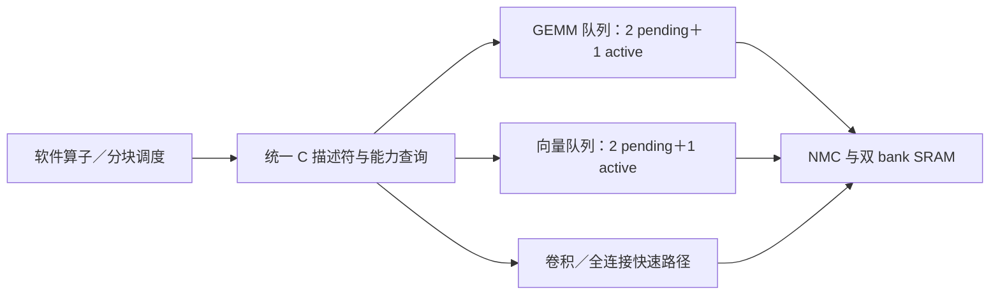

> 本页中的CRW1、CNN FC模式及性能/面积结果属于历史版本。当前CNN已移除FC，见[CRW2卷积专用化与Matrix FC](cnn-conv-only.md)。通用Vector指令设计仍沿用。

# 通用整数计算算子与 Operator ABI 1.0

当前独立单元恢复及本轮验证见[independent-units.md](independent-units.md)。本文面积／时序／网表数据保留为此前快照，不能替代当前源码的物理验证。

当前版本在双 bank CPU/NMC/NPU/JTAG 架构上扩充矩阵与向量单元。目的为软件提供可组合的整数原语，不把硬件限制为一份 MNIST 网络。这里的“标准化”指明确的运算语义、可查询能力、描述符和任务生命周期；不是完整 BLAS、ONNX 或外部指令集认证。



## 任务接口与兼容性

软件头文件为 `npu/sw/npu.h`。任务都以 SRAM 地址和明确的整数类型描述：配置 shadow CSR → START 保存快照 → 单元自动执行 → 状态／完成计数／中断。矩阵、向量保留两项 pending 队列，active 不计入容量。硬件自动运行同单元队列；跨单元依赖、缓冲所有权及分块循环仍由 CPU 管理。提交者需串行化写描述符，START 不是多写者事务。

原 MMIO 地址、矩阵 flags=0、向量 op=0 ReLU／op=1 Add 和 CNN op=0／1 保持原语义。旧程序首次复位运行不需要改动。混用新 API 后，直接操作寄存器的旧代码应显式把矩阵 FLAGS 写 0；更新后的 `npu_matmul_start()` 自动完成这一步。

| 相对 MMIO 基址 `0x40000000` | 内容 |
|---|---|
| `0x040` | ABI 版本 `0x00010000`（高16位 major，低16位 minor） |
| `0x044` | GEMM 支持 FLAGS mask=`0x1f` |
| `0x048` | 向量支持 opcode bitmask=`0xffff` |
| `0x04c` | CNN 支持 opcode bitmask=`0xf` |
| `0x130` | GEMM FLAGS shadow |
| `0x230` | 向量 scalar B shadow |

队列、submitted、completed、busy/done/error 延用原接口。队列满的 START 报总线错误；非法运算／描述符不入队、置 sticky error，submitted 不增加。reserved bits 不允许被静默截断。运行时故障可能留下部分输出，不提供回滚；软件检查错误和完成票据，不应仅等待单个 done 位。

## GEMM：矩阵、向量点积与分块累加

数学语义：`D[M,N] = op(A)[M,K] × op(B)[K,N]`，可选择加上旧 D。D 始终是紧凑的 signed INT32，累加以 2^32 回绕；没有饱和或浮点。等价于整数 GEMM 的 alpha=1、beta=0/1 子集。

| FLAGS bit | 含义 |
|---|---|
| 0 | transpose A：物理 A 为 K×M；否则 M×K |
| 1 | transpose B：物理 B 为 N×K；否则 K×N |
| 2 | accumulate：`D += A×B`；否则覆盖 D |
| 3 | packed：输入元素连续存放；否则每个元素占一个 32bit word |
| 4 | 输入为 signed INT16；否则 signed INT8 |

所有矩阵均按物理行主序、little-endian 存放，packed 行无额外 padding。基址须4字节对齐；packed INT8／INT16 的内部元素可以位于 word 内不同 byte／halfword，硬件对齐读 word 后提取并符号扩展。INT16 packed 的元素自然2字节对齐。非 packed 模式只取每个 word 的低8／16bit。

M/N/K 均为1～16。输入 A/B 可重叠；D 不得与输入的受保护存储范围重叠。范围校验按完整 packed footprint 向上取整到 word，避免越过16KB SRAM。转置由地址步进完成，不需要先物化整张转置矩阵。累加只在最后乘积完成后读取旧 D，不增加整块 C 存储。

硬件沿用一个乘法器，扩为有符号16×16→32，INT8 经符号扩展使用同一乘法器；不是新增一个阵列。GEMM 不承诺每周期一次 MAC，仍受单请求口和读写握手限制。

同一原语可以表示：

- GEMV：N=1。
- dot：M=N=1。
- outer product：K=1。
- FC：矩阵乘法，之后按需接向量 Add／激活；CNN 内已有更快的紧凑 FC 路径。
- 更大矩阵：CPU 按 M/N/K 分块，第一 K 块覆盖 D，后续 K 块开启 accumulate。输入 tile 必须符合紧凑布局；本版没有任意 leading dimension／批次 stride，必要时软件或 DMA 重排。

```c
struct npu_gemm_descriptor g = {
    .a=NPU_BANK0_BASE, .b=NPU_BANK1_BASE,
    .d=NPU_BANK0_BASE+0x1000, .m=3, .n=5, .k=7,
    .flags=NPU_GEMM_PACKED | NPU_GEMM_INT16
};
int rc=npu_gemm_start(&g);
if (rc==0) {
    uint32_t ticket=npu_read(NPU_MAT_SUBMITTED);
    rc=npu_queue_wait(NPU_MAT_COMPLETED,NPU_MAT_STATUS,ticket,1000000);
} /* 同一队列的提交者须串行化配置与 ticket 获取。 */
```

## 向量：16 种 INT32 逐元素运算

输入／输出为32bit word，长度1～1024。opcode 低4bit 定义算子，bit7 选择 scalar B，bits6:4 保留为0。广播时 B 不访问 SRAM，内容来自 `0x230`，与地址及 opcode 一起在 START 时捕获。

| opcode | 运算 | 第二操作数 |
|---:|---|---|
| 0 | ReLU：max(A,0) | 不使用 |
| 1 | Add | 向量或 scalar |
| 2 | Copy | 不使用 |
| 3 | Sub：A−B | 向量或 scalar |
| 4 / 5 | signed Min / Max | 向量或 scalar |
| 6 / 7 / 8 | AND / OR / XOR | 向量或 scalar |
| 9 / 10 / 11 | 左移／逻辑右移／算术右移 | B 低5bit 为移位量 |
| 12 | Equal，输出0或1 | 向量或 scalar |
| 13 / 14 / 15 | Neg／Abs／NOT | 不使用 |

Add/Sub/Neg/Abs 均按32bit回绕；`abs(INT32_MIN)` 仍为 `0x80000000`。Min/Max 使用有符号比较。精确原地 D=A 或 D=B 合法，部分地址范围重叠非法；不使用的 B 不要求有效地址。没有通用广播 shape，也没有隐式量化／饱和。

例如 bias、残差连接、缩放中的移位、掩码、比较和 Clip 都可以组合：`Max(x,lo)` 后接 `Min(x,hi)` 即整型 Clip。标量广播避免为每个元素存一份常量；同单元 FIFO 顺序保证两个原地 Clip 任务依次完成。仍需检查提交是否成功。

```c
struct npu_vector_descriptor v = {
    .a=NPU_BANK0_BASE+0x1000, .b=0,
    .d=NPU_BANK0_BASE+0x1000, .len=15,
    .op=NPU_V_MAX | NPU_VECTOR_SCALAR, .scalar=0
};
int rc=npu_elementwise_start(&v); /* 原地 max(x,0) */
```

当前不提供向量乘法、除法、归约、浮点、Softmax 或通用张量广播。避免为了“通用”无条件增加32×32乘法器。需要这些算子时由 CPU 或后续明确扩展实现；不要把 ABI 1.0 当作完整模型算子覆盖声明。

## CNN／FC 快速路径

卷积激活／输出采用 CHW，权重采用 OIHW；FC 权重按输出通道逐行存放。保留原 UINT8 激活、INT8 权重、24bit 部分和、Q24 ties-to-even、零点和 UINT8 饱和路径，三个并行乘积和工作集复用不变。opcode 扩为：0=Conv3×3+ReLU、1=FC、2=Conv3×3、3=FC+ReLU。卷积支持原有 stride1/2、padding 和输出裁切，尺寸约束延用旧接口；本版没有扩大为任意 kernel/group/dilation。

ReLU 以输出零点为阈值；选择无 ReLU 仍保留 UINT8 量化饱和。没有新增外置量化单元。此路径保持 MNIST 的性能；通用 GEMM 提供软件组合能力，不替换已优化的 CNN 内核。

## 验证入口

```sh
/usr/bin/python3.12 npu/scripts/run_vcs.py --suite ops --tag local --macro
/usr/bin/python3.12 npu/scripts/run_vcs.py --suite queues --tag local
/usr/bin/python3.12 npu/scripts/run_vcs.py --suite latency --tag local --macro --max-cycles 20000
/usr/bin/python3.12 npu/scripts/run_vcs.py --suite layers --tag local --macro
```

新增算子测试通过实际 NMC 和两片 SRAM 宏模型，覆盖所有32种 GEMM flags 组合、奇数 packed 行、最大16³矩阵、INT16极值／回绕、原地向量／广播／移位边界、描述符快照、SRAM末端边界、保留位和部分重叠拒绝。单独的队列测试检查扩展字段和 scalar 的 FIFO 快照。CNN测试新增有／无ReLU的负数实值案例，保留逐层整数 golden。

## 本次实测

功能结果目录前缀为 `npu/build/vcs-operators-final-*`：

- 新算子：67 个 GEMM、96 个向量任务，7,505 项检查；通过两片实际 SRAM 宏功能模型（timing check关闭）。
- 队列：59 项检查；原 SoC：1,241 项检查；JTAG：41 项检查。
- 逐层整数结果：10个样本，18,061项检查，另覆盖新增有／无ReLU模式。
- 普通 MNIST：每张18,726周期，含输入19,346周期，计算内核18,178周期；20帧连续流平均19,112.25周期。程序、参数、输入和 golden 没有为新增算子修改。

本轮完整 SoC 快速综合目录：`../eda-runs/20261101-operators-v1`。Genus19.17、TSMC180 TT，**low effort**，按16ns优化、同网表按20ns报告；TCK为100ns，异步于系统时钟。

| 项目 | 数值 |
|---|---:|
| Cell Area，含两块 SRAM | **2.2435574mm²** |
| 两块 SRAM | 0.8028872mm² |
| 标准单元 | 1.4406702mm² |
| GEMM 单元层级 | 0.0438777mm² |
| 向量单元层级 | 0.0440862mm² |
| 50MHz setup slack | **+4.0042ns** |
| 16ns优化目标 setup slack | +0.0042ns |
| TCK 100ns setup slack | +47.7999ns |

两个时钟 TNS=0。最差系统路径在原 CNN 的定点乘法流水级，不是新增 GEMM。Unresolved／empty／undriven leaf／multidriven leaf／top port 问题均为0；另记录2,026个优化后的 undriven hierarchical pin，不将其表述成所有检查全零。

接入新算子前的 JTAG 版本为2.0843088mm²，使用 **medium effort**。两次观察值相差0.1592486mm²，但 effort 和全局映射不同，**这不是严格控制优化条件的新算子面积增量**。没有增加 SRAM 宏或外置量化模块。此流程尚不含 PAD、CTS／布局布线或物理 signoff。

复测综合和映射网表：

```sh
/usr/bin/python3.12 npu/eda/tsmc180/prepare_run.py --out ../eda-runs/NEW --effort low
# 使用生成的 synth.tcl 启动 Genus，正常结束后：
/usr/bin/python3.12 npu/scripts/run_gate.py --run ../eda-runs/NEW --suite ops --tag local-ops
/usr/bin/python3.12 npu/scripts/run_gate.py --run ../eda-runs/NEW --tag local-mnist
```

最终映射网表已经通过同样的67个GEMM／96个向量任务、7,505项检查，以及一张真实CPU启动的MNIST（含输入19,346周期）。日志为 `npu/build/gate-operators-ops/`、`npu/build/gate-operators-final/`。使用实际标准单元／SRAM功能模型，零延迟、无SDF、关闭timing check；只证明映射后的功能，不是布线后验证。

已完成源码／库／测试哈希核验的汇总：`npu/reports/operators_validation.json`。收集命令：

```sh
/usr/bin/python3.12 npu/scripts/collect_dual.py --run ../eda-runs/20261101-operators-v1 --profile operators
```

该 profile 选择本轮 operators-final 功能日志和两个映射网表日志；NMC、DMA独立单元RTL未改动，复用源码哈希完全相同的已有单元回归，同时本轮SoC测试重新覆盖DMA集成路径。C头文件通过GCC C11语法检查；新增算子的完整组合由MMIO测试台驱动，不能把语法检查表述为新C API已经完成交叉编译／板测。
