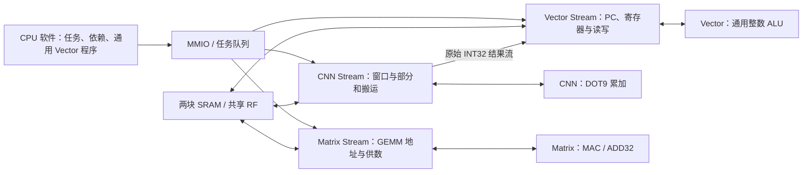

> 当前接口已扩展为共享并行读取、Matrix多乘积归约和Vector第二轻量lane，见[新实现](shared-parallel-operands.md)。本页为历史拆分记录。

> 本页是纯计算核拆分时的29,206周期基线。计算核接口继续沿用，最新窗口预取与RF并行搬运已降至25,388周期，见[本轮设计与测量](window-prefetch.md)。

# 三个纯计算核与推理周期分析

本轮把 Matrix、Vector 的算术从原有任务模块中分离。CNN、Matrix、Vector 的公开模块接口现在只承载运算；任务队列、地址、循环、访存应答与程序发射放在外部。固件、输入、权重、整数 golden 和 MMIO ABI 保持不变，完整推理仍是 **29,206 周期**。

## 计算与供数的边界



| 纯计算模块 | 实际运算 | 自身状态 |
|---|---|---|
| [`npu_cnn.sv`](../rtl/cnn/npu_cnn.sv) / [`npu_cnn_mac.sv`](../rtl/cnn/npu_cnn_mac.sv) | 九组 `(signed9(a)-signed9(offset))×signed8(w)`，mask、seed、INT32 累加 | 一个 INT32 累加器及输出 valid |
| [`npu_matmul.sv`](../rtl/matrix/npu_matmul.sv) | signed16×signed16 的 MAC，或 INT32 加数累加；INT8 在供数侧符号扩展 | 一个 INT32 累加器及输出 valid |
| [`npu_vector.sv`](../rtl/vector/npu_vector.sv) | 通用 INT32 算术/逻辑/比较/移位、32×32→64 乘法、ADD64、MADD32、最近偶数舍入右移；最多三个轻量后续操作及依赖转发 | 组合逻辑，无 PC、寄存器文件或存储状态 |

CNN/Matrix 的 ready/valid 能保持未消费结果，`flush` 清除累加状态及有效位。Matrix 的 `multiply=0` 使用通用 INT32 加数，供数器用它合并已有 D；`emit` 控制何时交付结果。累加按模 INT32 回绕。Vector 的发射侧在时钟边沿采样组合结果；它不另外添加结果流水级，避免改变原有周期。

每个计算核都不接收地址、长度、矩阵 M/N/K、张量 shape 或完整任务描述符。Vector 也不接收程序表；外部发射器解码程序并提供操作数与轻量操作控制。量化仍由软件组合通用 Vector 指令完成，没有专用量化核或识别固定量化序列的硬件。

| 外部任务/供数模块 | 负责的状态与功能 |
|---|---|
| [`npu_stream.sv`](../rtl/cnn/npu_stream.sv) 及 control/engine | SD91 的 16×32bit 队列、公共配置、CNN 窗口、权重、共享 RF 部分和读写与结果流 |
| [`npu_matrix_stream.sv`](../rtl/matrix/npu_matrix_stream.sv) | 快照 GEMM 任务、地址步进、A/B 取数、读旧 D、结果写回、错误恢复；不再持有数值累加器或乘法器 |
| [`npu_vector_stream.sv`](../rtl/vector/npu_vector_stream.sv) | 程序 PC、4×64bit 临时寄存器、操作数选择、轻量操作解码、LD32、打包和读写应答；数值结果由外部 ALU 返回 |
| [`npu_mmio.sv`](../rtl/control/npu_mmio.sv) | Matrix/Vector FIFO、公共程序配置、任务验证、完成票据及依赖控制 |

这些模块在 [`npu_core.sv`](../rtl/top/npu_core.sv) 中分别实例化。系统仍用外部任务层执行地址循环和程序发射，软件安排任务和依赖；并没有让 CPU 每个 MAC 都发一条指令。Matrix 与 CNN 仍共享普通访存 master 1、相互排斥；本轮拆分不会凭空增加并行带宽。

## 周期如何测量

[`mnist_profile.svh`](../tb/mnist_profile.svh) 仅是 testbench 观察逻辑，不进入综合。计时从输入 DMA 完成、CPU 启动命令之前开始，截止 CPU 完成。阶段边界来自 CPU 对 `0x80001f04` 的层完成写入，无 host 逐层轮询或 ACK。

阶段 0 含启动与第一层配置；FC 阶段含 CPU 输入重编码、任务提交和 Vector 后处理；最后 139 周期是 argmax 与收尾。不能把这些阶段时间等同于纯运算核时间。

十张样本均相同：

| 阶段 | 周期 | CNN 忙周期 | 主要观察 |
|---|---:|---:|---|
| Conv1，含启动/配置 | 2,322 | 2,045 | 输入窗口等待 1,009 |
| Conv2 | 6,517 | 6,281 | 输入窗口等待 3,154 |
| Conv3 | 6,761 | 6,589 | 输入窗口等待 4,229 |
| Conv4 | 3,026 | 2,883 | 输入窗口等待 1,807 |
| Conv5 | 3,412 | 3,248 | 输入等待 768、部分和等待 560、权重等待 544 |
| FC，含重编码/调度/后处理 | 7,029 | 0 | Matrix 忙 6,100，Vector 忙 170，其余 759 |
| Argmax/收尾 | 139 | 0 | CPU |
| **合计** | **29,206** | **21,046** | 含输入 DMA 为 29,827 |

拆分前后 **70 条阶段记录（10 张×7 阶段）的全部公共计数逐项一致**。实际 SRAM 宏模型仿真也与普通 RTL 模型的所有阶段计数一致。

## CNN 主要慢在供数

CNN 的 21,046 个忙周期按以下优先级归入互斥分类，总和精确相等：接受运算 → 权重未就绪 → 输出未消费 → 部分和未就绪 → 输入窗口未就绪 → 其他。

| CNN 互斥分类 | 周期 | 占 CNN 忙周期 |
|---|---:|---:|
| 输入窗口未就绪 | **10,967** | **52.1%** |
| 接受 DOT9 运算 | 5,256 | 25.0% |
| 权重未就绪 | 1,889 | 9.0% |
| 启动/排空等其他 | 1,165 | 5.5% |
| 部分和 seed 未就绪 | 952 | 4.5% |
| 输出未消费 | 817 | 3.9% |

接受 DOT9 的次数不是有效 MAC 数：mask 排除 padding 后仍为原来的 39,330 次有效乘加。这里的等待是供数器发射条件分类，多个底层等待可能同时存在，优先级会决定该周期落入哪个桶；不能把各项当成相互独立的可消除周期。

相比此前 25,156 周期的 RF-gather 版本，上一轮缩小 tile 并把私有部分和移到共享 RF 的变化为：

| 指标 | RF-gather 历史版本 | 当前 |
|---|---:|---:|
| 卷积任务数 | 212 | 296 |
| 普通口权重读 | 2,820 | 3,240 |
| 普通口激活读 | 5,566 | 6,128 |
| 部分和写 | 0 | **3,472** |
| gather 读的部分和 | 0 | **3,472** |
| gather 读的输入窗口 | 1,344 | 1,344 |
| CNN 忙周期 | 17,075 | 21,046 |
| 整体推理周期 | 25,156 | 29,206 |

新增流量和 tile 重启给供数增加开销。历史对照并不是单变量消融，但 CNN 忙周期增加 3,971，与总延迟增加 4,050 的量级接近。当前 RF gather bank 冲突只有 **32 周期**，因此不能把慢主要归咎于 bank 冲突。

## FC 主要慢在串行请求/应答

FC 仍为 90 个 K16 小任务，总共 1,440 次乘加。Matrix 的 6,100 个忙周期精确分解为：

| Matrix 状态 | 周期 |
|---|---:|
| A 请求 / A 应答 | 1,440 / 1,440 |
| B 请求 / B 应答 | 1,440 / 1,440 |
| 读原 D 请求 / 应答 | 80 / 80 |
| 写 D 请求 / 应答 | 90 / 90 |
| **合计** | **6,100** |

A/B 合计 5,760 周期，占 Matrix 忙周期约 94.4%。Matrix 普通请求的等待 grant 额外周期为 **0**，仍然需要每个乘加四个状态周期：发 A、收 A、发 B、收 B。

尽管 INT8 输入打包在 32bit word 中，供数器仍按每个元素各发一次 A/B 读取；NMC cache 命中能避免重复访问 SRAM 宏，却不能省掉这些请求/应答状态。这里优先需要打包 word 复用、操作数预取和两路读重叠，单独增加 MAC 数不会自动缩短这段时间。

## Vector 没有占用 21k 个额外串行周期

Vector 忙 21,536 周期，其中 **17,439 周期在等输入**。它与 CNN 同时忙的时间为 **20,980 周期**，不能把两个 busy 数相加算延迟。Vector 的 EXEC 状态共 3,704 周期，也与 CNN 供数重叠。CNN→Vector 的 valid 被反压共 1,038 周期，这是可优化项，但目前输入窗口等待更大。

## 下一步优化顺序

1. **优化 CNN 供数与跨 tile 复用。** 减少窗口和权重的重复装载，评估软件 tile 顺序及搬运侧预取；共享 RF 部分和仍由外部搬运层管理。复用方案需要同时检查 256B RF 的活跃区间和依赖，不能直接恢复原来的私有大数组。
2. **优化 Matrix operand feeder。** 保留已取回的 packed word、复用其中多个 INT8 元素，并重叠 A/B 读取；计算核无需认识地址或 K。扩展连续 K 任务还能减少 90 个小任务的提交和部分结果往返。
3. **再优化部分和往返与 Vector 反压。** 根据吞吐数据决定搬运侧暂存和并发，保留通用向量指令语义。现有数据不支持优先堆更多计算单元或更深命令 FIFO。

这些是测量支持的下一步方向，本轮完成结构拆分和定位，推理周期保持不变，尚未达到小于 20k。

## 验证与复现

- 17 项 RTL 回归全部通过：新增 `purecompute` 直接连接 Matrix/Vector 算术端口，原 `cnncompute` 继续检查 DOT9。
- 纯 Matrix 测试 3,008 项检查，覆盖符号、INT32 回绕、反压和 flush；纯 Vector 3,000 项检查，使用独立整数舍入参考，覆盖 INT64 边界、轻量操作与转发。
- 原 Vector 程序回归 220 个任务、6,676 项检查，访存错误回归 12 个失败任务与重试；完整十张 MNIST 逐层整数结果一致，20 帧连续流也通过。
- 实际 SRAM 宏模型下十张完整推理通过。本轮未重跑综合或布局布线；此前的 2.666814mm² / +4.0036ns 属于 2026-11-04 CNN 精简版本，不能当成本轮重新测量结果。

```sh
python3.12 npu/scripts/run_vcs.py --suite purecompute --tag NEW_PURE
python3.12 npu/scripts/run_vcs.py --suite latency --tag NEW_PROFILE
python3.12 npu/scripts/run_vcs.py --suite latency --macro --tag NEW_MACRO
```

本轮机器报告：[pure_compute_validation.json](../reports/pure_compute_validation.json)。冻结输入、完整日志和结果归档在工程同级 `eda-runs/20261105-pure-compute/`；`baseline/` 是拆分前已运行的计数基线，`rtl_tests/` 是最终回归，`functional_inputs/` 按内容哈希保存实际参与仿真的文件。
