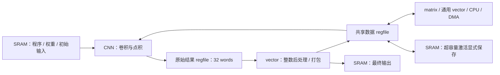
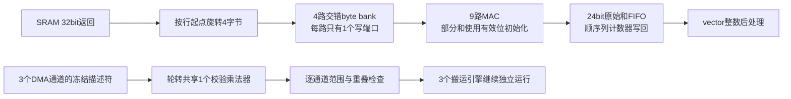

> 当前已改为通用vector指令程序，专用vector post已删除。以[通用vector说明](vector-program.md)和[本轮报告](../reports/vector_program_validation.json)为准；下文专用路径及其PPA数据是先前版本的历史记录。

# Regfile 中间结果与独立向量后处理

CNN 现在只负责卷积/点积归约，输出原始 signed INT32。整数缩放、舍入、输出零点、ReLU、U8 饱和和字节打包由 **vector 内部**执行。没有 CNN 私有量化乘法器，也没有外置共享量化服务。

## 两类寄存器存储

| 存储 | 用途 | 接口 |
|---|---|---|
| CNN 原始结果 regfile | 暂存一行最多28个原始和；32×32bit＝128B | CNN 顺序写入，vector 通过 ready/valid 消费；背压保持队首 |
| 共享数据 regfile | 层间 U8 激活、INT32 工作数据及通用中间结果 | 两个独立 bank；通过统一数据地址被 CPU、CNN、matrix、vector、DMA、host/SBA 访问 |

共享 regfile 是真实寄存器阵列，不是 SRAM 地址别名，也不是自动替换的 cache。每 bank 每周期最多接受一个32bit请求，两个bank可并行，响应延迟一个周期。支持 byte enable、轮转仲裁与 MMIO 在途 owner 排除；payload 不全局清零，软件先写后读。系统复位清除在途请求/仲裁状态，保留已存 payload。

原来的 SRAM 仍为2×8KB，NMC 的透明 SRAM 读缓存仍为每bank16words。它们与中间结果 regfile 是不同存储。

## 地址与容量

- SRAM：`0x80000000～0x80003fff`，保持16KB。
- 共享 regfile：从 `0x80004000` 开始，两bank连续排列。
- 每bank字节数＝`rf_bank_words × 4`。
- MMIO `0x40000050`：高16bit为bank数2，低16bit为每bank words。
- MMIO `0x40000054`：regfile基址。

默认配置以 [build_config.json](../build_config.json) 为准。VCS/ASIC 工具显式传入同一编译宏；固件生成器读取配置，并在启动时检查容量与 CNN ABI，避免错误容量的镜像继续执行。`NPU_RF_BANK_WORDS` 环境变量可用于生成指定实验配置的固件。

描述符保存15bit数据偏移，支持 SRAM 和新增 regfile 地址。范围校验仍检查完整32bit地址、长度和重叠；不允许从SRAM尾部越界“顺便进入”regfile。packed向量输出可以字节对齐，原始CNN输出和普通INT32向量必须word对齐。

## CNN 的 CRW1 接口

ABI寄存器 `0x40000654` 返回 `0x43525731`（CRW1）。该接口与原先 CRO2 的 U8 输出接口不兼容，需要重新生成固件。

| CNN MMIO偏移（相对`0x40000600`） | 字段 |
|---:|---|
| `0x08 / 0x0c / 0x10` | src / weights / 原始INT32 dst |
| `0x14 / 0x18 / 0x1c` | width / height / 输入通道数 |
| `0x20 / 0x24 / 0x28` | stride / 输出行宽 / 输出行号 |
| `0x2c / 0x30` | 输入零点 / op |

`op[0]`：0为卷积行，1为共用MAC的FC点积。`op[1]`：0写回原始INT32到SRAM/regfile，1把原始结果保存在结果寄存器中交给vector。stream模式忽略dst，不执行量化或激活。队列快照85bit，任务FIFO默认16项，另有active。

卷积仍为CHW、UINT8激活与INT8权重、3×3/padding1、stride1/2、W/H≤28、Ci≤16。FC点积长度≤144。输入零点减法属于乘加本身；输出零点与激活已从CNN移除。24bit部分和足以精确表示受支持范围，写出时符号扩展为32bit。

## vector 的后处理操作

原有16个INT32逐元素操作保持；新增低5bit opcode=16 的 REQUANT，使用现有描述符字段：

- A：INT32源地址；寄存器流模式忽略。
- B：signed32 `{M, scaled_bias}` 两个参数的地址。
- D：packed U8输出地址，可以位于SRAM或regfile。
- len：1～1024。
- scalar：输出零点，0～255。

| op | 输入 | 激活 |
|---:|---|---|
| `0x10` | 从SRAM/regfile读取INT32 | 无 |
| `0x30` | 从SRAM/regfile读取INT32 | ReLU |
| `0x50` | 从CNN结果寄存器消费INT32 | 无 |
| `0x70` | 从CNN结果寄存器消费INT32 | ReLU |

数学顺序为 `round_even((A*M+scaled_bias)/2^24)`，再做32bit输出零点相加、可选ReLU（下限为输出零点）和U8饱和。保留已部署整数语义，包括负数 halfway 舍入和明确的32bit商/加法。乘积/加偏置使用64bit中间值；没有浮点。

该操作也可处理GEMM等产生的INT32内存结果，不依赖CNN参数寄存器。此前的 `npu_vector_post.sv`（当前已删除）是vector的私有操作路径，通过同一个vector任务FIFO和访存端口执行。

## 软件调度与缓存分配

MNIST仍由CPU调度222个CNN行/点积任务，另提交48个vector通道任务。每通道先提交vector消费者，随后提交该通道的CNN行，顺序和元素数必须一致；硬件背压处理两侧速度差异。中间的原始INT32不再落SRAM。

每层结束需同时等到CNN和vector完成票据，再复用激活空间。CPU在CNN排队阶段只使能相应唤醒源，避免vector的sticky完成位导致无效WFI唤醒；等待最后vector结果时使能vector中断。跨单元依赖和生命周期由软件控制，没有新增整层硬件FSM。

固件分配器只要求“当前输入”和“下一层输出”的有效区间不重叠：优先不同RF bank，也允许张量跨bank，并利用当前输入之后的空闲尾部。若没有能容纳完整输出的空闲区间，显式选择SRAM scratch；没有隐式丢弃、覆盖或改变数值。

MNIST五个层间激活大小依次为 **392、784、392、72、144B**，最大同时存活量1176B。全量2KB RF能全部保存；较小RF有不同的显式spill策略：

| RF总容量 | 层间392B | 784B | 392B | 72B | 144B |
|---:|---|---|---|---|---|
| 2048B | RF | RF | RF | RF | RF |
| 1024B | RF | SRAM | RF | RF | RF |
| 512B | RF（跨bank） | SRAM | RF（跨bank） | RF空闲尾部 | RF |
| 256B | SRAM | SRAM | SRAM | RF | RF空闲尾部 |

初始输入、最终logits及程序/权重仍在SRAM；两槽连续帧输入和DMA接口保留。模型、输入、权重、量化参数和逐层golden未改变。通过 [npu.h](../sw/npu.h) 可单独调用原始CNN、内存REQUANT和regfile流REQUANT；也可以显式把任意层的原始和写回内存。

## 实现与证据

- [npu_data_regfile.sv](../rtl/interconnect/npu_data_regfile.sv)：双bank存储与仲裁。
- [npu_addr_pkg.sv](../rtl/common/npu_addr_pkg.sv)：统一地址范围。
- [npu_cnn_engine.sv](../rtl/npu_cnn_engine.sv)、[npu_cnn_mac.sv](../rtl/cnn/npu_cnn_mac.sv)：原始计算及结果寄存器。
- [firmware.py](../mnist/firmware.py)、[stream_firmware.py](../mnist/stream_firmware.py)：分配与软件流水。
- [验证报告](../reports/regfile_vector_validation.json)：各容量的源码/库/固件哈希、功能、面积、时序和最终选择。

本轮每种配置运行15项RTL回归，新增regfile仲裁/边界/复位保持测试和vector后处理154个任务、5554次检查，覆盖完整INT32、signed参数、字节边界、背压、错误与重试。逐层检查包括独立的原始CNN参考和最终量化golden。

综合为TSMC180 TT、16ns优化/20ns报告，包含CPU、DMA、DM/JTAG、NMC、全部计算单元、两个真实8KB SRAM宏与regfile；不含PAD。容量对照阶段仅做综合；后续同一默认配置的布局布线见 [后端报告](../reports/regfile_pnr_validation.json)。比较面积使用Cell Area，不把Net Area相加作为core面积。

## 容量与队列的实测选择

| RF总容量 | matrix/vector/CNN待执行项数 | Cell Area (mm²) | 50MHz setup slack (ns) | 单图周期 | 含输入周期 |
|---:|---|---:|---:|---:|---:|
| 2048B | 16/16/16 | 3.981578 | 4.0777 | 16181 | 16801 |
| 1024B | 16/16/16 | 3.357165 | 4.0052 | 17514 | 18134 |
| 512B | 16/16/16 | 3.090169 | 4.0050 | 17514 | 18134 |
| 256B | 16/16/16 | 2.955180 | 4.0053 | 18928 | 19548 |
| **512B** | **8/8/16** | **2.998059** | **4.0050** | **17514** | **18134** |

选择最后一组：两个bank各64×32bit，连续地址为`0x80004000～0x800041ff`，CNN结果寄存器队列额外128B。层间RF地址依次为`0x80004000`、SRAM scratch、`0x80004000`、`0x80004188`、`0x80004000`；392B激活会跨bank，但与72B尾部输出不重叠。初始化输入及最终logits保留SRAM。

10张单图均通过逐层golden，20帧平均17761.65周期。matrix/vector队列减半不影响本轮MNIST周期，但通用32任务突发测试的CPU提交时间由288增加到7434周期，总完成时间仍为16941周期；这是减少排队容量的明确代价，软件可查询容量并等待空位。

默认方案仅比3mm²小约0.00194mm²（0.065%），没有布局布线余量保证；256B RF方案为面积更宽松的回退。需要全量层间RF时可选择2048B，但本轮综合面积不满足预算。上述周期来自对应容量、对应固件及真实SRAM宏功能模型，报告保存各自输入，不能混用镜像。

默认配置后续已完成2mm×2mm无PAD核心布局布线，50MHz TT setup +1.262ns、hold +0.008ns，DRC和信号/电源连通性问题均为0。实际单元矩形面积（含时钟、tie、tap等辅助单元及两块SRAM，不含filler）为3.057160mm²，超出3mm²预算约1.9%；这不是含PAD的完整芯片可容纳性结论。

## 后续逻辑精简（保持512B RF和8/8/16队列）

- CNN输入与权重缓存按逻辑列号低2bit拆为四路交错字节bank。每次32bit返回旋转到各lane，每个lane只需一个写端口，支持行/权重起点不对齐。
- 卷积地址先计算首行基址，随后按行宽、通道plane递增，删除反复计算`Ci×plane`的乘法；Conv有效维度仍≤28，FC≤144，ABI不变。
- 缓存与结果FIFO以ready/count保证先写后读，payload不再全局清零。MAC部分和用28bit有效位重置，第一次贡献以零为基值；仍精确支持144项centered-U8×INT8求和。
- 有序行结果用一个列计数器生成写回地址，删除32个结果标签；原始和以signed24存储，对外符号扩展为INT32。
- DMA三个通道的六组校验乘法合为一个轮转共享乘法器。描述符在校验期间冻结，数据搬运仍可并发；单通道启动校验多一拍。

15项RTL回归通过，单图17514周期、含输入18135周期；20帧总355252周期。DMA对照测试192个描述符、2944次检查，覆盖并发、越界、重叠、取消和忙时写配置。

同条件16ns模块综合：CNN执行核0.459310→0.368870mm²，DMA控制0.143972→0.115584mm²。模块合计减0.118828mm²；整芯片总面积必须使用本轮完整综合结果，不能直接用上述差值代替物理结果。当前旧PAD/无PAD后端报告均不代表精简后RTL。

本轮完整综合已确认2.998059→2.876480mm²（−4.055%），50MHz setup +4.0017ns、TNS=0；15项RTL及4项映射网表回归通过。证据见[逻辑精简验证报告](../reports/logic_trim_validation.json)。上述含输入周期来自完整SoC接口的DMA仿真；9 PAD芯片使用JTAG SBA装载，其传输时间另计。

完整综合中的模块分布：CNN执行核0.460542→0.367257mm²，DMA控制0.143303→0.115437mm²；NMC含RF仍约0.510154mm²，其中512B RF约0.320007mm²。模块OOC数字与完整上下文数字略有差异，报告分别保存，不能混算。

上述512B配置完成2mm×2mm的9 PAD完整流程，但未物理收敛：最终密度95.38%，DRC124，50MHz setup −0.566ns、hold −0.033ns。[物理报告](../reports/fullchip_logic_trim_validation.json)明确区分阶段完成和收敛；[实际截图](images/logic-trim-fullchip.png)来自本轮checkpoint。

进一步优先评估256B RF（每bank32words）：当前精简RTL已通过全部15项RTL回归，单图18928周期、含输入DMA19549周期，20帧386215周期。容量不足的中间张量由软件分块/暂存SRAM，不减少MAC、指令或队列深度。该对照使用独立镜像，默认仍为512B，不能把512B布线结果当成256B物理结果。

256B候选的同条件综合已完成：Cell Area **2.741547mm²**，比精简后的512B方案再少0.134932mm²，比原始2.998059mm²少8.556%；50MHz setup +4.0052ns、TNS=0。RF模块0.320007→0.184417mm²。尚未跑该候选的布局布线，不能据综合结果保证含PAD的2mm×2mm收敛。见[256B候选报告](../reports/logic_trim_rf32_validation.json)。

容量之外，下一个值得检查的是描述符的存储位宽：当前MMIO模块约0.204138mm²，CNN控制/队列约0.177726mm²。可在保留非法描述符报错语义的前提下，压缩有界地址/长度字段；这是后续方向，尚未计入本轮面积节省。
