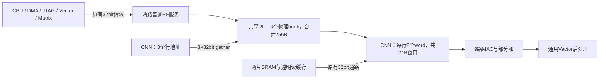

# 共享RF并行读与CNN小窗口试验

保持默认256B RF容量、软件地址、两块8KB SRAM及8/8/16队列不变。RF新增3路独立32bit只读计算接口，CNN作为第一个消费者；Matrix仍使用普通32bit接口。本次未增加外部PAD，也未重跑布局布线。



## RF组织与可见接口

软件仍看到两段逻辑RF地址，默认每段128B，整体为 `[0x80004000,0x80004100)`。每段内部拆成4个32B物理bank，共8个bank。普通访问保留每逻辑段每拍最多一个请求；计算侧可以额外发出三个不同地址的word读取。

一个物理bank每拍仅执行一个访问，不通过复制整份RF实现多读端口。对于字节地址 `a`：

```
logical_half = a[RF_BANK_BITS+2]
subbank      = a[3:2] XOR a[6:5]
physical_bank = logical_half*4 + subbank
row          = a[RF_BANK_BITS+1:4]
```

这个异或映射保持原有字节地址不变，改善部分行stride的分布，但不保证任意三地址都不冲突。每bank只生成一套payload读取选择，结果在普通接口与gather接收者之间路由。

- **不同bank：**三个计算word同拍接受、下一拍返回，最高96bit/拍。
- **普通接口并行：**若两个普通访问也落在其余bank，可以同时接受五个word，合计160bit/拍。
- **同一地址：**多个gather lane共用一次bank读取并广播响应。
- **同bank不同地址：**未获grant的lane保持请求并重试；三个lane轮转仲裁。
- **普通访问与gather冲突：**在该bank上交替服务，避免计算单元或普通master被饿死。
- **错误地址：**gather仅接受RF内4字节对齐地址。越界或未对齐请求下一拍返回error，不访问SRAM、不无限等待。
- **读写顺序：**同一物理bank不会在一拍接受两个不同事务；按实际grant顺序读取/写入。普通访问仍支持byte enable。

CSR `0x4000005c` 返回 `0x00030820`：`[23:16]`为3个计算lane，`[15:8]`为8个物理bank，`[7:0]`为每lane 32bit。`0x40000050`保留两段逻辑地址及容量查询语义，不把旧固件的容量检查改成8倍。

## CNN如何替代整行缓冲

旧的输入双缓冲为 `2×3×28 bytes = 168B`。当前改为三行各两个word，共 **24B**，payload减少85.7%；另有少量地址tag、valid和在途请求元数据。这是RTL声明容量对照，不等同于综合单元面积下降85.7%。

每个输出位置需要一个3×3窗口。硬件先检查当前窗口所需的对齐word是否在这六个槽中，缺失时才读取；当前窗口齐备时，尝试预取下一个水平位置所需的word。stride 1/2下，相邻两个窗口在每行最多涉及两个对齐word，因此不需要整行的动态读选择。

RF输入走三路gather；SRAM输入走原来的32bit端口，复用同一个小窗口。输入可能未对齐、窗口可能跨word，不能声称一次96bit读取总能得到九个像素。padding按原规则屏蔽，U8输入零点仍在九路MAC前扣除，整数结果不变。

仅保留两组九字节权重用于预取：普通端口可以加载下一输入通道的权重，同时gather读取当前通道的像素。部分和寄存器、32项原始结果FIFO以及CNN→Vector背压仍保留。软件必须等任务完成后才能改写其输入，与此前的缓冲所有权约定相同。

未把SRAM透明缓存当成多端口RF：SRAM仍是两个独立32bit单端口bank，透明读缓存容量仍为128B。此次并行读提升只发生在共享RF中，FC/Matrix尚未使用它。

## 同配置综合结果

均为TSMC180 TT、Genus low effort、16ns综合/20ns报告约束，含两块SRAM、不含PAD。

| 部分 | 修改前 | 修改后 |
|---|---:|---:|
| 共享RF（NMC子模块） | 0.184375mm² | 0.233892mm² |
| NMC合计（含RF） | 0.374870mm² | 0.425085mm² |
| CNN engine | 0.326562mm² | 0.283201mm² |
| CNN control | 0.173550mm² | 0.173743mm² |
| CNN合计 | 0.500113mm² | 0.456944mm² |
| 全核心 | 2.881318mm² | **2.885133mm²** |

CNN减少约8.6%，但RF的读口、回复路由和公平仲裁增加了面积。全核心净增0.003815mm²，约0.13%，没有实现总面积压缩。顺序单元从18,229个降至17,292个，组合单元从63,143个增至66,176个；更少的缓冲寄存器被更多选择和控制逻辑抵消，不能把payload缩小比例当成面积收益。

系统在50MHz报告约束下的综合setup slack为 **+4.0007ns**，TNS为0。总面积仍低于3mm²核心预算，但**这不能证明含PAD的2×2mm²已经可布通**。本轮没有布局布线或物理时序结论。

## 实测带宽与周期

独立RF测试覆盖连续8拍的三地址96bit读取、五个不同bank的160bit组合读取、同地址广播、同bank轮转、普通master公平性、byte write可见性、非法地址和reset，全部通过。

完整MNIST每张图实际记录：

| 指标 | 实测 |
|---|---:|
| CNN gather返回word | 1,344 |
| 有gather获grant的周期 | 864 |
| 多lane并行周期 | 368 |
| 三个不同地址同拍读取周期 | 48 |
| 请求遇到bank竞争的周期 | 32 |
| 峰值计算lane数 | 3 |

峰值96bit/拍不能解释为整个推理过程持续96bit/拍。宽度、对齐、存储分配、窗口命中和冲突都会影响实际利用率。

| 配置 | 单图推理周期 |
|---|---:|
| 修改前：CNN卷积专用、普通RF接口 | 25,950 |
| 第一版：小窗口＋gather，未做权重预取/广播 | 28,274 |
| 当前：加权重预取、广播并精简回复路由 | **25,156** |

当前10张单图均一致，减少794周期，约3.1%；仿真含输入DMA为25,777周期。20帧连续流合计509,731周期，平均25,486.55周期/帧。全部15项RTL回归通过，另有4项无SDF映射网表回归通过（推理、JTAG、通用算子和队列突发），映射网表推理周期与RTL一致。原固件、参数和golden保持逐字节一致。

**仍未满足小于20k周期目标。** 第一版虽然更宽却更慢，说明缓冲缩小后必须安排预取；当前Matrix的FC路径仍是32bit逐项取数，三路gather并没有自动加速所有计算单元。

综合面积、时序、输入哈希和映射网表回归见[本次机器报告](../reports/rf_gather_validation.json)。上一轮[卷积专用化记录](cnn-conv-only.md)及含PAD的CTS失败记录都是旧版本，不代表当前物理实现。

## 复现

```sh
python3.12 npu/scripts/run_vcs.py --suite regfile --tag NEW_RF
python3.12 npu/scripts/run_vcs.py --suite latency --tag NEW_LATENCY
python3.12 npu/scripts/run_vcs.py --suite layers --tag NEW_LAYERS
python3.12 npu/scripts/run_vcs.py --suite stream --tag NEW_STREAM
python3.12 npu/eda/tsmc180/prepare_run.py --out ../eda-runs/NEW_RF_GATHER --effort low --synth-period 16 --report-period 20
genus -no_gui -batch -files ../eda-runs/NEW_RF_GATHER/synth.tcl > ../eda-runs/NEW_RF_GATHER/launcher.log 2>&1
```

本轮冻结目录为 `../eda-runs/20261104-rf-gather/asic`。`regfile`套件不只是检查数据正确，还断言独立bank并发和冲突公平性；`latency`套件检查真实CNN调用了并行接口。固定的完整推理门限20000仍会失败，不能以单元峰值带宽代替周期达标。

主要实现：[RF物理分bank与仲裁](../rtl/interconnect/npu_data_regfile.sv)、[NMC接口](../rtl/nmc.sv)、[CNN小窗口与权重预取](../rtl/npu_cnn_engine.sv)、[SoC连接](../rtl/top/npu_core.sv)、[带宽与冲突测试](../tb/tb_regfile.sv)。报告收集脚本为[collect_rf_gather.py](../eda/tsmc180/collect_rf_gather.py)。
