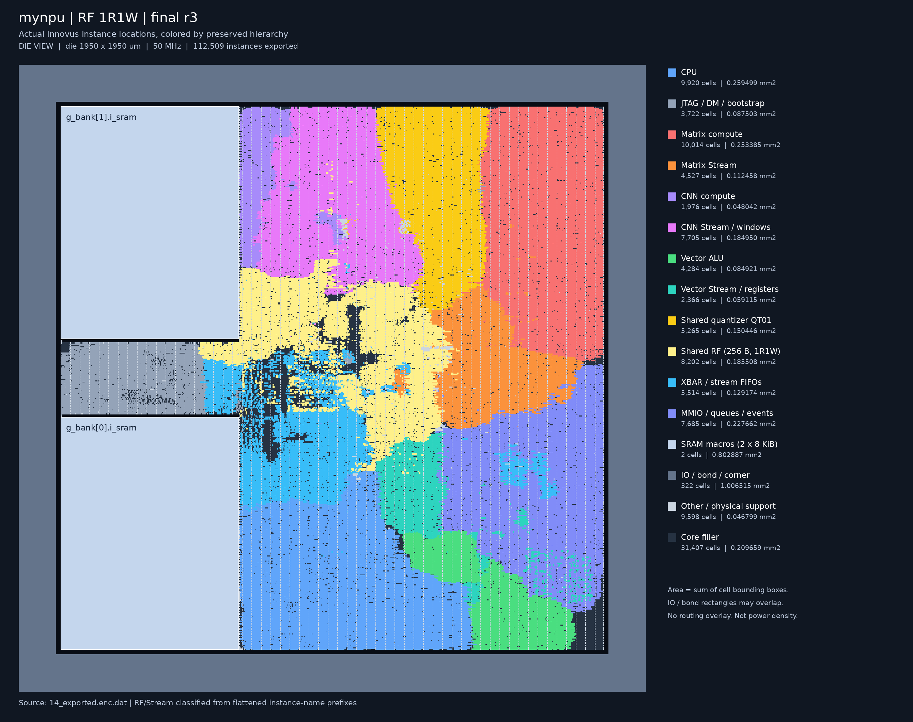
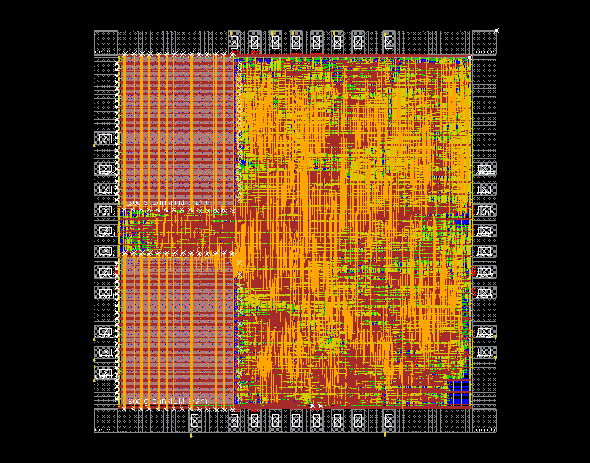
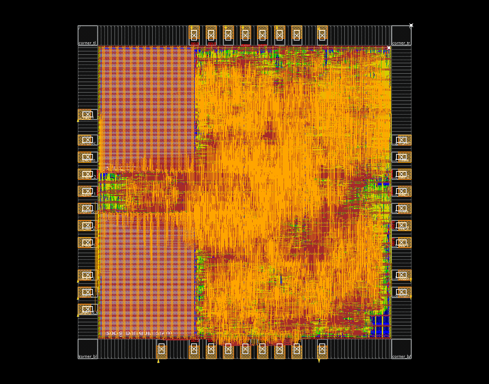
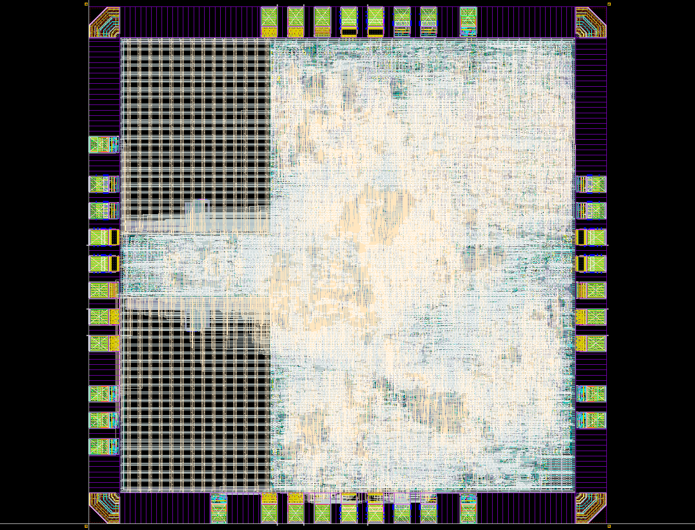

> 本报告为加入GPIO8前的冻结物理基线，只有9个信号PAD。GPIO版本为17个信号PAD，当前仅完成核心/封装综合、功能验证及初始floorplan，见[GPIO8报告](gpio8.md)。不要将本页时序或签核结论用于GPIO版。

# RF 1R1W：1950 µm 完整后端与最终检查

2026-11-10。本轮已对当前RF 1R1W版本完成全芯片布局布线、物理ECO、Seal Ring、Dummy Fill、最终DRC、LVS/ERC、天线、Wire Bond PAD检查和归档。最终版本为 **r3**。原始严格LVS的IO电阻参数偏差和ERC原库/外圈残项保留待评审，不能记为正式投片签核全部通过。

完整步骤、历史参数搜索、hold修复及问题台账见[详细实现复盘](backend-rf1r1w-r3-full-process.md)。

注意：Lab 5包含项目私有OA IO单元的PIMP右扩0.29µm修补以消除CO.R.4；共享PDK未修改，但不能表述为最终IO几何完全不变，详见复盘第10.5节。

## 源码版本核对

2026-11-11将实际r3冻结清单中的70个输入文件与当前工作区逐项核对，全部SHA256一致，包含全部24个项目RTL；五项默认容量/队列配置也一致。见[审计明细](../reports/backend_source_audit.json)。冻结清单的Git基线为`549b352`，不代表当时工作区无修改，不能据此把本轮RF 1R1W误判为旧1RW。此核对未重新执行综合、布局布线或签核。

## 结果

| 项目 | 本轮1R1W，最终r3 |
| --- | ---: |
| Die | **1950×1950 µm** |
| Seal Ring物理外框 | **1980×1980 µm** |
| 综合cell面积，含两块SRAM | **2.569286 mm²** |
| PNR核心非filler面积，含SRAM | **2.632349 mm²** |
| PNR标准单元面积，含CTS/tie/tap/天线支持、不含core filler | **1.829462 mm²** |
| SRAM宏面积 | 0.802887 mm² |
| Core filler面积，单列 | 0.209659 mm² |
| 原生IO几何并集，排除bond窗口重复面积 | 0.844100 mm² |
| 非filler placement density | 89.510% |
| 系统频率 | **50 MHz** |
| Post-route setup WNS / TNS | **+0.468 ns / 0** |
| Post-route hold WNS / TNS | **+0.018 ns / 0** |
| Setup / Hold违例路径 | **0 / 0** |
| Innovus DRC / 天线 | **0 / 0** |
| VDD/VSS特殊电源连通性 | **0问题** |
| 布线后9信号PAD JTAG/MNIST回归 | **34 checks通过** |

面积基本持平；微小差异包含全局综合映射、布局、CTS和优化选择，不能解释为新增读写端口本身节省了面积。最终STD cell 80,778个、SRAM 2个、core filler 31,407个。9个信号PAD、28个供电/POC PAD、37个Bond PAD均保留，最终导出审计无缺失GDS结构引用。

计算规模、RF容量、指令和固件不变：Matrix为4×4外积，CNN为3×3 DOT9，Vector为INT32/4路INT8 SIMD；RF总256B、8个物理bank各1R1W；任务队列4/4/4，4条数据流FIFO各8 words。RTL性能和RF端口对照见[RF 1R1W实现报告](rf1r1w.md)。

上述时序为TT单角、cap table RC、OCV/CPPR的Innovus布线后分析，系统周期20ns、JTAG周期100ns。未执行Dummy后PEX/STA或多角、IR/EM签核。布线后功能回归使用实际标准单元、IO和SRAM模型，10MHz JTAG、零延迟、不回标SDF。

## 当前模块染色分布

以下从最终r3的`14_exported.enc.dat`导出全部112,509个实例的实际坐标与单元边界，按保留层次前缀着色。计算核、Stream、RF与XBAR分开，非示意框图；图中不绘制金属走线。



[核心区放大图](images/rf1r1w-r3-module-map-core.png) · [分组统计与输入哈希](images/rf1r1w-r3-module-map.source.json)

导出的标准单元为80,778个，SRAM为2个，core filler为31,407个，IO/Bond/Corner/IO filler为322个。
按实例边界累计的核心非filler面积为2.632349mm²，与最终PNR报告一致。外围IO/Bond边界可能重叠，不能把该组矩形面积直接当作独立芯片占地。
颜色只表示实例归属，不表示该模块对附近全部布线、面积或功耗的独占；无法从保留层次明确归属的单元单列Other/physical support。

## Useful skew

从本轮`10_post_cts`实际检查点查询：

```tcl
usefulSkew          = true
usefulSkewCCOpt     = standard
usefulSkewPreCTS    = true
usefulSkewPostRoute = true
```

CTS使用完整`ccopt_design`。系统时钟树插入延迟约1.367～1.497ns，skew约0.130ns；不是强制所有sink零skew。后续金属ECO没有改变时钟树。

原始CTS日志保留了输入clock slew给定0.5ns高于内部目标0.393ns、系统skew略高于0.128ns目标的QoR提示。放置日志中还保留功能扫描型触发器未定义scan chain的IMPSP-9099提示，本轮沿用`place_global_ignore_scan true`。这些日志没有被删改，不能把工具命令结束解释为没有任何警告。



## 本轮修复的真实物理问题

| 阶段 | 实际问题 | 最终修正与复核 |
| --- | --- |
| 常规布线收尾 | 63处native DRC：58处PG过孔重叠、4处TCK PAD绕线、1处底边reset接入 | 删除两组重复19-cut VIA12阵列，保留同网18-/25-cut连接和全部电源导体；移动CPU寄存器文件`mem_reg[6][7]`；只删除已证明为单PAD端点＋重叠top port的外部多余绕线，内部核心网络保留。DRC、PG、STA重测通过。 |
| 第一轮Calibre | 1处M2.S.2，CPU内部乘法网络在底边IO宽M2附近间距不足；Innovus抽象检查未报出 | 在原生PVSS2CDG顶边增加项目级M2信号禁布区`(849,114.8)–(911,115.8)`，只重新布线一个CPU网络。没有编辑共享PDK、IO/SRAM原库或原始SPI/CDL。 |
| 第二轮WB | 5处CB.S.2.M5/M6：Bond金属到M5/M6走线不足2.5µm | 从原始PAD60LU_OBV GDS核对金属范围，给37个Bond PAD的M5/M6增加74个仅约束信号的route blockage，保留PG。实际仅4条CPU数据网络需要重新布线，影响时钟网络0条。 |
| 最后一轮 | 本轮r3 | 定向24项金属间距及2项PAD间距检查均0，随后完整DRC、LVS/ERC、62项天线和64项WB全部重新执行。 |

M2.S.2标记位于约`x=904.703～905.520、y=115.000～115.450µm`。WB所用原生PAD金属局部范围为M5 `(3.3,0)–(56.7,71.36)`、M6 `(1.5,0)–(58.5,73.16)`，按实际四边旋转后向外扩2.5µm。新增的是路由约束，不是制造金属、豁免标记或新增存储单元。

`r2/r3`从本轮1R1W完整PNR检查点继续增量修复；没有使用旧1RW布局替代新设计。父运行、检查点、实际执行脚本和哈希均记录。被工具拒绝/未完成的尝试另存`attempts/`，不计作通过阶段。第一轮M2失败和第二轮WB失败的GDS、摘要和诊断报告保留，以便核对修复前后。



## 最终Calibre检查

全部最终检查对应同一个`mynpu_asic_top_postDummy.gds`。GDS Top为`mynpu_asic_top_postDummy`，源CDL Top为`mynpu_asic_top`。

| 检查 | 本轮实际结果 |
| --- | --- |
| 最终几何DRC | **523项**；原始2433层次/21777展开；课程四类排除后 **0** |
| M1.S.1、M2.S.2、CO.R.4、M6.A.1、SR.S.1 | 0 |
| M5.R.1、M6.R.1、DOD.R.1 | Dummy后归零 |
| 教学容差LVS | **CORRECT**，605条完整属性检查、Split Gate YES，PR容差3.48%，无SRAM Box、无额外虚连 |
| LVS端口 / 网络 / 器件匹配 | 14/14；327488/327488；494947/494947 |
| 原始严格PR参数LVS | INCORRECT，IO PR阻值约+3.47%差异保留；没有通过删器件或关闭其余属性取得CORRECT |
| ERC | **7层次/977展开，待评审**；12项检查均执行 |
| 最终GDS天线 | **62项 / 0违规** |
| Wire Bond PAD | **64项 / 0违规**，PITCH_55_SINGLE＋OBV_CUP，SRwidth 15µm |
| 输入一致性 | 最终GDS和CDL SHA256复核通过；各阶段输出哈希复核通过 |

DRC原始非零展开计数：ESD.24g=270、ESD.25g=21456、LUP.3.3g_3.3V=9、LUP.5.3g_3.3V=40、MOM.R.2=1、DRM.R.1=1。按[课程Lab 5](https://full-stack-ai-chip.tianyuj.com/lab-5/)仅在汇总时单列DRM、ESD、MOM、LUP四类，未关闭完整deck的这些检查。定向诊断不能代替本表完整检查。

ERC残项为`mnpg 4/832`、`floating.nxwell_float 1/72`、`npvss49 1/72`、`floating.psub_float 1/1`，与课程记录的IO保护结构及隔离带外圈衬底模式一致，保留待负责人评审，不记ERC Clean。未跨Seal Ring禁布带补线、合并四条PG电源网或伪造接地标签。Regular connectivity的VDDPST/VSSPST两条no-routing提示仍单列；它们在原生IO GDS内的真实连接由完整LVS验证。

Seal Ring由7844个原库边/角实例拼接，实际bbox `(-15,-15)–(1965,1965)µm`。OA顶层bbox可能包含字体显示范围，不能用文字bbox代替物理环尺寸。所有改动都位于项目副本，未修改服务器共享PDK。



## 产物与复核

以下均相对`/home/s2400012841/chip-fullstack-2026/`：

| 内容 | 位置 |
| --- | --- |
| 最终PNR运行 | `eda-runs/20261110-rf1r1w-die1950-fullchip-r3/` |
| 最终Innovus数据库 | 上述目录`mynpu/pnr/checkpoints/13_wb_fixed.enc`及`.enc.dat/` |
| PNR GDS/DEF/Verilog/SDC/SPEF/SDF/LEF | 上述目录`mynpu/pnr/outputs/final/` |
| 实际物理修复脚本 | 上述目录`repairs/finish_eco.tcl`、`fix_calibre_m2_block.tcl`、`fix_wb_spacing2.tcl` |
| 最终Lab 5工作区 | `eda-runs/20261110-rf1r1w-lab5-die1950-r3/` |
| **最终物理版图** | 上述目录`outputs/mynpu_asic_top_postDummy.gds` |
| LVS源CDL | 上述目录`cdl/mynpu_asic_top.cdl` |
| 最终规则与原始报告 | 上述目录`rules/`、`drc_post/`、`lvs/`、`lvs_strict/`、`antenna/`、`wb/` |
| 验证汇总 | `mynpu-softpe/npu/reports/rf1r1w_die1950_fullchip_validation.json`及`lab5_rf1r1w_die1950_validation.json` |
| 修复前诊断 | 工作区`eda-runs/20261111-historical-report-cleanup/`内对应firstpass/r2 JSON，以及原始父运行目录 |
| 交付归档 | 最终Lab 5目录`deliverables/mynpu_rf1r1w_die1950_design_and_reports.tar.gz`及`SHA256SUMS` |

归档包含最终设计、公开RTL快照、规则、原始报告、日志、截图和诊断。活动OA库、完整Innovus检查点及外部授权工艺库继续保留在服务器记录路径，不全部放入交付压缩包。CDL引用外部原始SPI/SRAM CDL，迁移需同版工艺环境。

```bash
cd /home/s2400012841/chip-fullstack-2026/mynpu-softpe
python3.12 npu/eda/tsmc180/collect_fullchip.py --run ../eda-runs/20261110-rf1r1w-die1950-fullchip-r3 --out npu/reports/rf1r1w_die1950_fullchip_validation.json --gate-tags rf1r1w-die1950-r3-routed
python3.12 ../eda-runs/20261110-rf1r1w-lab5-die1950-r3/scripts/collect_results.py
sha256sum -c ../eda-runs/20261110-rf1r1w-lab5-die1950-r3/outputs/final_inputs.sha256
```

本轮完成的是课程后端流程及列明验证。ERC接受结论、严格IO模型适配、Dummy后PEX/STA、多角和IR/EM等正式投片工作不在已通过项中。

本轮实际成功执行的物理ECO与最终导出脚本已复制到[仓库内目录](../eda/tsmc180/fullchip/verified_die1950_ecos/README.md)，附源路径及SHA256；它们与冻结运行脚本逐字节一致，使用前需满足对应检查点和网表条件。
