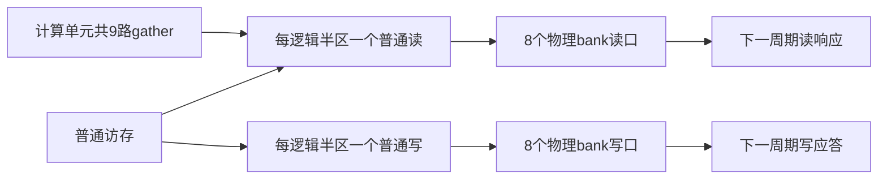

# RF 1R1W

当前RF为256 B：两个128 B逻辑半区、八个32 B物理bank。每个物理bank有一个读口和一个独立写口，不复制数据阵列，不引入RF数据锁存器。

## 访问协议

普通读与gather共享每个物理bank的唯一读口，按仲裁发放；同字gather可广播，不同地址同bank读取分拍。
普通写每逻辑半区最多一路，并非八个普通写口。写入按byte enable更新。
同沿同址读写返回旧值，没有写穿透；需要新值时，软件等待写回完成或依赖事件再读。
复位清仲裁和在途响应，不清RF数据。

实现：[npu_data_regfile.sv](../rtl/interconnect/npu_data_regfile.sv)。端口并行不自动改变计算单元的内部调度。

## 当前测量

| 指标 | 当前结果 |
| --- | --- |
| 同bank持续256写＋256 gather读 | 256周期 |
| 默认MNIST | 21,008周期/张，10张逐层一致，不含JTAG下载 |
| 综合总cell面积，含两块SRAM | 2.569286 mm² |
| XBAR综合层级面积，含RF/流FIFO | 0.309165 mm² |
| PNR核心非filler面积，含SRAM | 2.632349 mm² |
| 50MHz布线后setup / hold WNS | +0.468 / +0.018 ns |

当前功能/综合原始证据见[RF验证](../reports/rf1r1w-validation.json)，最终物理结果见[r3报告](rf1r1w-die1950-signoff.md)。
原始证据保留必要的对照和执行过程，以便追溯；入口仅使用当前版本数据，不将旧阶段结论作为当前测量。

## 复核

[源码核对](../reports/backend_source_audit.json)包含70个ASIC输入文件与24个项目RTL的一致性检查。
完整证据索引见[reports](../reports/README.md)。本轮文档清理没有重新执行仿真、综合或签核。
