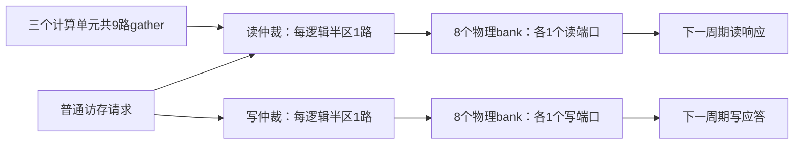

> 本版现已完成[1950µm全芯片后端及Lab 5检查](rf1r1w-die1950-signoff.md)：PNR核心非filler 2.632349mm²，50MHz setup/hold +0.468/+0.018ns；保留ERC待评审和严格PR参数差异。以下综合阶段的“未跑PNR”说明为当时快照。

# RF 每 bank 独立 1R1W

当前 RF 从“每个物理 bank 每拍一次读或写”改成“每拍一次读＋一次独立写”。容量、地址映射、计算阵列、指令、任务 FIFO、软件接口均不变。未引入 RF 数据锁存器，也没有复制数据阵列。

## 结构与协议



- RF 仍为256B：2个128B逻辑半区、8个32B物理bank。bank映射和软件地址不变。
- 普通请求由原来每半区一套混合读写仲裁，拆成读、写各一套。每半区最多接受一个普通读和一个普通写；**不是8个普通写口**。
- gather 与普通读仍共享每个物理bank的唯一读口，轮转仲裁；同字gather请求保留广播。不同地址的同bank读取仍需分拍。
- 写入不再占用读口，也不参与普通读/gather之间的仲裁。不同地址、同地址都允许同拍读写。
- **同一时钟沿读写同字时，读返回写入前的旧32bit字**。写入按byte enable更新，未使能字节保留；不增加写穿透旁路。
- 获准读写都保持下一周期响应。数据不随系统复位清零，复位只清仲裁和在途响应状态，与旧版一致。
- 软件需要新值时，先等生产者写回完成/事件，再发起读取。1R1W不消除数据依赖，也不承诺未同步的同地址竞争会得到新值。

实现：[npu_data_regfile.sv](../rtl/interconnect/npu_data_regfile.sv)。没有改变计算单元供数器的状态机；同一计算单元若仍按读、算、写串行推进，不会仅凭RF端口变化自动重叠。

## 实测面积和时序

### RF 独立模块对照

同一份TSMC180 TT标准单元库、18ns、高努力、clock gating；GATHER_PORTS=9、NUM_MASTERS=7、每逻辑半区32 words，与当前SoC接线一致。单独综合使用timing-library面积与wireload模式，不把其数值当作完整芯片中的精确归属面积。

| 指标 | 原1RW | 新1R1W |
| --- | ---: | ---: |
| RF单模块cell面积 | 0.189149 mm² | **0.191461 mm²** |
| cell数量 | 8495 | 8621 |
| 门控提取前FF数量 | 2472 | 2485 |

RF独立模块面积增加0.002312mm²，约**1.22%**。增量主要是独立写仲裁、地址与应答控制，数据存储位数不变。这支持了触发器RF拆分读写端口代价较小的判断，不能外推到SRAM宏或增加第二个读口。

### 完整芯片综合对照

唯一RTL变化是RF模块；库、约束、输入程序、容量及队列配置与`20261108-area26-all4`一致。TSMC180 TT，18ns优化、20ns报告，high effort、clock gating、保留计算单元边界。

| 指标 | 原1RW | 新1R1W |
| --- | ---: | ---: |
| 总cell面积，含两块SRAM | 2.569744 mm² | **2.569286 mm²** |
| XBAR层级面积，含RF及流FIFO等 | 0.308799 mm² | **0.309165 mm²** |
| 18ns系统setup WNS | +0.0044 ns | **+0.0006 ns** |
| 20ns系统setup WNS | +2.0044 ns | **+2.0006 ns** |
| TNS / 违例路径 | 0 / 0 | 0 / 0 |

整芯片面积变化−0.000459mm²（约−0.018%），视为**基本持平**。全局映射会改变其他逻辑的单元选择，这个微小下降不等于1R1W本身减少了存储面积。独立RF对照和完整XBAR层级数字分别保留，不互相替代。

这些是综合结果，未重跑本轮布局布线或签核。原1950µm版图及Lab 5结果属于前一版1RW冻结RTL，不能作为本轮物理收敛证据。网表中CPU原有的时钟门控使能锁存器与基线一致；新RF没有数据锁存器。

## 性能与验证

| 测试 | 原1RW | 新1R1W |
| --- | ---: | ---: |
| 同bank持续256写＋256 gather读 | 512周期 | **256周期** |
| 默认MNIST，10张逐层一致 | 21,008周期/张 | **21,008周期/张** |
| 通用负载，1302项数值检查，含host操作 | 21,466周期 | **21,466周期** |
| CPU GEMM→偏置→Sum | 741周期 | **741周期** |
| CPU CNN→Vector小图 | 726周期 | **726周期** |

微基准使用冻结历史1RW模型与新RF，两边由各自握手推进，检查每次读取和写应答；512→256是同bank读写饱和场景的带宽收益，不能称为整模型加速2倍。现有应用供数顺序、任务依赖和数据布局尚未形成可观的这类重叠，因此总周期不变。后续软件可针对独立任务生产/消费重叠利用新能力。

12组RTL回归通过，包括：RF普通接口、默认/大容量RF随机记分板、通用多负载、LY01/EV01、六方向单元流互联、10张MNIST、XBAR并发、RF专用写回、真实CPU小图和JTAG。默认容量的两组随机/定向记分板共10,448周期检查，覆盖同字读旧值、不同row、部分字节写入、广播、三方竞争、公平性、非法地址、排除owner与复位保留。测试不再要求与旧仲裁器逐拍grant相同，而按公开端口语义检查数值、响应和每bank端口限制。

四组映射网表回归全部通过：MNIST一张12项、计算单元25项、布局/事件34项、JTAG42项，共113项。使用实际标准单元/SRAM功能模型，零延迟、无SDF，不替代物理STA或签核。

## 复核入口

```bash
cd /home/s2400012841/chip-fullstack-2026/mynpu-softpe
python3.12 npu/scripts/collect_rf1r1w.py --run ../eda-runs/20261110-rf1r1w --experiment ../eda-runs/20261110-rf1r1w-experiment
```

- 机器报告：[rf1r1w-validation.json](../reports/rf1r1w-validation.json)。
- 完整综合：`../eda-runs/20261110-rf1r1w/`，冻结输入、库SHA、约束、面积/时序报告、映射网表均保留。
- 独立RF对照及网表测试驱动：`../eda-runs/20261110-rf1r1w-experiment/`。
- 原始RTL测试：`npu/build/vcs-rf1r1w-*`；网表测试：`npu/build/gate-rf1r1w-*`。
- 独立RF准备时误用时间单位的首次尝试保留在`*_invalid_units`并明确废弃，报告只使用修正为18ns的`old/`、`new/`；完整芯片约束始终与基线一致。
