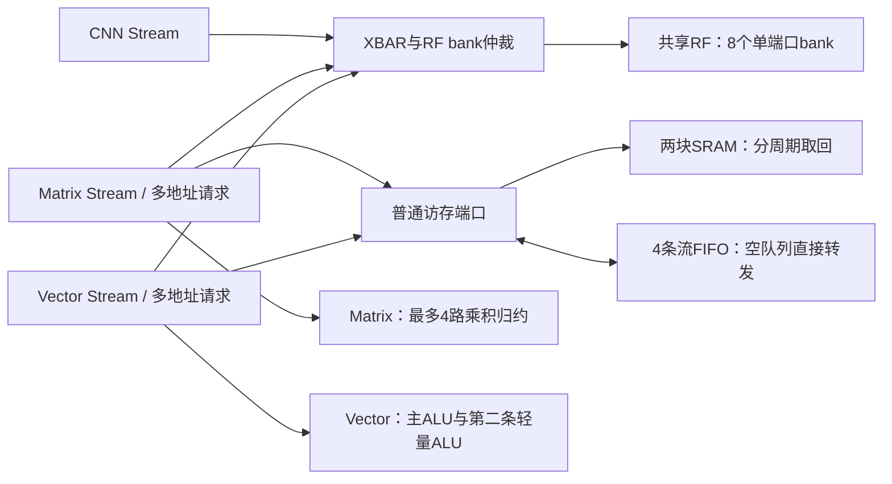

# 共享多地址读取与计算并行

本轮保留CPU、两块8KB SRAM、256B共享RF、CNN/Matrix/Vector和8/8/8任务队列。软件任务格式和模型参数不变。Matrix与Vector现在也能通过xbar的RF gather路径取数；计算核仍只接收数值与运算控制。



## RF与SRAM访问

`interconnect/npu_multi_read.sv`是可复用的批读前端，一批最多三个32位地址。每路分别记录是否被授权、是否返回和错误位。RF地址送gather；其他地址送普通32位端口。普通端口一次保留一笔在途请求，适用于SRAM和有副作用的流FIFO读取。读请求被授权后不会重复提交；输出在反压期间保持稳定。

SoC给CNN、Matrix、Vector各保留三个逻辑gather请求槽，共9槽。它们共享原有8个物理bank，并非新增9个物理读端口。不同bank可以同周期读取，同bank不同字由轮询仲裁分周期完成；同一字的多个请求共享一次读取并广播响应。普通读写与gather仍按bank交替服务。Matrix和Vector目前每批最多使用其中两个槽；第三槽留空。

批读错误会取消尚未授权的请求，同时等待已授权的请求返回，然后统一报告fault。任务之前已完成的写入不回滚。复位可以直接清除所有在途状态。

## Matrix

Matrix的纯计算核增加三个可屏蔽的乘法输入，与原乘积一起作平衡归约，再累加到同一个INT32累加器。INT32结果保持模2^32回绕语义。

对于PACKED输入，当A和B沿K方向都连续时，一次各读一个32位字，提取当前字中可用的操作数：INT8最多4个乘积，INT16最多2个。实际数量取剩余K、两边字边界和精度的最小值，不能跨字读取。其他步长、转置布局和旧版每元素占一字的格式每次计算一个乘积。输出依然是一个点积，尚不是多个输出位置并行的矩阵阵列。

D累加选项继续通过普通端口读取旧D；最终结果写回普通地址或流端点。RF的A/B读取可以并行；SRAM的A/B读取由前端分周期完成。即使使用SRAM，一个字也可提供多个打包操作数，不再每个INT8都重新读同一字。

## Vector

直接模式的二元操作可以在RF同时读取A/B。新增一条独立的INT32轻量ALU，使直接模式的单目操作和向量-标量轻量操作每批处理两个元素。第二lane支持0至15号算术、位运算、比较和移位操作，没有复制64位乘法器。

双元素路径自动要求：输入输出在普通SRAM/RF范围内，长度至少2，并且精确原地或地址范围互不重叠。偏移重叠和FIFO地址使用单元素路径，保留原来的顺序语义。奇数尾部自动退回单元素。两个结果经过普通32位写口依次写出，因此实际吞吐仍受写回带宽限制。

通用程序模式保留原来的四个64位临时寄存器、程序控制、通用乘法和舍入以及轻量指令合并；本轮没有把它扩成双上下文SIMD。二元向量-向量操作也仍一次算一个元素，新增并行度来自A/B同时读取。

## 单元间转发

任意单元把结果写入流端点，另一个单元从同一端点读取。队列非空时按FIFO顺序读取；空队列同时有生产者和消费者时，xbar直接把本次写数据送给消费者，不先等待入队一周期。字节掩码仍生效，满队列继续施加反压。响应仍在下一周期寄存输出，避免计算单元之间形成组合时序环。

## 复现测试

```bash
python3.12 npu/scripts/run_vcs.py --suite sharedoperands --macro --tag MY_ON
python3.12 npu/scripts/run_vcs.py --suite sharedoperands --macro --parallel-units 0 --tag MY_OFF
python3.12 npu/scripts/run_vcs.py --suite readbatch --tag MY_BATCH
python3.12 npu/scripts/run_vcs.py --suite latency --macro --tag MY_MNIST
python3.12 npu/scripts/run_vcs.py --suite unitroutes --macro --tag MY_ROUTES
```

`--parallel-units 0`禁用新增的计算和RF gather使用，供同源对照；它仍使用新的批读控制器，不能等同于历史RTL。历史原版MNIST为25,930周期。最终逐项结果、源码哈希和周期见[机器报告](../reports/shared_parallel_validation.json)。本轮功能仿真使用实际SRAM宏行为模型，不代表门级时序或物理后端签核。

## 本轮实测

12组最终源码回归均通过，报告中的源码和资产SHA256已逐一与当前文件复核。实际SRAM宏模型下，10张MNIST逐层整数检查全部通过，每张22,219周期（50MHz对应444.38µs），比历史25,930周期减少14.31%；仍未达到20k。FC阶段7,029→3,354周期，其中Matrix busy从6,100降至1,780周期。

同源开关对照覆盖256个GEMM任务及256个轻量Vector任务，分别累计busy周期：

| 测试集 | 关闭新增并行 | 开启 | 降低 |
|---|---:|---:|---:|
| Matrix | 69,120 | 51,416 | 25.61% |
| Vector轻量直接模式 | 5,760 | 4,608 | 20.00% |

额外的二元Vector、并发RF测试与上述微基准分开计数；共享操作数测试总共3,409项检查通过。另包括批读27项、通用Vector程序143任务/3,897项、故障恢复558项、纯算术6,008项、流FIFO随机4,000轮（177次空队列转发）、RF473项、xbar并发5,069项、单元流路由24项和JTAG42项。
