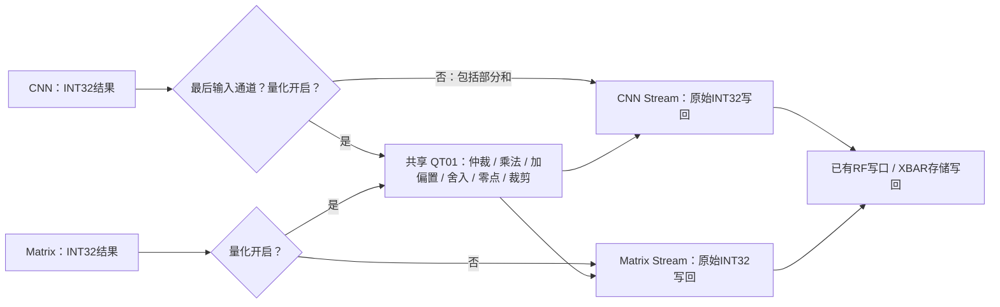

# CNN / Matrix 共享可选量化单元

修改前检查点提交：`d4a89a9`。纯计算核仍负责乘加；新增 `npu_shared_quant.sv` 直接接收 CNN、Matrix 的结果。进入量化单元不经过 XBAR。写回 RF / SRAM 或流 FIFO 仍使用各自原有 Stream 接口。



## 模式与数学语义

CNN 和 Matrix 分别拥有一组配置，复用一套计算逻辑；复位后都关闭量化。配置 `control`：

| 值 | 行为 |
|---|---|
| 0 | 旁路，导出原始 INT32，无新增量化流水等待 |
| 1 | 量化后仍导出 32 位值 |
| 3 | 量化后取低字节，按连续字节地址写 RF / SRAM |

`2` 非法。字节模式的上下限由软件设为 `[-128,127]` 或 `[0,255]`，分别用于 INT8 / UINT8。没有额外隐式饱和。

```text
corrected = INT32_wrap(raw + input_offset)
wide      = signed(corrected) × signed(multiplier) + signed(scaled_bias)
rounded   = round_nearest_even(wide / 2^shift)     # shift = 0..32
translated = INT32_wrap(low32(rounded) + zero_point)
result    = clamp_signed32(translated, lower, upper)
```

乘积和加偏置使用 64 位中间值，最终输出按现有 VPG2 低字 / 输出零点回绕语义处理。CNN 的输入零点扣除仍在卷积乘加中执行；`input_offset` 用于 Matrix 的零点补偿等情况，不是额外扣一次 CNN 输入零点。

同一时刻仅处理一个量化结果。CNN / Matrix 请求采用轮转仲裁，共享乘法器；乘积、加偏置分级寄存，舍入裁剪由后一级组合逻辑完成。无写回阻塞时每三拍最多接收一个结果。上游保持结果和元数据，直到量化输出被接收；下游阻塞时传播背压。某一路写回长期阻塞也会占住量化单元，软件应安排相应消费者。关闭量化的另一条原始结果路径可继续运行。

CNN 的中间输入通道部分和始终保持 INT32 存 RF；只有最后输入通道经过量化。Matrix 不自行判断多次任务是否为完整归约：软件在部分和任务中关闭量化，在最后一次任务开启。Matrix 的原始 D 地址仍用于读取旧部分和，量化目的地址独立指定。

## 配置寄存器

MMIO 基址为 `0x40000000`。CNN 配置起点 `0x700`，Matrix 起点 `0x740`；能力寄存器 `0x780` 返回 `0x51543031`（QT01）。

| 相对偏移 | 参数 |
|---|---|
| 0x00 | control：0 / 1 / 3 |
| 0x04 | 有符号 multiplier |
| 0x08 | 有符号 scaled_bias |
| 0x0c | shift，0..32 |
| 0x10 | 输出 zero_point |
| 0x14 | 有符号 lower |
| 0x18 | 有符号 upper |
| 0x1c | INT32 input_offset |
| 0x20 | 量化结果目的地址 |

**该源有活动任务或排队任务时，禁止写它的量化配置，返回总线错误。**配置与 CNN 的共享形状配置类似，按一批任务保持不变，没有把全部量化参数复制到每个 FIFO 项。要切换参数或开关，先等待该源队列排空。另一源可独立配置。

C 接口见 `npu/sw/npu.h` 的 `npu_quant_configure()`。例如：

```c
struct npu_quant_config q = {
  .control = 3, .multiplier = M, .bias = scaled_bias, .shift = 24,
  .zero = output_zero, .lower = output_zero, .upper = 255,
  .input_offset = 0, .dst = output_address
};
npu_quant_configure(NPU_QUANT_CNN, &q);  // 调用前先等CNN任务完成
// 随后按原接口提交该通道的CNN任务。
```

CNN 的任务 `dst_words` 在字节量化模式中表示相对量化目的地址的**字节偏移**；32 位模式中仍为字偏移。Matrix 从量化目的地址开始按 1 或 4 字节步进。字节写回采用 byte enable，保留相邻字节；CNN RF 独立写回口也增加 byte enable。当前没有四结果合并写回缓冲，每个量化结果发起一次字节写事务。

字节量化目的地址仅支持 RF / SRAM，允许不对齐；32 位目的地址要求字对齐，也可使用流 FIFO。字节模式直接输出到流 FIFO 会被拒绝，避免把每个字节误当成一个打包字。软件负责目的张量的总长度和活跃张量之间的别名检查；越界访存仍沿用 Stream 的 fault 路径。

## MNIST 软件与测量

保留原通用 Vector 固件为默认，便于比较和通用计算。实验固件通过 `NPU_SHARED_QUANT=1` 生成，权重、量化参数和 golden 不变：

- 卷积按输出通道配置量化参数，向 CNN FIFO 提交该通道的行 / tile 任务。CNN 完成跨输入通道累加，最终结果直接量化写回。通道任务排空后再换参数；不再提交 Vector 后处理任务。
- FC 仍使用 Matrix 的 9 个 K16 tile。先以原始 INT32 完成前 8 个 tile，排空队列；配置该输出通道的量化参数，再提交第 9 个带累加任务。最终量化直接写入字节输出，原始部分和地址与最终输出地址分开。
- 保留原 RF 权重暂存策略。

| 同一 SRAM 宏模型、10 张图 | 推理周期 / 张 | 50 MHz 下换算延迟 |
|---|---:|---:|
| 量化关闭，旧 VPG2 固件 | 29,817 | 596.34 µs |
| QT01 实验固件 | 27,633 | 552.66 µs |

周期减少 **7.32%**。最初版本为 29,262 周期，恢复 RF 写回与权重暂存后为 29,021，再减少一级结果等待后达到 27,633。结果没有达到 20k；当前共享单元吞吐、逐字节写回和按通道配置 / 排空仍有代价。已完成[本版综合测量](shared-quant-area.md)：总面积 **2.586795mm²**，含两块SRAM、不含PAD；相比加入量化前同配置净增加0.151089mm²（6.20%）。50MHz综合setup slack为+4.0014ns，尚未重新布局布线或完成物理时序签核。

[验证报告](../reports/shared_quant_validation.json)记录功能结果、源码哈希及周期。带主机逐层 ACK 的检查用于核对中间张量，不计入上表的性能测量。

## 复现

```bash
mkdir -p npu/build/quant-artifacts
cp npu/mnist/artifacts/* npu/build/quant-artifacts/
NPU_ARTIFACTS_DIR="$PWD/npu/build/quant-artifacts" NPU_SHARED_QUANT=1 \
  python3.12 npu/mnist/firmware.py
python3.12 npu/scripts/run_vcs.py --suite sharedquant --macro --tag QT_UNIT
python3.12 npu/scripts/run_vcs.py --suite latency --macro --tag QT_MNIST \
  --artifacts-dir npu/build/quant-artifacts
python3.12 npu/scripts/run_vcs.py --suite quantlayers --macro --tag QT_LAYERS \
  --artifacts-dir npu/build/quant-artifacts
```
