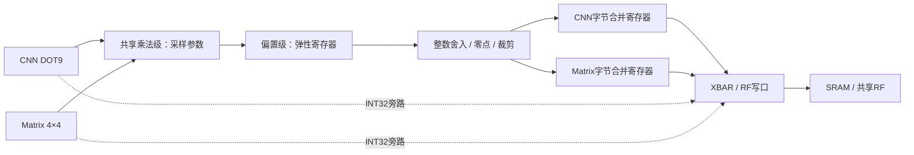

# FC、供数、量化写回与 Vector 优化

本轮在 `6697d58` 的功能基础上实现五项优化，保留 CPU、双 SRAM、共享 RF/XBAR、独立 CNN/Matrix/Vector、共享可选 QT01、JTAG SBA 和 IRQ。任务 FIFO 仍为8/8/8、描述符仍为32/96/99bit，RF仍为256B。

## 已实现

1. **FC合并**：三个1×4/1×4/1×2输出块各用一个K=144 GEMM，替代九次K=16分段。默认共享量化总Matrix任务37→13（3个GEMM＋10个K=0逐通道量化导出）。权重单份、B转置布局、ldb=144不变。取消无用K分段循环；量化常量按层配置，通道只修改乘数、偏置、目的地和必要输入修正。
2. **普通读续发**：`npu_multi_read`允许旧应答返回同拍接受下一读，旧owner接收旧应答、新grant更新新owner。错误应答同拍禁止续发，未获grant的请求取消，已获grant的其他读仍排干。RF gather与FIFO破坏性pop各只接受一次。
3. **量化/写回解耦**：QT01改为两级弹性流水；无反压时全局每拍可接收一个结果，CNN/Matrix轮询仲裁共用乘法器。CNN用4项、每项5bit的位置/最终输出标签，以及独立的raw接收/filtered消费游标，跟踪提前接受的结果。计算和字节写回可重叠；DONE仍等真实写应答排干。
4. **连续字节写合并**：CNN/Matrix共享同一小模块实现，不共享数据状态；每个生产者各一组32bit数据、字地址、byte mask和数量寄存器。同字不同byte的输出合并；满字、任务尾部、不连续/重复地址或关闭pack时结算。INT32旁路和量化INT32保持逐字输出；流FIFO的token不会合并。不同任务之间不隐式合并。
5. **Vector时序与面积整理**：MUL/MULH/MULHU（INT32与SIMD8）统一先锁存操作数、乘法模式、opcode和目的寄存器，再计算写回，切断PC/程序选择到乘法操作数的数据路径。简单运算维持原路径，SIMD8仍是四路并行；没有删除通用指令。乘法增加一拍，指令字段不变。数据流FIFO由每条16words缩至8words（四条共256B→128B），可用`--stream-fifo-depth 4/8/16`参数化构建；任务FIFO深度不变。lda/ldb shadow收窄为13bit，跨度算术保留21bit及原越界判定，非法配置行为保留。

CNN原有环形窗口、RF应答前递与权重预取继续保留，没有新增模型状态机或私有大缓存。

## 结果通路



INT32量化导出仍经过QT01，但不进行字节合并；关闭量化时走原始INT32旁路。量化INT32流输出继续保持原FIFO token语义。

## 同步接口 SYNC v2

`0x40000084`现在返回`0x0002007f`。原地址、累计计数及32bit回绕规则保留；新增bit6表示写合并取消计数。CNN/Matrix量化来源基址仍为`0x700/0x740`，新增相对`+0x3c`的只读`WRITE_CANCELLED`。

- ACCEPTED：输入ready/valid握手、采样算术参数。现在ready在接收时应答，不再等写回才释放原始结果。
- ISSUED：过滤后的结果被Stream/写合并寄存器接受。此时目的地址/字节内容已经确定；软件随后修改dst/pack/enable不再重定向这笔已接受结果。
- WRITTEN / WRITE_ERRORS：收到真实SRAM/RF/FIFO成功/错误应答后，按**结果元素数**累计。例如三个字节合成一笔写，成功/失败计数增加3，不能只加1。CNN两条物理写通路同拍应答的数量相加。
- FLUSHED：丢弃的量化流水线结果数，一次flush可以丢弃两个。
- WRITE_CANCELLED：flush丢弃的已ISSUED、尚未获得物理grant的写合并结果数。已获得grant的写应答仍按原标签统计。

enable/pack/dst在结果被消费前仍实时读取；算术参数在ACCEPTED采样。配置没有加锁。软件应以ISSUED划分仍可改路由的结果和已固定地址的结果，以WRITTEN确认真实成功；另一个单元从SRAM/RF消费结果时，需要用WRITTEN或任务完成同步，ISSUED不代表内存已可见。故障后要同时看WRITE_ERRORS、FLUSHED、WRITE_CANCELLED并重建基线，不能仅等待成功计数。

Q状态寄存器原位段保留；state=2表示输出级有效，state=1表示仅输入级有效，state=0为空；owner在state=2时显示输出级owner，state=1时该字段可能保留旧值；bit2表示任一级包含本来源结果，bit13表示本周期输入握手。它不是完整的原子流水线快照。

Matrix OBSERVE state新增DRAIN=9、PACK_STEP=10；Vector新增MUL_EXEC=9。它们不改变任务编码。

当前XBAR接受请求后下一拍返回应答；CNN及合并写的物理标签沿用这个SoC契约。独立的普通读适配器仍支持延迟应答，并对返还旧应答/接受新请求的边界做了定向测试。

## 周期对照

| 测量版本 | 默认共享量化周期/图 |
|---|---:|
| 6697d58基线 | 23,937 |
| FC K144＋普通读续发＋间距收窄 | 23,365 |
| 再加入弹性量化、字节合并、Vector初次切分和8word流FIFO | 21,420 |
| 再将不变的量化参数按层配置 | **20,728** |

最终十张图周期相同，比基线降低13.41%；仍未低于20k。另对照了队列空位IRQ/WFI等待，结果20,744拍，比当前多16拍，因此默认仍保留队列空间轮询与完成IRQ/WFI。

输入装载的392拍不在此推理内核计时内，带装载为21,120拍。模型、参数、输入、整数golden不变。

中间版本是开发过程观测，最终源码/固件哈希以本轮审计报告为准。编译期647条RV32指令，运行时指令数另见profile；二者不能混用。

实际CNN前三层最终SRAM写请求1,568→476，而不是理想392，因为每个窗口任务尾部都要结算、行边界可能不对齐。CNN部分和写回仍走RF；最终推理/逐层输出校验包含这些字节合并。

## 兼容性检查发现并修复的问题

完整通用Vector后处理路径的Conv5曾在RF输出第128个元素发生错误。原因是旧固件一直沿用首层56B部分和工作区（0x40c8），与Conv5输出尾部重叠；共享量化路径已经按层更新该地址。本轮将通用路径也改为按当前窗口宽度更新工作区，完整10张、60个逐层张量重新验证通过。

CNN等待原因是互斥优先分类，不能把单项下降直接当成净加速。Matrix仲裁等待使用`BUS_BLOCK_PROFILE.matrix_req_wait`；旧`STAGE_PROFILE.matrix_req_stall`索引和未递增的`vector_input_wait`不作为证据。

## 验证与后端

见`npu/scripts/collect_throughput_optimization.py`和`npu/reports/throughput-optimization-validation.json`。包含完整CPU推理、逐层比对、JTAG、真实双SRAM宏、普通读应答续发、弹性量化连续接收、写合并尾部/反压/flush，以及CNN/Matrix越界合并写的逐元素错误计数。

面积时序用两组独立冻结输入比较：基线6697d58与当前候选，均为18ns优化、20ns报告、门控、high effort、保留单元边界。最终值见本轮报告；综合面积包含两块8KB SRAM，不含PAD、CTS和布线开销。本轮不代表完成了新版本完整布局布线。


## 最终综合结果

基线为包含SYNC v1观测寄存器的`6697d58`，不是较早`edbb4ce`的2.547215mm²。相同TSMC180 TT库、两块SRAM、18ns优化、20ns报告、门控、high effort与保留单元边界：

| 指标 | 6697d58基线 | 最终版本 |
|---|---:|---:|
| 总Cell Area，含SRAM | 2.606325mm² | **2.562120mm²** |
| 标准单元面积，不含SRAM | 1.803438mm² | **1.759233mm²** |
| 18ns sys_clk setup slack | +0.0010ns | **+0.0072ns** |
| 20ns sys_clk setup slack | +2.0010ns | **+2.0072ns** |
| 18ns/20ns所有组TNS | 0 | **0** |

总面积减少0.044205mm²（1.70%）。Vector乘数和模式统一锁存后，最终最差路径为Matrix Stream状态寄存器到QT01乘积寄存器；原来的Vector PC控制乘法路径不再是最差路径。这里验证的是18ns/50MHz约束，未测量更高频率上限。

| 最终模块归属 | mm² |
|---|---:|
| 两块SRAM | 0.802887 |
| Matrix计算＋Stream | 0.357368 |
| XBAR，含共享RF与四条流FIFO | 0.307139 |
| CPU | 0.256015 |
| CNN计算＋Stream | 0.232417 |
| MMIO / 任务队列 | 0.228979 |
| 共享QT01 | 0.149476 |
| Vector计算＋Stream | 0.138118 |
| JTAG / Debug | 0.086230 |
| 顶层连接 | 0.003493 |

XBAR与MMIO节省的面积覆盖了结果标签、弹性流水和合并写的新增逻辑。统计按保留的模块边界归属；XBAR内部RF/FIFO若被展开，工具子项的0表示归属缺失，不表示真实面积为0。

26组RTL/软件运行对照与665项C接口检查通过；映射网表上单图MNIST、25项计算单元/合并写检查和42项JTAG检查通过。使用真实标准单元与SRAM功能模型、零延迟、无SDF，不能代替布线后时序验证。

JTAG的SBA接口在本版DM中没有可观察的总线错误输入。RTL测试保留原始内部错误监视；映射网表上该内部网可被优化，因此仍执行SBA访问，并额外通过host的真实错误响应端口验证三个已删除的DMA页，没有伪造SBCS错误状态。

最终运行目录：`/home/s2400012841/chip-fullstack-2026/eda-runs/20261108-optimization-v4/`。面积见`reports/area.rpt`，18ns/20ns时序见`reports/optimized_synth_clock_qor.rpt`和`reports/qor.rpt`。这次没有重跑含PAD布局布线。

复核：

```bash
python3.12 npu/scripts/collect_throughput_optimization.py \
  --run ../eda-runs/20261108-optimization-v4 \
  --baseline-run ../eda-runs/20261108-optimization-baseline-6697d58
```
