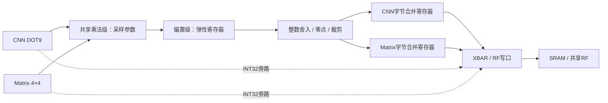

# FC、供数、量化写回与 Vector 优化

当前包含供数续发、量化写回解耦、字节写合并与Vector流水。任务队列4/4/4，流FIFO每通道8 words，RF共256 B；描述字段见当前头文件及布局/事件说明。

## 已实现

1. **FC合并**：三个1×4/1×4/1×2输出块各用一个K=144 GEMM，替代九次K=16分段。默认共享量化总Matrix任务37→13（3个GEMM＋10个K=0逐通道量化导出）。权重单份、B转置布局、ldb=144不变。取消无用K分段循环；量化常量按层配置，通道只修改乘数、偏置、目的地和必要输入修正。
2. **普通读续发**：`npu_multi_read`允许旧应答返回同拍接受下一读，旧owner接收旧应答、新grant更新新owner。错误应答同拍禁止续发，未获grant的请求取消，已获grant的其他读仍排干。RF gather与FIFO破坏性pop各只接受一次。
3. **量化/写回解耦**：QT01改为两级弹性流水；无反压时全局每拍可接收一个结果，CNN/Matrix轮询仲裁共用乘法器。CNN用4项、每项5bit的位置/最终输出标签，以及独立的raw接收/filtered消费游标，跟踪提前接受的结果。计算和字节写回可重叠；DONE仍等真实写应答排干。
4. **连续字节写合并**：CNN/Matrix共享同一小模块实现，不共享数据状态；每个生产者各一组32bit数据、字地址、byte mask和数量寄存器。同字不同byte的输出合并；满字、任务尾部、不连续/重复地址或关闭pack时结算。INT32旁路和量化INT32保持逐字输出；流FIFO的token不会合并。不同任务之间不隐式合并。
5. **Vector时序与面积整理**：MUL/MULH/MULHU（INT32与SIMD8）统一先锁存操作数、乘法模式、opcode和目的寄存器，再计算写回，切断PC/程序选择到乘法操作数的数据路径。简单运算维持原路径，SIMD8仍是四路并行；没有删除通用指令。乘法增加一拍，指令字段不变。数据流FIFO由每条16words缩至8words（四条共256B→128B），可用`--stream-fifo-depth 4/8/16`参数化构建；任务FIFO深度不变。lda/ldb shadow收窄为13bit，跨度算术保留21bit及原越界判定，非法配置行为保留。

CNN原有环形窗口、RF应答前递与权重预取继续保留，没有新增模型状态机或私有大缓存。

## 结果通路

INT32量化导出仍经过QT01，但不进行字节合并；关闭量化时走原始INT32旁路。量化INT32流输出继续保持原FIFO token语义。

## 同步接口 SYNC v2

`0x40000084`现在返回`0x0002007f`。原地址、累计计数及32bit回绕规则保留；新增bit6表示写合并取消计数。CNN/Matrix量化来源基址仍为`0x700/0x740`，新增相对`+0x3c`的只读`WRITE_CANCELLED`。

- ACCEPTED：输入ready/valid握手、采样算术参数。现在ready在接收时应答，不再等写回才释放原始结果。
- ISSUED：过滤后的结果被Stream/写合并寄存器接受。此时目的地址/字节内容已经确定；软件随后修改dst/pack/enable不再重定向这笔已接受结果。
- WRITTEN / WRITE_ERRORS：收到真实SRAM/RF/FIFO成功/错误应答后，按**结果元素数**累计。例如三个字节合成一笔写，成功/失败计数增加3，不能只加1。CNN两条物理写通路同拍应答的数量相加。
- FLUSHED：丢弃的量化流水线结果数，一次flush可以丢弃两个。
- WRITE_CANCELLED：flush丢弃的已ISSUED、尚未获得物理grant的写合并结果数。已获得grant的写应答仍按原标签统计。

enable/pack/dst在结果被消费前仍实时读取；算术参数在ACCEPTED采样。配置没有加锁。软件应以ISSUED划分仍可改路由的结果和已固定地址的结果，以WRITTEN确认真实成功；另一个单元从SRAM/RF消费结果时，需要用WRITTEN或任务完成同步，ISSUED不代表内存已可见。故障后要同时看WRITE_ERRORS、FLUSHED、WRITE_CANCELLED并重建基线，不能仅等待成功计数。

Q状态寄存器原位段保留；state=2表示输出级有效，state=1表示仅输入级有效，state=0为空；owner在state=2时显示输出级owner，state=1时该字段可能保留旧值；bit2表示任一级包含本来源结果，bit13表示本周期输入握手。它不是完整的原子流水线快照。

Matrix OBSERVE state新增DRAIN=9、PACK_STEP=10；Vector新增MUL_EXEC=9。它们不改变任务编码。

当前XBAR接受请求后下一拍返回应答；CNN及合并写的物理标签沿用这个SoC契约。独立的普通读适配器仍支持延迟应答，并对返还旧应答/接受新请求的边界做了定向测试。

## 兼容性检查发现并修复的问题

完整通用Vector后处理路径的Conv5曾在RF输出第128个元素发生错误。原因是旧固件一直沿用首层56B部分和工作区（0x40c8），与Conv5输出尾部重叠；共享量化路径已经按层更新该地址。本轮将通用路径也改为按当前窗口宽度更新工作区，完整10张、60个逐层张量重新验证通过。

CNN等待原因是互斥优先分类，不能把单项下降直接当成净加速。Matrix仲裁等待使用`BUS_BLOCK_PROFILE.matrix_req_wait`；旧`STAGE_PROFILE.matrix_req_stall`索引和未递增的`vector_input_wait`不作为证据。

## 当前验证入口

默认配置和性能使用[项目首页](../../README.md)；当前版本的功能、综合、最终PNR及检查证据统一见[报告索引](../reports/README.md)。
