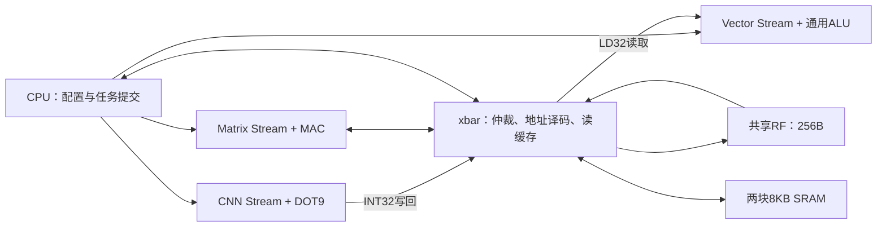

# 统一xbar与共享RF交接

当前已实现[通用xbar流转发](xbar-stream-routes.md)：CNN、Matrix、Vector任意方向可通过流端点直接传数，8/8/8配置单图25,930周期；下方RF串行交接描述为历史版本。

当前互连模块由`nmc.sv`改为`xbar.sv`，模块名为`xbar`，SoC实例为`i_xbar`，配置名为`XBAR_CACHE_WORDS`。当前RTL、测试、构建脚本及软件命名已更新；历史报告、冻结网表和物理数据库保留原名，不能拿当前源码重现旧报告。

CNN Stream的`result_valid_o/result_data_o/result_ready_i`接口和Vector Stream的`stream_valid_i/stream_data_i/stream_ready_o`接口已删除。Vector发射器同时删除直连专用的异步结果暂存和STREAM_DRAIN状态。CNN所有结果均走xbar的普通存储路径或RF-only写回入口；Vector从xbar读取，不存在CNN到Vector的专线。

保持共享RF容量256B、8个物理bank、5个普通请求者。RF gather与专用RF写回仍在xbar内部统一仲裁，并没有扩充成无冲突的多端口存储。Matrix及通用Vector计算指令保持原功能，后处理仍用软件配置的通用指令。

## 软件调度

继续使用RF末尾32B作为8个INT32字的工作区，软件保证它不与输入、输出激活或暂存权重重叠。每个tile：

1. CNN计算跨全部输入通道的卷积。部分和及最终INT32结果均写入该RF工作区。
2. CPU等待CNN完成计数达到提交票据。该完成事件已包含普通口、gather和RF sink全部在途应答排空，Vector不会读到尚未写完的结果。
3. CPU提交内存源Vector任务，指定RF地址、tile元素数和最终U8输出地址；每通道的量化参数复用。
4. CPU等待Vector完成后，下一tile才能覆盖同一工作区。尾tile、非对齐U8写回使用实际元素数与byte enable。

没有新增中间数组或RF容量。本版采用一个交接工作区，因此CNN与Vector逐tile串行；不再具有旧直连版本的流水重叠。这是明确的性能代价，不把硬件结构统一直接表述成性能提升。后续若需要恢复重叠，可由软件分配互不重叠的RF双缓冲并用完成票据管理所有权。

旧CNN mode=2及Vector op=0x60/0xe0需要直连，当前MMIO拒绝；CNN mode=0和Vector内存源0x20/0xa0继续支持。固件需重新生成，旧直连固件不能直接使用。

## 验证和版本范围

最终测试结果见[机器报告](../reports/unified_xbar_validation.json)。采用实际SRAM宏模型验证十张MNIST逐层整数结果，另由真实JTAG SBA加载整片SRAM镜像后完成推理；独立xbar、RF写回、Vector程序、错误恢复及队列测试覆盖新接口。

此前删除DMA后的2.412417mm²、setup +4.0005ns属于改名和删除直连前综合快照。本版尚未重新综合或布局布线，不能沿用这些数值作为新版本测量。

最终实测：10组回归全部通过。真实SRAM宏下10张MNIST均48,897周期（原直连25,388周期），逐层整数结果不变；JTAG SBA装载推理42项检查通过。Vector内存源程序143个任务、3,897项检查；错误恢复12个失败任务及12次成功重试。模型参数、10张输入和所有逐层golden与之前冻结版本逐文件哈希一致。代码格式检查通过。
