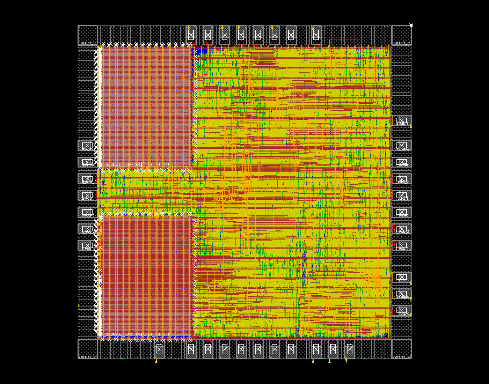
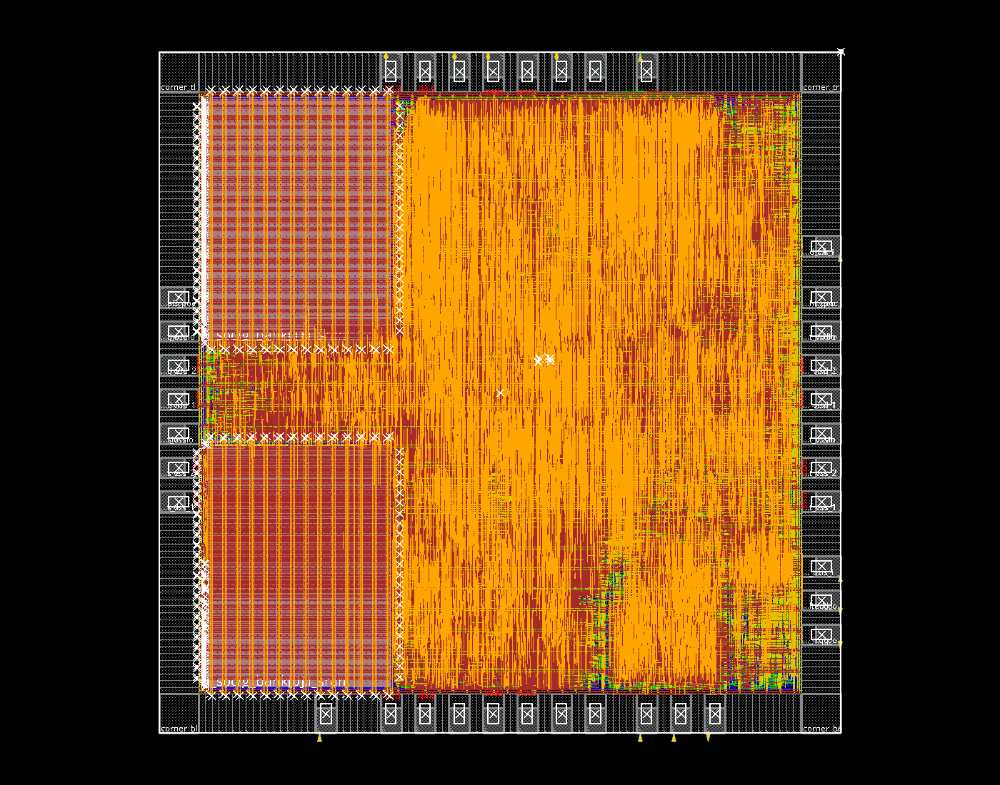

> 本页中的CRW1、CNN FC模式及性能/面积结果属于历史版本。当前CNN已移除FC，见[CRW2卷积专用化与Matrix FC](cnn-conv-only.md)。通用Vector指令设计仍沿用。

# 256B RF：通用 vector 的含 PAD 后端试验

输入为当前 VPG1 通用指令程序版本，RF 为两 bank × 32 words × 32 bit，共 256B。系统目标 50MHz，JTAG 10MHz，die 2000×2000µm，沿用 9 个信号 PAD。此次不修改 RTL、模型或软件调度。

核心综合 Cell Area 为 2.927683mm²；它不能直接解释为含 PAD 的物理占地。PAD 环、welltap、时钟树、布线修复缓冲以及宏逃线会进一步消耗布局空间。

## 相同网表的宏摆放对照

| 两块 SRAM 的摆放 | 放置密度 | 未放置实例 | preCTS setup WNS | 横/纵布线溢出估计 |
|---|---:|---:|---:|---:|
| 左下/左上贴角 | 98.04% | 0 | −2.715ns | 4.15% / 2.15% |
| 左下/右上对角 | 98.27% | 0 | −11.705ns | 8.46% / 5.60% |

两者使用字节相同的映射网表；宏摆放不改变计算功能。选用左侧贴角方案，执行一次 `reclaimArea` 和 `refinePlace`，密度降至 97.67%，setup WNS 为 −2.507ns，未放置实例仍为 0。上述都是布线前估计，不能作为最终 DRC 或时序结论。`checkPlace` 中 37 个 IO/bond 重叠属于原生 PAD 的 bond 窗口覆盖，单独的原生 IO 几何审计通过，9 个外部 pin 均落在对应 PAD terminal 上。



[截图来源](images/vector-program-rf32-placement.source.json)。初始最差路径从 vector 的 `pc_reg[0]` 到 `write_data_reg[24]`，尚不能据此断言布线后的最终瓶颈。

## 复现与文件位置

工作目录为仓库根目录。选定试验目录为 `../eda-runs/20261104-vector-program/fullchip-rf32`；对照目录在同级 `fullchip-rf32-diagonal`；同级 `macro_comparison.json` 记录相同网表哈希与摆放指标。每个目录内 `manifest.json` 固定 RTL、库、映射核心和程序镜像，`logs` 保存每阶段脚本及日志哈希，`mynpu/pnr/checkpoints` 保存检查点，`mynpu/pnr/reports` 保存原始报告。

```sh
python3.12 npu/eda/tsmc180/prepare_chip.py \
  --core ../eda-runs/20261104-vector-program/rf32-final --out ../eda-runs/NEW_CHIP
# 先执行生成的 synth_chip.tcl，再运行 mapped JTAG 检查，详见 EDA README。
python3.12 npu/eda/tsmc180/run_fullchip.py --run ../eda-runs/NEW_CHIP --stages 01 02 03
# 可选：标准单元面积回收，原始 08_post_tie 检查点保持不变。
python3.12 npu/eda/tsmc180/run_fullchip.py --run ../eda-runs/NEW_CHIP \
  --stages 03a --tag reclaim --stage-script npu/eda/tsmc180/fullchip/pnr_03a_reclaim.tcl
```

若使用回收结果，CTS 脚本的恢复输入必须显式改为 `08_reclaimed.enc.dat`，通过 `--stage-script` 传入，不能覆盖已冻结的原始脚本。继续 `04 04b 05 06 07`。需要对照宏位置时，`prepare_chip.py --reuse-chip <原试验目录>` 仅在核心输入、约束、库和映射网表一致时复用外壳综合结果，再以 `--macro-plan diagonal` 跑新的物理目录。

运行脚本中的 `COMPLETED` 仅说明命令返回和阶段 marker 存在；必须继续核对日志中的错误、未放置/重叠、DRC、连通性与 setup/hold。放置器曾出现 99.1% 密度错误，随后自动回收并完成合法化，原始错误未从日志中删除。优化密度上限 99% 是工具参数，不能充当通过条件。

## CTS 策略与试验边界

完整 `ccopt_design` 尝试中，数据路径修复反复使密度超过 99%，并产生 `IMPSP-2002`。该次优化被主动停止，保留为 `logs/04-reclaimed.json` 中的失败记录；不是工具完成后的正式时序结论。随后从相同 `08_reclaimed` 检查点以 `ccopt_design -cts` 重新构建时钟树，使用 `04-cts-only` 标签。`cts_strategy.json` 记录策略变更。

为取得可布通性基线，曾跳过独立 preRoute hold 优化，启动详细布线阶段，但发现 CTS 放置非法后立即停止，尚无完整数据网络布线结果。后续合法设计的 finish 可使用 `--skip-route-setup-fix --skip-route-hold-fix`，仍执行填充、增量布线、DRC/连通/天线/最终 setup 与 hold 检查。跳过修复不改变时钟约束，也不能解释为时序通过；报告必须保留真实负裕量。默认完整流程仍启用 setup/hold 修复。

## 本次结果：未收敛，停止在 CTS 后合法化

纯 CTS 的放置密度为 **98.02%**，有 10 个标准单元重叠，其中 3 个还有方向违例。再执行一次 `refinePlace`，方向违例消除，但仍有 **9 个重叠实例**；工具报告 `IMPSP-2021: Could not legalize <5> instances`。报告中的未放置数量为零，不能据此忽略重叠。已停止后续数据网络详细布线，不再对非法放置继续导出最终 GDS。

纯 CTS 检查点的时序估计为 setup WNS **−8.178ns**、hold WNS **−0.511ns**，不是布线后 signoff 数值。完整 CCOpt 的中间优化输出没有作为最终时序结论。当前没有最终信号 DRC、最终 setup/hold 或布线后网表仿真结果。CTS 阶段核心 PG 报告还有终端未连通、分离线段和 dangling wire 项，尚未进入 finish 的清理，不能宣称供电收敛。

9 个信号 PAD 的几何/落点审计通过，映射外壳网表通过 34 项 JTAG 功能检查（无 SDF）。这些检查不抵消标准单元放置和时序失败。原始输入、阶段状态、错误、放置合法性和时序报告哈希见[本次机器报告](../reports/fullchip_vector_program_validation.json)。其中 `04c` 的命令完成标记和放置检查 `passed: false` 分开记录。主动停止的 CCOpt 日志由 worker 在 launcher 返回后补写了退出信息，原 launcher JSON 保存在 `.json.at-launcher-exit`，最终日志哈希及原因显式记录，未抹去失败状态。



[截图来源](images/vector-program-rf32-cts-unclosed.source.json)。后端模板新增独立 `04c` 合法化阶段，并在进入数据布线前检查标准单元重叠/未放置；此防护用于后续新目录，不改写本次冻结脚本或原始失败结果。

因此，**本次工具流程未证明 256B RF 的当前 RTL 能在含 PAD 的 2×2mm²、50MHz 下实现**。下次应先降低控制/多路选择/计算逻辑面积，或给物理实现增加空间余量，再重跑。仅减少 RF 容量和切换 SRAM 摆放还不够；不能把“综合面积小于 3mm²”作为含 PAD 布线成功的依据。
