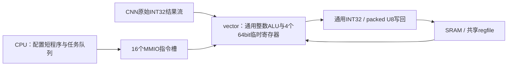

> 本页为历史VPG1接口。当前已改为[32位VPG2](vector32.md)，旧宽运算与固件不再兼容。

> 当前通用Vector程序状态在外部[`npu_vector_stream.sv`](../rtl/vector/npu_vector_stream.sv)，[`npu_vector.sv`](../rtl/vector/npu_vector.sv)是纯组合ALU。指令语义与本页一致；最新结构及周期测量见[三个纯计算核](pure-compute.md)。

> 本页中的CRW1、CNN FC模式及性能/面积结果属于历史版本。当前CNN已移除FC，见[CRW2卷积专用化与Matrix FC](cnn-conv-only.md)。通用Vector指令设计仍沿用。

# 通用 vector 指令程序（VPG1）

当前 vector 共用一套整数运算数据通路，已删除 `npu_vector_post.sv` 和硬件 REQUANT 指令。CNN 只产生原始 INT32；软件用通用指令组合缩放、舍入、激活和打包。CPU 程序仍在 SRAM，vector 的短程序通过 MMIO 配置。



## 一个任务如何执行

- 描述符仍为 A、B、D、len、op、scalar，使用原 vector FIFO。
- 临时寄存器初始化为 `r0=0, r1=sign_extend(B), r2=0, r3=sign_extend(scalar)`。
- 短程序前缀 `[0,loop)` 执行一次，可通过 LD32 读取任意软件约定的常量。
- 对每个输入，硬件把 INT32 符号扩展到 r0，执行 `[loop,count)`，将最终 r0 写回。
- 除 r0 的输入替换外，临时寄存器在各元素之间保留，可表达有状态的逐元素程序。
- 输出可以是 INT32，或取 r0 低8bit并打包。**打包本身不做饱和、ReLU、零点相加或缩放。**

每个任务最多处理1024个元素。内存输入每元素一个32bit字；结果流每次 ready/valid 交互消费一个INT32。程序顺序、元素数、参数地址及跨单元依赖由软件安排。

## MMIO 与编码

地址相对 `0x40000000`：

| 地址 | 含义 |
|---|---|
| `0x048` | 直接指令能力位图 `0x0700ffff` |
| `0x058` | 程序 ABI，返回 `0x56504731`（VPG1） |
| `0x234` | `[4:0]=count`（1～16），`[12:8]=loop`（小于count） |
| `0x240～0x27c` | 16个32bit指令槽 |

程序和配置在 active 或 FIFO 非空时禁止写入，返回总线错误；无需在每个队列项中复制整段程序。修改程序前必须等待整个 vector 队列排空。

任务 op：

| op | 输入 | 输出 |
|---|---|---|
| `0x20` | A指向的INT32数组 | INT32 |
| `0x60` | CNN结果流 | INT32 |
| `0xa0` | A指向的INT32数组 | packed U8 |
| `0xe0` | CNN结果流 | packed U8 |

直接操作0～15继续支持；新增直接操作24～26，设置bit7选择标量B。直接指令输出低32bit。旧的 `0x10/0x30/0x50/0x70` 融合量化编码被拒绝，需要重新生成固件。

指令字：`[4:0]=opcode, [6:5]=rd, [8:7]=ra, [10:9]=rb, [11]=立即数选择, [31:12]=signed imm20`。一般指令的B操作数可选择寄存器或立即数。

| opcode | 操作 |
|---:|---|
| 0～15 | 原有ReLU、ADD32、COPY、SUB32、MIN32、MAX32、AND、OR、XOR、SHL32、SHR32、SAR32、EQ32、NEG32、ABS32、NOT32 |
| 24 | `MUL32`：有符号32×32→64 |
| 25 | `ADD64`：64bit加法，溢出回绕 |
| 26 | `RSHR64`：有符号64bit舍入右移，移位量B低6bit，nearest-even，移位0保持原值 |
| 27 | `LD32 rd,[ra.low32+signed imm20]`，加载后符号扩展到64bit |
| 28 | `MADD32 rd,ra,rb,rc`：有符号32×32加64bit的rc，rc编码在 `[13:12]`，软件使用寄存器B模式 |

ADD32等32bit操作显式回绕并符号扩展；COPY保留完整64bit。MAX/MIN比较有符号低32bit。LD32必须字对齐；复杂程序的实际访存地址仍由软件负责构造，错误响应会终止当前任务，已完成的写入不回滚。

## MNIST 一层中的软件程序

软件约定 B 指向该输出通道的两个32bit参数，scalar为输出零点。这个参数格式只存在于软件，硬件不识别 M、bias 或 zero-point。

```text
; 每通道一次的前缀
LD32    r2, [r1+4]       ; scaled_bias
LD32    r1, [r1+0]       ; M
; 每个输入元素重复，r0由输入自动更新
MADD32  r0, r0, r1, r2   ; 完整64bit乘积加偏置
RSHR64  r0, r0, 24       ; 移位量由软件指定
ADD32   r0, r0, r3       ; INT32回绕语义
MAX32   r0, r0, r3       ; ReLU下限；无ReLU时软件改成MAX r0,0
MIN32   r0, r0, 255
; 通用输出格式：取低8bit并打包
```

配置为 `count=7, loop=2`。每层各通道复用同一段程序，只更新 B、D、len、scalar 等任务字段；FC前排空队列，再把MAX的操作数改成0。CNN与vector仍通过结果流重叠运行。

输出等价于原来的整数规则：先对完整64bit `A*M+B` 做ties-to-even右移，再做INT32零点相加与显式MAX/MIN。保留负数 halfway 及INT32回绕情形，不把它替换成浮点或普通截断右移。

## 执行优化和限制

流输出有一个待写字缓冲，写请求/响应可与下一元素的通用ALU执行重叠，背压时保持数据。满足条件的连续轻量操作可同周期执行：后继指令只包含ADD/SUB、COPY、MIN/MAX、AND/OR/XOR、NOT，保持相同累加目标且ra等于该目标，操作数依赖由旁路转发；最多追加3条。MUL、MADD、ADD64、RSHR64和LD不能作为追加槽。程序前缀不合并。

这条规则适用于一般整数程序，没有量化模式识别；例如 `ADD32→XOR→MAX32→MIN32` 同样可组合。MADD不隐含舍入或裁剪；U8打包也不隐含计算。

第一版顺序执行为29275周期，搬运重叠/轻量指令合并后20694周期，使用通用MADD后19115周期。最后通过CPU排队快速路径、跨层复用配置及常量寄存器，512B RF单图降到18711周期，仿真含输入DMA19332周期；当前默认256B为19986/20607周期。两者的纯推理均低于20k，但256B含输入DMA仍超过20k，不能沿用旧专用路径的19549周期结论。JTAG传输不包含在这些SoC仿真周期中。

综合和回归证据见[本轮报告](../reports/vector_program_validation.json)。本轮256B RF含PAD后端试跑在CTS后合法化失败，密度98.02%、仍有9个标准单元重叠，尚未完成数据网络详细布线；见[本次记录](vector-program-pnr.md)。旧含PAD结果不能代表修改后的RTL。


## 综合与验证

| RF容量 | 综合Cell Area | 50MHz setup slack | 纯推理周期 | 仿真含输入DMA |
|---|---:|---:|---:|---:|
| 256B，默认 | 2.927682727mm² | +4.0061ns | 19986 | 20607 |
| 512B，对照 | 3.063293402mm² | +4.0028ns | 18711 | 19332 |

TT单角综合含CPU/JTAG、DMA、全部计算单元、两块真实SRAM及共享RF，不含PAD；使用Cell Area，不加Net Area。256B版本相较此前同容量的专用路径2.741547329mm²增加0.186135398mm²，主要是通用vector和MMIO程序配置的代价。512B版本超过3mm²预算，因此默认选256B。综合通过不保证2mm×2mm含PAD布线收敛。

每种容量15项RTL回归通过，另外各4项映射网表回归：单图、GEMM/vector、队列突发、JTAG。网表测试使用真实标准单元和SRAM功能模型，未反标SDF。旧直接操作的突发测试仍为16941周期，新增直接MUL32/ADD64/RSHR64也覆盖不同标量模式及原地操作。程序单测同时覆盖MADD与分开的MUL/ADD、0～63位移位、memory/stream、字节边界、错误和重试，以及非量化程序。

```sh
# 当前默认配置
/usr/bin/python3.12 npu/mnist/firmware.py
/usr/bin/python3.12 npu/mnist/stream_firmware.py
/usr/bin/python3.12 npu/scripts/run_vcs.py --suite vectorprogram --tag NEW_TAG
/usr/bin/python3.12 npu/scripts/run_vcs.py --suite latency --macro --tag NEW_TAG --max-cycles 20000
# 综合前冻结当前RTL与外部库哈希
/usr/bin/python3.12 npu/eda/tsmc180/prepare_run.py --out ../eda-runs/NEW_VECTOR --effort low
# 进入新目录后运行 genus -no_gui -batch -files synth.tcl
```

已完成的综合目录为`../eda-runs/20261104-vector-program/rf32-final`及`rf64-final`。512B旧镜像存于`rf64-final/images`，256B独立镜像位于`rf32/fast-images`；`run_gate.py`和`run_vcs.py`均支持`--artifacts-dir`。各结果的真实输入副本、源码/库/网表/日志哈希保存在对应目录及本轮报告中。
