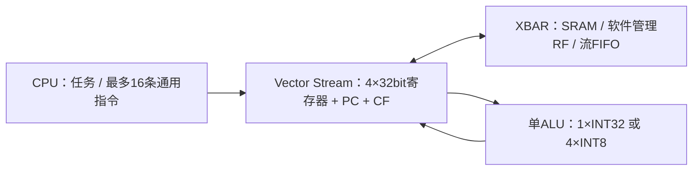

# Vector 单 ALU：INT32 / 4×INT8 SIMD

Vector 不再分主 ALU 和独立轻量 ALU。`npu_vector.sv` 是唯一的组合计算单元，`npu_vector_stream.sv` 管理取数、四个 32 位临时寄存器、程序 PC、进位和写回。CPU、CNN、Matrix 和 XBAR 的职责不变。



## 如何复用

- 加减、取负和绝对值共用一个分段 32 位加法器。INT32 模式允许字节之间传递进位；SIMD8 模式在字节边界截断进位和借位。
- 同一套字节比较器组合成 INT32 比较，或者分别产生四个 INT8 比较结果。
- 共用移位网络。INT32 使用 1/2/4/8/16 位移位级；SIMD8 把低三级分成四个字节通道，旁路高两级。
- 原有四个 16×16 部分积乘法器，在 INT32 模式组合成低字 / 高字，在 SIMD8 模式各计算一组 8×8 乘法。没有额外添加四个乘法器。

SIMD8 每个字节独立执行：ReLU、ADD、SUB、COPY、MIN/MAX、AND/OR/XOR/NOT、SHL/SHR/SAR、EQ/SLTU、NEG/ABS、MUL32、MULHU/MULH、RSHR32。名字沿用现有操作码，但 SIMD 模式中的 MUL32 返回乘积低 **8** 位，MULHU/MULH 返回无符号 / 有符号乘积高 **8** 位；RSHR32 是 INT8 nearest-even 舍入右移。每个字节的移位量取对应 B 字节的低三位；EQ/SLTU 返回每字节 0 或 1。加减乘法按 8 位回绕，**没有隐式饱和**。需要裁剪时用 MIN/MAX 指令组合。

INT32 的进位指令和双字移位继续支持，用于现有通用量化程序。它们在 SIMD8 程序中触发 fault；LD32 仍加载完整 32 位字，SCALAR 把任务 scalar 的低字节广播到四个通道。SIMD8 程序立即数也广播低 8 位。

## 软件接口

任务 `op` 的 bit6 为 `NPU_V_SIMD8`：

| 模式 | op | len 的单位 | 每步输入 / 输出 |
|---|---|---|---|
| INT32 直接模式 | 原操作码，可加 bit7 广播 scalar | INT32 元素 | 1 个 32 位字 |
| SIMD8 直接模式 | `0x40 \| 操作码` | INT8 元素 | 4 个 INT8，1 个 32 位字 |
| SIMD8 标量 B | `0xc0 \| 操作码` | INT8 元素 | A 的 4 个字节与广播的 scalar 低字节 |
| INT32 程序 | 原 `0x20` / `0xa0` | INT32 元素 | 原 VPG2 语义 |
| SIMD8 程序 | `0x60` | INT8 元素 | 对一个打包字执行整个程序，再处理下一个字 |

源 / 目标地址按 4 字节对齐。每个 SIMD8 字中 lane0 是最低字节；最后不足四个元素时只写低有效字节，SRAM / RF 的其余字节不变。允许完全原地处理 A 或 B，拒绝部分重叠。流 FIFO 传输仍按 32 位字，尾部无效字节置零，元素数由消费方任务指定。`0xe0` 组合不合法。

能力寄存器 `0x068` 返回 `0x00030408`：低字节是元素位宽8，下一字节是通道数4，bit16/17 分别表示直接 / 程序 SIMD 支持。VPG2 ABI 仍为 `0x56504732`，旧 INT32 固件不需改动。

```c
struct npu_vector_descriptor job = {
  .a = 0x80004000, .b = 0x80004040, .d = 0x80004080,
  .len = 17, .op = NPU_V_SIMD8 | NPU_V_ADD, .scalar = 0
};
npu_elementwise_start(&job);  // 共处理5个字，最后仅写1个字节
```

此前的第二轻量 ALU 可以并行处理两个 INT32 直接模式元素；合并后 INT32 直接模式每步一个元素，SIMD8 每步四个字节。四个 INT8 通道执行相同操作码，并非四条不同指令，也不是四个完整 32 位 ALU。

## 验证与限制

详见 [验证报告](../reports/vector_simd_validation.json)。独立整数参考模型检查 ALU；SoC 测试覆盖 SIMD8 直接 / 程序、SRAM / RF、scalar、原地写回、非4倍数长度和非法程序。旧 MNIST 后处理输入仍是 INT32 累加值，继续使用 INT32 通用指令，不会因为增加 SIMD8 自动获得四倍加速。

本次不以代码结构推断面积或时序改善；此前的面积测量属于旧源码，单 ALU SIMD 版尚未重新综合。

```bash
python3.12 npu/scripts/run_vcs.py --suite purecompute --tag SIMD_ALU
python3.12 npu/scripts/run_vcs.py --suite vectorsimd --macro --tag SIMD_SOC
python3.12 npu/scripts/run_vcs.py --suite vectorprogram --tag SIMD_VPG2
python3.12 npu/scripts/run_vcs.py --suite latency --macro --tag SIMD_MNIST
```
