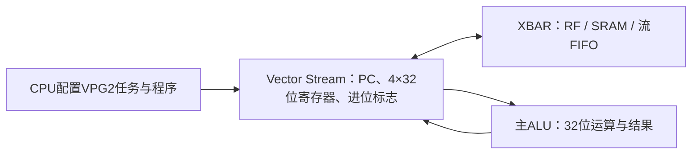

> Vector位宽和软件接口保持本页设计，最新[无透明SRAM缓存版本](no-sram-cache.md)综合面积为整芯片2.438904mm²。

# VPG2：四个32位寄存器的通用Vector

当前Vector的四个临时寄存器、ALU输入输出、运算中间值均不超过32位。另有1位进位标志，不存在64位数据寄存器、64位运算端口或64位移位器。删除了最多三条后续操作的组合合并，每条程序指令独立执行。后续版本已改成[单ALU INT32 / 4×INT8 SIMD](vector-simd.md)，删除独立轻量ALU。本文的测试、面积为当时版本记录。



## 通用指令

0至15号ReLU、加减、min/max、位运算、移位和比较保持32位语义。新指令如下，所有结果均为一个32位字：

| 编码 | 名称 | 语义 |
|---|---|---|
| 16 | ADDC | `a+b`，更新进位标志CF |
| 17 | ADC | `a+b+CF`，更新CF |
| 18 | SLTU | 无符号小于比较，结果为0或1 |
| 19 | MULHU | 两个无符号32位数乘积的高32位 |
| 20 | MULH | 两个有符号32位数乘积的高32位 |
| 21 | SHRD | 从软件保存的低字A、高字B中右移0至32位，返回低32位 |
| 22 | RSHRD | SHRD加nearest-even舍入，返回低32位 |
| 23 | ADCSX | `a+(signed(b)>>>31)+CF`，更新CF；用于把有符号单字加进软件字对 |
| 24 | MUL32 | 乘积低32位 |
| 26 | RSHR32 | 有符号32位数nearest-even右移，移位量为B低5位 |
| 27 | LD32 | 程序模式加载一个32位字 |
| 29 | SCALAR | 程序模式读取任务scalar |

25和28号旧宽运算编码不再支持，程序执行时触发fault。直接模式仅开放能力寄存器所列的0至15、18至20、24、26号操作；进位和双字操作通过程序模式使用。

乘法由四个16×16部分积形成32位中间值，分别选择高字或低字输出；没有声明或保存完整64位乘积。低字进位由分段加法器输出。软件可以把两个32位寄存器视为一个字对，但硬件每条指令只写回一个32位值。

指令仍为32位：`op[4:0]`、`rd[6:5]`、`ra[8:7]`、`rb[10:9]`、`imm_select[11]`、`imm20[31:12]`。SHRD/RSHRD使用寄存器B和`shift[19:14]`，0至32合法，超过32触发fault。最多16条程序，前缀执行一次，其余对每个输入重复。新任务清零CF，只有ADDC/ADC/ADCSX更新CF。

## MNIST卷积后处理

仍然精确计算`round_even((acc*M+bias)/2^24)`，随后按INT32回绕加输出零点、ReLU并裁剪。每通道前缀只加载一次M和bias：

```asm
LD32   r2, [r1+4]       # scaled bias
LD32   r1, [r1]         # M
# 以下每个输入重复，r0由Stream放入新的INT32结果
MUL32  r3, r0, r1       # low(acc*M)
MULH   r0, r0, r1       # high(acc*M)
ADDC   r3, r3, r2       # low + bias，产生进位
ADCSX  r0, r0, r2       # high + sign(bias) + carry
RSHRD  r0, r3, r0, 24  # 一个32位舍入结果
SCALAR r3              # 输出零点来自任务scalar
ADD    r0, r0, r3       # INT32回绕，与原版一致
MAX    r0, r0, r3       # ReLU阈值是输出零点
MIN    r0, r0, 255
```

量化由上述通用指令组合完成，没有外置量化单元。偏置、M和原模型参数字节不变，未重新量化或降低模型精度。

FC先在32位上加零点补偿offset，再执行同样的乘法、加偏置和舍入。固件生成器对每个通道验证`128*sum(abs(weight))+abs(offset)<2^31`，确保对所有可能的INT8输入都不会在这一步溢出；不是只依据十张回归样本。FC任务scalar承载每通道offset，输出零点作为普通ADD立即数。

## 软件兼容与实测

程序ABI寄存器`0x058`返回`0x56504732`（VPG2），旧VPG1固件会被启动检查拦截。C接口位于`npu/sw/npu.h`，新增`npu_vector_shift_pair()`编码助手。单图和连续运行固件均已重新生成；连续运行版本恰为736条CPU指令，代码截止位置不越过0xC00描述符表。本轮完整端到端验证使用单图固件。

9组最终回归通过，包含3,000组ALU算术、3,402项程序检查（116任务）、558项故障恢复、339项队列、3,409项共享操作数、27项批读、42项JTAG和24项单元流路由检查。10张MNIST实际SRAM宏模型逐层结果全部一致，每张**29,817周期**，含测试host输入搬运为30,209周期。相对之前22,219周期增加约34.20%，来自更长的软件后处理序列；本轮没有达到20k。

[机器报告](../reports/vector32_validation.json)保存源码哈希和逐项结果。已完成[当前版本综合面积测量](vector32-area.md)：默认优化总面积2.808663mm²；Vector计算与供数0.207111mm²（保留层级版）。不含PAD，尚未重新布局布线。

```bash
python3.12 npu/mnist/firmware.py
python3.12 npu/mnist/stream_firmware.py
python3.12 npu/scripts/run_vcs.py --suite purecompute --tag MY_V32_ALU
python3.12 npu/scripts/run_vcs.py --suite vectorprogram --tag MY_V32_PROGRAM
python3.12 npu/scripts/run_vcs.py --suite latency --macro --tag MY_V32_MNIST
```
