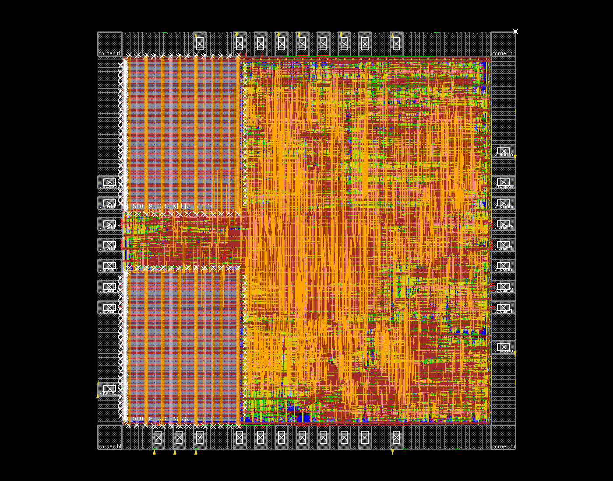
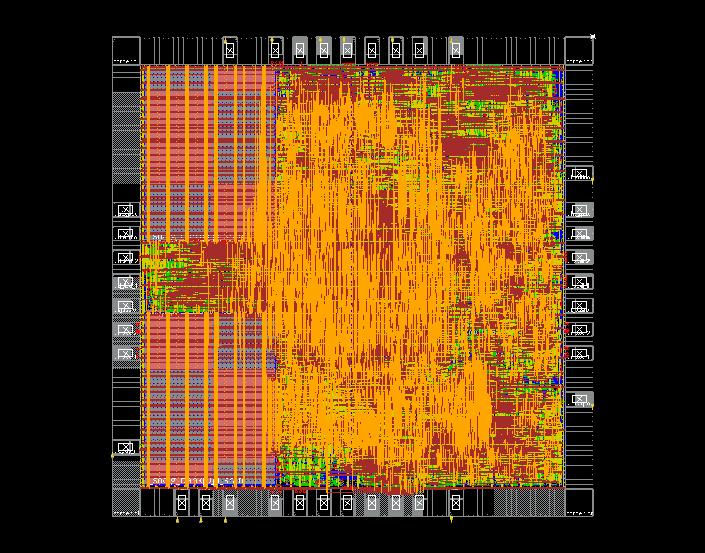

# 窗口预取版本的完整含 PAD 后端

当前源码已完成 Genus 综合、Innovus 放置、CTS、详细布线、布线后优化及 GDS 导出。RTL、固件与输入按哈希冻结，本轮没有修改计算架构。运行目录为工程同级 `eda-runs/20261105-window-prefetch-backend/`；[机器报告](../reports/window_prefetch_fullchip_validation.json)记录原始报告路径、输入哈希与检查范围。

| 项目 | 实测结果 |
| --- | ---: |
| Die，包含 PAD 环 | 2000×2000µm，4mm² |
| 核心综合面积，含两块 SRAM | 2.725461mm² |
| 布线后标准单元，不含 filler | 1.935146mm² |
| 两块 SRAM | 0.802887mm² |
| 核心非 filler 合计 | **2.738033mm²** |
| 核心 filler，单独统计 | 0.290260mm² |
| 原生 IO 几何并集，单独统计 | 0.867100mm² |
| 系统时钟 / 异步 JTAG | 50MHz / 10MHz |
| 最终 setup WNS / TNS | **+0.352ns / 0** |
| 最终 hold WNS / TNS | **+0.031ns / 0** |
| Setup / hold 违例路径 | 0 / 0 |
| 几何 DRC / 天线 / 核心电源连通问题 | 0 / 0 / 0 |
| 布线后 JTAG 测试 | 34项通过 |

核心非 filler 面积低于3mm²，但可放置区域内标准单元利用率仍约86.96%，余量有限。最终 checkPlace 显示100%是因为已插入 filler，不代表逻辑本身占满全部区域。IO 实例面积简单相加为1.029515mm²，包含 bond/PAD 的有意重叠，应使用几何并集口径，不能把上述所有数值直接相加。


两块 RA1SHD_2048x32M8 宏沿左侧上下角布置，下方R180、上方R0，使引脚朝核心内部。采用真实宏 LEF、时序库及 GDS。芯片沿用9个信号PAD、28个供电/地/POC PAD、4个角单元和37个bond窗口，程序和数据通过JTAG SBA访问。PAD在放置后按合法槽位优化，端点Manhattan目标由18,215,210µm降至13,745,214µm，约减少24.54%；该指标不等同于全局布线最优。

放置优化将早期setup −5.778ns修至+0.001ns。CTS后setup为+0.016ns，但出现3条hold违例，最差−0.502ns，来自boot_ready到CPU启动寄存器；保持约束不变，通过延迟单元修复。详细布线后仍有1条接近零的hold违例，最终后优化后setup +0.352ns、hold +0.031ns，违例数均为零。阶段01、02、03、04、04b、05、06、07全部执行完成。

实际 Innovus 放置截图：



实际最终布线截图：



两张图各有同名`.source.json`，记录数据库、截图命令日志及哈希。

核心映射网表完成15项检查，芯片封装映射网表及最终布线网表分别完成34项JTAG检查，包括调试模块、SBA装载、CPU控制和MNIST推理。均为实际单元库/宏模型的零延迟仿真，未反标SDF。RTL单图仍为25,388周期，未达到20k；外部DMA端口测试含输入为26,009周期，但该端口没有引出到9信号PAD，不能当作封装JTAG输入延迟。

原始信号连通报告仍保留`VSSPST`、`VDDPST`两条“no routing”提示。这两条对应原生IO单元相接形成的供电轨，IO几何审计通过；它们没有被删除或当作foundry签核豁免。机器报告因此保留保守的`physical_closure.passed=false`，同时明确核心检查通过的`core_physical_closure.passed=true`。导出完整性审计也已通过。

本次分析是TSMC180 TT单角、captable RC、SI关闭；系统setup uncertainty由参考流程在CTS前0.52ns改为CTS后0.47ns，hold为0.2ns。SRAM LEF中METAL7/8 obstruction不在六层技术定义内，工具有明确忽略提示。这些限制以及IO轨提示意味着本轮结果不能替代foundry DRC/LVS、ESD、EMIR或多角签核。

可恢复数据库：`chip/mynpu/pnr/checkpoints/13_finished.enc`与`14_exported.enc`。最终文件在`chip/mynpu/pnr/outputs/final/`：`mynpu_asic_top.gds.gz`、DEF、层次网表、LVS网表、SDC、SPEF、SDF和抽象LEF。报告位于`chip/mynpu/pnr/reports/`，执行日志位于`chip/logs/`；网表验证证据另存于运行根目录`gate_tests/`。

脚本沿用[TSMC180完整流程](../eda/tsmc180/README.md)，本轮具体执行命令和阶段状态在运行目录中保存。重新收集报告：

```bash
python3.12 npu/eda/tsmc180/collect_window_backend.py \
  --run ../eda-runs/20261105-window-prefetch-backend \
  --chip ../eda-runs/20261105-window-prefetch-backend/chip \
  --gate-tags window-prefetch-backend-mapped window-prefetch-backend-routed \
  --out npu/reports/window_prefetch_fullchip_validation.json
```

模块与物理位置的对应见[最终模块分布图](module-distribution.md)，提供分色图、可缩放SVG和Innovus直接截图。
