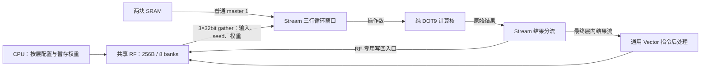

# CNN 循环窗口预取与共享 RF 并行搬运

最新[完整含PAD后端结果](window-prefetch-pnr.md)：2×2mm²，核心非filler面积2.738033mm²，TT 50MHz的setup/hold均收敛；原生IO电源轨的两条工具提示单独保留。

本轮只调整搬运与软件调度，CNN、Matrix、Vector 四个算术源文件（含 CNN MAC）与改动前哈希相同。默认共享 RF 仍为 **256B**。单图推理由 **29,206 降到 25,388 周期**，减少 **3,818 周期，13.07%**；仍未达到小于 20k。

## 三条内部搬运路径



普通 SRAM 读、RF gather 读、RF 写回入口可以同时工作。这里增加的是一个 **RF 请求入口**，不是给物理 bank 添加读写端口；RF 仍由八个单端口 bank 仲裁，同 bank 的读写仍会冲突。

## 窗口从两个字改为三个字

[`npu_stream_engine.sv`](../rtl/cnn/npu_stream_engine.sv) 每行保留三个 32bit 字，三行合计 **36B**，比之前 24B 多 12B。这是搬运端操作数暂存，与 256B 共享 RF 的容量分开统计。

- 一个循环 head 指向当前低字，随后是当前高字和后续预取字；跨 word 时推进 head，不搬移整组数据。
- 先补齐当前必需字，再预取后续两个字覆盖范围内的缺字。
- 每行最多一笔在途读取；回复写入请求时记录的物理槽位，head 前进也不会改变回复目的地。
- 预取截止于当前 tile 最后一个有效像素所在的 word。软件提供的行 mask 和左右 padding 仍决定有效像素，不越界猜测后续张量。
- `WAIT_INPUT` 阶段也允许准备输入。RF gather 与普通 SRAM 读取可在等待权重时先行。

普通读口或 RF gather 返回的输入字可以**当拍直通 MAC**，同时保存到窗口。反压时保留数据；计算跨通道时重置窗口有效位；新任务开始前等待所有在途响应排空。计算核不增加地址、shape 或任务状态。

## RF 用于权重暂存与部分和并行写回

### 软件选择可安全暂存的权重

[`firmware.py`](../mnist/firmware.py) 仅在以下条件同时满足时启用 RF 权重暂存：

1. 当前输入和下一输出都位于 SRAM，共享 RF 没有活跃激活张量。
2. 整层权重按 4B 补齐后，能放在 RF 末尾 32B 部分和工作区之前。
3. 参数源地址满足 word 对齐，上一层 Stream 与 Vector 已完成。

当前 MNIST 第一层暂存 **20B**（18B 权重，按 word 复制），第二层暂存 **72B**；每图总共复制 92B。其余层不满足容量或活跃区间条件，继续用原地址。原始参数仍只有一份持久副本，RF 中是可覆盖的工作缓存。

两段复制用 CPU 的普通 load/store 完成，随后将 Stream 权重基址设为 RF。没有逐 MAC 的 CPU 控制。单图程序 711 条 CPU 指令，连续流 724 条；程序像仍为 4608B，入口、描述表及 296 项任务表布局不变。

### RF 权重走空闲 gather lane

权重基址在 RF 时，九字节权重由空闲 gather lane 读取，普通口可以同时读 SRAM 激活。返回类型显式区分输入、seed 和权重，避免三种数据混写。每周期最多发出一个权重 word，下一输入通道仍使用权重双缓冲。

九字节最多跨三个对齐 word。RF 读口严格在 grant 后下一周期回复，加载起点及目标 bank 在完成前保持稳定，因此用低两位 word 地址即可识别这三笔权重回复，不需要恢复关联式窗口 tag。

### 部分和写不再堵住普通 SRAM 读口

[`nmc.sv`](../rtl/nmc.sv) 新增可选 RF-only 全字写回入口；在 SoC 中开启，独立模块默认关闭以保留原有普通总线接口用法。它在 RF 内部作为第九个普通请求者，复用既有逻辑写通道和物理 bank 仲裁，**SRAM 仲裁仍是原来的八个 master**。

Stream 的非末输入通道部分和、以及原始输出目标在 RF 时，通过该入口写回；原始输出目标在 SRAM 时仍用普通口，最终流式结果仍交给 Vector。

写回记录位置、类型及在途有效位。读 seed 必须等对应部分和完成；收到写应答当拍即可发起依赖读取，不再多等一拍。完成条件同时检查普通口、RF 写回和 gather 全部排空。写回入口会拒绝非 RF、未对齐或超范围地址，下一周期回复错误。

## 实测结果

| 指标 | 改动前 | 本轮 |
|---|---:|---:|
| 单图推理周期 | 29,206 | **25,388** |
| 含输入 DMA | 29,827 | **26,009** |
| CNN 忙周期 | 21,046 | **17,009** |
| CNN 输入窗口等待 | 10,967 | **6,774** |
| 普通口激活读 | 6,128 | 6,128 |
| 普通口权重读 | 3,240 | 2,400 |
| gather 权重读 | 0 | 840 |
| 普通口部分和写 | 3,472 | 0 |
| RF 专用入口部分和写 | 0 | 3,472 |
| gather 部分和读 | 3,472 | 3,472 |
| RF gather 冲突周期 | 32 | 32 |

**激活读取量没有减少，输入等待减少约 38.23%，收益来自提前准备、回复直通及并行搬运。** 普通请求口的 CNN 读写总量从 12,840 次降为 8,528 次，分流的是 RF 写回与部分权重读取，不能将其全部称为物理 SRAM 访问减少。

单图中，RF 写回与 SRAM 读取同时获准 **1,879 周期**，与 gather 读取同时获准 **1,723 周期**；两种重叠可能同时发生，不能相加当成独立节省。RF 写回等待 grant 只有 56 周期。

| 阶段，含相邻 CPU 配置开销 | 改动前周期 | 本轮周期 |
|---|---:|---:|
| Conv1，含启动 | 2,322 | 2,101 |
| Conv2 | 6,517 | 5,541 |
| Conv3 | 6,761 | 5,419 |
| Conv4 | 3,026 | 2,421 |
| Conv5 | 3,412 | 2,738 |
| FC，含重编码与后处理 | 7,029 | 7,029 |
| Argmax/收尾 | 139 | 139 |

十张样本结果一致。20 帧连续流总共 **516,512 周期**，平均 **25,825.6 周期**；基线 590,811 周期，平均 29,540.55 周期。

### RF 权重暂存是否值得

同一份当前 RTL，使用启用暂存的固件与冻结的暂存前 SD91 固件对照：

| 配置 | 推理周期 |
|---|---:|
| 关闭 RF 权重暂存 | 25,605 |
| 启用 RF 权重暂存 | **25,388** |

第一层净省 77 周期，第二层净省 140 周期，合计 **217 周期**，已包含复制开销。其余阶段计数不变。主要总体收益仍来自窗口与响应优化、RF 写回和普通读解耦，不能把全部 3,818 周期都归因于权重暂存。

诊断迭代依次测得 28,873（三字环形窗口）、28,171（回复直通等）、27,617（RF 暂存及依赖调度）、25,388（RF 写回分流）。这些是累积修改的调试运行，不是逐项独立消融；单因素暂存对照以上表为准。

## 验证、复现与边界

18 项 RTL 回归全部通过，实际 SRAM 宏模型下十张完整推理通过，阶段计数与普通 RTL 模型逐项相同。原参数、输入及所有逐层整数 golden 不变。

- 新增 RF 写回独立测试：868 项检查，覆盖与 SRAM 并发、与 gather/普通 RF 读竞争、响应顺序、公平性、无效地址与复位。
- 扩充 24 组 RF 输入、RF 权重、两者同时驻留 RF 的卷积用例，覆盖非对齐权重、跨物理 bank、RF 原始结果写回和 padding；完整 layers 回归共 20,088 项检查。
- 三个纯计算核及 CNN MAC 源码哈希与本轮改动前一致。
- MMIO SD91/VPG1、队列深度 8/8/16、RF 容量和 CPU/JTAG 接口保持兼容；原固件也通过当前 RTL 的对照测试。

```sh
python3.12 npu/mnist/firmware.py
python3.12 npu/mnist/stream_firmware.py
python3.12 npu/scripts/run_vcs.py --suite rfsink --tag NEW_SINK
python3.12 npu/scripts/run_vcs.py --suite latency --tag NEW_PROFILE
python3.12 npu/scripts/run_vcs.py --suite latency --macro --tag NEW_MACRO
```

可通过 `NPU_RF_WEIGHT_CACHE=0` 为独立 artifacts 副本生成不暂存权重的固件。实际本轮对照使用工程同级 `eda-runs/20261105-window-prefetch/before/artifacts` 中的冻结固件。

机器报告：[window_prefetch_validation.json](../reports/window_prefetch_validation.json)。冻结文件和日志在工程同级 `eda-runs/20261105-window-prefetch/`，最终测试在 `rtl_tests/`，权重暂存对照在 `ablations/`，参与仿真的源文件按哈希保存在 `functional_inputs/`。

本轮没有重新综合或布局布线。循环窗口增加了 12B 暂存、RF 仲裁增加一个内部请求者、回复直通也改变了组合路径，面积和频率需要重新测量。此前 2.666814mm² 等数据属于旧 RTL，不能直接沿用。本轮仍未达到小于 20k；FC 阶段保持 7,029 周期，后续需要继续优化 Matrix 供数与小任务开销。
